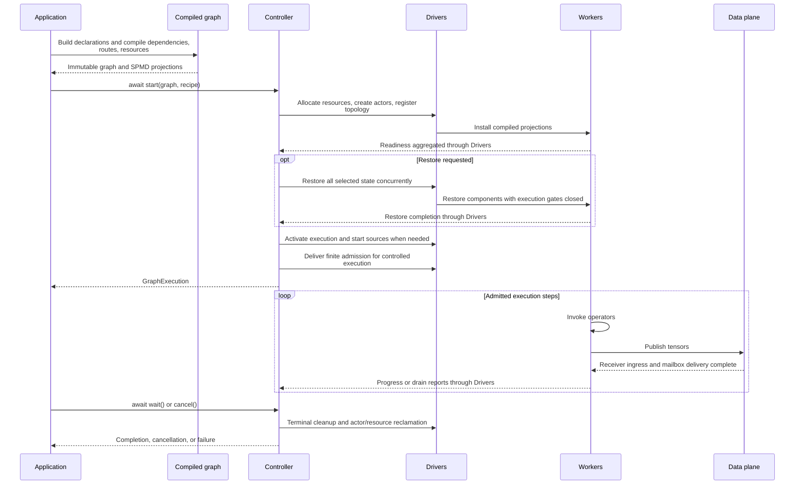
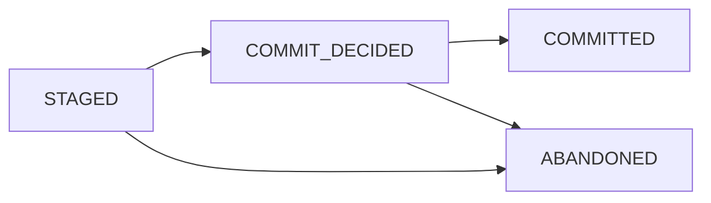
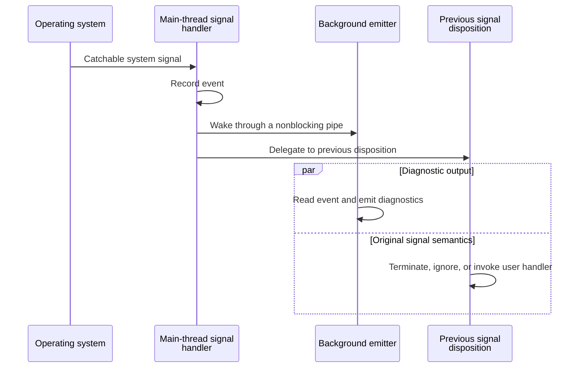

# Fluxway Architecture

[Chinese edition](ARCHITECTURE_zh.md)

Fluxway compiles operator declarations into one graph, places its workers, and
coordinates execution and recovery. The control plane decides when work may run;
the data plane moves the tensors required by that work.

Each SPMD graph node represents workers running the same program over a mesh.
Edges connect operator outputs to inputs.



This overview shows ordinary tensor delivery and collapses intermediate
acknowledgements. Driver and Worker calls remain concurrent, and admitted work
may begin before `start()` returns. Protocol-only paths and the delivery fence
are covered in [data-plane runtime](dataplane_runtime.md); see [execution
lifecycle](execution_lifecycle.md) for barriers
and failure boundaries.

## Build and inspect a graph

This complete example compiles two CPU operators without starting Ray. The edge
maps the producer's `value` output to the consumer's `item` input.

```python
import fluxway as fw
from fluxway.common.decorators import spmd


@spmd(
    resource_profile=fw.ResourceProfile(base={"CPU": 1}),
    mesh_axis_names=("data",),
    mesh_axis_shapes=(1,),
)
class Producer:
    @fw.operator(
        name="produce", output_sharding={"value": {"type": "static", "axis": []}}
    )
    def produce(self) -> dict[str, int]:
        return {"value": 1}


@spmd(
    resource_profile=fw.ResourceProfile(base={"CPU": 1}),
    mesh_axis_names=("data",),
    mesh_axis_shapes=(1,),
)
class Consumer:
    @fw.operator(
        name="consume", input_sharding={"item": {"type": "static", "axis": []}}
    )
    def consume(self, item: int) -> None:
        self.last_value = item


builder = fw.Builder()
builder.add_node("source", Producer)
builder.add_node("sink", Consumer)
builder.add_func_edge(
    "source", "produce", "sink", "consume", tensor_map={"value": "item"}
)
graph = builder.build("two-operators")
compiled = graph.require_compiled_graph()

assert len(compiled.dependencies) == 1
assert graph.nodes["source"].spmd_config.graph_view is compiled.spmd("source")
assert compiled.spmd("source").outgoing[0] is compiled.dependencies[0]
```

Both assertions about identity refer to the same compiled objects. Workers and
transfer planning use projections of that graph. This check validates graph
construction; it does not invoke either operator. To run the graph, follow
[execution lifecycle](execution_lifecycle.md#usage).

## Runtime ownership

The compiled graph is the single source of truth for SPMD declarations,
operator identity, dependencies, tensor transfers, placement inventory, and
worker routes. Workers receive immutable graph projections and do not rebuild
sharding or tensor identity metadata.

The Controller owns graph lifecycle, placement, drivers, heartbeats, drain,
checkpoint orchestration, and failure propagation. Drivers supervise workers
and forward control commands. Workers own local execution, admission, pending
step lifecycle, transport delivery, and local plan execution.

`ExecutionLifecycle` centralizes startup, restore, drain/checkpoint continuation,
admission delivery and failure ordering. Driver heartbeats report readiness only.
See [distributed execution lifecycle](execution_lifecycle.md) for the state flow
and ownership table.

Controller and Driver state machines use pure transition relations. A transition commits only
state and failure records; its effect is executed after the lock by the owning lifecycle object.
Source progress has one generation-aware supervisor, and terminal cleanup has one shared future.
Worker close has one release future. These boundaries prevent duplicate tasks and keep Ray,
checkpoint, transport and resource-release work off state-reducer critical sections.

Lifecycle effects use `BoundedLifecycleEffectScheduler`, whose bounded queue and fixed workers
provide explicit capacity. `ASYNC` is reserved for genuinely awaitable I/O; short blocking or
GIL-releasing calls use the fixed thread lane, and pickleable pure-Python CPU work uses the spawn-
based process lane. Same-key effects are ordered, different keys are bounded-concurrent, and a
full queue raises a backpressure error. Outcomes carry `state_revision`; an owner discards stale
outcomes before producing a fact event. CPython's event loop remains single-threaded and
cooperative, so an `async def` declaration alone is not a non-blocking guarantee.

## Coherence and data plane

The endpoint-local MESI directory is the sole coherence state owner. A
`CoherenceInstance(subject, epoch)` is the identity; `CoherenceDirectory.admit`
creates or returns that instance's entry, while `CoherenceSequencer` orders per-subject
intents. Directory operations are event-loop local and do not own worker tasks
or transport queues.

`TransportTensor` is the canonical tensor ABI. Tensor slicing, frame assembly,
batching, routing, and lineage belong to the transport/data-plane layer rather
than the worker scheduler. Exact-step inputs are required; another step cannot
be substituted as a fallback.

## Compiled transfer plans

`TensorTransfer.unit_routing` declares whole-unit incidence independently of source
operators. `CompiledDependency` validates and binds the relation; `CompiledSendPlan`
lowers it alongside ordinary sharding and receipt routing. Execution groups separate
physical identities from logical layout coordinates. All payloads use the existing
DataPlane. See [transfer planning](transfer_planning.md).

## Coherence fanout publication

One worker local step submits its complete immutable target-batch tuple to
`CoherenceBatchRetireRuntime.retire_publication()`. The runtime admits the
publication's instance set once, registers each unique child receipt, and starts
all target enqueues concurrently. `CoherenceSequencer` retains only subject
epoch admission and terminal retirement ordering; it does not serialize sibling
readonly deliveries for one instance.

For the CPU/Ray carrier, receiver completion means the frame was admitted and
deposited into the receiver mailbox. The receiver then owns its materialized
carrier, while the publication keeps the producer outbound references only until
all child results terminate. Same-worker aliases remain protected by their
consumer leases. This avoids a general variable-size buffer ring and does not
claim cross-process zero-copy. A target failure cancels unfinished siblings and
fails the complete publication through its single receipt owner.

## Drain and restore

One `DrainBoundary` reducer owns observed, admitted, drained and committed cuts.
Controller derives `DrainAdmission(revision, target, terminal_cut)` from that reducer
and carries it only on control messages and completion reports. Driver and Worker
reject stale or conflicting admissions before opening a new finite gate. Completion
requires the registered participant set and the active admission identity.

Controller mutation locks contain state reduction, not Driver RPC, source ACK waits
or checkpoint cancellation waits. Source ACK coverage is checked after drain and
before checkpoint preparation. Restore rebuilds canonical plans and physical bindings,
applies the committed cut, and restores model/runtime state with the Worker gate
closed at that cut. Driver `resume` resets checkpoint bookkeeping without clearing
the Worker gate; the next admission supplies its finite target.

## Checkpoint transaction ownership

Controller/Repository checkpoint coordination uses `CheckpointTransactionState`,
distinct from the Worker-local `CheckpointSaveState`:



`COMMIT_DECIDED` records that physical publication has started. If a crash occurs
before the global commit marker is written, startup fences the transaction via `abort_save(permit)`
to `ABANDONED`. If the commit marker was already written, startup fencing replays component
`acknowledge_save(permit)` and advances the transaction to `COMMITTED`. Only `COMMITTED` manifests
are restorable and visible. Manifests, transactions, and cleanup intents are persisted
using binary MessagePack via `msgpack_codec`. This format does not imply a fixed
storage size or a latency guarantee.

## Placement and execution

Placement declarations come from compiled SPMD declarations and
`ResourceProfile`. `PlacementRecipe` expresses constraints and lexicographic
objectives without duplicating resource ownership. Each solved NodeID maps to one
composite bundle in a shared heterogeneous placement group. Ray's `ray.io/node-id`
bundle label selector pins the exact identity under `STRICT_SPREAD`; IP resource
markers are not node identities. CPU, GPU and custom accelerator resources retain
the quantities selected by the planner. Workers attest their actual NodeID against
the plan. Multi-node execution requires compatible node environments and a shared
checkpoint repository when recovery is enabled.

Runtime-bound dynamic resources (such as dynamic routing tables, device meshes, or rank
providers) are managed through `ResourceRegistry` (`fluxway.common.resource_registry`)
and referenced via `ResourceHandle(namespace, resource_id)`. The active registry context is established
by `bind_resource_registry`. `LogicalPartitionBinding` selects worker-local values
by logical partition, optionally projecting selected layout axes. It does not define
a physical-rank remapping or authorize topology changes during restore; those remain
part of the component's [checkpoint contract](checkpoint.md#topology).

The worker admission owner contains gating and pending-state promotion.
`SourcePipelineMaintenance.request()` coalesces requests to fill the Worker source
step queue; `fill()` checks running state, pipeline depth, drain boundaries and
the total step target before enqueueing work. This queue maintenance does not
discover source revisions or publish new ingestion windows. The execution lane
consumes owned queue items, evaluates admission, dispatches plans, and completes
`task_done()`.

## Ingestion layout and source coordination

`IngestionSourceAdapter` returns immutable `SourceScanResult` values for bounded
scan requests. The controller's `SourceProgressSupervisor` owns event-driven
scan and activation publication. The compiler first creates canonical assignments,
identified by `SourceWorkKey(epoch, step, assignment_id)`, then binds them to current
reader quotas in transient `WorkerLayoutDescriptor` values. `LogicalWorkLedger`
alone owns leases, ACK frontiers and committed cuts. Driver activation checkpoint
state is empty. Restore reconstructs plans
and bindings before applying the logical committed cut.

`IngestionLayoutPlanningComponent` manages the lifecycle of source bindings and adapters. Binding construction, data scanning, and resource disposal run on a dedicated `IOLane`, while pure compilation uses a persistent process pool. On shutdown, the planner rejects new requests, drains in-flight operations, shuts down the adapter and compiler pool concurrently, and reclaims lane resources.

The planner and `IOLane` use `AsyncOperationSupervisor` and `AsyncCloseOnce` for concurrency safety: cancelling a caller's wait does not leak background tasks or resources, closure executes idempotently, and reentrant self-awaits are prevented from deadlocking. See [source coordination](source_coordination.md) for sequence details.

Planner and ledger publication is installed in
one owner-loop section without suspension; validation and installation costs still
scale with window size. I/O threads isolate blocking calls but do not remove the
GIL for Python CPU work.

`SourceExecutionScope` owns Worker window installation, the active-step index and
transient grants. Acquisition batches active steps up to operator pipeline depth;
the authority returns the complete-step prefix permitted by current credit.
Normal checkpoint continuation retains the scope. Restore uses fresh actors before
source activation. ACK submission uses a bounded asynchronous queue; full capacity
applies backpressure. Controller startup activates one layout. The planner component
supports idle observations and pending tails. The startup API starts this lifecycle;
the controller supervisor performs event-driven adapter scans and replenishment,
while the adapter itself does not own refill. Durable cuts reclaim completed
Controller windows, ledger bindings, and scan observations, retaining a continuity
anchor. Worker-installed windows and Driver activation digests remain retained,
so per-window metadata growth still requires validation.
See [source coordination](source_coordination.md) and
[formal protocol](source_spmd_formal_protocol.md) for the supported contracts.

## Process diagnostics and signal capture

To reliably attribute worker process exits caused by external preemption, evictions, or
operating system signals, Fluxway provides non-blocking process-level diagnostic
interception in `fluxway.diagnostics`:

- **Bootstrap hook injection**: `prepare_worker_runtime_env` injects `worker_process_setup_hook` via Ray's `WORKER_PROCESS_SETUP_HOOK_ENV_VAR`, initializing signal interceptors before worker execution while chaining importable user hooks.
- **Ray SIGTERM interception**: Intercepts Ray's internal `set_sigterm_handler` to record previous handlers and Ray's own SIGTERM callback without altering Ray's teardown protocol.
- **Non-blocking signal delivery**: Signal handlers enqueue events and wake a background emitter daemon thread via a non-blocking pipe (`os.pipe2(O_NONBLOCK | O_CLOEXEC)`), preventing deadlocks or blocking I/O inside OS interrupt context.
- **Faithful delegation**: Handlers always forward signals to prior handlers (`callable`, `SIG_DFL` via `raise_signal`, or `SIG_IGN`), preserving native process termination semantics.
- **Thread safety**: Signal handlers are only installed on the process main thread; asynchronous actor worker threads publish diagnostic metadata without attempting invalid signal registrations.

The worker launcher prepares this environment automatically. The following local
example is for authors integrating a worker launcher; it creates configuration
without registering signal handlers in the submitting process.

```python
from fluxway.diagnostics import prepare_worker_runtime_env

original = {"env_vars": {"PYTHONUNBUFFERED": "1"}}
prepared = prepare_worker_runtime_env(original)

assert original == {"env_vars": {"PYTHONUNBUFFERED": "1"}}
assert prepared["env_vars"]["PYTHONUNBUFFERED"] == "1"
assert len(prepared["env_vars"]) == 2
```

The added variable selects the Fluxway bootstrap hook. Supply user hooks as
importable module paths; a callable object or a manually supplied Ray hook
environment variable is rejected. The reporter preserves existing signal
semantics; it cannot report signals that the operating system does not let a
process intercept, such as `SIGKILL`.



The signal handler does not await output. An immediate process exit may still
prevent the diagnostic record from being written.

## Mechanism examples

| Task | Guide |
| --- | --- |
| Start, observe, cancel, and resume execution | [Execution lifecycle](execution_lifecycle.md) |
| Register state, save, restore, and configure retention | [Checkpoints](checkpoint.md) |
| Bound scans and track source assignments | [Source coordination](source_coordination.md) |
| Compile routing and move tensor payloads | [Transfer planning](transfer_planning.md), [data-plane runtime](dataplane_runtime.md) |
| Admit instances and release consumer leases | [Coherence protocol](coherence_protocol.md) |
| Place workers and bind runtime resources | [Placement recipe](placement_recipe.md) |
