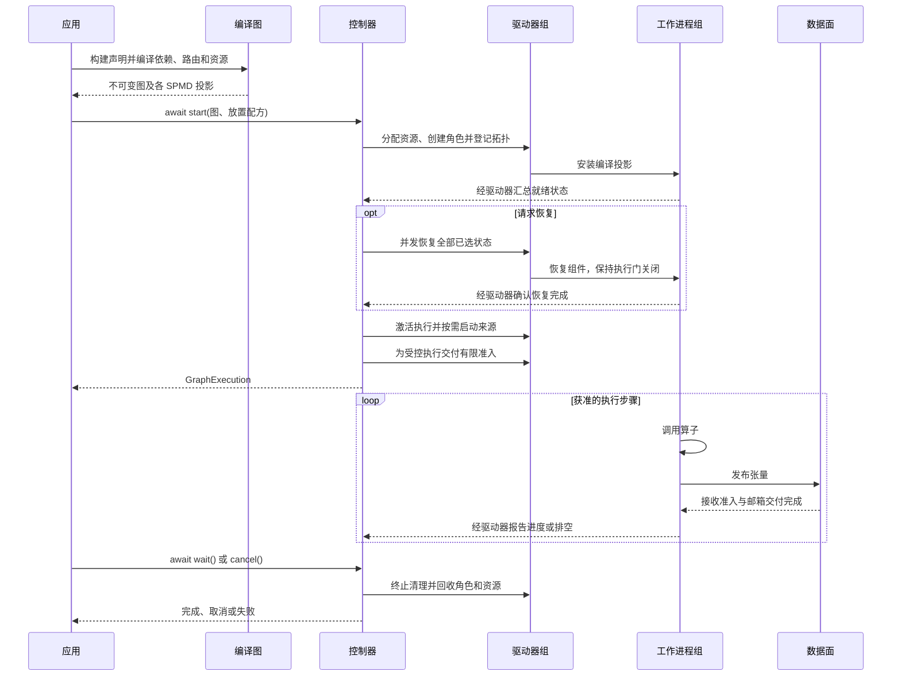
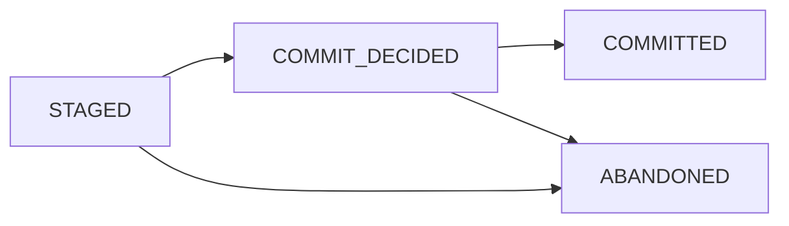
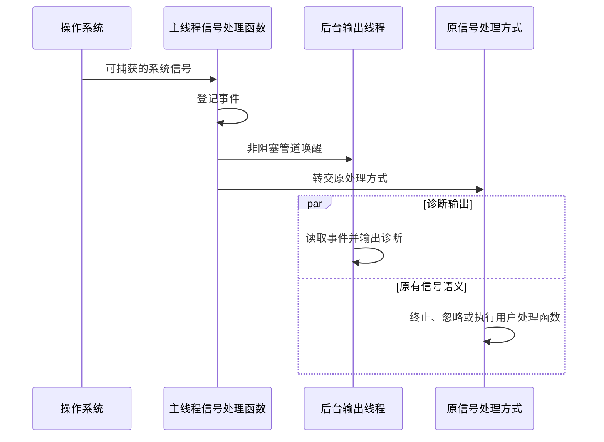

# Fluxway 架构

英文版见 [ARCHITECTURE.md](ARCHITECTURE.md)。

Fluxway 将算子声明编译为计算图，分配工作进程，协调执行与恢复。控制面决定何时允许执行，数据面传递执行所需的张量。

图中一个 SPMD 节点表示一组在网格上运行相同程序的工作进程，边连接算子输出与输入。



图示普通张量路径并聚合多级确认；驱动器和工作进程调用保持并发，获准工作可能在 `start()` 返回前开始。协议空帧等分支与统一交付屏障见[数据面运行时](dataplane_runtime_zh.md)。详细屏障与异常边界见[执行生命周期](execution_lifecycle_zh.md)。

## 构建并检查计算图

下面是完整的本地例子，无需启动 Ray。依赖边将生产端的 `value` 输出连接到消费端的 `item` 输入。

```python
import fluxway as fw
from fluxway.common.decorators import spmd


@spmd(
    resource_profile=fw.ResourceProfile(base={"CPU": 1}),
    mesh_axis_names=("data",),
    mesh_axis_shapes=(1,),
)
class Producer:
    @fw.operator(
        name="produce", output_sharding={"value": {"type": "static", "axis": []}}
    )
    def produce(self) -> dict[str, int]:
        return {"value": 1}


@spmd(
    resource_profile=fw.ResourceProfile(base={"CPU": 1}),
    mesh_axis_names=("data",),
    mesh_axis_shapes=(1,),
)
class Consumer:
    @fw.operator(
        name="consume", input_sharding={"item": {"type": "static", "axis": []}}
    )
    def consume(self, item: int) -> None:
        self.last_value = item


builder = fw.Builder()
builder.add_node("source", Producer)
builder.add_node("sink", Consumer)
builder.add_func_edge(
    "source", "produce", "sink", "consume", tensor_map={"value": "item"}
)
graph = builder.build("two-operators")
compiled = graph.require_compiled_graph()

assert len(compiled.dependencies) == 1
assert graph.nodes["source"].spmd_config.graph_view is compiled.spmd("source")
assert compiled.spmd("source").outgoing[0] is compiled.dependencies[0]
```

两个身份检查引用的都是同一份编译结果。工作进程和传输规划使用这份图的投影，不各自构造另一份元数据。例子只检查构图，不调用算子；执行方法见[执行生命周期](execution_lifecycle_zh.md#使用方式)。

## 运行时职责

编译图是 SPMD 声明、算子身份、依赖、张量传输、资源清单和工作进程路由的唯一来源。工作进程接收不可变的图投影，不重建分片或张量身份。

| 对象 | 负责的工作 |
| --- | --- |
| 控制器 | 图生命周期、资源放置、驱动器、心跳、排空、检查点编排与故障传播 |
| 驱动器 | 监督工作进程，转发控制命令 |
| 工作进程 | 本地执行、准入、待执行步骤、传输交付和本地计划 |
| `ExecutionLifecycle` | 启动、恢复、准入交付、检查点后继续执行及故障处理的顺序 |

驱动器心跳只报告就绪情况，不授权开始执行。详细状态流见[执行生命周期](execution_lifecycle_zh.md)。

控制器和驱动器使用纯状态转移：锁内只提交状态与失败记录，释放锁后才执行外部操作。来源进度由唯一的监督器管理；终止清理和工作进程资源释放各自复用同一个异步结果，重复请求不会创建重复任务。

`BoundedLifecycleEffectScheduler` 以有界队列和固定数量的执行任务处理外部操作。同一排序键串行，不同键在容量内并发；队列满时抛出异常。真正可等待的输入输出使用 `ASYNC`，短阻塞调用或释放 GIL 的调用使用 `THREAD`，可序列化的纯 Python 计算使用 `PROCESS`。结果带有 `state_revision`，状态拥有者忽略过期结果。仅写成 `async def` 不会把阻塞代码移出事件循环。

## 一致性与数据面

端点本地的 MESI 目录独占一致性状态，以 `CoherenceInstance(subject, epoch)` 标识一个实例。`CoherenceDirectory.admit` 创建或返回该实例的目录项，`CoherenceSequencer` 负责同一主体的意图排序。目录在所属事件循环内使用，不持有工作进程任务或传输队列。

`TransportTensor` 是统一的张量表示。切片、数据帧组装、批处理、路由和谱系属于传输与数据面，不属于工作进程调度器。输入必须匹配指定步骤，不能取其他步骤的数据代替。示例见[数据面运行时](dataplane_runtime_zh.md)。

## 编译传输计划

`TensorTransfer.unit_routing` 声明完整单元的路由关系，不依赖特定来源算子。`CompiledDependency` 验证并绑定该关系，`CompiledSendPlan` 将它与分片和回执路由一起编译为执行指令。执行组区分物理身份和逻辑布局坐标，所有载荷仍由数据面传递。示例见[传输计划](transfer_planning_zh.md)。

## 多目标发布

一个工作进程步骤将全部目标批次作为不可变元组，提交给 `CoherenceBatchRetireRuntime.retire_publication()`。运行时一次准入所需实例，登记每个子回执，并发向全部目标发送；同一实例的只读交付不会被主体排序器逐个串行化。

CPU 与 Ray 承载方式下，接收完成表示数据帧已通过准入并进入接收邮箱。接收端负责物化后的载荷，生产端引用保留到所有子结果结束；同一工作进程内的别名仍受消费租约保护。这不保证跨进程零复制。任一目标失败都会取消尚未结束的同批交付，由唯一回执拥有者使整个发布失败。接入示例见[一致性协议](coherence_protocol_zh.md)。

## 排空与恢复

`DrainBoundary` 统一归约已观察、已准入、已排空和已提交的边界。控制器据此产生 `DrainAdmission(revision, target, terminal_cut)`，通过控制消息和完成报告交接。驱动器与工作进程先拒绝过期或冲突版本，再开放有限执行范围。排空完成要求全部已登记参与者在当前准入版本下报告完成。

控制器锁内不等待远程调用、来源确认或检查点取消。排空后、准备检查点前，需要确认来源任务已完整确认。恢复先重建逻辑计划与物理绑定，应用已提交位置，再恢复模型与运行状态；此时工作进程的执行门保持关闭。驱动器继续执行时只重置检查点记账，新的准入才提供下一段执行范围。

## 检查点事务

控制器与仓库使用 `CheckpointTransactionState`，工作进程使用另一套 `CheckpointSaveState`，两者不能混用：



`COMMIT_DECIDED` 表示物理发布已经开始。若崩溃前未写入全局提交标记，重启时调用 `abort_save(permit)` 并置为 `ABANDONED`；若标记已写入，则重放 `acknowledge_save(permit)`，完成到 `COMMITTED` 的转移。只有 `COMMITTED` 清单可用于恢复。清单、事务和清理意图通过 `msgpack_codec` 保存为二进制 MessagePack，不保证固定存储大小或延迟。注册与恢复示例见[检查点](checkpoint_zh.md)。

## 放置与执行

资源声明来自编译后的 SPMD 和 `ResourceProfile`。`PlacementRecipe` 表达约束和按优先级排序的目标，不另建资源清单。每个已求解的节点身份对应共享异构放置组中的一个组合资源包。Ray 通过 `ray.io/node-id` 标签在 `STRICT_SPREAD` 下固定节点；IP 地址资源标记不能充当节点身份。实际 CPU、GPU 和其他加速器用量保留求解结果，工作进程启动后校验实际节点身份。

多节点执行要求环境兼容；启用恢复时，各参与者还需访问检查点仓库。例子见[放置配方](placement_recipe_zh.md)和[放置数学](placement_mathematics_zh.md)。

动态路由表、设备网格等运行时资源由 `ResourceRegistry` 管理，通过 `ResourceHandle(namespace, resource_id)` 引用。`bind_resource_registry` 提供当前上下文。`LogicalPartitionBinding` 根据逻辑分片选择工作进程内的值，也可按指定布局轴投影；它不提供物理秩重映射，拓扑恢复仍由组件契约约束。

工作进程中的准入拥有者管理执行门和待执行状态。`SourcePipelineMaintenance.request()` 合并补队列请求；`fill()` 检查运行阶段、流水深度、排空边界和总步骤上限后才入队。它不扫描来源或发布新窗口。执行任务消费队列、检查准入、运行计划，并完成队列记账。

## 摄取布局与来源协调

适配器 `IngestionSourceAdapter` 按有界请求返回不可变的 `SourceScanResult`。控制器中的 `SourceProgressSupervisor` 负责事件驱动的扫描与激活发布。编译器先构建由 `SourceWorkKey(epoch, step, assignment_id)` 标识的规范任务，再按当前读取配额绑定为瞬态的 `WorkerLayoutDescriptor`。只有 `LogicalWorkLedger` 管理租约、确认前沿和已提交位置，驱动器不保存激活检查点状态。

`IngestionLayoutPlanningComponent` 统一管理来源绑定与适配器的生命周期。绑定构造、数据扫描和资源关闭均在专用 `IOLane` 中执行，纯编译使用常驻进程池。规划器关闭时拒绝新请求并等待已有任务落盘，随后并发释放适配器并退出编译池，最后彻底回收各通道。

规划器与 `IOLane` 通过 `AsyncOperationSupervisor` 与 `AsyncCloseOnce` 保证并发安全：外部取消等待不会造成后台任务或资源泄漏，关闭逻辑保证幂等执行一次，且防止操作反向关闭拥有者导致的死锁。详情见[来源协调](source_coordination_zh.md)。

规划和账本发布在同一拥有者事件循环内完成，中间不挂起；其校验成本仍随窗口大小增加。输入输出线程隔离阻塞调用，不消除 Python 计算的 GIL 限制。

`SourceExecutionScope` 管理工作进程窗口安装、活跃步骤索引和瞬态授权。它按算子流水深度批量请求，只获取信用额度允许的完整步骤前缀。普通检查点继续使用当前作用域；恢复使用新的执行角色，随后才激活来源。确认通过有界异步队列提交，容量满时施加背压。

公开启动入口启动生命周期，控制器监督器负责补窗；适配器自身不调度补窗。规划器支持暂时无新数据和待补齐尾部。持久化切点会回收已完成的控制器窗口、账本绑定和扫描观察，并保留连续性锚点；工作进程安装窗口与驱动器激活摘要仍被保留，因此按窗口增长的元数据仍需验证。示例与限制见[来源协调](source_coordination_zh.md)和[来源任务协议](source_spmd_formal_protocol_zh.md)。

## 进程诊断与信号捕获

`fluxway.diagnostics` 用于记录外部抢占、驱逐或系统信号造成的进程退出：

- 启动器通过 `prepare_worker_runtime_env` 注入诊断挂钩，并串联用户提供的可导入挂钩。
- 诊断层记录 Ray 的终止处理函数，并保留其原有退出流程。
- 信号处理函数只登记事件，通过非阻塞管道唤醒后台输出线程，不在信号处理期间执行阻塞输出。
- 信号继续交给原处理方式，保留默认终止、忽略或自定义处理语义。
- 只在进程主线程安装信号处理函数，异步执行线程仅发布诊断元数据。

工作进程启动器会自动准备环境。下面是启动器作者使用的本地配置例子，不会在提交进程安装信号处理函数：

```python
from fluxway.diagnostics import prepare_worker_runtime_env

original = {"env_vars": {"PYTHONUNBUFFERED": "1"}}
prepared = prepare_worker_runtime_env(original)

assert original == {"env_vars": {"PYTHONUNBUFFERED": "1"}}
assert prepared["env_vars"]["PYTHONUNBUFFERED"] == "1"
assert len(prepared["env_vars"]) == 2
```

新增变量选择 Fluxway 启动挂钩。用户挂钩须使用可导入的模块路径；可调用对象或手动设置的 Ray 挂钩环境变量会被拒绝。`SIGKILL` 等无法拦截的信号不能由进程内部记录。



信号处理函数不等待输出完成。进程立即退出时，诊断记录仍可能来不及写出。

## 各机制示例

| 要做的事 | 文档 |
| --- | --- |
| 启动、观察、取消与恢复执行 | [执行生命周期](execution_lifecycle_zh.md) |
| 注册状态、保存、恢复与配置保留策略 | [检查点](checkpoint_zh.md) |
| 限制扫描预算与跟踪来源任务 | [来源协调](source_coordination_zh.md) |
| 编译路由与传递张量 | [传输计划](transfer_planning_zh.md)、[数据面运行时](dataplane_runtime_zh.md) |
| 准入实例与释放消费租约 | [一致性协议](coherence_protocol_zh.md) |
| 放置工作进程与绑定运行时资源 | [放置配方](placement_recipe_zh.md) |
