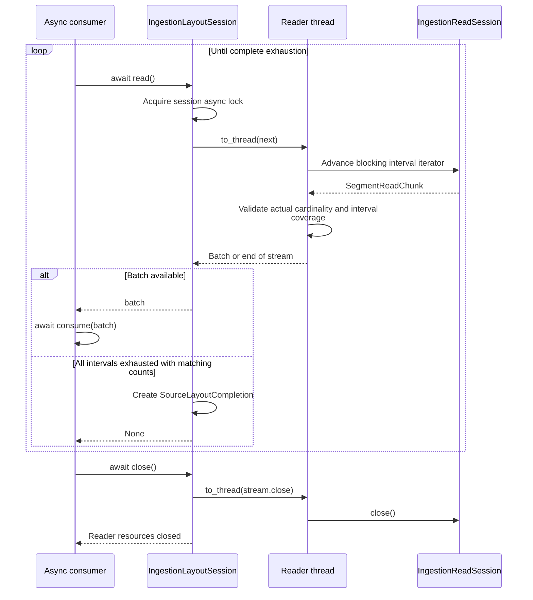

# Reader API

[Chinese edition](base_reader_zh.md)

`BaseReader` turns source records into `TransportTensor` values with global row
coordinates. A controlled reader reads exactly the intervals in
`self.ctx.source_work_items`. The planner fixes record order and logical batches;
`LogicalWorkLedger` owns leases and progress. The dispatcher selects workers and
routes data.

## Read assigned records

Before each controlled read, the runtime validates a nonempty tuple of
`SourceWorkItem` values for the current step. Source identity, schema and global
batch size must agree, and duplicate intervals fail. Readers use the captured
revision and physical locator, never a newly discovered latest revision.

This CPU example supplies the context that the runtime normally injects. One
reader owns two separate intervals of the same assignment. Constructing work
items here demonstrates coordinates; it does not register a source or start a
distributed execution.

```python
import numpy as np

from fluxway.common.decorators import operator, operator_context
from fluxway.common.ingestion import (
    LayoutUnitDescriptor,
    SourceWorkAssignment,
    SourceWorkItem,
)
from fluxway.common.tensor_backend import set_backend
from fluxway.common.types.configs import OperatorContext
from fluxway.common.types.tensor import TransportTensor
from fluxway.reader import BaseReader


class FeatureReader(BaseReader):
    @operator("read")
    def read(self) -> tuple[TransportTensor, TransportTensor, TransportTensor]:
        if self.ctx is None or not self.ctx.source_work_items:
            raise RuntimeError("acquired source work is required")
        revisions = self.static_args["revision_rows"]
        rows = np.concatenate(
            [
                revisions[
                    (
                        item.assignment.descriptor.revision_identity,
                        item.assignment.descriptor.physical_identity,
                    )
                ][item.logical_start : item.logical_end]
                for item in self.ctx.source_work_items
            ]
        )
        return (
            self.create_tensor(rows, uniform_dense_partition=True),
            self.create_row_sparse_tensor(rows.tolist(), width=2, dtype=np.int64),
            self.create_tensor(
                [row[: index % 2 + 1].tolist() for index, row in enumerate(rows)],
                dtype=np.int64,
            ),
        )


set_backend("hybrid")
unit = LayoutUnitDescriptor(
    unit_id="part-0:2:8",
    revision_identity="revision-7",
    cardinality=6,
    cardinality_metric="rows",
    split_policy="SplittableSpan",
    locality_key="part-0",
    physical_identity="part-0",
    logical_start=2,
    opaque_token=b"pinned-array",
)
assignment = SourceWorkAssignment.create(
    epoch=0,
    step=3,
    source_identity="features",
    view_identity="view-7",
    schema_digest="two-columns",
    lineage_digest="revision-7",
    descriptor=unit,
    global_start=24,
    global_batch_size=8,
    global_valid_count=8,
)
context = OperatorContext(
    physical_rank=1,
    physical_world_size=4,
    logical_rank=1,
    logical_world_size=4,
    step=3,
    source_work_items=(
        SourceWorkItem(assignment, 2, 4),
        SourceWorkItem(assignment, 6, 8),
    ),
)
revisions = {("revision-7", "part-0"): np.array([[i, i + 1] for i in range(10)])}
with operator_context(
    static_args={"revision_rows": revisions},
    rank=1,
    world_size=4,
    operator_ctx=context,
):
    dense, sparse, nested = FeatureReader.read()

assert dense.global_shape == sparse.global_shape == (8, 2)
assert dense.origin_indices.materialize().tolist() == [24, 25, 28, 29]
assert sparse.origin_indices.materialize().tolist() == [24, 25, 28, 29]
assert nested.origin_indices.materialize().tolist() == [24, 25, 28, 29]
assert nested.logical_shape == (4, None)
assert nested.global_shape is None
```

The file rows are `2, 3, 6, 7`; their global rows are `24, 25, 28, 29`.
Physical rank `1` does not determine either set of coordinates. For a storage
adapter, resolve each interval relative to its original source metadata; a file
fragment's local index need not equal the file's physical row number. Nested
lists retain row coordinates and report local variable-length structure; they
do not infer a global variable-length shape.

## Tensor helpers

| API | Use |
| --- | --- |
| `create_tensor(data, dtype=None, uniform_dense_partition=False)` | Wrap dense or nested data and attach source coordinates. |
| `create_row_sparse_tensor(rows, *, width, dtype=None)` | Encode a variable number of values per row with a declared row width. |
| `self.ctx.source_work_items` | Read the exact intervals for this invocation; do not cache them. |
| `self.rank`, `self.world_size` | Inspect physical placement, not source ownership. |

The outer row count must equal the total acquired cardinality. Every item must
belong to the current step and one logical batch. Dense uniform and row-sparse
helpers use the assignment's `global_batch_size` for global rows. Missing context,
wrong row counts or conflicting metadata raise an exception.

An explicitly coordinated source without work items must supply
`global_source_offset`. This separate CPU example shows that mode:

```python
import numpy as np

from fluxway.common.decorators import operator, operator_context
from fluxway.common.tensor_backend import set_backend
from fluxway.common.types.configs import OperatorContext
from fluxway.common.types.tensor import TransportTensor
from fluxway.reader import BaseReader


class ExplicitReader(BaseReader):
    @operator("read")
    def read(self) -> TransportTensor:
        return self.create_tensor(
            self.static_args["rows"], uniform_dense_partition=True
        )


set_backend("hybrid")
context = OperatorContext(
    physical_rank=3,
    physical_world_size=4,
    logical_rank=1,
    logical_world_size=2,
    step=3,
    global_source_offset=14,
)
with operator_context(
    static_args={"rows": np.array([[10.0], [20.0]])},
    rank=3,
    world_size=4,
    operator_ctx=context,
):
    tensor = ExplicitReader.read()

assert tensor.global_shape == (4, 1)
assert tensor.origin_indices.materialize().tolist() == [14, 15]
```

Here global row count is local rows times `logical_world_size`. The caller owns
coordination of these explicit offsets. This mode alone provides neither
checkpoint replay nor ownership across topology changes.

## Read a compiled layout

`IngestionReadSession.read` accepts a `ScheduledSegmentRead` and an explicit
`batch_size`, then yields `SegmentReadChunk` values. Each chunk reports its actual row count,
physical bytes and whether it opened the object. `IngestionLayoutSession` moves
blocking iteration to a thread and verifies the total count.

The following integration function needs a runtime-issued activation, a storage
read session and an asynchronous consumer. Exhaustion returns layout completion
information; early exit or a count mismatch must not report completion.

```python
from collections.abc import Awaitable, Callable
from typing import Any

from fluxway.common.ingestion import (
    IngestionLayoutActivation,
    SourceLayoutCompletion,
)
from fluxway.reader import IngestionLayoutSession, IngestionReadSession


async def consume_layout(
    activation: IngestionLayoutActivation,
    reader: IngestionReadSession,
    consume: Callable[[Any], Awaitable[None]],
    *,
    batch_size: int,
) -> SourceLayoutCompletion:
    session = IngestionLayoutSession(activation, reader, batch_size=batch_size)
    try:
        while True:
            batch = await session.read()
            if batch is None:
                return session.acknowledgement
            await consume(batch)
    finally:
        await session.close()
```

Layout completion is distinct from `SourceWorkAcknowledgement`. During normal
controlled execution the worker acquires leases, injects work items, calls the
reader and submits lease acknowledgements through a bounded asynchronous queue.
Applications do not manually acknowledge a whole descriptor for other workers.



Early exit or read failure produces no layout completion; count mismatches raise. Await
consumption and close the session in `finally`. `close()` does not acknowledge a work
lease or commit a checkpoint.

## Source registration and recovery

Implement `IngestionSourceAdapter.scan_next(cursor, budget)` and pure
`advance_cursor(cursor, records)`, plus `close()` even without external resources.
A source descriptor supplies `build_source_scan_binding` and `build_component`.
The Controller delegates binding creation and caching to the planner, retaining
the reader topology, adapter, tail policy, and initial opaque cursor together.
The planner owns adapter closure after successful binding, even if a caller stops
waiting before the first scan. Construction, initial-cursor, scan, and close
callbacks may return awaitables and run on the dedicated adapter lane; cursor
advancement remains synchronous. The Worker's `IngestionReadSession.close()` is
a separate synchronous read-session contract and does not close the control-side
scan adapter. See executable scanning and lifecycle examples in
[source coordination](source_coordination.md), and the
[recommendation descriptor](../fluxway/example/recommendation/source_adapter.py)
and [reader](../fluxway/example/recommendation/reader.py).

A source acknowledgement confirms production, not model consumption or durable
commit. The planner derives a consumption bookmark at the joint checkpoint cut.
Restore replans from that bookmark; readers do not save independent durable
cursors or restore old windows. External side effects need their own transaction
or idempotency contract. A reader implementation alone does not establish a
complete refill, drain or recovery loop; those boundaries are defined by
[source coordination](source_coordination.md).
