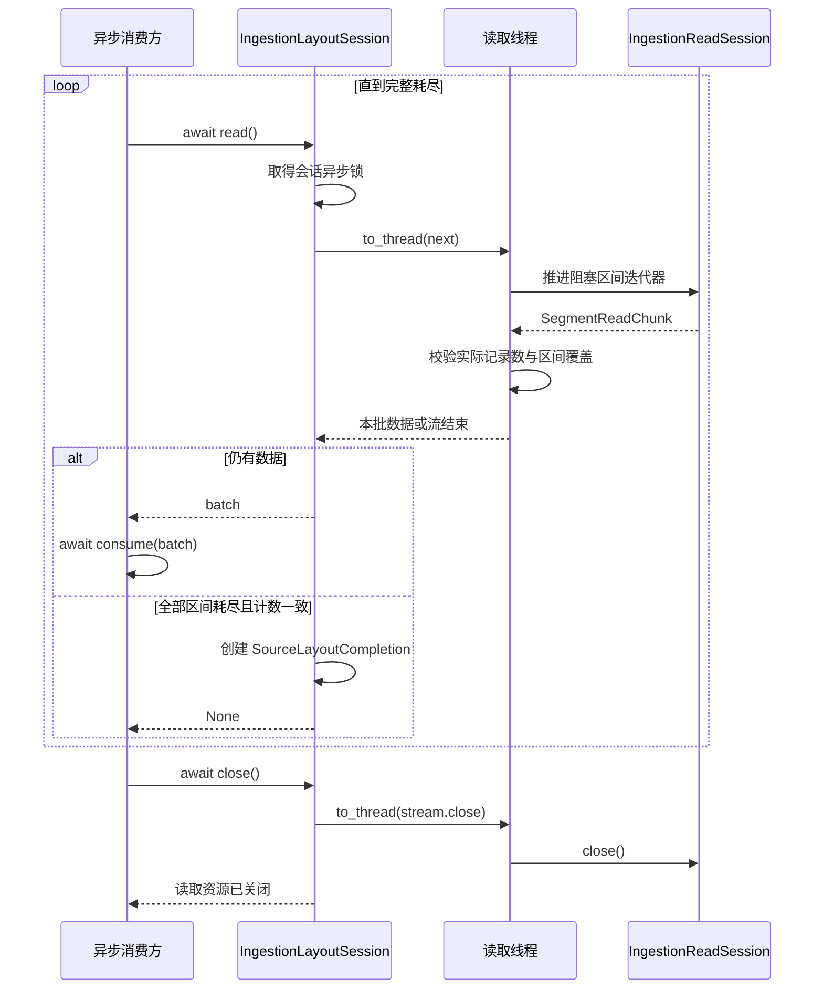

# 读取接口

[英文版](base_reader.md)

`BaseReader` 将来源记录转换成带有全局行坐标的 `TransportTensor`。受控读取器只读取
`self.ctx.source_work_items` 中的精确区间。规划器固定记录顺序与逻辑批次，
`LogicalWorkLedger` 管理租约与进度，分发器选择工作进程并路由数据。

## 读取已分配的记录

每次受控读取前，运行时检查当前训练步的 `SourceWorkItem` 非空元组。来源身份、结构和
全局批次大小必须一致，重复区间直接报错。读取器使用任务中固定的修订和物理位置，
不能临时换成最新修订。

下面的本地示例手动提供运行时通常会注入的上下文。一个读取器持有同一任务中两个
分开的区间。这里构造任务只是为了说明坐标，不代表已经注册来源或启动分布式执行。

```python
import numpy as np

from fluxway.common.decorators import operator, operator_context
from fluxway.common.ingestion import (
    LayoutUnitDescriptor,
    SourceWorkAssignment,
    SourceWorkItem,
)
from fluxway.common.tensor_backend import set_backend
from fluxway.common.types.configs import OperatorContext
from fluxway.common.types.tensor import TransportTensor
from fluxway.reader import BaseReader


class FeatureReader(BaseReader):
    @operator("read")
    def read(self) -> tuple[TransportTensor, TransportTensor, TransportTensor]:
        if self.ctx is None or not self.ctx.source_work_items:
            raise RuntimeError("acquired source work is required")
        revisions = self.static_args["revision_rows"]
        rows = np.concatenate(
            [
                revisions[
                    (
                        item.assignment.descriptor.revision_identity,
                        item.assignment.descriptor.physical_identity,
                    )
                ][item.logical_start : item.logical_end]
                for item in self.ctx.source_work_items
            ]
        )
        return (
            self.create_tensor(rows, uniform_dense_partition=True),
            self.create_row_sparse_tensor(rows.tolist(), width=2, dtype=np.int64),
            self.create_tensor(
                [row[: index % 2 + 1].tolist() for index, row in enumerate(rows)],
                dtype=np.int64,
            ),
        )


set_backend("hybrid")
unit = LayoutUnitDescriptor(
    unit_id="part-0:2:8",
    revision_identity="revision-7",
    cardinality=6,
    cardinality_metric="rows",
    split_policy="SplittableSpan",
    locality_key="part-0",
    physical_identity="part-0",
    logical_start=2,
    opaque_token=b"pinned-array",
)
assignment = SourceWorkAssignment.create(
    epoch=0,
    step=3,
    source_identity="features",
    view_identity="view-7",
    schema_digest="two-columns",
    lineage_digest="revision-7",
    descriptor=unit,
    global_start=24,
    global_batch_size=8,
    global_valid_count=8,
)
context = OperatorContext(
    physical_rank=1,
    physical_world_size=4,
    logical_rank=1,
    logical_world_size=4,
    step=3,
    source_work_items=(
        SourceWorkItem(assignment, 2, 4),
        SourceWorkItem(assignment, 6, 8),
    ),
)
revisions = {("revision-7", "part-0"): np.array([[i, i + 1] for i in range(10)])}
with operator_context(
    static_args={"revision_rows": revisions},
    rank=1,
    world_size=4,
    operator_ctx=context,
):
    dense, sparse, nested = FeatureReader.read()

assert dense.global_shape == sparse.global_shape == (8, 2)
assert dense.origin_indices.materialize().tolist() == [24, 25, 28, 29]
assert sparse.origin_indices.materialize().tolist() == [24, 25, 28, 29]
assert nested.origin_indices.materialize().tolist() == [24, 25, 28, 29]
assert nested.logical_shape == (4, None)
assert nested.global_shape is None
```

读取的文件行号为 `2、3、6、7`，全局行号为 `24、25、28、29`。物理进程编号 `1`
不决定这两组坐标。接入存储时应根据原始来源编码解析区间；文件片段的局部下标
不一定等于文件内的物理行号。嵌套列表保留行坐标并报告本地不定长结构，不推测全局
不定长形状。

## 张量辅助方法

| 接口 | 用途 |
| --- | --- |
| `create_tensor(data, dtype=None, uniform_dense_partition=False)` | 封装密集或嵌套数据，并附上来源坐标。 |
| `create_row_sparse_tensor(rows, *, width, dtype=None)` | 编码每行数量可变的值，并声明行宽。 |
| `self.ctx.source_work_items` | 本次调用的精确区间，不能跨调用缓存。 |
| `self.rank`, `self.world_size` | 查看物理放置，不用于推导来源所有权。 |

数据外层行数必须等于已领取区间的记录数之和，所有条目必须属于当前训练步和同一
逻辑批次。均匀密集和行稀疏辅助方法使用任务的 `global_batch_size` 作为全局行数。
缺少上下文、行数错误或元数据冲突时直接抛出异常。

没有任务条目、但由调用方显式协调的来源必须提供 `global_source_offset`。下面是
这种模式的独立本地示例：

```python
import numpy as np

from fluxway.common.decorators import operator, operator_context
from fluxway.common.tensor_backend import set_backend
from fluxway.common.types.configs import OperatorContext
from fluxway.common.types.tensor import TransportTensor
from fluxway.reader import BaseReader


class ExplicitReader(BaseReader):
    @operator("read")
    def read(self) -> TransportTensor:
        return self.create_tensor(
            self.static_args["rows"], uniform_dense_partition=True
        )


set_backend("hybrid")
context = OperatorContext(
    physical_rank=3,
    physical_world_size=4,
    logical_rank=1,
    logical_world_size=2,
    step=3,
    global_source_offset=14,
)
with operator_context(
    static_args={"rows": np.array([[10.0], [20.0]])},
    rank=3,
    world_size=4,
    operator_ctx=context,
):
    tensor = ExplicitReader.read()

assert tensor.global_shape == (4, 1)
assert tensor.origin_indices.materialize().tolist() == [14, 15]
```

这里的全局行数等于本地行数乘以 `logical_world_size`。调用方负责协调这些显式偏移；
这种模式本身不提供检查点重放，也不保证拓扑变化后的所有权。

## 读取已编译布局

`IngestionReadSession.read` 接受 `ScheduledSegmentRead` 和显式 `batch_size`，为请求区间
提供 `SegmentReadChunk`。每块数据记录实际行数、物理字节数，以及是否打开了对象。
`IngestionLayoutSession` 在线程中推进阻塞迭代器，并验证总记录数。

下面的集成函数需要运行时发出的激活信息、存储读取会话和异步消费函数。全部读完后
才能返回布局完成信息；提前退出或记录数不符时不能报告完成。

```python
from collections.abc import Awaitable, Callable
from typing import Any

from fluxway.common.ingestion import (
    IngestionLayoutActivation,
    SourceLayoutCompletion,
)
from fluxway.reader import IngestionLayoutSession, IngestionReadSession


async def consume_layout(
    activation: IngestionLayoutActivation,
    reader: IngestionReadSession,
    consume: Callable[[Any], Awaitable[None]],
    *,
    batch_size: int,
) -> SourceLayoutCompletion:
    session = IngestionLayoutSession(activation, reader, batch_size=batch_size)
    try:
        while True:
            batch = await session.read()
            if batch is None:
                return session.acknowledgement
            await consume(batch)
    finally:
        await session.close()
```

布局完成信息与 `SourceWorkAcknowledgement` 不同。正常受控执行由工作进程领取租约、
注入任务条目、调用读取器，再通过有界异步队列确认租约。应用不能替其他工作进程
确认整个描述区间。



提前退出或读取异常不会生成布局完成信息；计数不符直接报错。调用方需等待消费完成并在 `finally` 中关闭会话，不能把 `close()` 当作租约确认或检查点提交。

## 来源注册与恢复

来源适配器实现 `IngestionSourceAdapter.scan_next(cursor, budget)` 和纯位置运算
`advance_cursor(cursor, records)`，并提供 `close()`，即使没有外部资源也必须实现。
来源描述提供 `build_source_scan_binding` 与 `build_component`。控制器将绑定创建和缓存
交给规划器，统一保存读取拓扑、适配器、尾部策略和初始不透明位置；绑定成功后由规划器
负责适配器关闭，首次扫描前取消等待也不会丢弃资源。构造、初始位置、扫描和关闭可返回
可等待对象，在适配器专用通道执行；位置运算保持同步。工作进程的 `IngestionReadSession.close()`
仍是独立的同步读取会话契约，不替代控制侧适配器关闭。可运行的扫描与生命周期示例见[来源协调](source_coordination_zh.md)，
完整接入见[推荐来源描述](../fluxway/example/recommendation/source_adapter.py)与
[读取器](../fluxway/example/recommendation/reader.py)。

来源确认只表示生产完成，不代表模型已经消费或状态已经持久化。规划器按共同检查点
的切点生成消费书签，恢复后从书签重新规划；读取器不另存独立持久位置，也不恢复旧窗口。
外部副作用需要独立事务或幂等契约。仅实现读取器不能证明补充窗口、整图排空和恢复
流程已经完整接通，这些边界由[来源协调](source_coordination_zh.md)定义。
