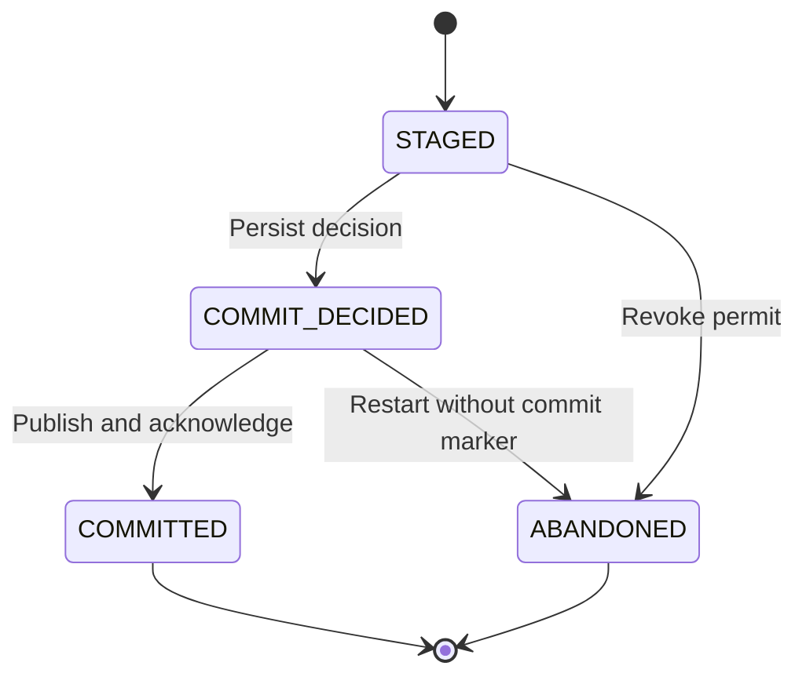
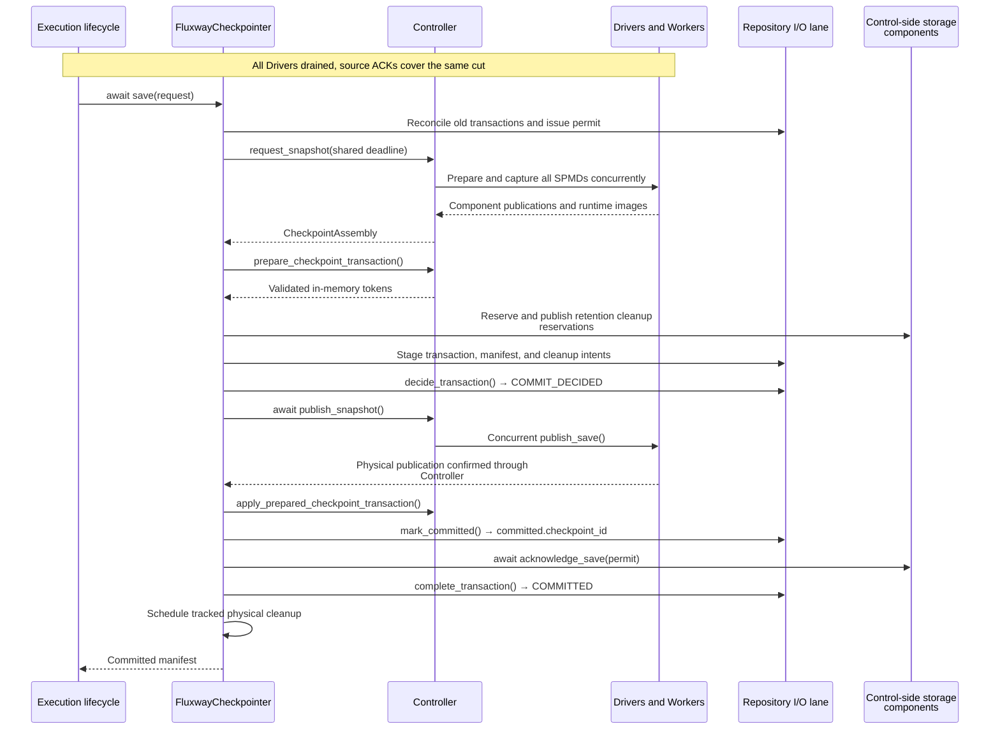
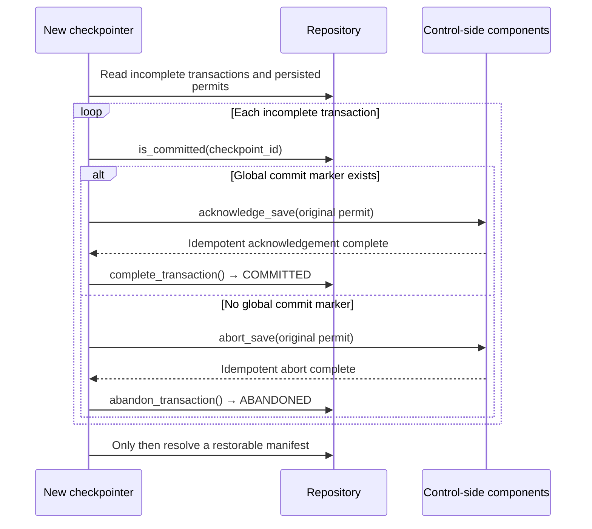
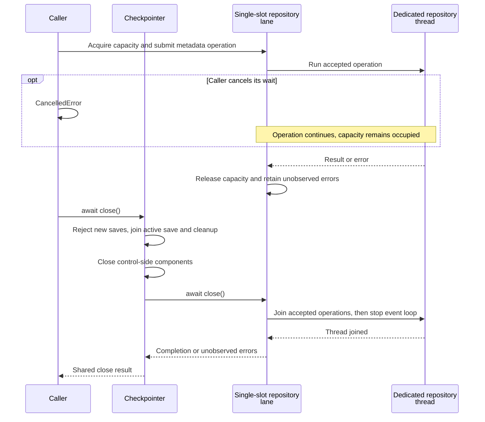
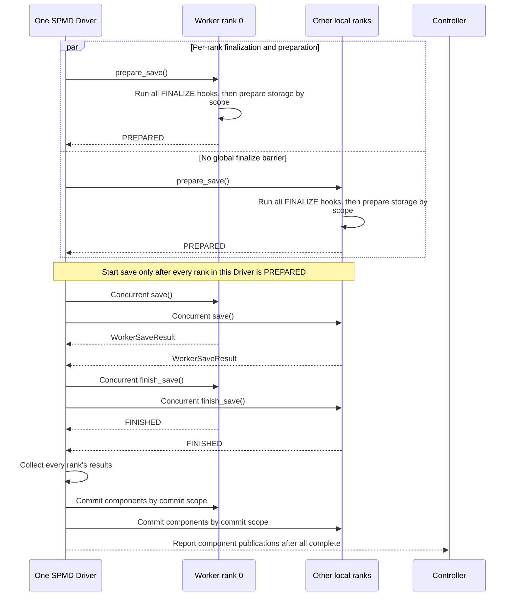
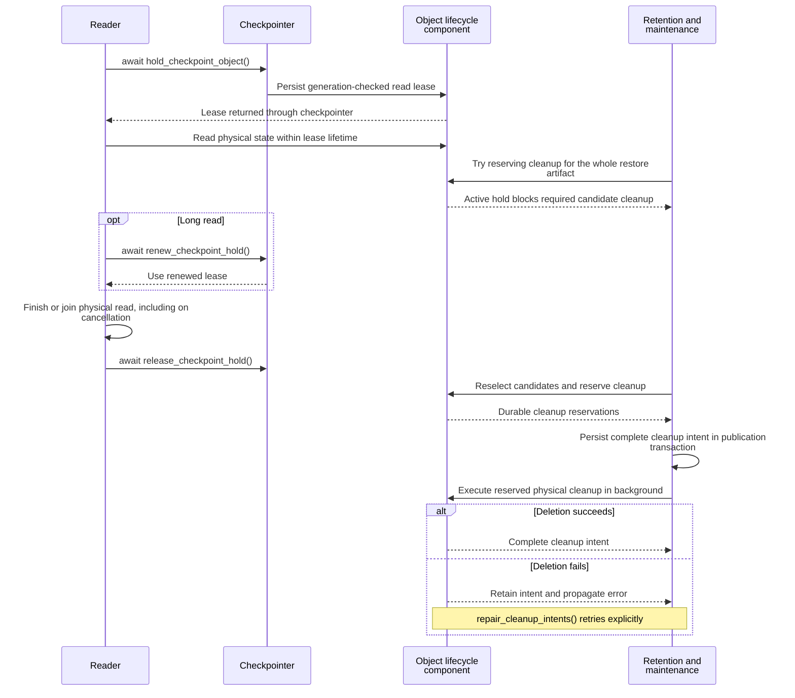
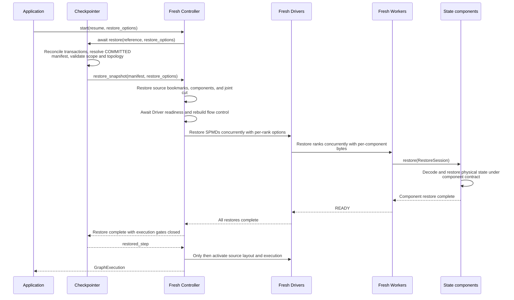

# Checkpoints

[Chinese edition](checkpoint_zh.md)

A checkpoint saves the source position, model, optimizer, and required operator
state at one agreed progress boundary. Register the state components on the graph,
then configure periodic saves through `fluxway.start`. See
[execution lifecycle](execution_lifecycle.md#usage) for startup, waiting, and cleanup.

Fluxway owns the transaction, progress cut, references, and retention decisions.
Each component owns its encoding, storage, restore mapping, and physical deletion.
The component contract determines which topology changes are supported.

## Register a small state component

This complete local example registers a counter in the manifest. It does not
start execution or write a checkpoint. During a real save and restore, the runtime
passes the operator owner and a session to the callbacks.

```python
import fluxway as fw
from fluxway.checkpoint import (
    register_checkpoint_component,
    state_checkpoint_component,
)
from fluxway.common.decorators import spmd


def restore_counter(owner, state, session):
    owner.seen = state["seen"]


counter_state = state_checkpoint_component(
    "counter",
    save=lambda owner, session: {"seen": owner.seen},
    restore=restore_counter,
)
registration = register_checkpoint_component(
    counter_state,
    component_lifecycle=counter_state,
    save=counter_state,
    restore=counter_state,
)


@spmd(
    resource_profile=fw.ResourceProfile(base={"CPU": 1}),
    mesh_axis_names=("data",),
    mesh_axis_shapes=(1,),
    checkpoint_components=(registration,),
)
class Counter:
    def __init__(self):
        self.seen = 0

    @fw.operator(
        name="advance", output_sharding={"value": {"type": "static", "axis": []}}
    )
    def advance(self) -> dict[str, int]:
        self.seen += 1
        return {"value": self.seen}


assert registration.descriptor.checkpoint_objects == ()
assert Counter.get_spmd_config().checkpoint_components == (registration,)
```

The assertions verify registration and show that the component owns no physical
checkpoint objects. Small state must be representable by the checkpoint metadata
codec. Use a storage component for large state. The default topology contract is
`EXACT_TOPOLOGY`; a reader that needs elastic recovery must implement an explicit
logical-position mapping rather than copy another worker's cursor.

## Repository directories and encoding

The runtime opens the configured repository. A new root receives
`CHECKPOINT_ROOT_MARKER`; an existing unmarked directory remains unmarked.
The root must be a real directory. A present marker must be a regular,
non-symlink file with the current format. Invalid paths or markers raise
`CheckpointDirectoryOwnershipError`.

This local example creates and removes only its own temporary repository:

```python
from pathlib import Path
from tempfile import TemporaryDirectory

from fluxway.control_plane.checkpointer import (
    CHECKPOINT_ROOT_MARKER,
    CheckpointDirectory,
)

Path("tmp").mkdir(exist_ok=True)
with TemporaryDirectory(dir="tmp", prefix="checkpoint-example-") as temporary:
    root = Path(temporary) / "repository"
    CheckpointDirectory.open(root)
    assert (root / CHECKPOINT_ROOT_MARKER).is_file()
    CheckpointDirectory.clear(root)
    assert not root.exists()

    prepared = Path(temporary) / "application"
    prepared.mkdir()
    CheckpointDirectory.open(prepared)
    assert not (prepared / CHECKPOINT_ROOT_MARKER).exists()
```

`clear()` requires a valid ownership marker, so it rejects the unmarked
`application` directory. Opening an existing directory neither claims ownership
nor migrates its contents.

Manifests, transaction records, cleanup intents, and references use binary
MessagePack through `msgpack_codec`. Source envelopes and transaction digests use
`fluxway.common.metadata`. Binary user metadata stays binary. The current
`CheckpointManifest` dataclass defines the root fields; decoding rejects missing
or extra fields. There is no release-version migration layer. Encoding alone
does not prove that a source cursor and its published work share one committed cut.

## Progress and checkpoint identity

The public identity is:

```text
checkpoint_id -> component_id -> checkpoint_object_id
```

- `checkpoint_id` selects the whole published checkpoint.
- `component_id` names the state owner, such as `dense` or `reader`.
- `checkpoint_object_id` distinguishes a component's saved objects; a single
  physical state object usually uses `"state"`.

`CheckpointCut.position` is the durable boundary. Each SPMD projection stores
that same value as `drain_boundary.committed_cut`; publication rejects a mismatch.
Reader records, interleave units, and optimizer updates can use different
coordinates. Their components must map the shared position to their own state.

Mailboxes, coherence leases, ready queues, physical layouts, prefetch buffers,
and credit observations are transient. Drain makes the boundary quiescent.
Save records it; restore creates a fresh runtime there. A saved lease or mailbox
generation is not a supported restore mechanism.

### Step and named requests

The following local example creates a request, not a saved checkpoint:

```python
from fluxway.checkpoint import NameReference, SaveCheckpointRequest, StepReference

request = SaveCheckpointRequest.for_step(1200, names=("best_model",))
assert request.cut.position == 1200
assert StepReference(1200) in request.references
assert NameReference("best_model") in request.references
```

The factory creates unique attempt and cut IDs. The step and `best_model` name
select the same checkpoint after publication; they are lookups rather than
physical storage paths.

The following functions are for Controller integrations, not running operator
code. `save_best` requires a coordinated drained position and complete source
ACK coverage. `restore_best` is a separate operation on a fresh execution before
activation. The graph runtime normally owns both operations.

```python
from fluxway.checkpoint import SaveCheckpointRequest
from fluxway.control_plane.checkpointer import FluxwayCheckpointer


async def save_best(checkpointer: FluxwayCheckpointer, drained_step: int) -> str:
    manifest = await checkpointer.save(
        SaveCheckpointRequest.for_step(drained_step, names=("best_model",))
    )
    return manifest.checkpoint_id


async def restore_best(checkpointer: FluxwayCheckpointer) -> int | None:
    return await checkpointer.restore_named("best_model")
```

Use `restore_step(step)`, `restore_latest()`, or `restore_checkpoint(id)` as
alternative selectors. Do not invoke several restore methods in sequence on a
running graph. `latest()` and `list_steps()` are asynchronous queries.

For a stream without a step coordinate, the integration supplies source-owned
bookmarks and a named reference. This helper only constructs the request:

```python
from collections.abc import Mapping
from uuid import uuid4

from fluxway.checkpoint import NameReference, SaveCheckpointRequest
from fluxway.common.types.checkpoint import CheckpointCut


def stream_checkpoint_request(bookmarks: Mapping[str, bytes]) -> SaveCheckpointRequest:
    return SaveCheckpointRequest(
        attempt_id=uuid4().hex,
        cut=CheckpointCut(
            cut_id=uuid4().hex,
            position=None,
            stream_cuts=dict(bookmarks),
        ),
        references=(NameReference("stream-head"),),
    )
```

`StepReference` requires a position and must match it. A name can select a
non-step checkpoint. The source owner defines the bookmarks' meaning and must
align them with the other components.

## Global publication transaction

The Controller and repository use `CheckpointTransactionState`. This durable
decision record is distinct from the worker's `CheckpointSaveState`.





One `deadline` covers every save phase; repository calls are awaited in order. A
post-decision failure preserves the durable decision and propagates. Later
reconciliation uses the global marker; it cannot treat the attempt as undecided.

Publication follows this order:

1. Capture immutable state and prepare all participants.
2. Stage the manifest and transaction, then persist `COMMIT_DECIDED`.
3. Publish worker artifacts and apply the prepared Controller tokens.
4. Write the global `committed.<checkpoint_id>` marker.
5. Acknowledge component saves and finish the record as `COMMITTED`.

Preparation validates captured state; apply installs validated in-memory tokens
without serializing them again. Storage and publication errors still propagate.

Before the commit decision, failure or deadline expiry revokes the permit and
moves the attempt to `ABANDONED`. Staging artifacts can remain for later cleanup.
After a crash, startup fencing examines the global marker: without it, components
receive `abort_save(permit)`; with it, they receive the original persisted permit
in `acknowledge_save(permit)` and the transaction finishes as `COMMITTED`.
Both control methods must be idempotent and propagate errors so recovery can retry.

Only `COMMITTED` records are restorable and enter reference resolution, `latest`,
or retention. Each global snapshot has one monotonic deadline passed to all
participants in parallel. Controller integrations must accept that deadline.



A failed acknowledgement or abort stops reconciliation and propagates. Repeated
reconciliation uses the original persisted permit.

### Repository I/O and shutdown

The Controller owns `prepare_checkpoint_transaction` and
`apply_prepared_checkpoint_transaction` on its event loop. A storage thread must
not mutate its ledger or wake its asyncio waiters.

Each checkpointer owns a `CheckpointRepositorySession` with a dedicated I/O
thread and event loop. One in-flight metadata slot orders directory opening,
coordinator-generation claims, transactions, queries, and retention records.
It does not carry tensor payloads or use the caller's default executor.

Internal integrations create it with
`await FluxwayCheckpointer.create(controller, repository_dir, interval_steps=...)`.
Applications use `CheckpointConfig` and let the runtime manage it.

Cancelling a wait does not abandon accepted repository work. Capacity is released
when that work finishes. Errors after waiter cancellation remain observable in a
later operation or close.

`close()` rejects new saves, joins the active save and cleanup operations, closes
components, then stops and joins the repository thread. Repeated close calls
observe the same result; cancellation of one waiter does not stop cleanup.
This isolates scheduling capacity, not storage latency or Python GIL contention.



Waiting for capacity has not submitted an operation. Only accepted work is protected
from waiter cancellation. Repeated close shares its result; cancelling one close waiter
leaves cleanup running.

## Component capabilities

Use `fluxway.checkpoint` for the authoring helpers and session types shown here.
Bundled storage components live in `fluxway.control_plane.checkpointer`; complete
extension interfaces live in its `component` module.

| Capability | Interface | Responsibility |
| --- | --- | --- |
| Descriptor | `CheckpointComponent` | Declare identity, saved objects, and topology |
| `COMPONENT_LIFECYCLE` | `CheckpointComponentLifecycle` | `open`, `close` |
| `FINALIZE` | `CheckpointComponentFinalize` | `finalize_save` before storage preparation |
| `SAVE` | `CheckpointComponentSave` | Whole save transaction, including publish, abort, and acknowledge |
| `RESTORE` | `CheckpointComponentRestore` | Apply the selected component publication |
| `OBJECT_LIFECYCLE` | `CheckpointObjectLifecycle` | Holds and durable cleanup reservations |
| `OBJECT_CLEANUP` | `CheckpointObjectCleanup` | Execute reserved physical cleanup |

A registration's non-null interface fields determine its capabilities.
`register_checkpoint_component` makes them explicit, as in the counter example.
Bundled components provide `registration()`. A missing save or restore
implementation that disagrees with the descriptor is an error.

`SAVE` is one contract, not independently selectable phases:

```text
FINALIZING -> FINALIZE callbacks -> SAVE.prepare -> PREPARED
           -> SAVE.save -> SAVE.finish -> SAVE.commit -> SAVE.publish
```

The Driver waits for every local rank to reach `PREPARED` before starting
`save`. No Controller-wide finalize phase exists.



Callbacks run in component order within each Worker; calls across ranks remain
concurrent. `LEADER` preparation or commit runs only on the leader, while registered
finalizers run on every rank. Component commit still precedes global publication and
does not make the checkpoint restorable.

### Finalize memory before reserving storage

`finalize_save` runs on every rank, even when storage preparation or commit is
leader-only. It canonicalizes drained algorithm state without storage I/O.
A failure stops execution because local state may already have changed.
`prepare_save` reserves staging paths or storage leases and can be rolled back.

This local registration example flushes a buffered count before capture.
A training integration can supply its own partial-gradient finalizer under the
same contract.

```python
from dataclasses import dataclass

from fluxway.control_plane.checkpointer import StateCheckpointComponent


@dataclass
class BufferedCounter:
    committed: int = 0
    pending: int = 0


def finalize_counter(owner, session):
    owner.committed += owner.pending
    owner.pending = 0


def restore_counter(owner, state, session):
    owner.committed = state["committed"]
    owner.pending = 0


counter = StateCheckpointComponent(
    "buffered-counter",
    save_state=lambda owner, session: {"committed": owner.committed},
    restore_state=restore_counter,
    finalize_state=finalize_counter,
)
registration = counter.registration()
assert registration.finalize is counter
```

An operator using this registration must provide the `BufferedCounter` fields.
The example checks the capability; it does not run a coordinated save.

### Choose a storage component

| State | Component | Restore topology |
| --- | --- | --- |
| Small metadata in the manifest | `state_checkpoint_component` | `EXACT_TOPOLOGY` by default |
| Trusted Python state local to a worker | `WorkerLocalCheckpointComponent` | `EXACT_TOPOLOGY` |
| Tensor state in SafeTensors | `SafeTensorsCheckpointComponent` | `EXACT_TOPOLOGY` |
| Collective JAX PyTree | `OrbaxCheckpointComponent` | `GLOBAL_RESHARD` |
| Native sparse table | `SparseEmbeddingCheckpointComponent` | `LOGICAL_PARTITION_REMAP` |

This local registration requires an operator owner with a `cursor` attribute:

```python
from fluxway.common.types.checkpoint import RestoreTopologyMode
from fluxway.control_plane.checkpointer import WorkerLocalCheckpointComponent


def restore_local(owner, state, session):
    owner.cursor = state["cursor"]


local = WorkerLocalCheckpointComponent(
    "worker-local",
    save_state=lambda owner, session: {"cursor": owner.cursor},
    restore_state=restore_local,
)
registration = local.registration()

assert registration.descriptor.restore.topology is RestoreTopologyMode.EXACT_TOPOLOGY
assert registration.object_lifecycle is local
assert registration.object_cleanup is local
```

The bundled component supplies hold and cleanup support. Worker-local state uses
Python pickle and must be read from a trusted repository. A local reader cursor,
RNG, or metric history cannot be automatically copied to a different topology.

For JAX state, install `fluxway[jax]`. The following registration expects
`owner.training` to be a nested PyTree of JAX arrays containing every model and
optimizer value needed to continue training. The layout callback describes the
current target shapes, dtypes, and shardings.

```python
import jax
import jax.numpy as jnp

from fluxway.common.types.checkpoint import RestoreTopologyMode
from fluxway.control_plane.checkpointer import OrbaxCheckpointComponent


def target_layout(state):
    return jax.tree_util.tree_map(
        lambda value: jax.ShapeDtypeStruct(
            value.shape, value.dtype, sharding=value.sharding
        ),
        state,
    )


def restore_training(owner, state, session):
    owner.training = state


dense = OrbaxCheckpointComponent(
    "dense",
    save_state=lambda owner, session: owner.training,
    restore_state=restore_training,
    restore_layout=lambda owner, session: target_layout(owner.training),
)
registration = dense.registration()
training = {
    "model_state": {"weight": jnp.ones((2,), dtype=jnp.float32)},
    "optimizer_state": {"moment": jnp.zeros((2,), dtype=jnp.float32)},
}
layout = target_layout(training)

assert layout["model_state"]["weight"].shape == (2,)
assert registration.descriptor.restore.topology is RestoreTopologyMode.GLOBAL_RESHARD
```

This example builds the registration; actual I/O is performed by the runtime.
Orbax uses `ocp.args.StandardSave` and a collective shared record. Multiple SPMD
ranks require one initialized JAX process per rank. An absent or mismatched process
group fails during preparation. Single-rank saves use single-process I/O.
Keep rank-private state in a separate worker-local component.

### Opaque storage objects and commit authority

A storage integration receives `SaveSession` during save and
`CommitSaveSession` during commit. The latter adds every rank's
`WorkerSaveResult`. `RestoreSession` carries the saved and current topologies
and selected component publication.

These integration helpers consume sessions supplied by the runtime and bytes
supplied by the storage owner:

```python
from fluxway.checkpoint import (
    CheckpointComponentPublication,
    CommitAuthority,
    CommitSaveSession,
    SaveSession,
    WorkerSaveResult,
)


def storage_authority(session: SaveSession, scope: str) -> CommitAuthority:
    return session.commit_authority(scope)


def saved_fragment(session: SaveSession, fragment: bytes) -> WorkerSaveResult:
    return session.worker_save_result(fragment)


def committed_object(
    session: CommitSaveSession, object_id: str, version_id: str, locator: bytes
) -> CheckpointComponentPublication:
    state = session.checkpoint_object_ref(object_id, version_id, locator)
    return session.component_checkpoint((state,))
```

The storage owner chooses `scope` for its commit/CAS protocol and supplies an
`object_id` declared in its descriptor. It uses the returned commit authority.
Call `committed_object` only after that storage commit succeeds.
`version_id` identifies the logical object version; `locator` identifies the
physical state using an owner-defined binary format. Fluxway transports the
locator without decoding it.

One logical object version can include several physical partitions, distinguished
by `partition_key`. The storage component defines those partitions; Fluxway does
not infer elastic restore from their names.

The save request's `attempt_id`, the published `checkpoint_id`, and
`CheckpointCommitPermit` have different roles. Coordinator generations fence old
permits after takeover. A revoked permit cannot authorize a late decision;
repository mutation fails with `PermissionError`. Permit tokens are not put in
manifests, and restore or close needs no permit. Never fabricate a permit in
application code.

## Retention and read protection

Configure retention on `CheckpointConfig`, not on individual object descriptors:

```python
from fluxway.checkpoint import CheckpointRetentionPolicy
from fluxway.common.types import CheckpointConfig

config = CheckpointConfig(
    repository_dir="checkpoints/training",
    interval_steps=100,
    retention_policy=CheckpointRetentionPolicy(retain_last=3),
)
assert config.retention_policy.retain_last == 3
```

This example requests a save every 100 steps and keeps the latest three eligible
restore artifacts. A `retention_domains` mapping can select policies by component
domain, but required objects in one restorable artifact cannot be evicted
independently. Components must expose cleanup capabilities for finite retention;
missing support is a registration error.

Components delete saved objects only against Fluxway's durable cleanup
reservations. Register object lifecycle and cleanup implementations for physical
state. Do not enable an independent history deleter, such as Orbax
`CheckpointManager`, alongside Fluxway retention; it cannot coordinate the
manifests, other components, or active holds.

A hold protects a live saved object while another consumer reads it.
The following internal integration function accepts a published object reference
and a storage-specific asynchronous reader:

```python
from collections.abc import Awaitable, Callable

from fluxway.checkpoint import CheckpointObjectRef
from fluxway.control_plane.checkpointer import FluxwayCheckpointer


async def read_protected(
    checkpointer: FluxwayCheckpointer,
    spmd_id: str,
    checkpoint_object: CheckpointObjectRef,
    consumer_id: str,
    request_id: str,
    ttl_seconds: float,
    read: Callable[[CheckpointObjectRef], Awaitable[bytes]],
) -> bytes:
    lease = await checkpointer.hold_checkpoint_object(
        spmd_id, checkpoint_object, consumer_id, ttl_seconds, request_id
    )
    try:
        return await read(checkpoint_object)
    finally:
        await checkpointer.release_checkpoint_hold(spmd_id, lease)
```

The reader callback must finish or join its physical reads before returning or
raising, including on cancellation. The read must finish within the lease lifetime.
A long reader must renew the hold
with `renew_checkpoint_hold(spmd_id, lease, ttl_seconds)` and keep the returned
lease. Holds are persistent, generation-checked read protection, not exclusive locks.



Named references also protect checkpoints. A protected required candidate can make
publication raise `CheckpointCleanupBlocked`. Reselecting candidates represents a later
operation, not an automatic bypass.

Names such as `best_model` protect their selected checkpoint until the name moves.
Candidates are ordered by checkpoint sequence. If required candidates are held,
publication raises `CheckpointCleanupBlocked`. Failed physical cleanup leaves a
durable `CheckpointCleanupIntent`; `repair_cleanup_intents()` retries it and
propagates errors. Each intent covers all reservations needed to delete one
complete restore artifact. Cleanup runs on the control maintenance lane.

## Topology

Restore scope and topology mode answer different questions: scope chooses the
saved SPMDs, while each component's mode determines how its state can be mapped.

| Mode | Requirement |
| --- | --- |
| `EXACT_TOPOLOGY` | Same rank count, mesh axis names, and mesh shape |
| `LOGICAL_PARTITION_REMAP` | Component-owned mapping of canonical logical partitions |
| `GLOBAL_RESHARD` | Collective shared state restored into the current layout |

The manifest records source topology and restore supplies both saved and current
topologies. Fluxway does not infer a partition function from physical ranks.

This local configuration selects saved `training` state and binds it to
`evaluation`. It does not authorize a topology change by itself:

```python
from fluxway.common.types import CheckpointConfig

config = CheckpointConfig(
    repository_dir="checkpoints/training",
    interval_steps=100,
    restore_scope=("training",),
    restore_spmd_bindings={"training": "evaluation"},
)
assert config.restore_spmd_bindings["training"] == "evaluation"
```

Component-specific restore plans use `restore_options`, shaped as
`SPMD ID -> current rank -> component ID -> non-empty bytes`. The component owner
encodes those bytes. Fluxway checks the mapping and transports it without decoding
the owner's format.

This integration function requires a compiled graph, initialized Ray, a placement
recipe, and owner-produced options for the target workers:

```python
import fluxway
from fluxway.common.types import CheckpointConfig, Graph
from fluxway.common.types.checkpoint import RestoreOptions
from fluxway.placement import PlacementRecipe


async def resume_training(
    graph: Graph,
    recipe: PlacementRecipe,
    repository_dir: str,
    options: RestoreOptions,
) -> fluxway.GraphExecution:
    return await fluxway.start(
        graph,
        placement_recipe=recipe,
        checkpoint_config=CheckpointConfig(
            repository_dir=repository_dir,
            interval_steps=100,
        ),
        resume="latest",
        restore_options=options,
    )
```

The caller owns the returned execution and must wait or cancel it as described in
[execution lifecycle](execution_lifecycle.md#usage). Options require a restore
request; unknown SPMDs or worker ranks fail instead of being skipped.



This path selects an existing checkpoint; `latest` returns `None` for an empty
repository. Component options remain opaque in generic layers. Required options missing,
unknown targets, or restore failures raise with execution admission closed.

### Sparse training state

The optional `fluxway[recommendation]` integration requires the native
`sparse_embedding` package and its storage dependencies. This registration
restores embedding values and optimizer state together:

```python
from fluxway.integrations.sparse_embedding.checkpoint import (
    LocalLanceStorageFactory,
    SparseEmbeddingCheckpointComponent,
)

embedding_checkpoint = SparseEmbeddingCheckpointComponent(
    LocalLanceStorageFactory(),
    load_optimizer_state=True,
).registration()
```

Pass it in `@spmd(checkpoint_components=(embedding_checkpoint,))`.
The operator owner exposes its native table as `store`.
`load_optimizer_state=True` requires an optimizer-enabled target table.
Inference uses a weight snapshot and an optimizer-disabled table instead.
Compare restored values by logical key and dimension; page IDs and slots may change.

`LocalLanceStorageFactory` supports local or shared POSIX storage.
`GravitinoLanceStorageFactory` accepts runtime catalog settings supplied by the
application. Compaction can run outside training through
`compact_sparse_checkpoints(repository_root, spmd_id, lineage_name=...)`.
The native storage owner defines sparse partition plans, lineage, and restore.
Keep credentials in runtime configuration.

## Source recovery boundary

`SourceWorkKey(epoch, step, assignment_id)` identifies logical work. Physical
segments have separate interval leases. ACK advances only over contiguous,
fully acknowledged steps; only the coordinated checkpoint advances the committed
cut. New leases fence delayed acknowledgements from an older execution.

A source component must reconstruct output at the shared durable position.
The intended split is `Committed = [0, position)` and
`Replay = [position, ...)`; mapping records or interleave units into that
position remains the source owner's responsibility. Source ledger checks alone
do not prove crash recovery of a model and optimizer.

Save the consumption bookmark, source binding, logical progress, and every
stateful operator needed to reproduce future output at the common cut.
Restore validates the binding and logical batch size, replans with current window
limits and reader topology, then starts fresh workers. Old window digests,
watermarks, prefetch buffers, leases, ACK caches, and physical bindings are rebuilt.
Driver activation checkpoint state is empty.

The Controller installs bookmarks and the shared cut before publishing newly
planned segments. Topology readiness precedes restore, and explicit execution
activation follows it. Source layout installation and per-cut admission are
separate permissions. The controller's `SourceProgressSupervisor` owns adapter
scans and window refill. See [source coordination](source_coordination.md) and
the [source work protocol](source_spmd_formal_protocol.md) for runnable source
examples and the limits of local evidence.
