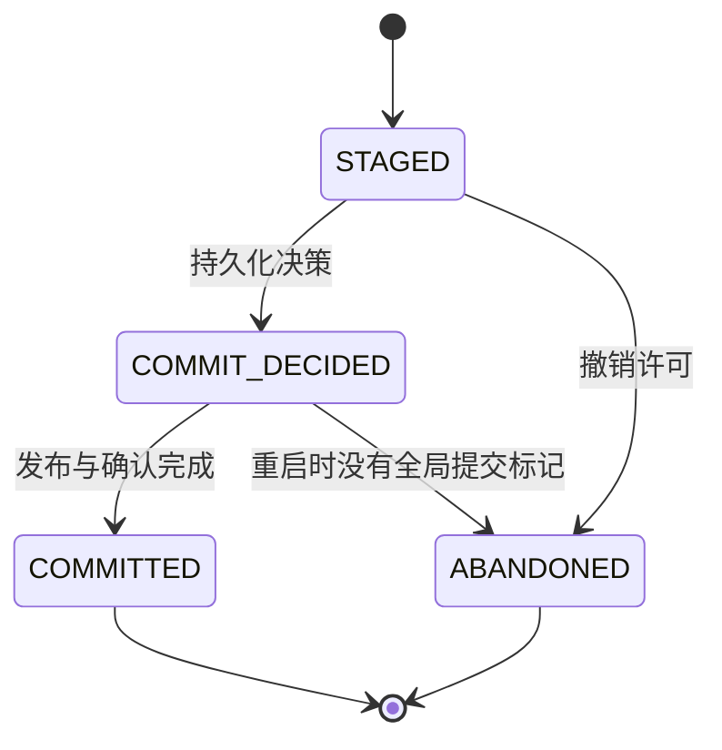
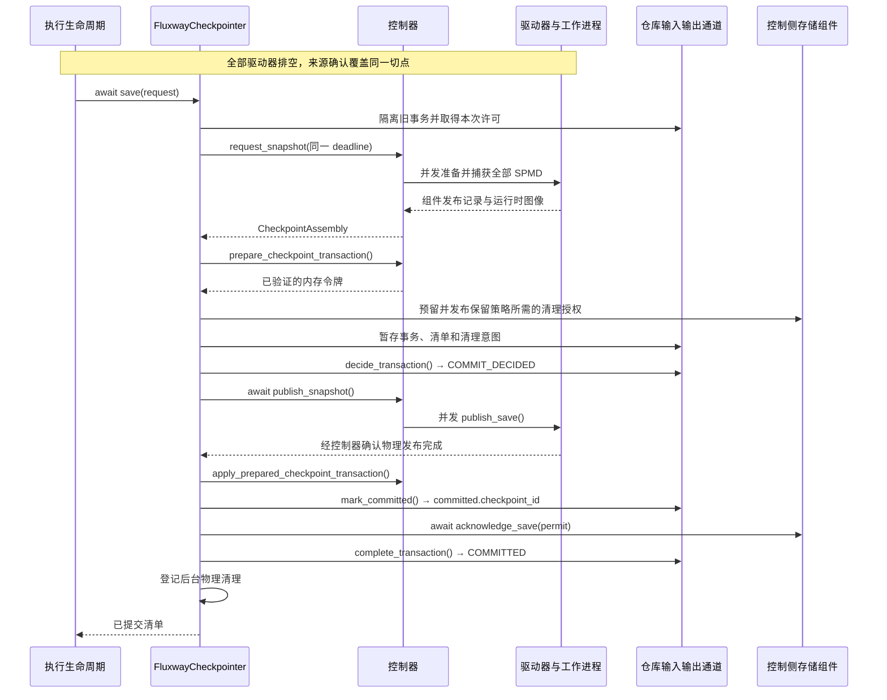
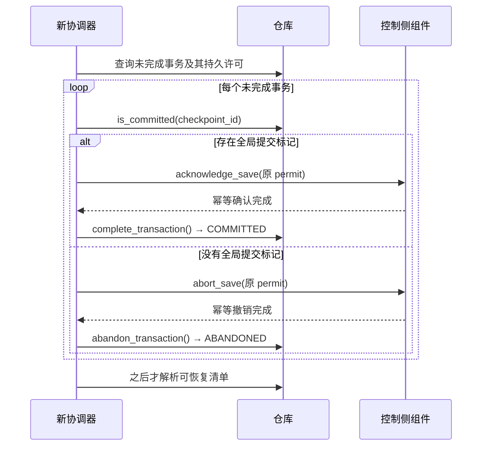
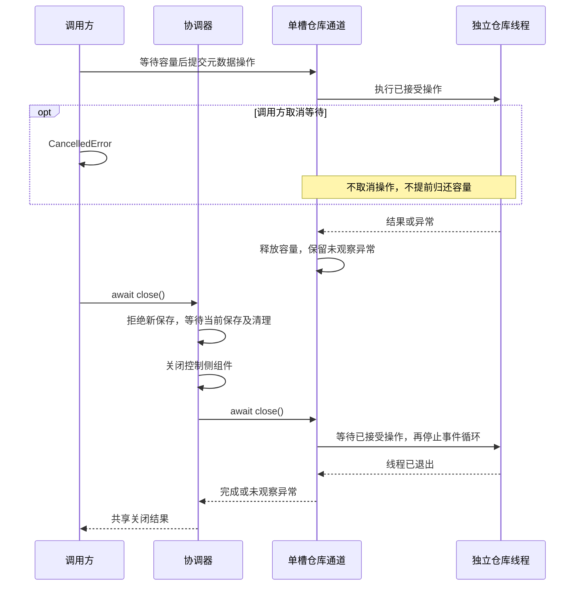
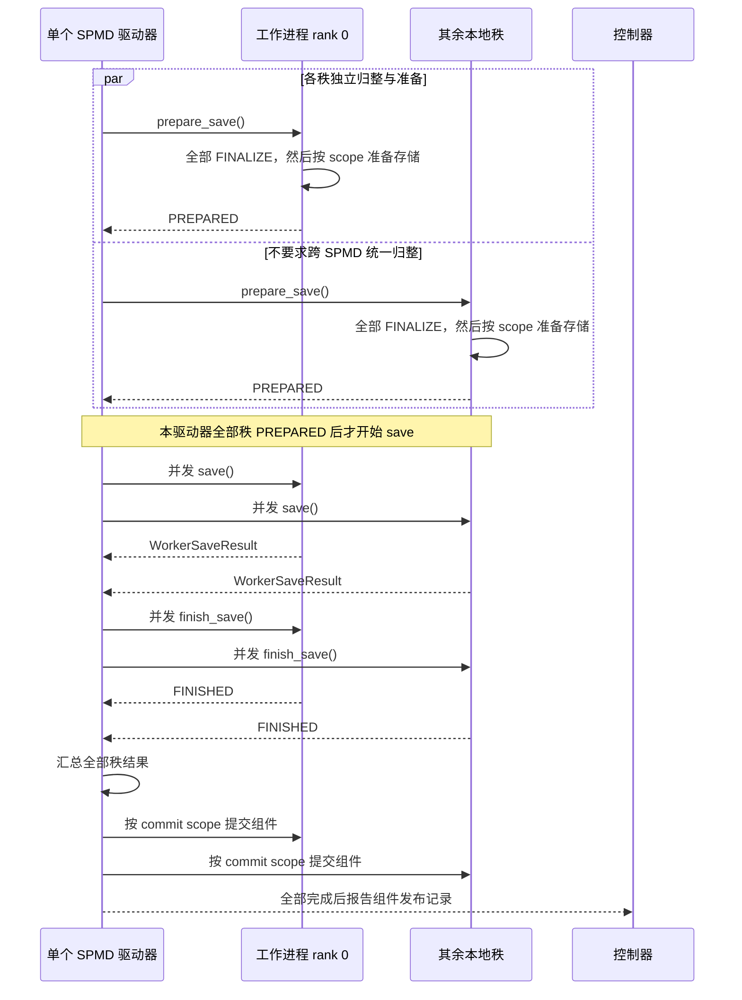
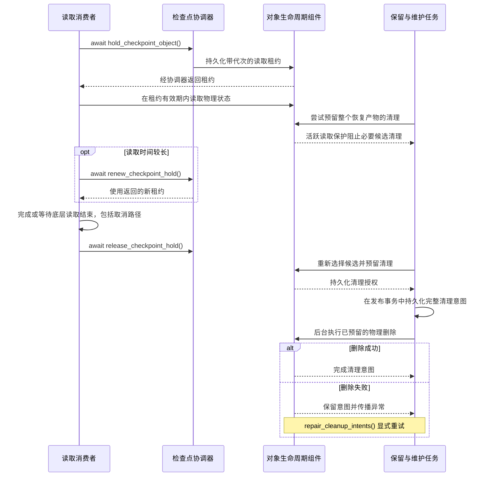
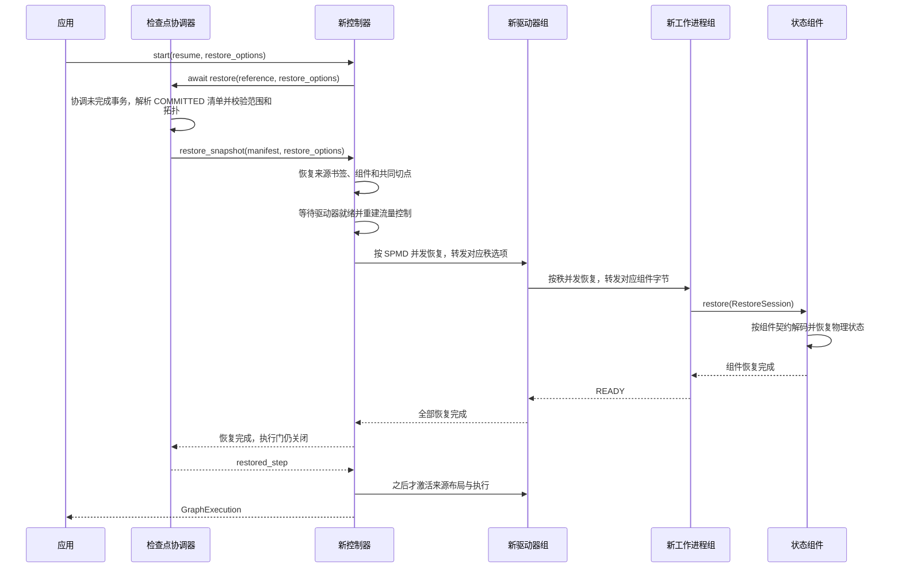

# 检查点与恢复

英文版见 [checkpoint.md](checkpoint.md)。

检查点在同一个已确认的进度边界保存来源位置、模型、优化器和必要算子状态。先在图中注册状态组件，再通过 `fluxway.start` 配置周期保存。启动、等待和清理示例见[执行生命周期](execution_lifecycle_zh.md#使用方式)。

Fluxway 决定事务、进度切点、引用和保留策略；各组件负责编码、存储、恢复映射和物理删除。能否改变拓扑恢复，由组件契约决定。

## 注册小状态组件

下面是完整的本地例子，将计数器状态注册到清单中。它不启动执行，也不写检查点。实际保存和恢复时，运行时会将算子拥有者和会话传入回调。

```python
import fluxway as fw
from fluxway.checkpoint import (
    register_checkpoint_component,
    state_checkpoint_component,
)
from fluxway.common.decorators import spmd


def restore_counter(owner, state, session):
    owner.seen = state["seen"]


counter_state = state_checkpoint_component(
    "counter",
    save=lambda owner, session: {"seen": owner.seen},
    restore=restore_counter,
)
registration = register_checkpoint_component(
    counter_state,
    component_lifecycle=counter_state,
    save=counter_state,
    restore=counter_state,
)


@spmd(
    resource_profile=fw.ResourceProfile(base={"CPU": 1}),
    mesh_axis_names=("data",),
    mesh_axis_shapes=(1,),
    checkpoint_components=(registration,),
)
class Counter:
    def __init__(self):
        self.seen = 0

    @fw.operator(
        name="advance", output_sharding={"value": {"type": "static", "axis": []}}
    )
    def advance(self) -> dict[str, int]:
        self.seen += 1
        return {"value": self.seen}


assert registration.descriptor.checkpoint_objects == ()
assert Counter.get_spmd_config().checkpoint_components == (registration,)
```

断言检查注册结果，并表明此组件没有物理检查点对象。小状态必须可由检查点元数据编码器表示，大状态应使用存储组件。默认恢复要求 `EXACT_TOPOLOGY`；需要弹性恢复的读取器必须明确实现逻辑位置映射，不能复制其他工作进程的游标。

## 仓库目录与编码

运行时打开配置中的仓库。新建根目录会写入 `CHECKPOINT_ROOT_MARKER`，已有且无标记的目录保持无标记。根目录必须是实体目录；已有标记必须是格式正确的普通文件，不能是符号链接。路径或标记不合法时抛出 `CheckpointDirectoryOwnershipError`。

下面的本地例子只创建和删除自己的临时仓库：

```python
from pathlib import Path
from tempfile import TemporaryDirectory

from fluxway.control_plane.checkpointer import (
    CHECKPOINT_ROOT_MARKER,
    CheckpointDirectory,
)

Path("tmp").mkdir(exist_ok=True)
with TemporaryDirectory(dir="tmp", prefix="checkpoint-example-") as temporary:
    root = Path(temporary) / "repository"
    CheckpointDirectory.open(root)
    assert (root / CHECKPOINT_ROOT_MARKER).is_file()
    CheckpointDirectory.clear(root)
    assert not root.exists()

    prepared = Path(temporary) / "application"
    prepared.mkdir()
    CheckpointDirectory.open(prepared)
    assert not (prepared / CHECKPOINT_ROOT_MARKER).exists()
```

`clear()` 要求有效的所有权标记，因此会拒绝删除上面无标记的 `application` 目录。打开已有目录不会接管它，也不会迁移其中的文件。

清单、事务、清理意图和引用通过 `msgpack_codec` 保存为二进制 MessagePack。来源封装和事务摘要使用 `fluxway.common.metadata`，用户二进制元数据保持二进制。当前 `CheckpointManifest` 数据类定义清单根字段，解码拒绝缺失或多余字段，不提供按发行版本迁移的兼容层。编码成功不能证明来源游标和已发布任务在同一切点提交。

## 进度与检查点身份

公开身份为：

```text
checkpoint_id -> component_id -> checkpoint_object_id
```

- `checkpoint_id` 选择一次完整的已发布检查点。
- `component_id` 标识状态拥有者，如 `dense` 或 `reader`。
- `checkpoint_object_id` 区分组件内的保存对象，单个物理状态对象通常使用 `"state"`。

`CheckpointCut.position` 是持久化边界，各 SPMD 投影将同一值保存为 `drain_boundary.committed_cut`，发布时拒绝不一致。读取记录、交错单元和优化器更新可能采用不同坐标，各组件负责将共同位置映射为自己的状态。

邮箱、一致性租约、就绪队列、物理布局、预取缓冲和信用观察属于瞬态状态。排空使边界静止，保存记录该边界，恢复在该位置创建新的运行时。保存租约或邮箱代次不能实现恢复。

### 按步骤和名称选择检查点

下面的本地例子只构造请求，不保存检查点：

```python
from fluxway.checkpoint import NameReference, SaveCheckpointRequest, StepReference

request = SaveCheckpointRequest.for_step(1200, names=("best_model",))
assert request.cut.position == 1200
assert StepReference(1200) in request.references
assert NameReference("best_model") in request.references
```

工厂为保存尝试和切点生成唯一标识。发布后，步骤和 `best_model` 名称选择同一个检查点；它们是查询引用，不是物理存储路径。

下面的函数用于控制器接入，不用于正在执行的算子。`save_best` 要求已经完成协调排空，并确认来源任务完整。`restore_best` 是另一条独立路径，要求新的执行尚未激活。通常由图运行时管理这些操作。

```python
from fluxway.checkpoint import SaveCheckpointRequest
from fluxway.control_plane.checkpointer import FluxwayCheckpointer


async def save_best(checkpointer: FluxwayCheckpointer, drained_step: int) -> str:
    manifest = await checkpointer.save(
        SaveCheckpointRequest.for_step(drained_step, names=("best_model",))
    )
    return manifest.checkpoint_id


async def restore_best(checkpointer: FluxwayCheckpointer) -> int | None:
    return await checkpointer.restore_named("best_model")
```

其他选择方式为 `restore_step(step)`、`restore_latest()` 或 `restore_checkpoint(id)`。不能在运行图上连续调用多个恢复方法。`latest()` 和 `list_steps()` 是异步查询。

没有步骤坐标的流式任务，由接入方提供来源书签和命名引用。下面的函数也只构造请求：

```python
from collections.abc import Mapping
from uuid import uuid4

from fluxway.checkpoint import NameReference, SaveCheckpointRequest
from fluxway.common.types.checkpoint import CheckpointCut


def stream_checkpoint_request(bookmarks: Mapping[str, bytes]) -> SaveCheckpointRequest:
    return SaveCheckpointRequest(
        attempt_id=uuid4().hex,
        cut=CheckpointCut(
            cut_id=uuid4().hex,
            position=None,
            stream_cuts=dict(bookmarks),
        ),
        references=(NameReference("stream-head"),),
    )
```

`StepReference` 要求存在位置且与其一致，名称可以选择非步骤检查点。来源拥有者定义书签含义，并将其与其他组件对齐。

## 全局发布事务

控制器和仓库使用持久化决策记录 `CheckpointTransactionState`，它与工作进程的 `CheckpointSaveState` 是两套不同状态。





图中同一 `deadline` 覆盖全部保存阶段，仓库调用按序等待。`COMMIT_DECIDED` 后的失败保留持久决策并传播异常，由后续隔离流程根据全局标记协调；不能直接当作未提交尝试撤销。

发布依次完成：

1. 捕获不可变状态，准备全部参与者。
2. 暂存清单与事务，持久化 `COMMIT_DECIDED`。
3. 发布工作进程产物，应用已准备的控制器令牌。
4. 写入全局标记 `committed.<checkpoint_id>`。
5. 确认组件保存，将记录完成为 `COMMITTED`。

准备阶段校验捕获状态，应用阶段只安装已验证的内存令牌，不重新序列化；存储和发布错误仍会传播。

提交决策前失败或超时，会撤销许可并将尝试改为 `ABANDONED`，暂存产物可留待后续清理。崩溃后，启动隔离检查全局标记：没有标记时调用组件的 `abort_save(permit)`；已有标记时，使用原持久化许可调用 `acknowledge_save(permit)`，完成至 `COMMITTED`。这两个控制方法必须幂等并传播异常，以便恢复重试。

只有 `COMMITTED` 记录可以恢复，并进入引用解析、最新记录和保留流程。一次全局快照使用同一个单调时钟截止时间，并行传给全部参与者；控制器接入必须接受该参数。



组件确认或撤销失败会阻止本次协调，异常继续传播；重复协调使用原持久许可。

### 仓库输入输出与关闭

控制器在自己的事件循环调用 `prepare_checkpoint_transaction` 和 `apply_prepared_checkpoint_transaction`。存储线程不能修改其账本，也不能唤醒其异步等待者。

每个检查点协调器持有 `CheckpointRepositorySession`，独占输入输出线程与事件循环。单个在途元数据槽位为目录打开、协调器代次申请、事务、查询与保留记录排序，不承载张量载荷，也不使用调用方的默认执行器。

内部接入通过 `await FluxwayCheckpointer.create(controller, repository_dir, interval_steps=...)` 创建协调器。应用使用 `CheckpointConfig`，由运行时管理它。

取消等待不会丢弃已接收的仓库操作，容量在操作结束时才释放。等待取消后发生的异常会保留，并在后续操作或关闭时报告。

`close()` 拒绝新保存，等待当前保存与清理结束，关闭组件，最后停止并等待仓库线程。重复关闭观察同一结果，取消其中一个等待者不会取消清理。这隔离的是调度容量，不保证存储延迟，也不能消除 Python 的 GIL 竞争。



容量等待尚未提交操作；只有已接受操作受取消保护。重复关闭共享结果，取消一个关闭等待者不会中断清理。

## 组件能力

本文使用 `fluxway.checkpoint` 中的编写辅助函数和会话类型。内置存储组件位于 `fluxway.control_plane.checkpointer`，完整扩展接口位于其 `component` 模块。

| 能力 | 接口 | 职责 |
| --- | --- | --- |
| 描述符 | `CheckpointComponent` | 声明身份、保存对象与拓扑 |
| `COMPONENT_LIFECYCLE` | `CheckpointComponentLifecycle` | 打开与关闭 |
| `FINALIZE` | `CheckpointComponentFinalize` | 在存储准备前完成内存状态归整 |
| `SAVE` | `CheckpointComponentSave` | 完整保存事务，含发布、放弃和确认 |
| `RESTORE` | `CheckpointComponentRestore` | 应用选中的组件发布记录 |
| `OBJECT_LIFECYCLE` | `CheckpointObjectLifecycle` | 读取保护与持久化清理预留 |
| `OBJECT_CLEANUP` | `CheckpointObjectCleanup` | 执行已预留的物理清理 |

注册对象中非空的接口字段决定能力。计数器例子通过 `register_checkpoint_component` 显式注册，内置组件提供 `registration()`。描述符声明的保存或恢复能力与实现不符时直接报错。

`SAVE` 是完整契约，不能独立选择其中部分阶段：

```text
FINALIZING -> FINALIZE 回调 -> SAVE.prepare -> PREPARED
           -> SAVE.save -> SAVE.finish -> SAVE.commit -> SAVE.publish
```

驱动器等本地全部秩到达 `PREPARED` 后才开始保存，不存在控制器范围的统一内存归整阶段。



各工作进程内部按组件顺序执行回调，跨秩调用保持并发；`LEADER` 准备或提交仅在主秩执行，但每秩都要执行已注册的归整回调。之后仍需全局发布事务，组件提交不代表全局可恢复。

### 先归整内存，再预留存储

`finalize_save` 在每个秩执行，即使存储准备或提交只在主秩执行。它将已排空的算法状态整理为可保存状态，不做存储输入输出。失败会停止执行，因为本地状态可能已经改变。`prepare_save` 负责预留暂存路径或存储租约，可回滚。

下面的本地注册例子在捕获前合并缓冲计数。训练接入可以按相同契约提供自己的部分梯度累积处理函数。

```python
from dataclasses import dataclass

from fluxway.control_plane.checkpointer import StateCheckpointComponent


@dataclass
class BufferedCounter:
    committed: int = 0
    pending: int = 0


def finalize_counter(owner, session):
    owner.committed += owner.pending
    owner.pending = 0


def restore_counter(owner, state, session):
    owner.committed = state["committed"]
    owner.pending = 0


counter = StateCheckpointComponent(
    "buffered-counter",
    save_state=lambda owner, session: {"committed": owner.committed},
    restore_state=restore_counter,
    finalize_state=finalize_counter,
)
registration = counter.registration()
assert registration.finalize is counter
```

使用此注册的算子拥有者需具有 `BufferedCounter` 中的字段。例子只检查注册能力，不执行协调保存。

### 选择存储组件

| 状态 | 组件 | 恢复拓扑 |
| --- | --- | --- |
| 清单内的小元数据 | `state_checkpoint_component` | 默认 `EXACT_TOPOLOGY` |
| 工作进程内的可信 Python 状态 | `WorkerLocalCheckpointComponent` | `EXACT_TOPOLOGY` |
| SafeTensors 张量状态 | `SafeTensorsCheckpointComponent` | `EXACT_TOPOLOGY` |
| JAX 集体共享嵌套状态 | `OrbaxCheckpointComponent` | `GLOBAL_RESHARD` |
| 原生稀疏表 | `SparseEmbeddingCheckpointComponent` | `LOGICAL_PARTITION_REMAP` |

下面的本地注册例子要求算子拥有者具有 `cursor` 属性：

```python
from fluxway.common.types.checkpoint import RestoreTopologyMode
from fluxway.control_plane.checkpointer import WorkerLocalCheckpointComponent


def restore_local(owner, state, session):
    owner.cursor = state["cursor"]


local = WorkerLocalCheckpointComponent(
    "worker-local",
    save_state=lambda owner, session: {"cursor": owner.cursor},
    restore_state=restore_local,
)
registration = local.registration()

assert registration.descriptor.restore.topology is RestoreTopologyMode.EXACT_TOPOLOGY
assert registration.object_lifecycle is local
assert registration.object_cleanup is local
```

内置组件提供读取保护和清理能力。工作进程本地状态使用 Python 的 `pickle` 格式，只应读取可信仓库。读取游标、随机数状态或本地指标不能自动复制到不同拓扑。

使用 JAX 状态时安装 `fluxway[jax]`。下面的注册要求 `owner.training` 是由 JAX 数组组成的嵌套状态，包含继续训练所需的全部模型与优化器值。布局回调描述当前目标形状、数据类型和分片。

```python
import jax
import jax.numpy as jnp

from fluxway.common.types.checkpoint import RestoreTopologyMode
from fluxway.control_plane.checkpointer import OrbaxCheckpointComponent


def target_layout(state):
    return jax.tree_util.tree_map(
        lambda value: jax.ShapeDtypeStruct(
            value.shape, value.dtype, sharding=value.sharding
        ),
        state,
    )


def restore_training(owner, state, session):
    owner.training = state


dense = OrbaxCheckpointComponent(
    "dense",
    save_state=lambda owner, session: owner.training,
    restore_state=restore_training,
    restore_layout=lambda owner, session: target_layout(owner.training),
)
registration = dense.registration()
training = {
    "model_state": {"weight": jnp.ones((2,), dtype=jnp.float32)},
    "optimizer_state": {"moment": jnp.zeros((2,), dtype=jnp.float32)},
}
layout = target_layout(training)

assert layout["model_state"]["weight"].shape == (2,)
assert registration.descriptor.restore.topology is RestoreTopologyMode.GLOBAL_RESHARD
```

此例构造注册并检查目标形状，实际输入输出由运行时执行。Orbax 使用 `ocp.args.StandardSave` 和集体共享记录。多秩 SPMD 要求每秩对应一个已初始化 JAX 进程，进程组缺失或不匹配时在准备阶段报错；单秩使用单进程输入输出。私有状态应另注册为工作进程本地组件。

### 不透明存储对象与提交授权

存储接入在保存阶段收到 `SaveSession`，提交时收到 `CommitSaveSession`，后者增加全部秩的 `WorkerSaveResult`。恢复会话 `RestoreSession` 携带保存时和当前拓扑，以及选中的组件发布记录。

下面的接入辅助函数接收运行时提供的会话，以及存储拥有者提供的字节：

```python
from fluxway.checkpoint import (
    CheckpointComponentPublication,
    CommitAuthority,
    CommitSaveSession,
    SaveSession,
    WorkerSaveResult,
)


def storage_authority(session: SaveSession, scope: str) -> CommitAuthority:
    return session.commit_authority(scope)


def saved_fragment(session: SaveSession, fragment: bytes) -> WorkerSaveResult:
    return session.worker_save_result(fragment)


def committed_object(
    session: CommitSaveSession, object_id: str, version_id: str, locator: bytes
) -> CheckpointComponentPublication:
    state = session.checkpoint_object_ref(object_id, version_id, locator)
    return session.component_checkpoint((state,))
```

存储拥有者为自己的提交或比较交换协议选择 `scope`，并提供描述符中已声明的 `object_id`，然后使用返回的授权。存储提交成功后才能调用 `committed_object`。`version_id` 标识逻辑对象版本，`locator` 用拥有者定义的二进制格式定位物理状态。Fluxway 原样传递定位信息，不解码其格式。

一个逻辑对象版本可以包含多个物理分区，由 `partition_key` 区分。分区由存储组件定义，Fluxway 不根据分区名称推导弹性恢复。

保存请求的 `attempt_id`、发布后的 `checkpoint_id` 和提交许可 `CheckpointCommitPermit` 各有用途。协调器代次使接管前的旧许可失效。许可撤销后，延迟决策无法修改仓库，会抛出 `PermissionError`。许可令牌不写入清单，恢复和关闭也不需要许可。应用不能自行伪造提交许可。

## 保留策略与读取保护

在 `CheckpointConfig` 配置保留策略，不在单个对象描述符上配置：

```python
from fluxway.checkpoint import CheckpointRetentionPolicy
from fluxway.common.types import CheckpointConfig

config = CheckpointConfig(
    repository_dir="checkpoints/training",
    interval_steps=100,
    retention_policy=CheckpointRetentionPolicy(retain_last=3),
)
assert config.retention_policy.retain_last == 3
```

此例每隔 100 步请求保存，保留最近三个符合条件的完整恢复产物。`retention_domains` 可按组件所属域选择策略，但同一恢复产物的必要对象不能各自淘汰。有限保留策略要求物理对象组件提供清理能力，缺少能力时注册失败。

组件只能依据 Fluxway 的持久化清理预留删除保存对象；物理状态应注册对象生命周期和清理实现。不能同时启用 Orbax `CheckpointManager` 等独立历史删除器，因为它无法协调清单、其他组件和活跃读取保护。

读取保护在其他消费者读取时保留一个有效对象。下面的内部接入函数接收已发布对象引用，以及存储专用的异步读取函数：

```python
from collections.abc import Awaitable, Callable

from fluxway.checkpoint import CheckpointObjectRef
from fluxway.control_plane.checkpointer import FluxwayCheckpointer


async def read_protected(
    checkpointer: FluxwayCheckpointer,
    spmd_id: str,
    checkpoint_object: CheckpointObjectRef,
    consumer_id: str,
    request_id: str,
    ttl_seconds: float,
    read: Callable[[CheckpointObjectRef], Awaitable[bytes]],
) -> bytes:
    lease = await checkpointer.hold_checkpoint_object(
        spmd_id, checkpoint_object, consumer_id, ttl_seconds, request_id
    )
    try:
        return await read(checkpoint_object)
    finally:
        await checkpointer.release_checkpoint_hold(spmd_id, lease)
```

读取回调返回或抛出异常前，必须结束或等待底层读取完成，取消时也一样。读取必须在租约有效期内完成。长时间读取需调用 `renew_checkpoint_hold(spmd_id, lease, ttl_seconds)` 续期，并使用返回的新租约。保护记录持久化并检查代次，属于共享读取保护，不是互斥锁。



名称引用也会保护检查点。候选受保护时发布可能抛出 `CheckpointCleanupBlocked`；图中再次选择候选表示后续操作，不表示自动绕过保护。

`best_model` 等名称在移动到新检查点前保护当前选中记录。清理候选按检查点序号排序；必要候选仍有读取保护时，发布抛出 `CheckpointCleanupBlocked`。物理清理失败会留下持久化的 `CheckpointCleanupIntent`，由 `repair_cleanup_intents()` 重试并传播错误。一条意图包含删除一个完整恢复产物所需的全部预留，清理在控制维护通道执行。

## 拓扑

恢复范围决定选择哪些已保存 SPMD，拓扑模式决定每个组件如何映射状态，两者不能互相代替。

| 模式 | 要求 |
| --- | --- |
| `EXACT_TOPOLOGY` | 秩数量、网格轴名称和网格形状一致 |
| `LOGICAL_PARTITION_REMAP` | 由组件映射规范逻辑分区 |
| `GLOBAL_RESHARD` | 将集体共享状态恢复到当前布局 |

清单记录来源拓扑，恢复同时传入已保存和当前拓扑。Fluxway 不根据物理秩猜测分区函数。

下面的本地配置选择已保存的 `training` 状态，并绑定到 `evaluation`。它本身不授权改变拓扑：

```python
from fluxway.common.types import CheckpointConfig

config = CheckpointConfig(
    repository_dir="checkpoints/training",
    interval_steps=100,
    restore_scope=("training",),
    restore_spmd_bindings={"training": "evaluation"},
)
assert config.restore_spmd_bindings["training"] == "evaluation"
```

组件专用恢复计划经 `restore_options` 传递，结构为 `SPMD 标识 -> 当前秩 -> 组件标识 -> 非空字节`。组件拥有者编码这些字节，Fluxway 校验映射结构并原样传递，不解码其格式。

下面的接入函数要求编译图、已初始化的 Ray、放置配方，以及针对目标工作进程生成的恢复选项：

```python
import fluxway
from fluxway.common.types import CheckpointConfig, Graph
from fluxway.common.types.checkpoint import RestoreOptions
from fluxway.placement import PlacementRecipe


async def resume_training(
    graph: Graph,
    recipe: PlacementRecipe,
    repository_dir: str,
    options: RestoreOptions,
) -> fluxway.GraphExecution:
    return await fluxway.start(
        graph,
        placement_recipe=recipe,
        checkpoint_config=CheckpointConfig(
            repository_dir=repository_dir,
            interval_steps=100,
        ),
        resume="latest",
        restore_options=options,
    )
```

调用方持有返回的执行对象，需按[执行生命周期](execution_lifecycle_zh.md#使用方式)等待或取消。恢复选项必须伴随恢复请求；未知 SPMD 或工作进程秩会报错，不会被跳过。



图示为选中检查点的路径；空仓库的 `latest` 返回 `None`。组件选项在通用层保持不透明；缺失所需选项、未知目标或恢复失败均直接报错，执行准入保持关闭。

### 稀疏训练状态

可选的 `fluxway[recommendation]` 集成依赖原生 `sparse_embedding` 包及其存储依赖。下面的注册将嵌入值和优化器状态一起恢复：

```python
from fluxway.integrations.sparse_embedding.checkpoint import (
    LocalLanceStorageFactory,
    SparseEmbeddingCheckpointComponent,
)

embedding_checkpoint = SparseEmbeddingCheckpointComponent(
    LocalLanceStorageFactory(),
    load_optimizer_state=True,
).registration()
```

通过 `@spmd(checkpoint_components=(embedding_checkpoint,))` 传入注册对象。算子拥有者的 `store` 属性提供原生表。`load_optimizer_state=True` 要求目标表启用优化器；推理使用权重快照和禁用优化器的表。恢复结果应按逻辑键和维度比较，物理页号与槽位可能改变。

`LocalLanceStorageFactory` 支持本地或共享 POSIX 存储，`GravitinoLanceStorageFactory` 接收应用提供的运行时目录设置。训练之外可通过 `compact_sparse_checkpoints(repository_root, spmd_id, lineage_name=...)` 合并片段。原生存储拥有者定义稀疏分区计划、谱系和恢复。凭据通过运行时配置传入。

## 来源恢复边界

`SourceWorkKey(epoch, step, assignment_id)` 标识逻辑任务，物理分段使用独立区间租约。确认只推进连续、完整确认的步骤，只有协调检查点推进已提交位置。新的租约会隔离旧执行的延迟确认。

来源组件必须能在共同持久化位置重建输出。目标区间为 `Committed = [0, position)` 和 `Replay = [position, ...)`；记录或交错单元到位置的映射仍由来源拥有者定义。来源账本检查不能单独证明模型与优化器的崩溃恢复。

保存共同切点上的消费书签、来源绑定、逻辑进度，以及重现后续输出所需的全部有状态算子。恢复校验绑定和逻辑批大小，按当前窗口限制与读取拓扑重新规划，再启动新的工作进程。旧窗口摘要、领先水位、预取缓冲、租约、确认缓存和物理绑定均重建，驱动器激活检查点状态为空。

控制器先安装书签和共同切点，再发布新规划分段。拓扑就绪先于恢复，显式执行激活在恢复之后；来源布局安装与每个切点的准入是不同授权。控制器的 `SourceProgressSupervisor` 负责扫描和补窗。可运行来源示例及本地证据限制见[来源协调](source_coordination_zh.md)和[来源任务协议](source_spmd_formal_protocol_zh.md)。
