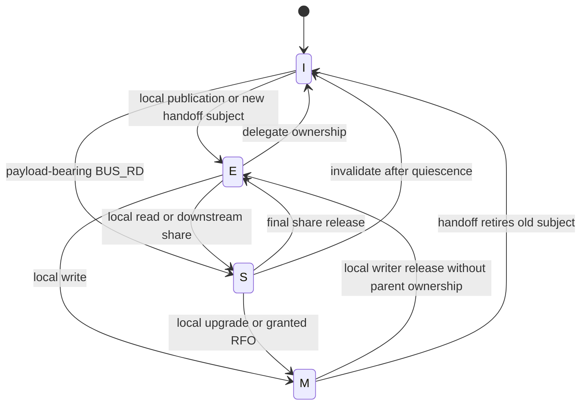
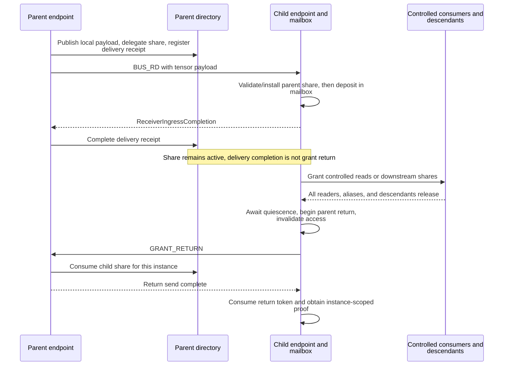
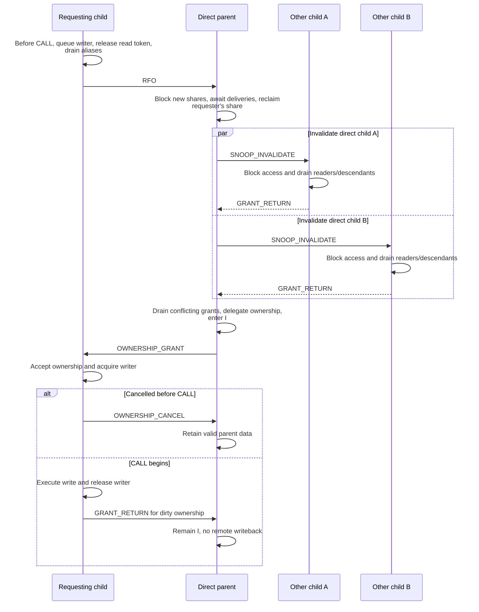
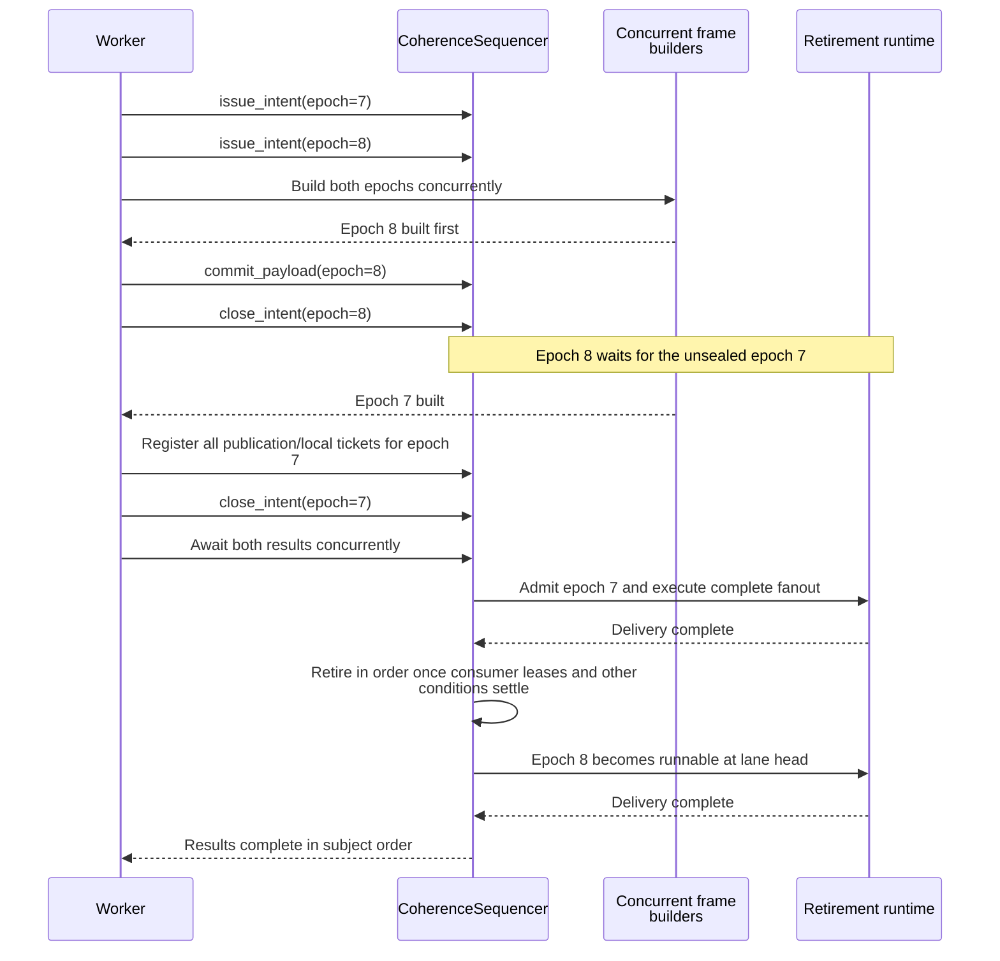
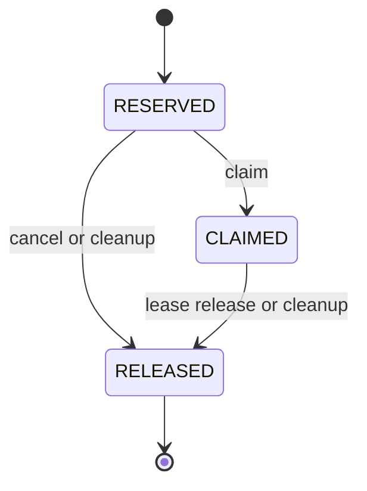
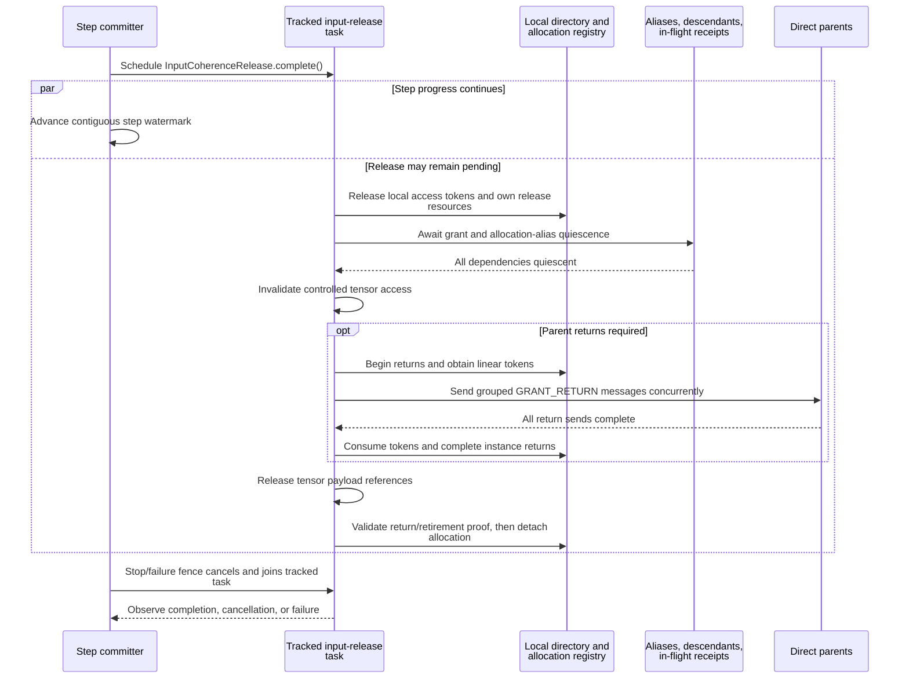

# Endpoint-local coherence protocol

[Chinese edition](coherence_protocol_zh.md)

Fluxway uses MESI states to control access to tensor storage. This is a software
authority protocol, not hardware cache coherence for Python or accelerator memory.
Application operators declare `readonly`, `writable` or `donate` access; the Worker
executes the protocol. The directory and sequencer examples below are isolated
runtime examples, not APIs for application code to bypass Worker ownership.

## Identity and state owners

```text
Subject           = (owner_spmd_code, owner_rank, logical_tuuid)
CoherenceInstance = (Subject, epoch)
route_code        -> compiled direct edge and logical_tuuid
child_slot        <-> direct-child endpoint for that logical tensor
```

`CompiledTensorTransfer` supplies the logical tensor identity and route.
`CompiledSendPlan.coherence_instance()` binds them to the physical sender and
epoch. A route code is not a tensor identity. `source_step` is sample provenance;
`FRAME_STEP` is scheduling metadata; `ENTRY_AUX` projects the bound instance's
epoch onto the wire. Neither step field creates or advances directory authority.

Each endpoint owns a `CoherenceDirectory` keyed by the complete
`CoherenceInstance`. Different epochs have separate entries and may coexist.
`admit()` validates an instance and creates an invalid entry if absent; it does
not wait for or overwrite another epoch. Currently `can_admit()` validates and
returns `True`. The sequencer owns increasing intent order and ordered retirement.

This local example shows why admitting a later epoch does not revoke old grants:

```python
from fluxway.common.coherence import (
    CoherenceDirectory,
    CoherenceInstance,
    CoherenceState,
    CoherenceSubject,
    GrantReady,
)

directory = CoherenceDirectory()
subject = CoherenceSubject(owner_spmd_code=1, owner_rank=2, logical_tuuid=41)
old = CoherenceInstance(subject, epoch=7)
new = CoherenceInstance(subject, epoch=8)
directory.publish_local_payload(subject, old.epoch)
grant = directory.delegate_read(subject, old.epoch, child_id=0)
assert isinstance(grant, GrantReady)
assert directory.can_admit(new)
assert directory.admit(new).state is CoherenceState.INVALID
assert directory.admit(old).child_share_bitmap == 1
directory.return_child(subject, old.epoch, child_id=0)
assert directory.is_quiescent(old)
```

Production identities must come from the compiled graph, not the example's
literal test identifiers. Internal integration can inspect a binding as follows:

```python
from fluxway.common.coherence import CoherenceInstance
from fluxway.spmd.worker.data_plane import CompiledSendPlan


def bound_instance(
    plan: CompiledSendPlan, transfer_code: int, epoch: int
) -> CoherenceInstance:
    return plan.coherence_instance(transfer_code, epoch)
```

Child slots are assigned by sorting the finite `(target_spmd_id, target_rank)`
endpoint set for each logical tensor. The mapping is bijective; graph projections
do not renumber existing slots. There is no global directory, sibling-holder list,
cross-level broadcast or second mutable epoch counter.

## States and invariants

| State | Meaning |
| --- | --- |
| `M` | This endpoint has the sole write authority; bytes may have changed. |
| `E` | This endpoint is the sole valid holder and has not started modification. |
| `S` | A parent share, controlled local reader or direct-child share is active. |
| `I` | This endpoint has no valid accessible payload for this instance. |

An entry records its epoch, state, parent authority and return transaction,
local read/write grants, ownership child, child bitmap, delivery receipts,
pending requests and allocation binding. The protocol preserves:

```text
I1 writer != NONE
   => readers = 0 and ownership_child = NONE and child_bitmap = 0
I2 ownership_child != NONE
   => writer = NONE and readers = 0 and child_bitmap = 0 and mesi = I
I3 delegated write authority => direct parent is I
I4 mesi = I => no read/write/shared grant without explicit payload publication
I5 local retirement => no reader, writer, ownership child, child bit,
                       inflight delivery or live pending request
I6 issued intents for one subject have strictly increasing epochs
I7 delivery_committed and return_pending are subsets of child_bitmap;
   delivery_inflight(child) > 0 => child is in child_bitmap
I8 each read/write/delivery/parent-return token is consumed exactly once
```

I5 describes instance-local quiescence. Returning a parent grant additionally
requires stable parent authority and no active return transaction; final input
release consumes the completed return proof or checks instance retirement before
detaching the allocation. It must not infer payload lifetime from local quiescence.
I6 is enforced by `CoherenceSequencer.issue_intent()`, which raises
`CoherenceStateTransitionError` on duplicate or decreasing epochs. Directory
admission alone does not reject an older independent instance.

Only explicit local publication, a payload-bearing `BUS_RD`, or a valid storage
handoff establishes accessible bytes. Creating an entry leaves it in `I`.



Each arrow requires the conditions below; the diagram is not a shortcut around
grant validation. A child holding parent ownership remains `M` after releasing
its writer until ownership is returned.

| Event | Preconditions | Result |
| --- | --- | --- |
| `PublishLocal` | `I`, no parent authority, locally quiescent | `E` |
| `PrRd` | Valid data, not revoking, no ownership child or active/pending writer | Read token; `E` becomes `S` |
| `PrWr` | Valid data, local/child shares and deliveries drained, parent not shared | Write token; `M` |
| `TxBusRd` | `E`/`S`, or explicit local publication; no writer, ownership child, revocation or pending writer | Set child bit; `S` |
| `RxBusRd` | No conflicting authority, writer, ownership child or active share | Parent authority `SHARED`; `S` |
| `BeginGrantReturn` | Parent authority `SHARED`/`OWNERSHIP`, locally quiescent | Return token; authority `NONE`; `I` |
| `CompleteGrantReturn` | Matching active return token | Consume token and clear its transaction |
| `TxOwnershipGrant` | Valid write token, no local/child shares or deliveries | Set ownership child; `I` |
| `RxOwnershipGrant` | Parent authority `SHARED`, no local/child shares or ownership child | Parent authority `OWNERSHIP` |
| `TxOwnershipCancel` | Parent authority `OWNERSHIP`, no local writer, before `CALL` | Authority `NONE`; `I` |
| `RxSnoopInval` | Not revoking, no ownership authority, `M`, writer or ownership child | Mark revoking |
| `AckSnoopInval` | Revoking, local/child shares and ownership drained | `I` |

## Wait for local access

The directory changes synchronous protocol state. A blocked request returns
`GrantPending(request_id, ...)`; `CoherenceAdmissionRuntime` waits on directory
progress events and returns the eventual token. It suspends the requesting
coroutine without blocking the actor thread or holding a directory lock.

```python
import asyncio
from fluxway.common.coherence import (
    CoherenceDirectory,
    CoherenceInstance,
    CoherenceState,
    CoherenceSubject,
    ExecutionToken,
    GrantPending,
    GrantReady,
)
from fluxway.spmd.worker.coherence_runtime import CoherenceAdmissionRuntime


async def local_write_after_read() -> None:
    directory = CoherenceDirectory()
    subject = CoherenceSubject(1, 0, 41)
    instance = CoherenceInstance(subject, 7)
    directory.publish_local_payload(subject, 7)
    reader = directory.request_read(subject, 7, ExecutionToken(1))
    assert isinstance(reader, GrantReady)
    writer = directory.request_write(subject, 7, ExecutionToken(2))
    assert isinstance(writer, GrantPending)
    directory.release(reader.token)
    token = await CoherenceAdmissionRuntime(directory).await_grant(writer)
    assert directory.admit(instance).state is CoherenceState.MODIFIED
    directory.release(token)
    assert directory.admit(instance).state is CoherenceState.EXCLUSIVE


asyncio.run(local_write_after_read())
```

Pending writers block later readers to prevent starvation. Cancelling a waiter
removes its pending request. Invalid requests return `GrantRejected`; callers
raise its error. Duplicate token release raises and cannot consume another grant.
OS threads submit intents to the Worker event loop; they never mutate the
directory directly. The Python interpreter lock is not a coherence primitive.

## Shared delivery and return

`BUS_RD` follows this order: publish locally, register the child share and
delivery receipt, send payload, validate and install the receiver share, then
deposit into the mailbox. Acceptance ends delivery, not the grant. The child
returns only after its operator, aliases and descendants finish.

The following two-directory example simulates successful transport synchronously:

```python
from fluxway.common.coherence import (
    CoherenceDirectory,
    CoherenceInstance,
    CoherenceState,
    CoherenceSubject,
    ExecutionToken,
    GrantReady,
)

parent, child = CoherenceDirectory(), CoherenceDirectory()
subject = CoherenceSubject(1, 0, 41)
instance = CoherenceInstance(subject, 7)
parent.publish_local_payload(subject, 7)
delegated = parent.delegate_read(subject, 7, child_id=0)
assert isinstance(delegated, GrantReady)
receipt = parent.register_child_delivery(delegated.token)
child.accept_parent_read(subject, 7)
parent.complete_child_delivery(receipt, delivered=True)
reader = child.request_read(subject, 7, ExecutionToken(1))
assert isinstance(reader, GrantReady)
child.release(reader.token)
returned = child.begin_parent_return(subject, 7)
assert child.admit(instance).state is CoherenceState.INVALID
parent.return_child(subject, 7, child_id=0)
child.complete_parent_return(returned)
assert parent.admit(instance).state is CoherenceState.EXCLUSIVE
assert parent.is_quiescent(instance)
```

On delivery failure, only the new delegation for that delivery is removed.
If a return overtakes an inflight delivery, the parent marks it pending. Failure
clears the share; success cancels the early return because the accepted grant
must later return again. If invalidation crosses an outbound return for the
same instance, the child coalesces it with that transaction rather than sending
a second return. A same-epoch regrant clears the previous return tombstone.

`return_transaction` is transient state, not another parent authority or MESI
state. Beginning return removes stable authority and invalidates access while
retaining a linear transaction token. Completion produces an instance-scoped
proof; another epoch's activity cannot stand in for that proof.



This is the normal ordering. If return overlaps an in-flight delivery, the directory
reconciles that instance; quiescence in another epoch cannot substitute for its return
proof.

## Exclusive ownership, invalidation and cancellation

Only an existing current sharer can request ownership through `RFO`. Before
`CALL`, the child queues a writer, releases its execution read token and drains
local aliases and descendants. The parent blocks new shares, awaits delivery,
and invalidates its other direct children concurrently. After all shares drain,
it becomes `I` and sends `OWNERSHIP_GRANT`. The child accepts ownership, acquires
its writer and resumes `CALL`.

This isolated example starts after shares have drained and the parent has
validated the requester. It shows a clean cancellation followed by dirty return:

```python
from fluxway.common.coherence import (
    CoherenceDirectory,
    CoherenceInstance,
    CoherenceState,
    CoherenceSubject,
    ExecutionToken,
    GrantReady,
)

parent, child = CoherenceDirectory(), CoherenceDirectory()
subject = CoherenceSubject(1, 0, 41)
instance = CoherenceInstance(subject, 7)
parent.publish_local_payload(subject, 7)
child.accept_parent_read(subject, 7)
writer = parent.request_write(subject, 7, ExecutionToken(1))
assert isinstance(writer, GrantReady)
parent.delegate_ownership(writer.token, child_id=0)
child.accept_parent_ownership(subject, 7)
child.cancel_parent_ownership(subject, 7)
parent.return_ownership_child(subject, 7, child_id=0, data_valid=True)
assert parent.admit(instance).state is CoherenceState.EXCLUSIVE

child.accept_parent_read(subject, 7)
writer = parent.request_write(subject, 7, ExecutionToken(2))
assert isinstance(writer, GrantReady)
parent.delegate_ownership(writer.token, child_id=0)
child.accept_parent_ownership(subject, 7)
child_writer = child.request_write(subject, 7, ExecutionToken(3))
assert isinstance(child_writer, GrantReady)
child.release(child_writer.token)
returned = child.begin_parent_return(subject, 7)
parent.return_ownership_child(subject, 7, child_id=0, data_valid=False)
child.complete_parent_return(returned)
assert parent.admit(instance).state is CoherenceState.INVALID
```

`SNOOP_INVALIDATE` first blocks new access, then drains controlled readers and
direct descendants before invalidating access and returning once. `M` cannot
satisfy shared invalidation. `OWNERSHIP_CANCEL` is valid only before `CALL`;
after `CALL` starts, failure fences the run because modified bytes cannot be
assumed clean. A dirty ownership return always leaves the parent `I`.



The compiled graph determines the child set. Failure after `CALL` starts fences
execution and cannot use the clean cancellation path.

## Sequence publications and leases

`CoherenceSequencer` is the only asynchronous reorder buffer. Intent issuance
is increasing per subject, while frame construction may finish out of order.
`commit_payload()` registers its ticket synchronously and returns a coroutine.
Register every publication and local-only ticket before `close_intent()`, then
await completion. A sealed ticket at every lane head can run inline; blocked
tickets suspend. Independent subjects can progress concurrently.

```python
import asyncio
from fluxway.common.coherence import (
    CoherenceDirectory,
    CoherenceInstance,
    CoherenceSubject,
)
from fluxway.spmd.worker.coherence_runtime import CoherenceAdmissionRuntime
from fluxway.spmd.worker.coherence_sequencer import CoherenceSequencer


async def ordered_publications() -> None:
    directory = CoherenceDirectory()
    retired = []

    async def retire(instances, value):
        retired.append((instances[0].epoch, value))
        return value

    sequencer = CoherenceSequencer(retire, CoherenceAdmissionRuntime(directory).admit)
    subject = CoherenceSubject(1, 0, 41)
    first, second = CoherenceInstance(subject, 7), CoherenceInstance(subject, 8)
    sequencer.issue_intent(first)
    sequencer.issue_intent(second)
    second_result = sequencer.commit_payload((second,), "second")
    first_result = sequencer.commit_payload((first,), "first")
    sequencer.close_intent(first)
    sequencer.close_intent(second)
    assert await asyncio.gather(first_result, second_result) == ["first", "second"]
    assert retired == [(7, "first"), (8, "second")]


asyncio.run(ordered_publications())
```



This diagram uses one subject; independent subjects can overlap. Register and seal
before awaiting results. Do not wait for retirement before registering another ticket
for the same intent.

One publication ticket owns the complete child fanout. The retirement runtime
starts all enqueues concurrently, validates carrier acceptance and producer
retention release, and completes every child receipt through one owner. One
failure cancels unfinished siblings and propagates. See the publication and
lifetime examples in [data-plane runtime](dataplane_runtime.md).

At the sealed drain boundary, a cross-subject dependency cycle fences all
waiting tickets. An unsealed predecessor is ordinary construction backpressure;
the ready path does not rebuild a global dependency graph.

A `ConsumerLeaseReservationRef` is a non-owning reference. The sequencer owns
reservation state and the active-count binding:



The following isolated example reserves while a payload is delivering, claims
the lease, and releases it before allowing retirement:

```python
import asyncio
from fluxway.common.coherence import (
    CoherenceDirectory,
    CoherenceInstance,
    CoherenceSubject,
)
from fluxway.spmd.worker.coherence_runtime import CoherenceAdmissionRuntime
from fluxway.spmd.worker.coherence_sequencer import CoherenceSequencer


async def reserved_consumer() -> None:
    directory = CoherenceDirectory()
    reserved = asyncio.get_running_loop().create_future()
    finished = asyncio.Event()

    async def deliver(instances, value):
        reserved.set_result(sequencer.reserve_consumer_lease(instances))
        await finished.wait()
        return value

    sequencer = CoherenceSequencer(deliver, CoherenceAdmissionRuntime(directory).admit)
    instance = CoherenceInstance(CoherenceSubject(1, 0, 41), 7)
    sequencer.issue_intent(instance)
    result = sequencer.commit_payload((instance,), "payload")
    sequencer.close_intent(instance)
    delivery = asyncio.create_task(result)
    reservation = await reserved
    lease = reservation.claim()
    assert reservation.claimed
    lease.release()
    finished.set()
    assert await delivery == "payload"


asyncio.run(reserved_consumer())
```

In `RESERVED`, `claim()`, `cancel()` or shutdown cleanup is legal. In `CLAIMED`,
the saved `ConsumerLease` owns normal release; `cancel()` raises. Repeated
explicit lease release raises. Repeated `release_for_cleanup()` is complete
without another count decrement. The tensor clears its reservation reference
after claiming, so it never becomes a second reservation owner.

Reservation state and its index have separate thread protection. Fence snapshots
the index, then cleans each record through the same state machine. Claim racing
with fence cannot leave active counts behind. A worker-thread lease release
schedules the count change on the sequencer's owner event loop.

## Release operator inputs

Input release uses one immutable `InputCoherenceReleasePlan` and one
`InputCoherenceRelease.complete()` lifecycle, in this order:

1. Release each local access token once.
2. Await grant and allocation-alias quiescence, including descendants and receipts.
3. Invalidate tensor access.
4. Begin, send and complete grouped parent returns when required.
5. Release tensor payload references.
6. Consume the returned-instance proof or check instance retirement, then detach allocation identity.

This internal integration function requires the Worker's live grants, alias
instances, parent handlers, tensors and return sender. It builds the plan before
transport so missing direct-parent handlers fail immediately:

```python
from collections.abc import Mapping
from fluxway.common.allocation import AllocationRegistry
from fluxway.common.coherence import CoherenceDirectory, CoherenceInstance
from fluxway.common.types.tensor import TransportTensor
from fluxway.spmd.worker.coherence_runtime import (
    CoherenceAdmissionRuntime,
    InputCoherenceRelease,
    InputCoherenceReleasePlan,
    InputGrant,
    ParentGrantReturnRuntime,
    ParentReturnSender,
)


async def release_inputs(
    directory: CoherenceDirectory,
    allocations: AllocationRegistry,
    grants: tuple[InputGrant, ...],
    aliases: tuple[CoherenceInstance, ...],
    revoked: frozenset[CoherenceInstance],
    parent_handlers: Mapping[str, Mapping[int, object]],
    tensors: tuple[TransportTensor, ...],
    send_returns: ParentReturnSender,
) -> None:
    plan = InputCoherenceReleasePlan.create(
        grants=grants,
        alias_dependencies=aliases,
        revoked_instances=revoked,
        parent_handlers=parent_handlers,
        tensors=tensors,
    )
    await InputCoherenceRelease(
        directory=directory,
        admission_runtime=CoherenceAdmissionRuntime(directory),
        parent_return_runtime=ParentGrantReturnRuntime(directory, send_returns),
        allocation_registry=allocations,
        plan=plan,
    ).complete()
```

This is a release lifecycle, not a commit/rollback transaction. A revoked grant
has no second return route. Local-only grants follow the same phases with an
empty parent-route set; releasing a read token cannot bypass alias quiescence.
A `ROUTING_MISS` tensor entry still carries `BUS_RD`, but its local grant has
`parent_return_required=False`: the sender created no child delegation, so the
receiver releases its local token without inventing an upstream return.

After a step finishes, `_commit_finished_steps` schedules release on a tracked
background task and advances the step watermark without awaiting quiescence.
The coroutine takes ownership of release resources before its first suspension.
Shutdown and failure fences await these tasks; scheduling release does not prove
that inputs are already free.

Delivery completion and ordered retirement are separate typed proofs. Receivers
may still hold grants after acceptance. `PayloadLifetime` owns outbound frame
references and physical release; it waits for all receipts, transport retention
and local leases. Allocation identity, a raw address, an RPC timeout or one of
the two completion proofs alone cannot authorize reuse.



A failed return cannot authorize detachment or storage reuse. The same resource owner
settles normal release and failure cleanup; the step watermark does not authorize
physical reclamation.

## Hand off exact storage

Allocation identity includes backend, device, root address/size and view
address/size; its descriptor strongly retains the real storage owner. A pointer
integer or DLPack capsule is not an owner. Donation is a one-input/one-output
handoff to a new single-assignment tensor subject, with an active write grant.

The following isolated CPU example checks both the directory permission and the
exact allocation relation before transferring either binding:

```python
import numpy as np
from fluxway.common.allocation import AllocationRegistry, AllocationRelation
from fluxway.common.coherence import (
    CoherenceDirectory,
    CoherenceInstance,
    CoherenceState,
    CoherenceSubject,
    ExecutionToken,
    GrantReady,
)
from fluxway.common.tensor_backend import HybridBackend

backend = HybridBackend(default_device="cpu")
values = np.array([10, 20, 30], dtype=np.int32)
descriptor = backend.allocation_descriptor(values)
assert (
    descriptor.identity.relation(backend.allocation_descriptor(values[1:]).identity)
    is AllocationRelation.OVERLAP
)
old = CoherenceInstance(CoherenceSubject(1, 0, 41), 7)
new = CoherenceInstance(CoherenceSubject(1, 0, 42), 7)
directory, allocations = CoherenceDirectory(), AllocationRegistry()
directory.publish_local_payload(old.subject, old.epoch)
writer = directory.request_write(old.subject, old.epoch, ExecutionToken(1))
assert isinstance(writer, GrantReady)
allocations.bind(old, descriptor)
directory.require_local_handoff(old, new, writer.token.execution)
allocations.require_handoff(old, new, descriptor)
directory.handoff_local_write(old, new, writer.token.execution)
allocations.handoff(old, new, descriptor)
assert directory.admit(old).state is CoherenceState.INVALID
assert directory.admit(new).state is CoherenceState.EXCLUSIVE
assert not allocations.is_bound(old)
assert allocations.binding(new).descriptor.owner is values
```

Only the same root and byte span is `EXACT`; overlap or unsupported identity
raises `UnsupportedAllocationHandoffError`. Worker integration also invalidates
the old tensor wrapper. Raw aliases outside controlled access are undefined
behavior. A copied remote payload is a new allocation even when its logical
route returns to an earlier node.

`AllocationRegistry` only owns identity and exact handoff. Input retirement
checks the directory proof before detaching a binding. Advancing a watermark
does not prove that storage can be released or reused. Failed recycler calls
and missing receipts fence the payload lifetime.

## Wire actions and carriers

The existing four-bit action field has these meanings:

| Code | Action | Payload | Direction |
| --- | --- | --- | --- |
| 0 | `NONE` | Frame-dependent | None |
| 1 | `BUS_RD` | Required for tensor data | Parent to child |
| 2 | `RFO` | Forbidden | Child to parent |
| 3 | Reserved; local upgrade is internal | Forbidden | Invalid |
| 4 | `SNOOP_INVALIDATE` | Forbidden | Parent to child |
| 5 | `GRANT_RETURN` | Forbidden | Child to parent |
| 6 | Reserved; no remote writeback | Forbidden | Invalid |
| 7 | `OWNERSHIP_GRANT` | Forbidden | Parent to child |
| 8 | `OWNERSHIP_CANCEL` | Forbidden | Child to parent |
| 9-15 | Reserved | Forbidden | Invalid |

Tensor-transfer frames carry `BUS_RD`. Header-only coherence frames are handled
before mailbox deposit and do not change arrival counts. A coherence frame has
one action and epoch; sends group by endpoint, action and epoch, while different
endpoints send concurrently through the Ray/Axon data-plane handler.

The same semantic tensor may use a local reference, local mailbox frame or
remote DLPack carrier. Carrier selection does not create a different identity,
epoch or authority table. The protocol guarantees controlled access and
reclamation ordering; it does not establish cross-process zero-copy.

In hardware, a flush writes changed bytes back. Fluxway does not implement
remote writeback: a header cannot restore copied parent bytes, and a second
payload path would violate transfer and mailbox accounting. Such attempts raise
`UnsupportedRemoteWritebackError`; state updates travel as ordinary new tensor
values with new logical identities.

## Progress and failure fencing

Mutual exclusion follows from the local grant and child-share invariants.
Progress requires controlled readers to release and direct children to respond.
Runtime-owned events wake waiters without periodic polling, a global lock or a
global scan. A failed invariant, transport or execution fences the whole run:

1. Close frame admission and stop scheduling.
2. Cancel preparation, `CALL`, sends, delivery and pending coherence tasks.
3. Close transport endpoints and invalidate controlled wrappers.
4. Clear endpoint-local directory and allocation bindings.
5. Await tracked release tasks, acknowledge stop and explicitly terminate every Ray worker actor.

Only after that barrier may a new Controller create workers from a checkpoint.
The protocol does not replace one rank within the same run, so its flat frame
header has no execution-incarnation field. Local examples validate state-machine
contracts; they do not prove distributed exactly-once processing or bitwise replay.
