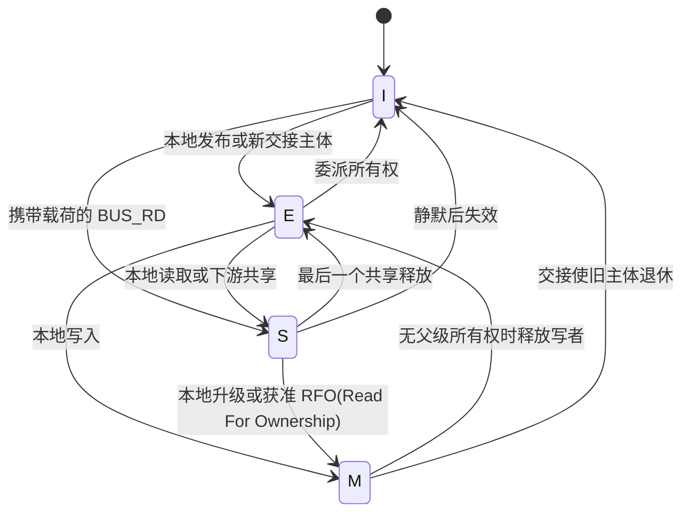
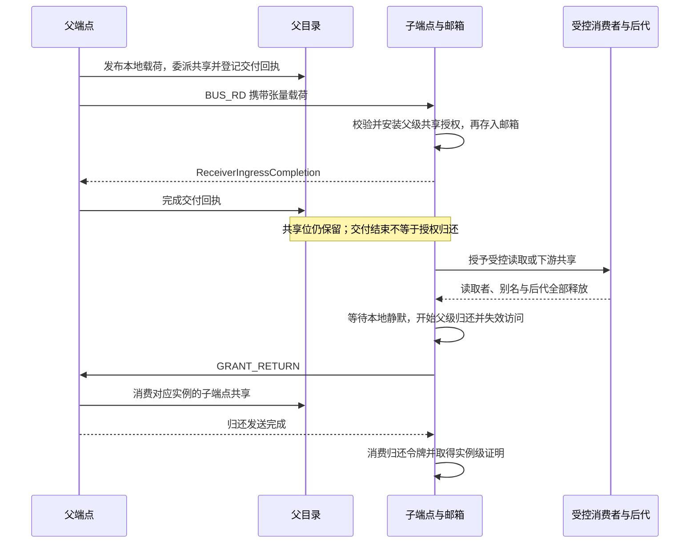
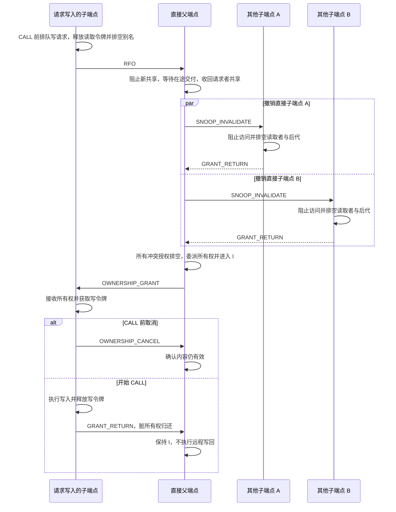
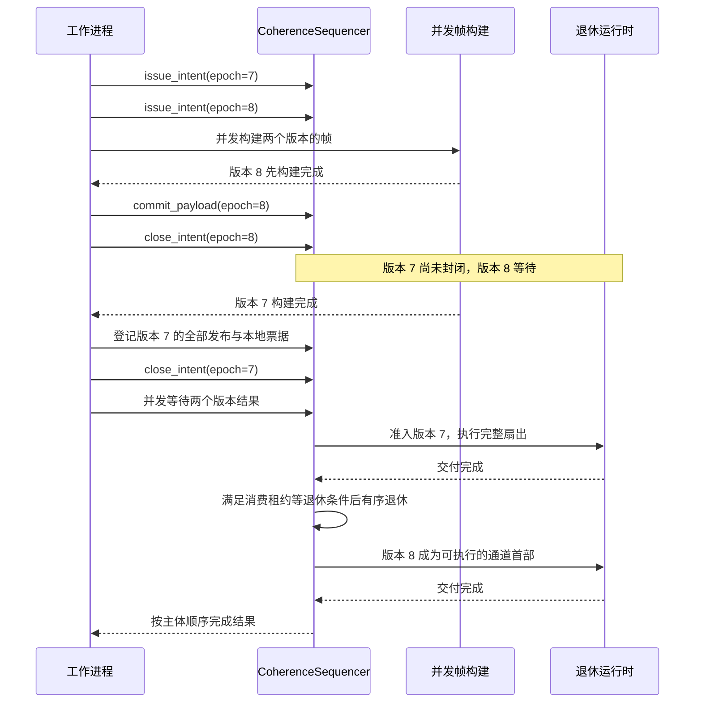
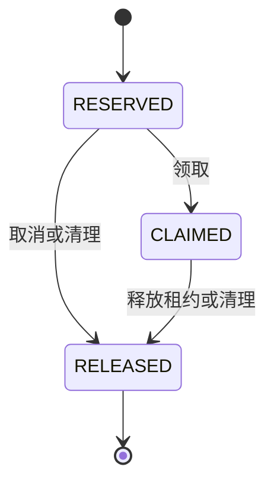
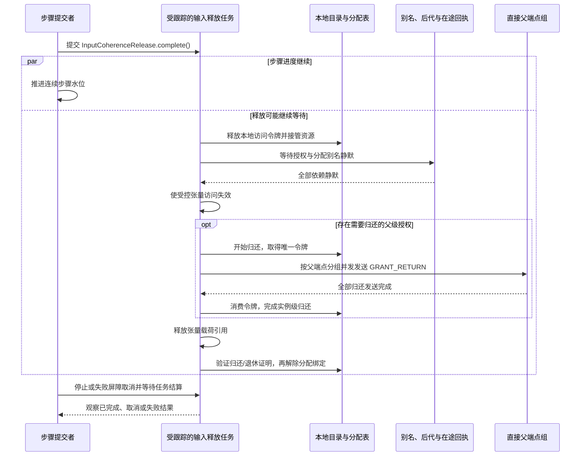

# 端点本地一致性协议

[英文版](coherence_protocol.md)

Fluxway 用 MESI 状态控制张量存储的访问权限。这是软件权限协议，不代表 Python 或加速器内存
具有硬件缓存一致性。应用算子声明 `readonly`、`writable` 或 `donate`，由工作进程执行协议。
下文目录与排序器示例均为独立运行时示例，不允许应用代码绕过工作进程的所有权管理。

## 身份与状态责任者

```text
Subject           = (owner_spmd_code, owner_rank, logical_tuuid)
CoherenceInstance = (Subject, epoch)
route_code        -> 编译后的直接边及 logical_tuuid
child_slot        <-> 该逻辑张量的直接子端点
```

`CompiledTensorTransfer` 提供逻辑张量身份与路由，`CompiledSendPlan.coherence_instance()`
将其绑定到发送端物理编号与版本。路由编号不是张量身份。
`source_step` 记录样本来源，`FRAME_STEP` 用于调度，`ENTRY_AUX` 是实例版本的线路投影。
两个步骤字段都不创建或推进目录权限。

每个端点拥有按完整 `CoherenceInstance` 索引的 `CoherenceDirectory`。
不同版本各有独立目录项，可以并存。`admit()` 校验实例，在缺失时创建无效项，
不等待或覆盖其他版本；当前 `can_admit()` 校验后返回 `True`。
意图递增顺序与有序退休由排序器负责。

以下本地示例说明：准入较新版本不会撤销旧版本授权。

```python
from fluxway.common.coherence import (
    CoherenceDirectory,
    CoherenceInstance,
    CoherenceState,
    CoherenceSubject,
    GrantReady,
)

directory = CoherenceDirectory()
subject = CoherenceSubject(owner_spmd_code=1, owner_rank=2, logical_tuuid=41)
old = CoherenceInstance(subject, epoch=7)
new = CoherenceInstance(subject, epoch=8)
directory.publish_local_payload(subject, old.epoch)
grant = directory.delegate_read(subject, old.epoch, child_id=0)
assert isinstance(grant, GrantReady)
assert directory.can_admit(new)
assert directory.admit(new).state is CoherenceState.INVALID
assert directory.admit(old).child_share_bitmap == 1
directory.return_child(subject, old.epoch, child_id=0)
assert directory.is_quiescent(old)
```

生产环境的身份必须来自编译图，不能使用示例中的测试编号。内部接入可以这样检查绑定：

```python
from fluxway.common.coherence import CoherenceInstance
from fluxway.spmd.worker.data_plane import CompiledSendPlan


def bound_instance(
    plan: CompiledSendPlan, transfer_code: int, epoch: int
) -> CoherenceInstance:
    return plan.coherence_instance(transfer_code, epoch)
```

每个逻辑张量的直接子端点按 `(target_spmd_id, target_rank)` 排序后分配位置。
该映射一一对应，图投影不会重新编号已有位置。系统没有全局目录、同级持有者列表、跨层广播或第二个可变版本计数器。

## 状态与不变量

| 状态 | 含义 |
| --- | --- |
| `M` | 当前端点拥有唯一写权限，内容可能已修改。 |
| `E` | 当前端点是唯一有效持有者，尚未开始修改。 |
| `S` | 父级共享授权、受控本地读取者或直接子端点共享有效。 |
| `I` | 当前端点没有该实例的有效可访问载荷。 |

目录项记录版本、状态、父级权限与归还事务、本地读写授权、独占子端点、子端点位图、
交付回执、挂起请求和分配绑定。协议保持以下不变量：

```text
I1 writer != NONE
   => readers = 0 and ownership_child = NONE and child_bitmap = 0
I2 ownership_child != NONE
   => writer = NONE and readers = 0 and child_bitmap = 0 and mesi = I
I3 委派写权限 => 直接父端点为 I
I4 mesi = I => 未显式发布载荷前不能授予读取、写入或共享
I5 本地退休 => 无读取者、写者、独占子端点、共享位、在途交付或有效挂起请求
I6 同一主体发出的意图版本严格递增
I7 delivery_committed 和 return_pending 均为 child_bitmap 的子集；
   delivery_inflight(child) > 0 => child 位于 child_bitmap
I8 每个读取、写入、交付和父级归还令牌恰好消费一次
```

I5 表示实例本地静默。归还父级授权还要求稳定父级权限和没有活动归还事务；
最终输入释放必须消费已完成的归还证明，或检查实例退休，之后才能解除分配身份绑定。
本地静默本身不能决定物理载荷生命周期。
I6 由 `CoherenceSequencer.issue_intent()` 检查，重复或倒退版本抛出
`CoherenceStateTransitionError`；单独的目录准入不会拒绝独立的较旧实例。

只有显式本地发布、携带载荷的 `BUS_RD` 或有效存储交接才能建立可访问内容。
新建目录项仍为 `I`。



每条箭头仍要求满足下表条件，不能绕过授权校验。持有父级所有权的子端点释放写者后仍为 `M`，直到归还所有权。

| 事件 | 前提 | 结果 |
| --- | --- | --- |
| `PublishLocal` | `I`，无父级权限，本地静默 | `E` |
| `PrRd` | 内容有效，未撤销，无独占子端点、活动或挂起写者 | 读取令牌；`E` 变为 `S` |
| `PrWr` | 内容有效，本地和子端点共享及交付已排空，父级非共享 | 写入令牌；`M` |
| `TxBusRd` | `E`/`S` 或显式本地发布，无写者、独占子端点、撤销或挂起写者 | 设置共享位；`S` |
| `RxBusRd` | 无冲突权限、写者、独占子端点或活动共享 | 父级权限 `SHARED`；`S` |
| `BeginGrantReturn` | 父级权限为 `SHARED`/`OWNERSHIP`，本地静默 | 归还令牌；权限 `NONE`；`I` |
| `CompleteGrantReturn` | 匹配活动归还令牌 | 消费令牌并清除对应事务 |
| `TxOwnershipGrant` | 有效写令牌，本地和子端点共享及交付已排空 | 设置独占子端点；`I` |
| `RxOwnershipGrant` | 父级权限为 `SHARED`，无本地和子端点共享或独占子端点 | 父级权限 `OWNERSHIP` |
| `TxOwnershipCancel` | 父级权限为 `OWNERSHIP`，无本地写者，尚未开始 `CALL` | 权限 `NONE`；`I` |
| `RxSnoopInval` | 未撤销，无所有权权限、`M`、写者或独占子端点 | 标记撤销中 |
| `AckSnoopInval` | 已标记撤销，本地和子端点共享及所有权已排空 | `I` |

## 等待本地访问

目录只同步变更协议状态。阻塞请求返回 `GrantPending(request_id, ...)`，
`CoherenceAdmissionRuntime` 按目录进展事件等待并返回最终令牌。
它只挂起请求协程，不阻塞远程对象线程，也不持有目录锁。

```python
import asyncio
from fluxway.common.coherence import (
    CoherenceDirectory,
    CoherenceInstance,
    CoherenceState,
    CoherenceSubject,
    ExecutionToken,
    GrantPending,
    GrantReady,
)
from fluxway.spmd.worker.coherence_runtime import CoherenceAdmissionRuntime


async def local_write_after_read() -> None:
    directory = CoherenceDirectory()
    subject = CoherenceSubject(1, 0, 41)
    instance = CoherenceInstance(subject, 7)
    directory.publish_local_payload(subject, 7)
    reader = directory.request_read(subject, 7, ExecutionToken(1))
    assert isinstance(reader, GrantReady)
    writer = directory.request_write(subject, 7, ExecutionToken(2))
    assert isinstance(writer, GrantPending)
    directory.release(reader.token)
    token = await CoherenceAdmissionRuntime(directory).await_grant(writer)
    assert directory.admit(instance).state is CoherenceState.MODIFIED
    directory.release(token)
    assert directory.admit(instance).state is CoherenceState.EXCLUSIVE


asyncio.run(local_write_after_read())
```

挂起写者阻止后续读取，避免饥饿；取消等待会移除挂起请求。
非法请求返回 `GrantRejected`，调用者抛出其中的错误。
重复释放令牌直接抛错，不能消费另一项授权。
系统线程必须向工作进程事件循环提交意图，不能直接修改目录；Python 解释器锁不是一致性原语。

## 共享交付与归还

`BUS_RD` 的顺序是：本地发布，登记子端点共享与交付回执，发送载荷，
接收端校验并安装共享授权，再存入邮箱。接收成功只结束交付，不结束授权。
子端点必须等算子、别名和后代使用结束后才归还。

以下双目录示例同步模拟一次成功传输：

```python
from fluxway.common.coherence import (
    CoherenceDirectory,
    CoherenceInstance,
    CoherenceState,
    CoherenceSubject,
    ExecutionToken,
    GrantReady,
)

parent, child = CoherenceDirectory(), CoherenceDirectory()
subject = CoherenceSubject(1, 0, 41)
instance = CoherenceInstance(subject, 7)
parent.publish_local_payload(subject, 7)
delegated = parent.delegate_read(subject, 7, child_id=0)
assert isinstance(delegated, GrantReady)
receipt = parent.register_child_delivery(delegated.token)
child.accept_parent_read(subject, 7)
parent.complete_child_delivery(receipt, delivered=True)
reader = child.request_read(subject, 7, ExecutionToken(1))
assert isinstance(reader, GrantReady)
child.release(reader.token)
returned = child.begin_parent_return(subject, 7)
assert child.admit(instance).state is CoherenceState.INVALID
parent.return_child(subject, 7, child_id=0)
child.complete_parent_return(returned)
assert parent.admit(instance).state is CoherenceState.EXCLUSIVE
assert parent.is_quiescent(instance)
```

交付失败只撤销本次新建的委派。归还先于在途交付到达时，父端点将其标记为待归还；
交付失败会清除共享，成功则取消过早归还，因为已接收授权以后仍需再次归还。
同一实例的失效请求与出站归还交错时，子端点将其合并到活动归还事务，不重复发送。
同版本重新授权会清除旧归还标记。

`return_transaction` 是暂态，不是新的父级权限或 MESI 状态。
开始归还时移除稳定权限并使访问失效，同时保留只能消费一次的事务令牌。
完成后生成实例级证明，其他版本的活动不能代替该证明。



图示正常顺序。归还与在途交付交错时，目录按同一实例合并状态，不能用另一版本的静默代替归还证明。

## 独占所有权、失效与取消

只有当前共享者可以通过 `RFO` 请求所有权。`CALL` 前，子端点排队请求写权限，
释放执行读取令牌并排空本地别名和后代。父端点阻止新共享，等待交付完成，
并发撤销其他直接子端点。共享全部排空后，父端点进入 `I` 并发送 `OWNERSHIP_GRANT`；
子端点接收所有权，获取写令牌，然后继续 `CALL`。

以下独立示例从共享已排空、父端点已校验请求者的位置开始，演示干净取消与脏归还：

```python
from fluxway.common.coherence import (
    CoherenceDirectory,
    CoherenceInstance,
    CoherenceState,
    CoherenceSubject,
    ExecutionToken,
    GrantReady,
)

parent, child = CoherenceDirectory(), CoherenceDirectory()
subject = CoherenceSubject(1, 0, 41)
instance = CoherenceInstance(subject, 7)
parent.publish_local_payload(subject, 7)
child.accept_parent_read(subject, 7)
writer = parent.request_write(subject, 7, ExecutionToken(1))
assert isinstance(writer, GrantReady)
parent.delegate_ownership(writer.token, child_id=0)
child.accept_parent_ownership(subject, 7)
child.cancel_parent_ownership(subject, 7)
parent.return_ownership_child(subject, 7, child_id=0, data_valid=True)
assert parent.admit(instance).state is CoherenceState.EXCLUSIVE

child.accept_parent_read(subject, 7)
writer = parent.request_write(subject, 7, ExecutionToken(2))
assert isinstance(writer, GrantReady)
parent.delegate_ownership(writer.token, child_id=0)
child.accept_parent_ownership(subject, 7)
child_writer = child.request_write(subject, 7, ExecutionToken(3))
assert isinstance(child_writer, GrantReady)
child.release(child_writer.token)
returned = child.begin_parent_return(subject, 7)
parent.return_ownership_child(subject, 7, child_id=0, data_valid=False)
child.complete_parent_return(returned)
assert parent.admit(instance).state is CoherenceState.INVALID
```

`SNOOP_INVALIDATE` 先阻止新访问，再排空受控读取者与直接后代，最后使访问失效并归还一次。
`M` 不能满足共享失效请求。`OWNERSHIP_CANCEL` 只允许发生在 `CALL` 前；
`CALL` 开始后的失败必须封锁执行，不能假设内容仍然干净。脏所有权归还始终让父端点保持 `I`。



实际子端点数量由编译图决定。`CALL` 开始后失败会封锁执行，不能再使用干净取消路径。

## 发布排序与租约

`CoherenceSequencer` 是唯一异步重排缓冲区。同一主体的意图按版本递增发出，
帧构建可以乱序完成。`commit_payload()` 同步登记票据并返回协程。
全部发布与本地引用票据登记后才能 `close_intent()`，随后再等待完成。
已封闭且位于全部通道首部的票据可以直接执行，阻塞票据挂起；独立主体可以并发前进。

```python
import asyncio
from fluxway.common.coherence import (
    CoherenceDirectory,
    CoherenceInstance,
    CoherenceSubject,
)
from fluxway.spmd.worker.coherence_runtime import CoherenceAdmissionRuntime
from fluxway.spmd.worker.coherence_sequencer import CoherenceSequencer


async def ordered_publications() -> None:
    directory = CoherenceDirectory()
    retired = []

    async def retire(instances, value):
        retired.append((instances[0].epoch, value))
        return value

    sequencer = CoherenceSequencer(retire, CoherenceAdmissionRuntime(directory).admit)
    subject = CoherenceSubject(1, 0, 41)
    first, second = CoherenceInstance(subject, 7), CoherenceInstance(subject, 8)
    sequencer.issue_intent(first)
    sequencer.issue_intent(second)
    second_result = sequencer.commit_payload((second,), "second")
    first_result = sequencer.commit_payload((first,), "first")
    sequencer.close_intent(first)
    sequencer.close_intent(second)
    assert await asyncio.gather(first_result, second_result) == ["first", "second"]
    assert retired == [(7, "first"), (8, "second")]


asyncio.run(ordered_publications())
```



图示同一主体；独立主体可以并发。必须先登记并封闭意图，再等待结果；不能等待当前版本退休后才补登记同一意图的票据。

一个发布票据负责完整子端点扇出。退休运行时并发启动所有入队，校验承载方接收证明和发送引用释放证明，
通过同一责任者完成所有子端点回执。任一失败会取消未完成同级任务并传播异常。
发布与生命周期示例见[数据面运行时](dataplane_runtime_zh.md)。

全部活动意图封闭后的排空边界会检查跨主体依赖环；发现环时封锁所有等待票据。
尚未封闭的前驱只是普通构建背压，正常路径不会重建全局依赖图。

`ConsumerLeaseReservationRef` 是非拥有引用，预留状态和活动计数绑定唯一属于排序器：



以下独立示例在载荷交付期间预留，随后领取租约，释放后才允许退休：

```python
import asyncio
from fluxway.common.coherence import (
    CoherenceDirectory,
    CoherenceInstance,
    CoherenceSubject,
)
from fluxway.spmd.worker.coherence_runtime import CoherenceAdmissionRuntime
from fluxway.spmd.worker.coherence_sequencer import CoherenceSequencer


async def reserved_consumer() -> None:
    directory = CoherenceDirectory()
    reserved = asyncio.get_running_loop().create_future()
    finished = asyncio.Event()

    async def deliver(instances, value):
        reserved.set_result(sequencer.reserve_consumer_lease(instances))
        await finished.wait()
        return value

    sequencer = CoherenceSequencer(deliver, CoherenceAdmissionRuntime(directory).admit)
    instance = CoherenceInstance(CoherenceSubject(1, 0, 41), 7)
    sequencer.issue_intent(instance)
    result = sequencer.commit_payload((instance,), "payload")
    sequencer.close_intent(instance)
    delivery = asyncio.create_task(result)
    reservation = await reserved
    lease = reservation.claim()
    assert reservation.claimed
    lease.release()
    finished.set()
    assert await delivery == "payload"


asyncio.run(reserved_consumer())
```

`RESERVED` 阶段允许 `claim()`、`cancel()` 或停止清理。
`CLAIMED` 阶段由保存的 `ConsumerLease` 负责正常释放，`cancel()` 抛错。
重复显式释放租约抛错；重复 `release_for_cleanup()` 不会再次减少计数。
张量领取后清空预留引用，不成为第二个预留责任者。

预留状态和索引各有线程保护。封锁先取得索引快照，再通过同一状态机清理各条记录，
领取与封锁交错不能遗留活动计数。工作线程释放租约时，将计数变更提交到排序器所属事件循环。

## 释放算子输入

输入释放由一个不可变 `InputCoherenceReleasePlan` 和一次
`InputCoherenceRelease.complete()` 生命周期完成，顺序固定：

1. 每个本地访问令牌释放一次。
2. 等待授权和分配别名静默，包括后代与回执。
3. 使张量访问失效。
4. 需要时开始、发送并完成分组父级归还。
5. 释放张量载荷引用。
6. 消费归还证明或检查实例退休，然后解除分配身份绑定。

以下内部接入函数要求工作进程提供有效授权、别名实例、父端点句柄、张量和归还发送函数。
计划先于传输创建，因此缺失直接父端点句柄时立即失败：

```python
from collections.abc import Mapping
from fluxway.common.allocation import AllocationRegistry
from fluxway.common.coherence import CoherenceDirectory, CoherenceInstance
from fluxway.common.types.tensor import TransportTensor
from fluxway.spmd.worker.coherence_runtime import (
    CoherenceAdmissionRuntime,
    InputCoherenceRelease,
    InputCoherenceReleasePlan,
    InputGrant,
    ParentGrantReturnRuntime,
    ParentReturnSender,
)


async def release_inputs(
    directory: CoherenceDirectory,
    allocations: AllocationRegistry,
    grants: tuple[InputGrant, ...],
    aliases: tuple[CoherenceInstance, ...],
    revoked: frozenset[CoherenceInstance],
    parent_handlers: Mapping[str, Mapping[int, object]],
    tensors: tuple[TransportTensor, ...],
    send_returns: ParentReturnSender,
) -> None:
    plan = InputCoherenceReleasePlan.create(
        grants=grants,
        alias_dependencies=aliases,
        revoked_instances=revoked,
        parent_handlers=parent_handlers,
        tensors=tensors,
    )
    await InputCoherenceRelease(
        directory=directory,
        admission_runtime=CoherenceAdmissionRuntime(directory),
        parent_return_runtime=ParentGrantReturnRuntime(directory, send_returns),
        allocation_registry=allocations,
        plan=plan,
    ).complete()
```

这是释放生命周期，不是提交与回滚事务。已经撤销的授权没有第二条归还路由。
本地引用授权也经过相同阶段，只是父级路由为空；释放读取令牌不能绕过别名静默。
`ROUTING_MISS` 张量条目仍携带 `BUS_RD`，但本地授权的 `parent_return_required=False`：
发送端没有创建子端点委派，因此接收端只释放本地令牌，不虚构上游归还。

步骤完成后，`_commit_finished_steps` 在受跟踪的后台任务中启动释放，
不等待静默就推进步骤水位。协程在第一次挂起前接管释放资源。
停止与失败屏障会等待这些任务；启动释放不代表输入已经可回收。

交付完成与有序退休是两种独立的类型化证明，接收成功后接收端仍可能持有授权。
`PayloadLifetime` 负责出站帧引用与物理释放，等待全部回执、传输保留引用和本地租约完成。
分配身份、裸地址、远程调用超时或只有其中一种完成证明，都不能授权复用内存。



归还失败时不能继续解除绑定或复用存储。正常释放和失败清理由同一资源拥有者结算，步骤水位本身不授权物理回收。

## 精确交接存储

分配身份包含后端、设备、根地址与大小、视图地址与大小；描述符强引用真实存储所有者。
指针整数或 DLPack 胶囊不是所有者。捐赠要求一输入对应一输出，交给新的单赋值张量主体，
且当前执行持有活动写授权。

以下独立处理器示例先同时检查目录权限与精确分配关系，再转移两个绑定：

```python
import numpy as np
from fluxway.common.allocation import AllocationRegistry, AllocationRelation
from fluxway.common.coherence import (
    CoherenceDirectory,
    CoherenceInstance,
    CoherenceState,
    CoherenceSubject,
    ExecutionToken,
    GrantReady,
)
from fluxway.common.tensor_backend import HybridBackend

backend = HybridBackend(default_device="cpu")
values = np.array([10, 20, 30], dtype=np.int32)
descriptor = backend.allocation_descriptor(values)
assert (
    descriptor.identity.relation(backend.allocation_descriptor(values[1:]).identity)
    is AllocationRelation.OVERLAP
)
old = CoherenceInstance(CoherenceSubject(1, 0, 41), 7)
new = CoherenceInstance(CoherenceSubject(1, 0, 42), 7)
directory, allocations = CoherenceDirectory(), AllocationRegistry()
directory.publish_local_payload(old.subject, old.epoch)
writer = directory.request_write(old.subject, old.epoch, ExecutionToken(1))
assert isinstance(writer, GrantReady)
allocations.bind(old, descriptor)
directory.require_local_handoff(old, new, writer.token.execution)
allocations.require_handoff(old, new, descriptor)
directory.handoff_local_write(old, new, writer.token.execution)
allocations.handoff(old, new, descriptor)
assert directory.admit(old).state is CoherenceState.INVALID
assert directory.admit(new).state is CoherenceState.EXCLUSIVE
assert not allocations.is_bound(old)
assert allocations.binding(new).descriptor.owner is values
```

只有根对象和字节范围完全相同才是 `EXACT`；重叠或不支持的身份抛出
`UnsupportedAllocationHandoffError`。工作进程接入还会使旧张量包装器失效。
绕过受控访问的裸别名属于未定义行为。远程复制载荷得到新的分配，即使逻辑路由回到此前节点也一样。

`AllocationRegistry` 只管理身份和精确交接，输入退休先检查目录证明再解除绑定。
推进水位不能证明存储已可释放或复用；回收器失败和回执缺失会封锁载荷生命周期。

## 线路动作与载体

现有四位动作字段定义如下：

| 编码 | 动作 | 载荷 | 方向 |
| --- | --- | --- | --- |
| 0 | `NONE` | 由帧类型决定 | 无 |
| 1 | `BUS_RD` | 张量数据必须携带 | 父到子 |
| 2 | `RFO` | 禁止 | 子到父 |
| 3 | 保留，本地升级仅在内部发生 | 禁止 | 非法 |
| 4 | `SNOOP_INVALIDATE` | 禁止 | 父到子 |
| 5 | `GRANT_RETURN` | 禁止 | 子到父 |
| 6 | 保留，不支持远程写回 | 禁止 | 非法 |
| 7 | `OWNERSHIP_GRANT` | 禁止 | 父到子 |
| 8 | `OWNERSHIP_CANCEL` | 禁止 | 子到父 |
| 9-15 | 保留 | 禁止 | 非法 |

张量传输帧携带 `BUS_RD`。只有头部的一致性帧在邮箱存放前处理，不改变到达计数。
一帧只有一种动作与版本；按端点、动作、版本分组，不同端点经 Ray/Axon 数据面处理器并发发送。

同一语义张量可以通过本地引用、本地邮箱帧或远程 DLPack 载体传递。
选择载体不会产生另一套身份、版本或权限表。协议保证受控访问与回收顺序，不证明跨进程零复制。

硬件刷新会写回修改内容，Fluxway 不实现远程写回：仅靠头部无法恢复父端点复制的内容，
第二条载荷通道又会破坏传输和邮箱计数。此类请求抛出 `UnsupportedRemoteWritebackError`，
状态更新应作为新的普通张量值传递，并使用新的逻辑身份。

## 进展与失败封锁

本地授权与子端点共享不变量保证互斥。进展依赖受控读取者释放、直接子端点响应。
运行时事件唤醒等待者，不进行定时轮询、全局加锁或全局扫描。
不变量破坏、传输失败或执行错误会封锁整个执行：

1. 关闭帧准入并停止调度。
2. 取消准备、`CALL`、发送、交付和挂起一致性任务。
3. 关闭传输端点并使受控包装器失效。
4. 清除端点本地目录与分配绑定。
5. 等待受跟踪释放任务，确认停止并明确终止全部 Ray 工作进程对象。

只有屏障完成后，新控制器才能从检查点创建工作进程。
协议不在同一执行中替换单个编号，因此扁平帧头没有执行代次字段。
本地示例检查状态机契约，不能证明分布式处理恰好一次或逐位数值重放。
