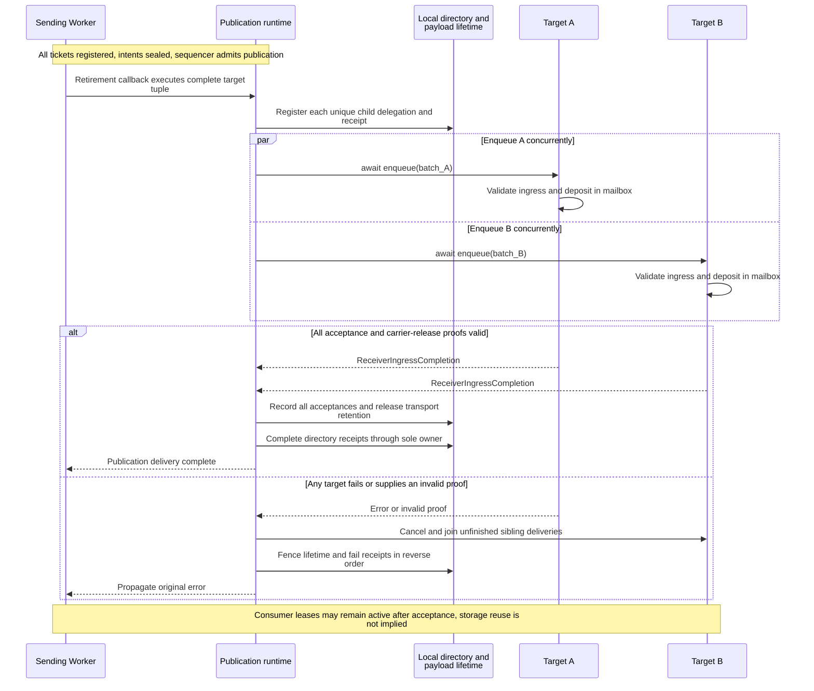
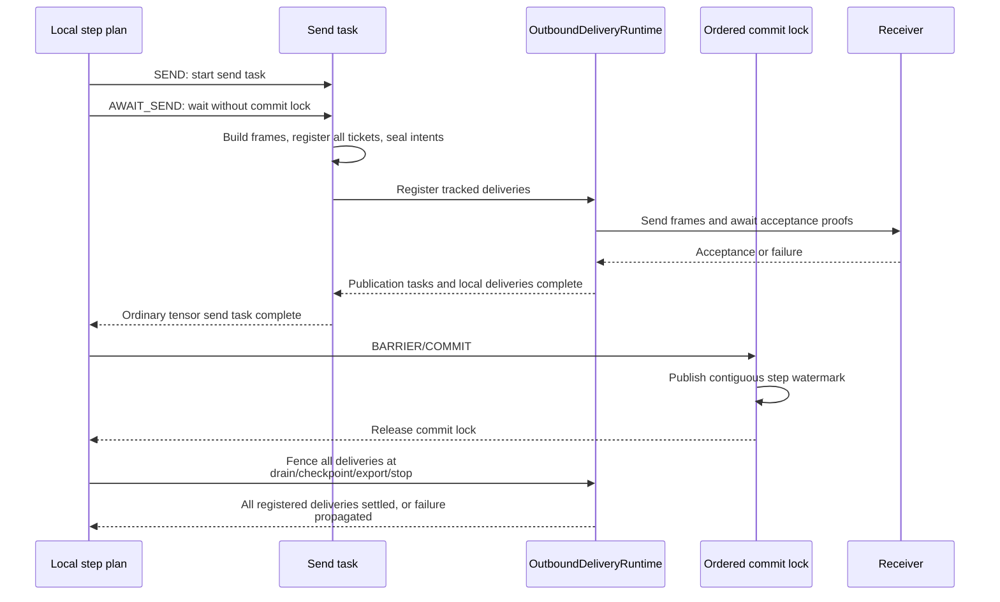

# Data-plane runtime

[Chinese edition](dataplane_runtime_zh.md)

The data plane turns operator results into frames, groups deliveries, applies
bounded backpressure and sends asynchronously. It does not allocate source work,
admit operator steps or advance checkpoint progress. `local_only` edges may
pass references directly while preserving the tensor access contract.

## Describe the actual payload

`TransportTensor` holds values, layout, routing indices, origin lineage,
receipts and runtime access state. Metadata describes routing entities: rows for
dense batches and outer rows for ragged batches. A short final batch uses its
actual row count, not the configured capacity:

```python
import numpy as np
from fluxway.common.index_descriptor import ContinuousIndex
from fluxway.common.tensor_backend import use_backend
from fluxway.common.types.tensor import SymmetryReceipt, TransportTensor

with use_backend("numba_cpu"):
    values = np.array([[10, 11], [20, 21]], dtype=np.int32)
    tensor = TransportTensor(
        values,
        global_shape=values.shape,
        origin_indices=ContinuousIndex.chunk(start=40, count=len(values)),
        receipt=SymmetryReceipt(world_size=4, sender_rank_tags=2),
        source_step=7,
    )
    assert tensor.shape == (2, 2)
    assert tensor.origin_indices_materialized.tolist() == [40, 41]
    assert tensor.receipt.materialize(2).tolist() == [2, 2]
    assert np.shares_memory(tensor.flat_values, values)
```

The origin indices identify sample positions. The receipt records producer
ranks for reverse routing; it is distinct from a delivery acceptance receipt.
`source_step` records provenance and does not create a coherence identity or
epoch. Production identity comes from the compiled transfer; see the
[coherence protocol](coherence_protocol.md).

Ragged rows may contain different numbers of values. Their metadata still has
one entry per outer row:

```python
import numpy as np
from fluxway.common.tensor_backend import use_backend
from fluxway.common.types.tensor import TransportTensor

with use_backend("numba_cpu"):
    tensor = TransportTensor.from_lists(
        [[10, 11], [20]],
        dtype=np.int32,
        origin_indices=np.array([40, 41], dtype=np.int64),
    )
    assert tensor.logical_shape == (2, None)
    assert tensor.flat_values.tolist() == [10, 11, 20]
    assert tensor.nested_splits[0].tolist() == [0, 2, 3]
    assert tensor.origin_indices_materialized.tolist() == [40, 41]
```

Mismatched metadata lengths raise. Filtered, ragged and partial batches must
not infer a global size by multiplying local length by worker count.

## Build and submit one publication

`CompiledSendPlan` uses the relation described in
[transfer planning](transfer_planning.md). Complete-unit routes select one
complete producer result per target; fragment routes assemble shard
intersections. Direct delivery skips packing gathers and concatenation of
several shards. Frame identity retains the physical sender rank even when
layout calculations use an execution group's logical coordinates.

The Worker supplies one callback for the complete frame plan. This function is
for internal integration: both arguments come from the initialized Worker.

```python
from functools import partial
from fluxway.spmd.worker.coherence_runtime import CoherenceBatchRetireRuntime
from fluxway.spmd.worker.data_plane import CompiledSendPlan


def publication_callback(
    runtime: CoherenceBatchRetireRuntime,
    plan: CompiledSendPlan,
):
    return partial(runtime.retire_publication, plan)
```

`BatchingDataPlaneExecutor` invokes the callback once with an immutable tuple
of all target `TransportFrameBatch` values and an asynchronous enqueue callable.
The Worker registers every publication and local-only ticket before sealing the
intent with `close_intent()`. Sealing must happen before awaiting retirement;
otherwise each side can wait for the other.

`retire_publication()` derives the union of coherence instances, records each
distinct `(instance, child_slot)` delegation once, and starts all target
enqueues concurrently. A target batch is a physical carrier, not a separate
ordering unit. Calling `CoherenceSequencer.commit_payload()` once per target
would introduce an extra ordering boundary.

`_ChildDeliveryReceipts` owns all terminal directory receipt transitions. One
failed enqueue cancels unfinished siblings and completes the registered receipts
as failed in reverse order; the original exception propagates. No target retry
or timeout substitutes for successful acceptance.



A represents whichever target fails first. Producer references remain retained until
sibling deliveries settle. More targets do not create extra ordering boundaries for the
same instance.

## Acceptance and payload lifetime

A carrier returns `ReceiverIngressCompletion` only after receiver ingress and
release of its producer-side retention are proven. For CPU/Ray, awaiting the
receiver's frame admission and mailbox deposit supplies that carrier completion.
The publication runtime validates its type and both proof flags, then records
`ReceiverAcceptanceReceipt` values using the declared batch identities:

```text
(publication_id, instance, child_slot, context_index, target_rank, batch_seq)
```

A bare RPC result cannot complete the publication. Acceptance also does not
mean that the receiver's operator has finished reading: parent grant return and
quiescence remain separate obligations.

The following isolated CPU example exercises the lifetime owner. Its receipt
objects are test inputs; a real carrier must establish acceptance first.

```python
import numpy as np
from fluxway.common.coherence import CoherenceInstance, CoherenceSubject
from fluxway.common.payload_lifetime import (
    PayloadLifetime,
    ReceiverAcceptanceReceipt,
    ReferencePayloadRecycler,
    payload_handle,
)

instance = CoherenceInstance(CoherenceSubject(1, 0, 41), epoch=7)
handle = payload_handle(np.array([10, 20], dtype=np.int32))
lifetime = PayloadLifetime(
    publication_id=1,
    handles=(handle,),
    expected_children=((instance, 0, 0, 0, 0), (instance, 1, 0, 1, 0)),
    recycler=ReferencePayloadRecycler(),
)
lifetime.retain_local_lease()
for child_slot in (0, 1):
    lifetime.accept(
        ReceiverAcceptanceReceipt(
            publication_id=1,
            instance=instance,
            child_slot=child_slot,
            context_index=0,
            target_rank=child_slot,
            batch_seq=0,
        )
    )
lifetime.release_transport_retention()
assert not handle.released
lifetime.release_local_lease()
assert handle.released
assert lifetime.released
```

`PayloadLifetime` releases its handles once all receipts, transport retention
and local leases complete. A duplicate receipt, duplicate terminal transition
or failed recycler raises or fences the lifetime. `AllocationRegistry` tracks
identity and exact handoff; it cannot release a buffer by advancing a watermark.
Same-worker aliases retain their `ConsumerLease` until reading finishes.

## Source acquisition and backpressure

For controlled sources, the Worker indexes planned segments by step and
acquires complete step prefixes through batched Controller calls. Ownership
comes from `SourceWorkItem` coordinates, not the dispatcher's physical rank.
Acknowledgements enter the bounded `SourceAcknowledgementRuntime` queue and
flush during checkpoint drain. Below capacity, each acknowledgement need not
wait for a separate call; a grant cache miss still waits for acquisition.

The Controller's event-driven `SourceProgressSupervisor` scans adapters and
refills contiguous immutable windows. The startup API starts this lifecycle;
the adapter does not own refill. See [source coordination](source_coordination.md)
for the declaration and acquisition examples.

Credit and execution cycles bound batch size. A Reader active once every
`L` logical steps sees at most `ceil(C / L)` active steps in `C` consecutive
credited steps; pipeline depth and remaining work impose further limits.
For example, `L=4`, `C=10`, depth 8 and 20 remaining steps allow at most three
grants. More physical Readers with unchanged logical parallelism and credit can
therefore reduce batching efficiency. A partial-prefix reply leaves the suffix
available for a later request. Size credit together with the checkpoint interval.

## Export and device boundaries

Adopting a value with `copy=False` requires the destination backend to use the
same device domain. This local CPU check establishes only array aliasing:

```python
import numpy as np
from fluxway.common.tensor_backend import HybridBackend

backend = HybridBackend(default_device="cpu")
values = np.array([10, 20], dtype=np.float32)
adopted = backend.asarray(values, device="cpu", copy=False)
assert np.shares_memory(adopted, values)
np.testing.assert_array_equal(adopted, values)
```

GPU JAX outputs must first select their sole addressable local shard. The
backend uses DLPack for lifetime transfer and consumer-stream negotiation;
a shared pointer alone does not prove producer completion. Parameter gradients
must be fully replicated before flattening. Unsupported devices, missing CUDA
support and cross-device zero-copy adoption raise. Frame staging uses the
configured backend device with `copy=False`; ragged lengths may still need
separate metadata buffers.

An adapter exporting a runtime input must retain its lease through the entire
consumer operation. This internal integration function requires a live,
readonly tensor backed by physically writable storage and a synchronous
consumer that finishes using the storage before it returns:

```python
from collections.abc import Callable
from typing import Any
from fluxway.common.types.tensor import TransportTensor


def consume_dlpack(tensor: TransportTensor, consume: Callable[[Any], Any]) -> Any:
    lease = tensor.acquire_consumer_lease()
    try:
        return consume(tensor.dlpack_values_for_consumer())
    finally:
        lease.release()
```

Returning a pending device operation violates that function's lifetime contract;
an asynchronous integration must retain the lease until its completion is proven.
An invalidated tensor cannot be read or exported.

Same-process aliasing, same-node Ray delivery and cross-node transport require
separate measurements. Reader/Input node affinity does not select Ray shared
memory. `RayActorDataPlane` submits CPU payloads to Ray, which owns inter-process
delivery and receiver allocation; even a readonly NumPy array may use private
memory. Aliasing the received array during assembly does not prove copy-free
delivery. Receiver producer caches use execution-cycle slots rather than one
entry per absolute step.

## Delivery identity and numerical replay

Routing a sample to the right consumer does not select which version of mutable
operator state its computation reads. A bounded-staleness policy is declared as:

```python
from fluxway.common.operator_policy import AsyncPolicy

policy = AsyncPolicy.bounded_stale(depth=8, max_staleness=7)
assert policy.max_staleness == 7
assert policy.commit == "relaxed"
```

This bounds execution lag; it does not impose an identical lookup/update order
after restore. Equal checkpoint state and committed sample order do not guarantee
the same numerical trajectory, even with unchanged worker counts. GPU gradient
scatter with duplicate indices may also differ in floating-point accumulation.
Check restored state, sample provenance and numerical behavior separately.
For transport validation, compare a produced value with its received value;
comparisons between independent computations test a different property.

## Local commit and delivery locks

`SEND` starts a send task. `AWAIT_SEND` awaits that task without the operator
commit resource. `BARRIER/COMMIT` acquires the ordered commit lock
only to publish the contiguous watermark. Drain, checkpoint, export and stop
still await every registered delivery through the delivery fence.



This is the ordinary tensor path: its send task awaits complete publication and local
delivery. Protocol-only frame paths can return after registration and are still joined
by the drain fence. Send failures prevent normal commit or enter execution failure
handling. Acceptance still does not imply consumer-lease return or physical storage
reclamation.

The ordered commit lock is not held across send registration or network waits. Step
progress, receiver completion, and physical input release are distinct events.

Protocol failure closes frame admission and propagates through the execution
failure channel. Input release and payload retirement remain tracked
asynchronous operations; scheduling them does not prove they have finished.
See [coherence protocol](coherence_protocol.md) and [architecture](ARCHITECTURE.md).
