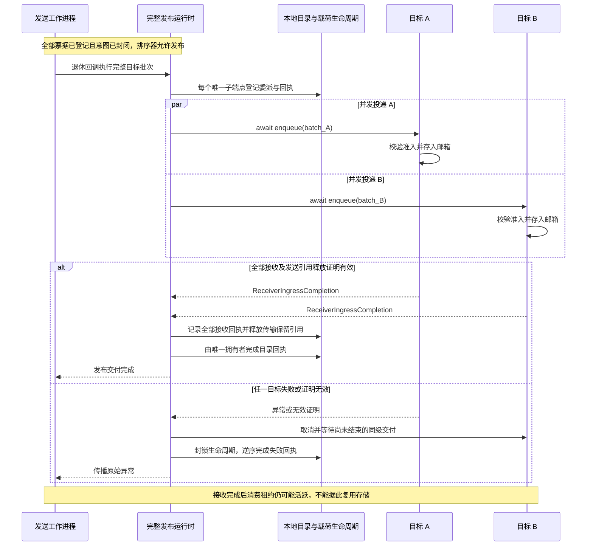
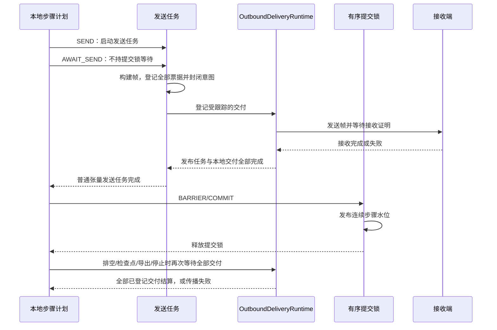

# 数据面运行时

[英文版](dataplane_runtime.md)

数据面将算子结果编码为传输帧，分组投递，施加有限背压，并异步发送。
它不分配来源任务、不决定算子步骤准入，也不推进检查点进度。
`local_only` 边可以直接传递引用，同时遵守张量访问契约。

## 描述真实载荷

`TransportTensor` 保存值、布局、路由索引、来源信息、回执和运行时访问状态。
元数据对应路由实体：规则批次按行计数，不规则批次按最外层行计数。
最后一个不足容量的批次必须使用真实行数：

```python
import numpy as np
from fluxway.common.index_descriptor import ContinuousIndex
from fluxway.common.tensor_backend import use_backend
from fluxway.common.types.tensor import SymmetryReceipt, TransportTensor

with use_backend("numba_cpu"):
    values = np.array([[10, 11], [20, 21]], dtype=np.int32)
    tensor = TransportTensor(
        values,
        global_shape=values.shape,
        origin_indices=ContinuousIndex.chunk(start=40, count=len(values)),
        receipt=SymmetryReceipt(world_size=4, sender_rank_tags=2),
        source_step=7,
    )
    assert tensor.shape == (2, 2)
    assert tensor.origin_indices_materialized.tolist() == [40, 41]
    assert tensor.receipt.materialize(2).tolist() == [2, 2]
    assert np.shares_memory(tensor.flat_values, values)
```

来源索引标识样本位置，回执记录反向路由所需的生产者编号，与交付接收回执不同。
`source_step` 只记录来源，不创建一致性身份或版本。生产环境的身份来自编译后的传输，
见[一致性协议](coherence_protocol_zh.md)。

不规则数据的各行可以有不同数量的值，元数据仍然每个外层行一项：

```python
import numpy as np
from fluxway.common.tensor_backend import use_backend
from fluxway.common.types.tensor import TransportTensor

with use_backend("numba_cpu"):
    tensor = TransportTensor.from_lists(
        [[10, 11], [20]],
        dtype=np.int32,
        origin_indices=np.array([40, 41], dtype=np.int64),
    )
    assert tensor.logical_shape == (2, None)
    assert tensor.flat_values.tolist() == [10, 11, 20]
    assert tensor.nested_splits[0].tolist() == [0, 2, 3]
    assert tensor.origin_indices_materialized.tolist() == [40, 41]
```

元数据长度不匹配时直接抛错。经过筛选、不规则或不足容量的批次，不能通过
“本地长度乘以工作进程数”推断全局大小。

## 构建并提交一次发布

`CompiledSendPlan` 使用[传输计划](transfer_planning_zh.md)中的关系。
完整单元路由为每个目标选定一个生产者的完整结果，分片路由装配分片交集。
直达交付跳过收集打包和多分片拼接。即使布局计算使用执行组内的逻辑坐标，
传输帧仍保留发送端的物理编号。

工作进程为完整帧计划提供一个回调。以下函数仅供内部接入，两个参数均来自已初始化的工作进程：

```python
from functools import partial
from fluxway.spmd.worker.coherence_runtime import CoherenceBatchRetireRuntime
from fluxway.spmd.worker.data_plane import CompiledSendPlan


def publication_callback(
    runtime: CoherenceBatchRetireRuntime,
    plan: CompiledSendPlan,
):
    return partial(runtime.retire_publication, plan)
```

`BatchingDataPlaneExecutor` 向该回调传入全部目标 `TransportFrameBatch` 的不可变元组，
以及异步入队函数，只调用一次。工作进程必须先登记全部发布票据和本地引用票据，再用
`close_intent()` 封闭该意图；封闭后才能等待退休，否则双方可能互相等待。

`retire_publication()` 求出一致性实例并集，为每个唯一的 `(instance, child_slot)`
登记一次委派，然后并发启动全部目标入队。目标批次只是物理载体，不是独立的排序单元。
逐目标调用 `CoherenceSequencer.commit_payload()` 会增加额外排序边界。

`_ChildDeliveryReceipts` 统一拥有目录回执的终态转换。任一入队失败时，取消尚未完成的同级任务，
按相反顺序将已登记回执完成为失败，并传播原始异常。目标重试或超时不能代替接收成功证明。



图用 A 表示最先失败的任意目标。生产端引用保留到同批交付全部结算；目标数量不会增加同一实例的排序边界。

## 接收证明与载荷生命周期

承载方证明接收准入完成，并且不再保留发送端引用后，才返回 `ReceiverIngressCompletion`。
对于处理器上的 Ray 传输，等待接收端完成帧准入和邮箱存放可得到该完成证明。
发布运行时检查返回类型及两个证明标志，再按声明的批次身份记录 `ReceiverAcceptanceReceipt`：

```text
(publication_id, instance, child_slot, context_index, target_rank, batch_seq)
```

普通远程调用返回值不能完成发布。接收成功也不代表接收端算子已经读完，
父级授权归还和静默仍是独立义务。

以下独立处理器示例检查生命周期责任者。回执对象只是测试输入；真实承载方必须先建立接收证明。

```python
import numpy as np
from fluxway.common.coherence import CoherenceInstance, CoherenceSubject
from fluxway.common.payload_lifetime import (
    PayloadLifetime,
    ReceiverAcceptanceReceipt,
    ReferencePayloadRecycler,
    payload_handle,
)

instance = CoherenceInstance(CoherenceSubject(1, 0, 41), epoch=7)
handle = payload_handle(np.array([10, 20], dtype=np.int32))
lifetime = PayloadLifetime(
    publication_id=1,
    handles=(handle,),
    expected_children=((instance, 0, 0, 0, 0), (instance, 1, 0, 1, 0)),
    recycler=ReferencePayloadRecycler(),
)
lifetime.retain_local_lease()
for child_slot in (0, 1):
    lifetime.accept(
        ReceiverAcceptanceReceipt(
            publication_id=1,
            instance=instance,
            child_slot=child_slot,
            context_index=0,
            target_rank=child_slot,
            batch_seq=0,
        )
    )
lifetime.release_transport_retention()
assert not handle.released
lifetime.release_local_lease()
assert handle.released
assert lifetime.released
```

全部回执、传输保留引用和本地租约都完成后，`PayloadLifetime` 才释放句柄一次。
重复回执、重复终态或回收器失败会抛错或封锁生命周期。
`AllocationRegistry` 只管理身份和精确交接，不能靠推进水位释放内存。
同一工作进程内的别名必须保留 `ConsumerLease`，直到读取结束。

## 来源获取与背压

对于受控来源，工作进程按步骤索引计划片段，并批量向控制器获取完整步骤前缀。
任务所有权由 `SourceWorkItem` 的坐标决定，不由调度器的物理编号决定。
确认消息进入有界 `SourceAcknowledgementRuntime` 队列，并在检查点排空阶段刷新。
容量允许时不必为每项确认单独等待调用，授权缓存未命中时仍需等待获取。

控制器的事件驱动 `SourceProgressSupervisor` 扫描适配器并补充连续不可变窗口。
启动接口负责启动生命周期，适配器不负责补窗。
声明与获取示例见[来源协调](source_coordination_zh.md)。

信用额度和执行周期共同限制批量大小。每隔 `L` 个逻辑步骤执行一次的读取进程，
在覆盖 `C` 个连续逻辑步骤的额度中最多有 `ceil(C / L)` 个活动步骤，
还受到流水深度和剩余任务数限制。例如，`L=4`、`C=10`、深度为 8、剩余 20 步时，
最多只能授予三步。逻辑并行度和额度不变时，增加物理读取进程可能降低批量效率。
部分前缀回复会保留尚未授予的后缀，后续请求可以继续获取。额度需要与检查点间隔一起配置。

## 导出与设备边界

使用 `copy=False` 接收值时，目标后端必须位于相同设备域。
以下本地处理器检查只证明数组共享内存：

```python
import numpy as np
from fluxway.common.tensor_backend import HybridBackend

backend = HybridBackend(default_device="cpu")
values = np.array([10, 20], dtype=np.float32)
adopted = backend.asarray(values, device="cpu", copy=False)
assert np.shares_memory(adopted, values)
np.testing.assert_array_equal(adopted, values)
```

加速器上的 JAX 输出必须先取出唯一可寻址的本地分片。后端通过 DLPack 交接生命周期并协商消费者流，
共享指针本身不能证明生产计算已经结束。参数梯度必须完整复制后才能展平。
不支持的设备、缺少 CUDA 支持和跨设备免复制接收都会直接抛错。
帧暂存按配置的后端设备使用 `copy=False`；不规则行长度仍可能需要独立元数据缓冲区。

导出运行时输入的适配器必须在消费者使用期间保留租约。以下函数仅供内部接入，要求张量仍有效、
获得只读授权、底层存储可写，而且同步消费者在返回前已结束所有存储访问：

```python
from collections.abc import Callable
from typing import Any
from fluxway.common.types.tensor import TransportTensor


def consume_dlpack(tensor: TransportTensor, consume: Callable[[Any], Any]) -> Any:
    lease = tensor.acquire_consumer_lease()
    try:
        return consume(tensor.dlpack_values_for_consumer())
    finally:
        lease.release()
```

返回尚未完成的设备操作会违反该函数的生命周期契约；异步接入必须一直保留租约，直到证明操作完成。
张量失效后不可读取或导出。

同进程别名、同节点 Ray 交付和跨节点传输需要分别测量。读取与输入进程同节点不等于使用 Ray 共享内存。
`RayActorDataPlane` 把处理器载荷提交给 Ray，由 Ray 负责进程间交付和接收内存分配，
只读 NumPy 数组也可能使用私有内存。装配时直接引用收到的数组，不能证明交付过程没有复制。
接收端生产者缓存按执行周期位置索引，不为每个绝对步骤新建条目。

## 交付身份与数值重放

样本被送到正确消费者，不会决定该次计算读取哪个版本的可变算子状态。
有界过时策略声明如下：

```python
from fluxway.common.operator_policy import AsyncPolicy

policy = AsyncPolicy.bounded_stale(depth=8, max_staleness=7)
assert policy.max_staleness == 7
assert policy.commit == "relaxed"
```

该策略限制执行进度差，不保证恢复后的查询与更新顺序完全相同。
相同检查点状态和已提交样本顺序不保证相同数值轨迹，即使工作进程数未变。
加速器上的重复索引梯度分散操作也可能有不同的浮点累加结果。
应分别验证恢复状态、样本来源和数值行为。验证传输时比较某次计算的输出与接收值；
比较两次独立计算则检查另一项性质。

## 本地提交与交付锁

`SEND` 启动发送任务，`AWAIT_SEND` 不持有算子提交资源等待该任务完成，
`BARRIER/COMMIT` 只在发布连续水位时获取有序提交锁。
排空、检查点、导出和停止仍通过交付屏障等待全部已登记交付。



图示普通张量路径：发送任务会等待完整发布和本地交付。仅协议空帧等分支可以在登记后返回，统一排空屏障仍会等待它们。发送失败阻止正常提交或经执行失败通道传播；接收完成仍不等于消费租约归还或物理存储回收。

有序提交锁不跨发送登记等待或网络等待持有。步骤水位推进、接收完成和输入物理释放是不同事件。

协议失败后关闭帧准入，并通过执行失败通道传播错误。输入释放和载荷退休仍是受跟踪的异步操作，
仅仅启动它们不能证明已经完成。见[一致性协议](coherence_protocol_zh.md)和[架构](ARCHITECTURE_zh.md)。
