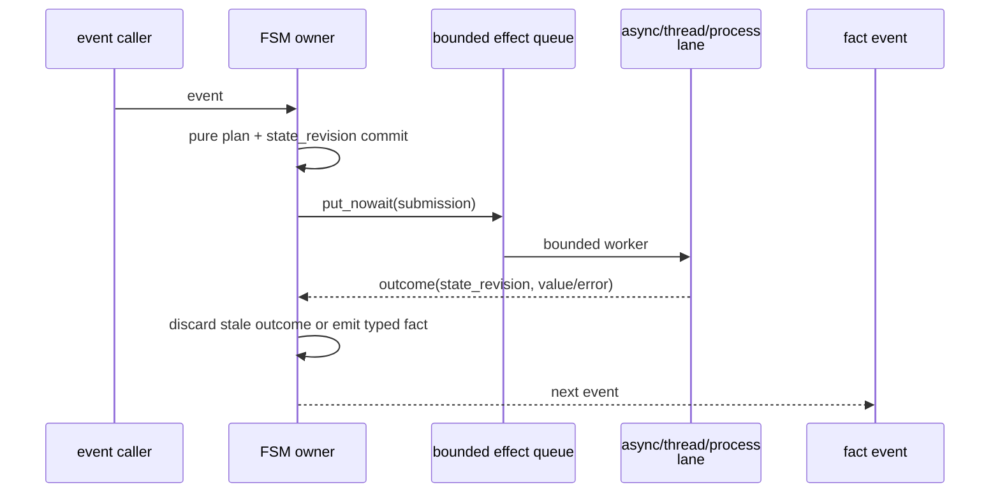
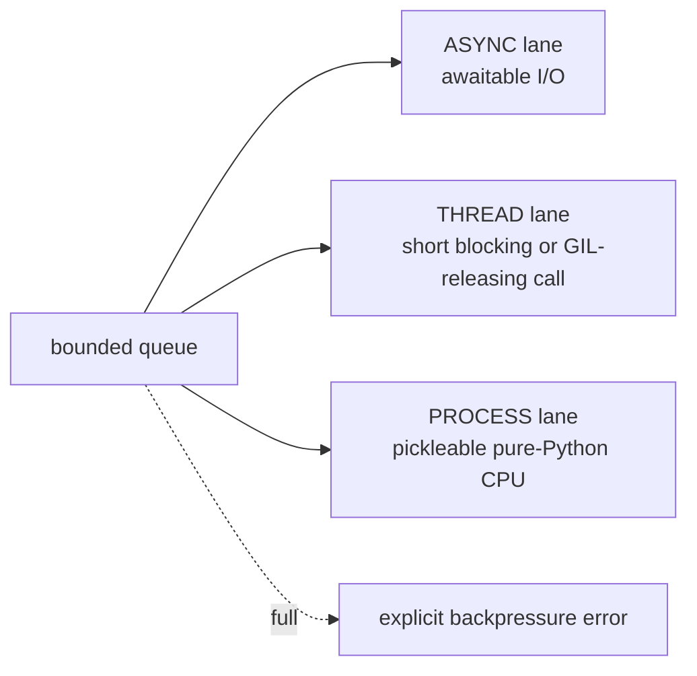
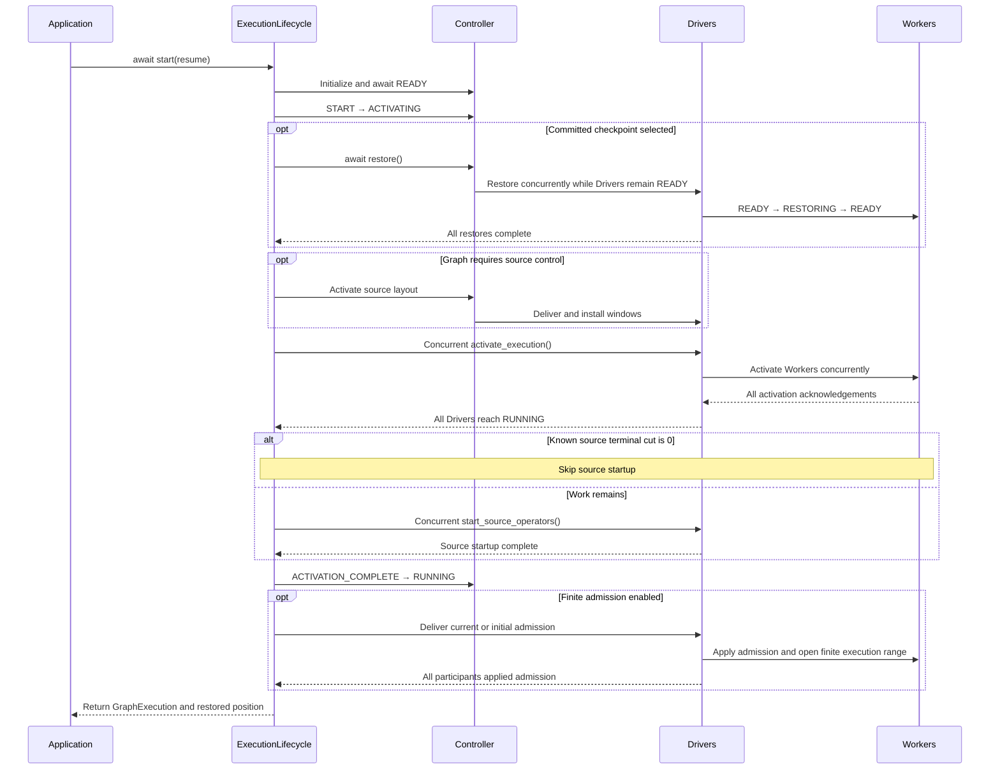
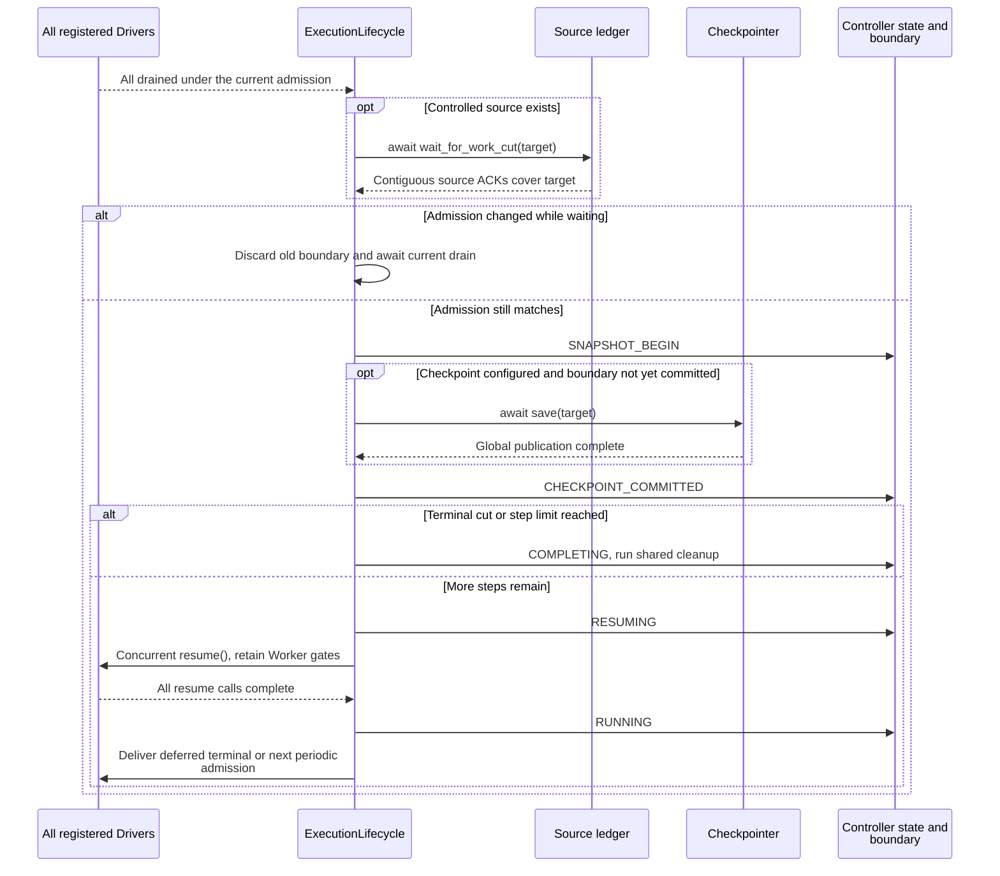
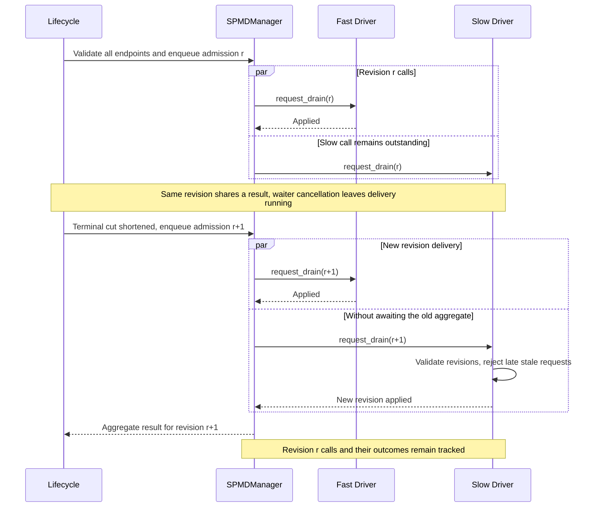
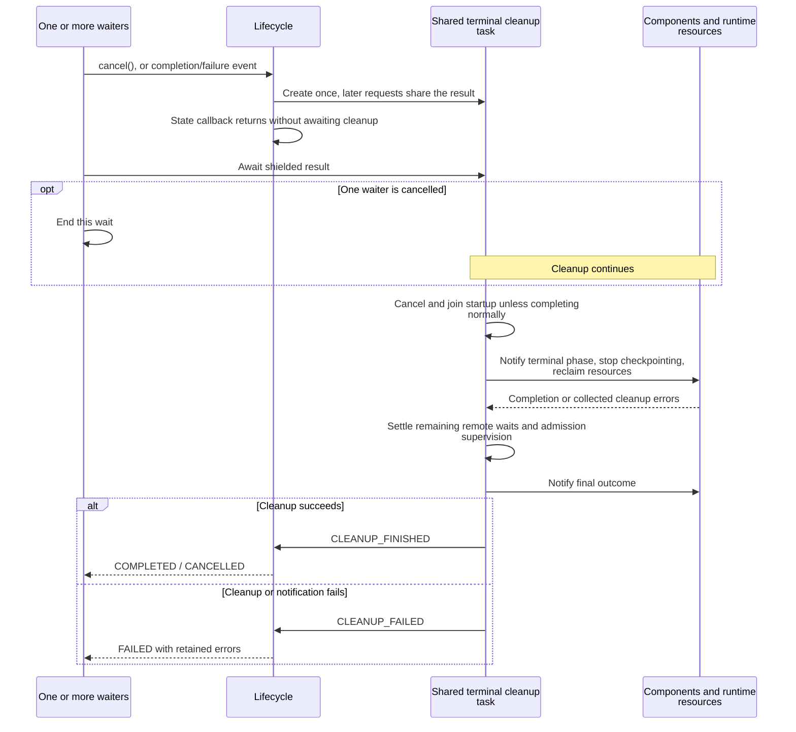

# Distributed Execution Lifecycle

[Chinese edition](execution_lifecycle_zh.md)

Start a compiled graph with `fluxway.start`, wait or observe progress through the
returned `GraphExecution`, and call `cancel()` to stop early. The examples under
[Usage](#usage) are the application-facing entry points. The earlier sections
explain the ordering that those calls enforce.

`fluxway/control_plane/lifecycle.py::ExecutionLifecycle` coordinates
startup, restore, admission delivery, drain completion, checkpoint publication,
resume and failure routing. Controller RPC methods validate requests and invoke
this coordinator. Numerical boundary reduction remains in `DrainBoundary`.

## Owners

| Owner | Responsibility | Does not authorize |
| --- | --- | --- |
| Controller FSM | Global lifecycle phases and terminal cleanup | Per-step work identities |
| ExecutionLifecycle | Ordering and concurrent Driver fan-out | Independent progress or source ownership |
| SPMDManager | Live Driver registry, RPC endpoint validation and enqueue | Lifecycle ordering or admission values |
| DrainBoundary reducer | Observed, admitted, drained and committed cuts | Driver readiness |
| Driver FSM and SnapshotOrchestrator | Local activation and application of an admission revision | Global continuation before Controller decision |
| Worker | Finite execution gate, local queues and checkpoint fences | A new global admission during restore/resume |
| LogicalWorkLedger | Canonical source assignments, leases and ACK coverage | Tensor routing |
| CompiledSendPlan and DataPlane | Payload routing and delivery | Startup, discovery or checkpoint decisions |

## Liveness, progress and execution diagnostics

`heartbeat_timeout_s` is a liveness boundary only. A worker or driver that
continues to publish heartbeats remains alive even when committed execution
progress is quiet. `execution_progress_warning_s` controls a diagnostic warning
and never stops execution; checkpoint inactivity remains owned by the checkpoint
watchdog.

Workers attach execution metadata to heartbeats and profiler records: execution
generation, SPMD/rank, operator, step, epoch, sequence, current phase, phase age,
execution-activity age, committed-progress age, and a typed wait classification.
The classification distinguishes an active operator invocation (which may include
first-use JAX/XLA compilation), source admission, operator admission, transport,
input preparation, queued work, and an empty completion/driver wait. These are
diagnostic states, not cancellation decisions. A heartbeat cannot prove that an
XLA compiler is healthy; an active operator phase only proves that the worker has
not reached a committed completion yet. Backend-specific compile callbacks or a
later completion/failure event are required to close that uncertainty.

The shared event chain covers activation publication and dispatch, installation,
source-scope wait/take, admission, local-plan and operator invocation,
transport/barrier activity, and completion reporting. `execution_progress_warning_s`
reports committed-progress age together with the activity and wait state; it never
stops, retries, or rewinds execution.

## Effect scheduling and Python execution boundaries

The Controller and Driver reducers perform only validation, an O(1) pure transition,
state commit, and a bounded `put_nowait` into the lifecycle effect scheduler. The
reducer lock never waits for RPC, checkpoint storage, component code, worker fan-out,
or source planning. Every accepted submission carries an `ordering_key` and the
committed `state_revision`:



`BoundedLifecycleEffectScheduler` uses fixed worker and queue limits. Effects with the
same `ordering_key` are serialized; different keys run concurrently up to the worker
limit. A full queue raises `LifecycleEffectQueueFullError` immediately so the owning
state machine can apply its admission policy. Closing rejects new submissions, joins
accepted work, and then closes the executors. Cancelling a caller's wait does not cancel
an accepted effect.



CPython's `asyncio` loop is single-threaded and cooperative. `async def` does not move
synchronous I/O or a Python CPU loop away from the actor thread; those operations must
use the explicitly selected thread or process lane. The process lane uses a spawn
context and initializes its pool outside the event-loop call stack. This architecture
defines scheduling and ordering; throughput and tail latency still require workload-
specific measurement.

### Verify an execution lane locally

This internal scheduler example runs without Ray. It checks that a `THREAD`
operation executes on another thread and returns the submitted revision. The
scheduler returns failures in `outcome.error`; its owner must propagate them and
check the revision before applying a result.

```python
import asyncio
from threading import get_ident

from fluxway.common.effect_scheduler import (
    BoundedLifecycleEffectScheduler,
    LifecycleEffectExecutionMode,
    LifecycleEffectSubmission,
)


async def check_thread_lane():
    scheduler = BoundedLifecycleEffectScheduler(queue_size=2, worker_count=2)
    await scheduler.start()
    try:
        outcome = await scheduler.submit(
            LifecycleEffectSubmission(
                operation=get_ident,
                ordering_key="diagnostic",
                state_revision=7,
                mode=LifecycleEffectExecutionMode.THREAD,
            )
        )
        if outcome.error is not None:
            raise outcome.error
        assert outcome.state_revision == 7
        assert outcome.value != get_ident()
    finally:
        await scheduler.close()


asyncio.run(check_thread_lane())
```

`ASYNC` operations must return an awaitable. `PROCESS` operations must be
pickleable; define them in an importable module and protect script startup with
`if __name__ == "__main__":`. This example does not measure concurrency or test
the process lane.

Worker heartbeat distinguishes INITIALIZING, READY, RESTORING, RUNNING, BLOCKED,
STOPPED and ERROR. Driver heartbeat aggregates `workers_ready` (initialization)
and `topology_ready` (registered communication topology). Neither authorizes START.
Topology readiness cannot change a committed checkpoint cut. The manager installs
topology before registering Drivers and passes it to their constructors; replacement
after registration is rejected before mutation.

## Startup and restore



Admitted work may begin before `start()` returns. The diagram collapses acknowledgements
forwarded through the Controller and Drivers. A failure at any stage enters the shared
failure path.

`ACTIVATING` includes restore, source layout activation, Driver `activate_execution`
and source startup. A Driver moves READY → ACTIVATING before issuing concurrent
Worker activation RPCs, then ACTIVATING → RUNNING after every acknowledgement.
`RESTORE_REQUESTED` is invalid during Driver ACTIVATING. Controller ACTIVATING
includes restore while Drivers are still READY, before Driver activation begins.
Component notification follows
activation without starting Controller-managed source production. Controller reaches
RUNNING after those activation calls finish. Controlled or checkpointed Workers keep
their finite gate closed until admission; ordinary graphs without drain gating start
sources after all Drivers have been activated.

Terminal observations during activation update the existing reducer. They cannot
send admission to partially activated Drivers. A terminal cut of zero still activates
Drivers, skips source startup when known before that stage, and delivers the zero
boundary. If zero is discovered during source startup, the closed gate prevents
controlled source execution beyond that boundary.

Restore reconstructs canonical plans and current physical layouts, restores the
committed cut, and restores Worker state before activation. The public restore method
requires a pre-execution READY/ACTIVATING state. Rewinding a running graph is rejected;
there is no implicit live-rewind protocol.

Recovery creates a new execution with fresh Driver and Worker actors. A Driver
accepts restore only in READY; a Worker enters RESTORING from READY and accepts it before execution starts and
before source activation. A failed restore leaves execution admission closed.
Checkpoint save/resume continues the same actors and preserves valid prefetched
source grants. Actor identities separate delayed messages from earlier executions;
source epoch numbers identify data windows and do not identify execution lifetimes.

`WorkerExecutionLifecycle` owns the Worker phase and activation event. Topology
registration moves INITIALIZING → READY without opening the event. Restore moves
READY → RESTORING → READY; failure retires execution into FAILED. Activation alone
moves READY → ACTIVE. Local scheduling reads ACTIVE without a Controller RPC.
Closing and failure reject activation, including delayed commands. Operator blocking,
checkpoint activity, source leases and cut admission retain their separate owners.
Tensor consumer reservations retain their own `RESERVED → CLAIMED → RELEASED` lifecycle;
the sequencer owns the state and Tensor keeps only a non-owning reservation reference. Worker
shutdown submits cleanup to that state machine; cleanup is idempotent, while an explicit repeated
`ConsumerLease.release()` remains an error. Shutdown must not call `cancel()` on a claimed
reservation. See [coherence protocol](coherence_protocol.md#sequence-publications-and-leases).
Driver shutdown moves through STOPPING → STOPPED in its existing FSM. A delayed
activation acknowledgement cannot transition a stopped Driver to RUNNING. Driver
and Worker each retain their local resource-release task; repeated stop calls join
the same operation and observe its errors.

Driver transitions are reduced by one pure relation that returns the next state and a local
effect (`BLOCK_WORKERS`, `REPORT_COMPLETION`, or `REPORT_ERROR`). The Driver lock only commits
state and failure records; worker blocking, Controller reporting and component notification run
after the lock. Worker phase changes use one lifecycle owner, and `close()` creates one release
future; repeated close calls join that future instead of repeating phase writes or resource
release.

`SourceExecutionScope` is a child resource of Worker, not another execution state
machine. It owns installed source windows, their active-step index, grant caches,
installation operations and executing lease batches. Matching activation deliveries
share a supervised operation. Caller cancellation does not abandon installation,
and publication follows successful Reader installation. No lock is held while the
Reader callback runs. The scope cannot change admission or decide a checkpoint cut.

To resume after changing physical Worker counts, build a new graph with the same
canonical source and logical batch cardinality, then call
`await fluxway.start(graph, ..., resume="latest")` against the checkpoint repository.
Stop the previous execution before admitting the replacement. Do not invoke Worker
restore on an already-used actor to rewind its local queues or model state.

## Drain, checkpoint and continuation

### Source progress supervisor

`SourceProgressSupervisor` is the sole owner of the source-window progress task. It has an
independent `generation` and state (`STOPPED`, `STARTING`, `RUNNING`, `STOPPING`, `FAILED`).
Entering Controller `RUNNING` starts the current generation; entering `RESUMING` does not
create another task. A repeated start joins the live generation, and a failed generation is
terminal until the execution itself is replaced. Progress reports wake the supervisor without
running planning work in the Controller FSM lock. Planner work runs in the supervisor task and
its failure enters the normal Controller failure path.

The invariant is `live_source_progress_tasks(generation) <= 1`. Terminal cleanup stops the same
supervisor and observes its failure before publishing the terminal Controller state. This is a
runtime ownership rule, not a training or source-data protocol.



Without checkpoint configuration, boundary commit updates runtime progress without
creating a durable restore artifact.

Driver resume resets checkpoint bookkeeping and synchronizer drain state. It does
not clear the Worker execution gate. Observations during RESUMING are reduced but
delivery waits until every Driver has resumed. If the current admission changes
while waiting for source ACK coverage, the old boundary cannot initiate a snapshot.

Startup, admission, save and resume failures enter the same Controller failure path.
Exceptions remain visible. Worker/Driver errors also enter that FSM failure path;
cleanup owns resource reclamation. No retry or CPU-copy fallback hides a failure.

### Follow a shortened terminal boundary

This local reducer example explains why observing the end of input does not
itself commit a checkpoint. A periodic target of 8 is shortened to 5; only the
commit event advances the durable position. It creates no actors and writes no
checkpoint. Applications use `fluxway.start` rather than drive this internal
reducer themselves.

```python
from fluxway.common.types.drain import (
    DrainAdmission,
    DrainBoundary,
    DrainEvent,
    DrainEventKind,
    reduce_drain_boundary,
)

boundary = DrainBoundary.from_committed_cut(0)
periodic = reduce_drain_boundary(
    boundary, DrainEvent(DrainEventKind.PERIODIC_REQUEST, 8)
)
terminal = reduce_drain_boundary(
    periodic.boundary, DrainEvent(DrainEventKind.TERMINAL_OBSERVATION, 5)
)
boundary = terminal.boundary
assert boundary.admitted_cut == 5
assert boundary.committed_cut == 0

for kind in (DrainEventKind.DRAIN_COMPLETE, DrainEventKind.SNAPSHOT_BEGIN):
    boundary = reduce_drain_boundary(boundary, DrainEvent(kind, 5)).boundary
assert boundary.committed_cut == 0

boundary = reduce_drain_boundary(
    boundary, DrainEvent(DrainEventKind.CHECKPOINT_COMMITTED, 5)
).boundary
assert boundary.committed_cut == 5

admission = DrainAdmission(boundary.revision, 5, terminal_cut=5)
assert not admission.supersedes(admission)
restored = DrainBoundary.from_committed_cut(5)
assert restored.admitted_cut is None
```

An identical admission is idempotent. An older revision or conflicting values at
the same revision raise `ValueError`. A restored boundary has a durable position
but no new admission; the lifecycle must grant the next finite range.

## Admission handoff



Remote arrival order can differ. Every recipient validates revisions, and all remote
failures still enter the failure path.

The lifecycle selects the current immutable admission. `SPMDManager.enqueue_driver_calls`
validates every registered participant and remote endpoint, then enqueues the RPCs
before returning an aggregate Future. Missing actor handles or invalid RPC endpoints
fail the entire preflight; participants are never silently skipped. The manager
keeps no copy of Driver readiness: the receiving Driver FSM validates whether the
operation is legal in its current state. Submission and remote failures
raise when awaited, rather than being returned as ordinary result values. The
manager's existing registry is the only recipient source; lifecycle code does not
adapt Ray handles or keep a second registry.

Concurrent callers share one aggregate Future for that
revision. A new revision can be dispatched while an older RPC is outstanding, so
terminal shortening does not wait behind a slow recipient. Driver/Worker revision
checks reject stale or conflicting requests.

A Driver validates its local state before remembering the admission. Concurrent
identical requests await the same application task, including its failure. Recording
receipt alone does not constitute successful application. The lifecycle retains all
pending supervisors and caches only the latest delivery result for duplicate callers.
These delivery objects are transient and are not checkpoint authorities.

The lifecycle owns a supervision task for each outstanding admission operation.
Callers shield that task; cancelling a caller does not cancel the command or its
failure handling. Completed operations leave the pending set; the latest revision's
result remains available for duplicate waiters. Manager tracks every submitted RPC,
including slow peers after aggregate failure.

FSM transitions commit phase/failure state and hand entry effects to the lifecycle.
COMPLETING, FAILING and CANCELLING register one owned terminal cleanup task and return immediately.
Resource finalization proceeds even if terminal component notification fails.
After resource reclamation, Manager cancels and joins remaining local RPC waits and
the lifecycle settles its admission supervisors. Local cancellation does not prove
remote cessation; actor shutdown and resource reclamation remain responsible for it.
A failure during COMPLETING changes the outcome to FAILED without starting another
cleanup. Cleanup reports CLEANUP_FINISHED or CLEANUP_FAILED through the same FSM.

`GraphExecution.cancel()` requests CANCELLING and joins that cleanup through a shielded
wait. Repeated cancellation joins the same result, including after completion.
Cancelling a waiter does not cancel cleanup. Successful reclamation produces CANCELLED;
a cleanup failure produces FAILED. `wait()` raises `asyncio.CancelledError` for a
cancelled execution and `ExecutionFailedError` for failure. Cancellation does not
create a checkpoint; recovery uses the latest committed coordinated checkpoint.
Startup is also lifecycle-owned. Failure or cancellation settles any pending startup
before reclamation, so a readiness wait cannot outlive a terminal execution. A
cancelled placement wait releases its allocated placement group.



`wait()` observes terminal state; `cancel()` joins cleanup. A wait timeout alone does
not trigger this cancellation path.

Reducer mutation locks contain no RPC, checkpoint I/O or source ACK wait. Driver
fan-out is concurrent; Worker execution and tensor traffic remain distributed.
This design establishes ordering and bounded retained delivery state, not measured
Controller scalability or cross-node throughput.

## Usage

The following integration function accepts a compiled `graph`, a `PlacementRecipe`,
and a repository path. Initialize Ray on the submitting process before calling it.
Every participating node needs compatible dependencies and access to that repository.
The graph must register all state components required to continue training.

```python
from typing import Literal

import fluxway
from fluxway.common.types import AsyncStepConfig, CheckpointConfig, Graph
from fluxway.placement import PlacementRecipe


async def train(
    graph: Graph,
    recipe: PlacementRecipe,
    repository_dir: str,
    *,
    resume: Literal["latest"] | int | None = None,
) -> int | None:
    execution = await fluxway.start(
        graph,
        placement_recipe=recipe,
        async_step_config=AsyncStepConfig(max_steps=37),
        checkpoint_config=CheckpointConfig(
            repository_dir=repository_dir,
            interval_steps=17,
        ),
        resume=resume,
    )
    try:
        await execution.wait()
        return execution.restored_step
    finally:
        await execution.cancel()
```

The function returns the position restored at startup, or `None` when nothing was
restored. Its example runs to position 37 and requests periodic checkpoints every
17 steps; reaching a terminal boundary follows the drain sequence above.
Use `resume="latest"` or a committed checkpoint step to start a new execution.
Topology changes must preserve the logical batch and satisfy each checkpoint
component's topology contract. `wait(timeout=...)` limits the wait; it does not
cancel execution. Call `cancel()` explicitly to stop early. A completed execution
already owns its cleanup; the final `cancel()` safely observes that result.

### Observe progress or bound a wait

Pass a running execution to either function below. `observe` prints the progress
mapping returned by each SPMD at five-second intervals until completion.
`finish_with_deadline` propagates `TimeoutError` and always requests cleanup,
so its deadline also stops execution.

```python
from fluxway import GraphExecution


async def observe(execution: GraphExecution) -> None:
    async for progress in execution.monitor_progress(interval_s=5.0):
        print(progress)


async def finish_with_deadline(execution: GraphExecution, timeout_s: float) -> None:
    try:
        await execution.wait(timeout=timeout_s)
    finally:
        await execution.cancel()
```

A bare `wait(timeout=...)` leaves execution running when it times out.
`monitor_progress` also leaves cleanup to the caller. Successful cancellation
makes a pending `wait()` raise `asyncio.CancelledError`; execution failure raises
`ExecutionFailedError`. Neither path creates a new checkpoint.

The public entry point accepts compiled graphs. Source-free graphs use the same
authorization sequence and omit source layout preparation. A standalone dynamic
eager graph submission API is not provided.
Eager numerical computation inside an operator uses the same execution authorization.

## Conformance boundaries

The lifecycle contract covers startup, out-of-order Driver activation, terminal cuts,
restore ordering, concurrent admission revisions, duplicate application, save/resume
failure propagation and checkpoint continuation. Source-window progress and refill are
owned by the source coordination contract: the controller's event-driven
`SourceProgressSupervisor` performs them, while the public startup API only starts the
lifecycle. See [source coordination](source_coordination.md) for ingestion semantics.
