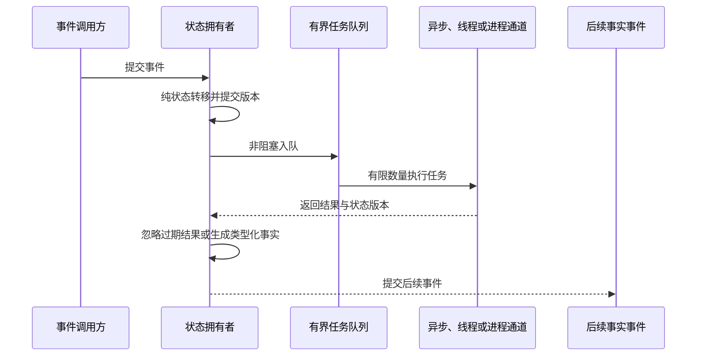
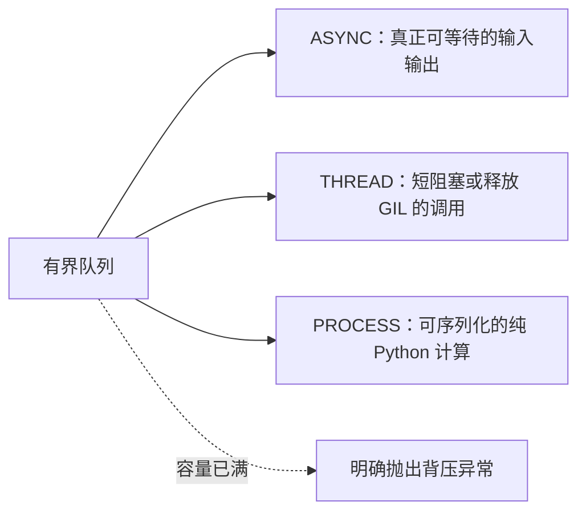
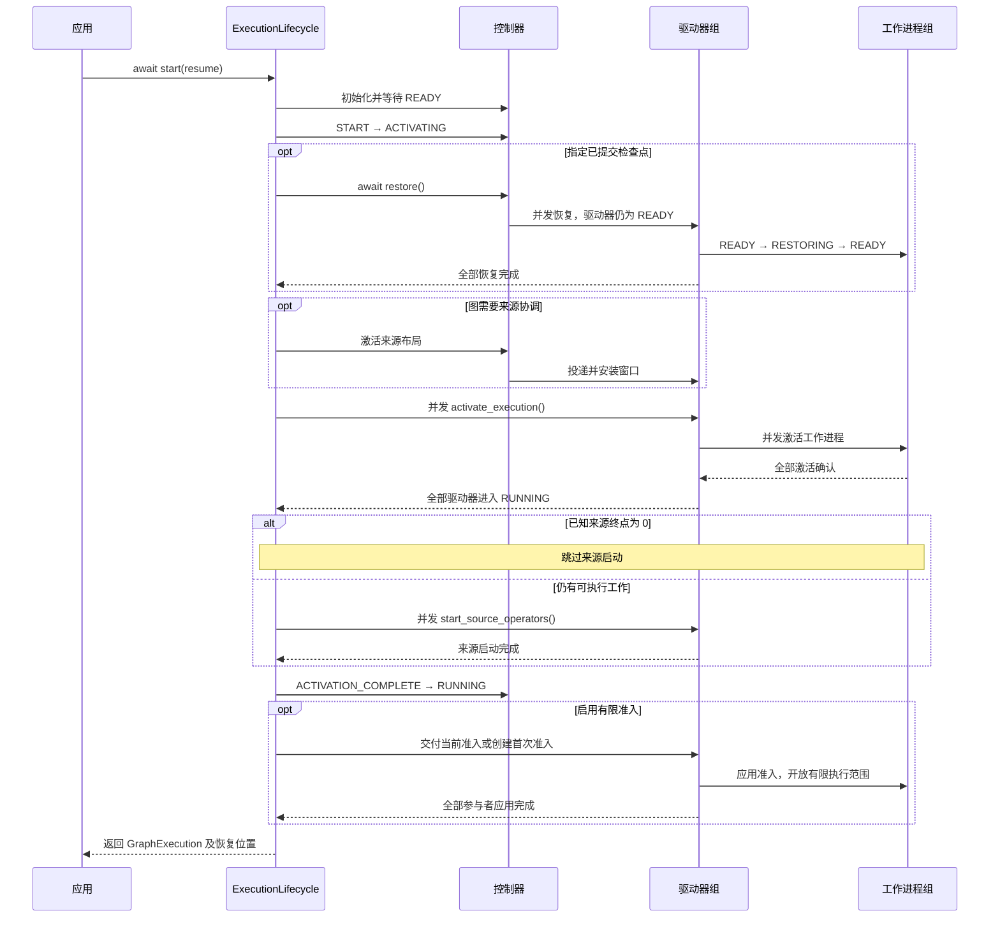
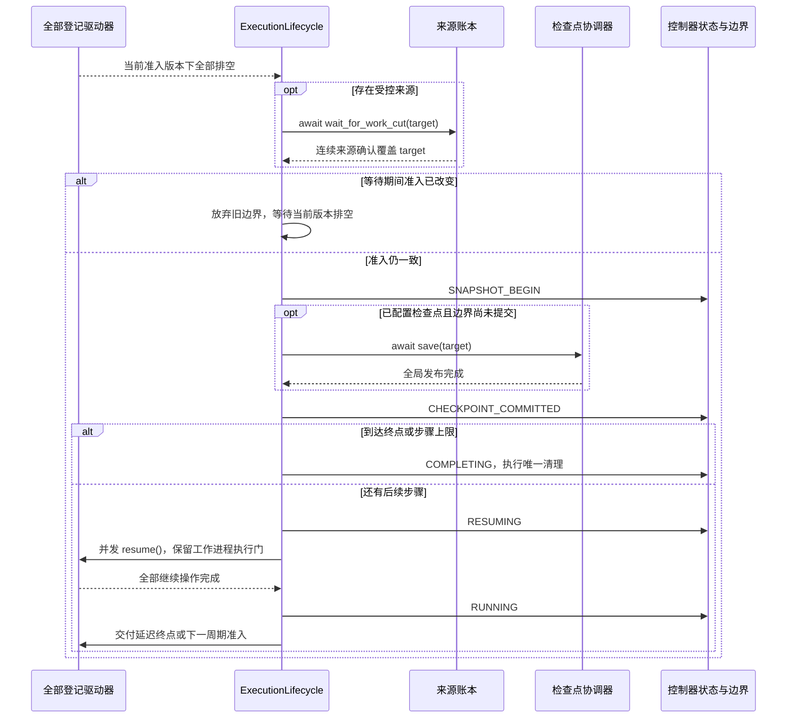
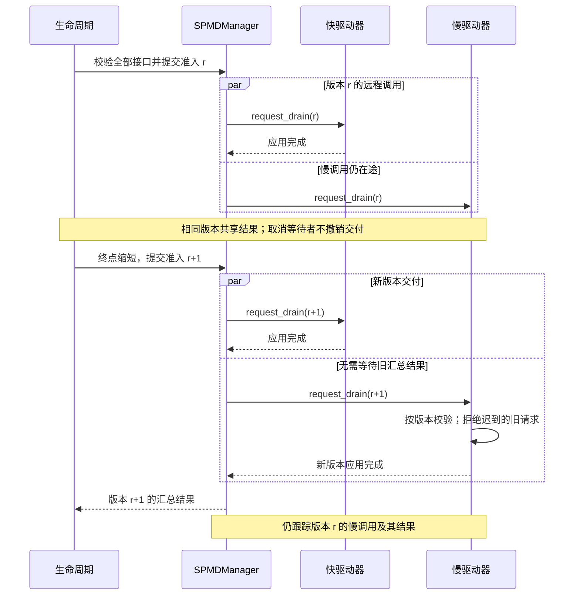
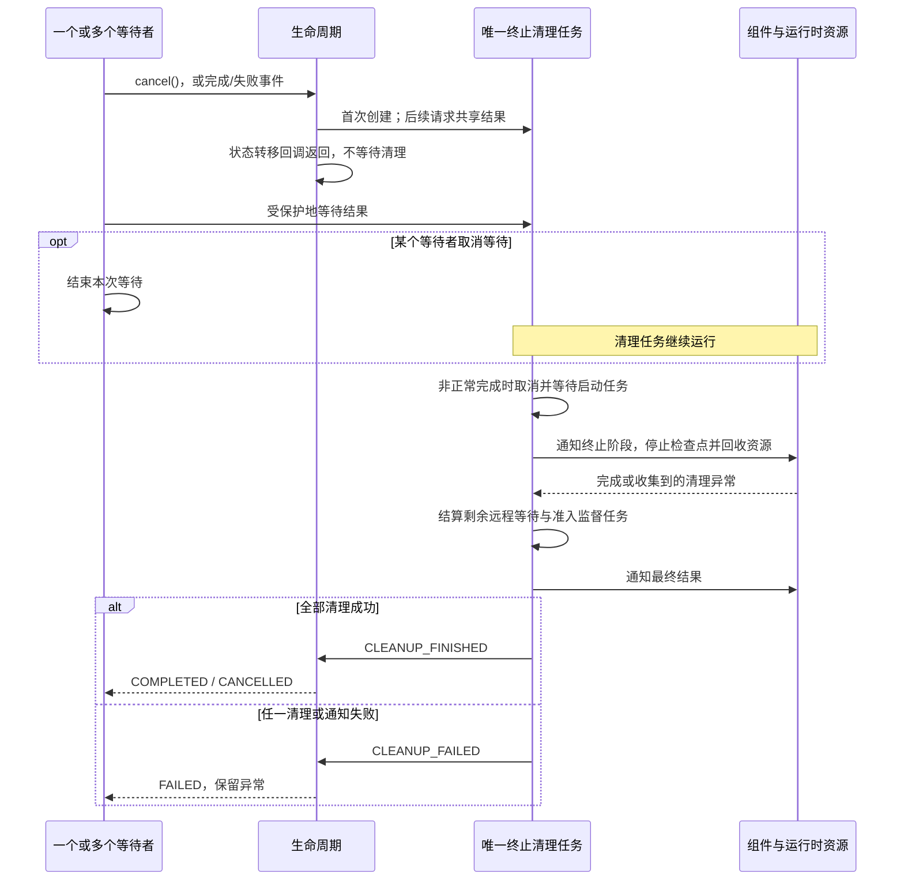

# 分布式执行生命周期

英文版见 [execution_lifecycle.md](execution_lifecycle.md)。

使用 `fluxway.start` 启动编译图，通过返回的 `GraphExecution` 等待完成或观察进度，提前停止时调用 `cancel()`。[使用方式](#使用方式)给出应用接入示例，前面的章节说明这些调用保证的顺序。

`fluxway/control_plane/lifecycle.py` 中的 `ExecutionLifecycle` 协调启动、恢复、准入交付、排空完成、检查点发布、继续执行和故障处理。控制器的远程接口校验请求后调用它，数值边界仍由 `DrainBoundary` 归约。

## 职责归属

| 对象 | 职责 | 不负责 |
| --- | --- | --- |
| 控制器状态机 | 全局阶段与终止清理 | 每一步的任务身份 |
| `ExecutionLifecycle` | 阶段顺序与驱动器并发调用 | 独立的来源进度或所有权 |
| `SPMDManager` | 活跃驱动器登记、接口校验与调用排队 | 生命周期顺序或准入数值 |
| `DrainBoundary` | 已观察、已准入、已排空与已提交位置 | 驱动器是否就绪 |
| 驱动器状态机与 `SnapshotOrchestrator` | 本地激活与应用准入版本 | 自行决定全局继续执行 |
| 工作进程 | 有限执行门、本地队列与检查点隔离 | 恢复时创建新的全局准入 |
| `LogicalWorkLedger` | 规范来源任务、租约与确认覆盖 | 张量路由 |
| `CompiledSendPlan` 与数据面 | 载荷路由与交付 | 启动、发现或检查点决策 |

## 存活、进度与执行诊断

`heartbeat_timeout_s` 只判断存活。驱动器或工作进程仍在发布心跳时，即使已提交进度暂时不变，也仍视为存活。`execution_progress_warning_s` 控制诊断告警，不会停止执行；检查点不活跃由检查点看门狗负责。

工作进程在心跳和分析记录中附带执行代次、SPMD 与秩、算子、步骤、轮次、序号、当前阶段、阶段持续时间、最近活动时间、提交进度停滞时间及等待分类。分类区分算子调用、来源准入、算子准入、传输、输入准备、排队和空闲等待。

算子调用可能包含首次 JAX/XLA 编译。这些分类用于诊断，不决定取消。心跳不能证明编译器健康；需要后续完成、失败事件或后端编译回调，才能判断该阶段的结果。

事件链覆盖激活发布、分发和安装，来源作用域等待与获取，准入，本地计划与算子调用，传输、屏障和完成报告。进度告警同时报告停滞时间、活动情况和等待状态，不会自动重试或回退进度。

## 外部操作调度与 Python 执行边界

控制器和驱动器在归约锁内只做校验、常数时间的纯状态转移、状态提交，以及向有界调度器非阻塞入队。锁内不等待远程调用、检查点存储、组件代码、工作进程并发调用或来源规划。每个任务带有 `ordering_key` 和已提交的 `state_revision`：



`BoundedLifecycleEffectScheduler` 使用固定的队列和执行容量。同一排序键串行，不同键在容量内并发。队列满时立即抛出 `LifecycleEffectQueueFullError`，由状态拥有者决定准入策略。关闭时拒绝新任务，等待已接收任务结束，再关闭执行器。取消调用方的等待不会取消已接收任务。



CPython 的事件循环采用单线程协作式调度。`async def` 不会将同步输入输出或纯 Python 计算移出事件循环；这些工作需明确选择线程或进程通道。进程池通过 `spawn` 创建，初始化不占用事件循环调用栈。这定义了调度与顺序，不保证某个工作负载的吞吐或尾延迟。

### 本地检查执行通道

下面的内部调度器例子无需 Ray，检查 `THREAD` 任务是否在其他线程执行，以及结果是否带回提交时的状态版本。错误保存在 `outcome.error` 中，拥有者必须传播错误，并在应用结果前检查版本。

```python
import asyncio
from threading import get_ident

from fluxway.common.effect_scheduler import (
    BoundedLifecycleEffectScheduler,
    LifecycleEffectExecutionMode,
    LifecycleEffectSubmission,
)


async def check_thread_lane():
    scheduler = BoundedLifecycleEffectScheduler(queue_size=2, worker_count=2)
    await scheduler.start()
    try:
        outcome = await scheduler.submit(
            LifecycleEffectSubmission(
                operation=get_ident,
                ordering_key="diagnostic",
                state_revision=7,
                mode=LifecycleEffectExecutionMode.THREAD,
            )
        )
        if outcome.error is not None:
            raise outcome.error
        assert outcome.state_revision == 7
        assert outcome.value != get_ident()
    finally:
        await scheduler.close()


asyncio.run(check_thread_lane())
```

`ASYNC` 任务必须返回可等待对象。`PROCESS` 任务必须可序列化，应在可导入模块中定义，并以 `if __name__ == "__main__":` 保护脚本入口。此例不测量并发性能，也不验证进程通道。

工作进程心跳区分 `INITIALIZING`、`READY`、`RESTORING`、`RUNNING`、`BLOCKED`、`STOPPED` 和 `ERROR`。驱动器汇总 `workers_ready` 与 `topology_ready`，但二者都不能授权开始执行。拓扑就绪不能改变已提交位置。管理器先安装拓扑再登记驱动器，登记后替换拓扑会在修改前被拒绝。

## 启动与恢复



获准的工作可能在 `start()` 返回前开始。图中聚合了经控制器和驱动器转发的确认；任一阶段失败都会进入统一故障路径。

控制器的 `ACTIVATING` 包含恢复、来源布局激活、驱动器激活和来源启动。恢复发生在驱动器仍为 `READY` 时；驱动器进入 `ACTIVATING` 后并发激活工作进程，收到全部确认才进入 `RUNNING`，此时不接受恢复请求。

组件通知不能启动由控制器管理的来源生产。受控来源或启用检查点的工作进程保持有限执行门关闭，直到收到准入。未使用排空门控的普通图在全部驱动器激活后启动来源。

激活期间发现来源终点时，只更新当前边界，不向部分激活的驱动器发送准入。终点为零也要完成驱动器激活；若来源启动前已知终点为零，则跳过来源启动并交付零边界。若在启动期间才发现，关闭的执行门阻止受控来源越界执行。

恢复先重建规范计划与当前物理布局，再恢复已提交位置和工作进程状态，最后激活执行。公开恢复要求处于执行前的 `READY` 或 `ACTIVATING` 阶段，不能倒退正在运行的图。

恢复使用新的驱动器和工作进程。驱动器只在 `READY` 接受恢复，工作进程在 `READY → RESTORING → READY` 期间完成恢复；失败时准入保持关闭。普通检查点后的继续执行保留原角色和有效预取授权。角色身份隔离旧执行的延迟消息，来源轮次仅标识数据窗口，不标识执行生命周期。

`WorkerExecutionLifecycle` 独占工作进程阶段和激活事件。登记拓扑只将 `INITIALIZING` 改为 `READY`，不开放激活事件；只有显式激活才进入 `ACTIVE`。失败进入 `FAILED`。本地调度直接读取 `ACTIVE`，不为此调用控制器。关闭或失败后，延迟激活命令也会被拒绝。

算子阻塞、检查点活动、来源租约和切点准入仍各自管理。张量消费预留遵循独立的 `RESERVED → CLAIMED → RELEASED` 生命周期，序列器拥有其状态，张量只保留非拥有引用。关闭时提交幂等清理，不能取消已领取的预留；显式重复调用 `ConsumerLease.release()` 仍然报错。见[一致性协议](coherence_protocol_zh.md)。

驱动器关闭经过 `STOPPING → STOPPED`，延迟的激活确认不能让它重新进入 `RUNNING`。驱动器和工作进程各自保留唯一资源释放任务，重复停止或关闭会等待同一结果并观察其异常。

驱动器的纯转移关系返回新状态及 `BLOCK_WORKERS`、`REPORT_COMPLETION` 或 `REPORT_ERROR` 等外部操作。锁内只提交状态和失败，锁外才阻塞工作进程、报告控制器或通知组件。

`SourceExecutionScope` 是工作进程的子资源，管理已安装窗口、活跃步骤索引、授权缓存、安装操作和执行中的租约批次。重复激活共享受监督的安装操作；调用方取消不会放弃安装，读取器成功安装后才发布。调用读取器时不持锁。这个作用域不能决定准入或检查点位置。

改变工作进程数量后恢复，需要构建新的图，保持同一规范来源和逻辑批大小，并调用 `fluxway.start(..., resume="latest")`。替代执行开放准入前，先停止旧执行。不能在已使用的角色上直接恢复以倒退队列或模型状态。

## 排空、检查点与继续执行

### 来源进度监督器

`SourceProgressSupervisor` 是来源窗口进度任务的唯一拥有者，独立维护代次和 `STOPPED`、`STARTING`、`RUNNING`、`STOPPING`、`FAILED` 状态。控制器进入 `RUNNING` 时启动当前代次，进入 `RESUMING` 不会创建另一个任务。

重复启动复用活跃代次，代次失败后只能通过替换执行恢复。进度报告只唤醒监督器，不在控制器状态锁内规划；规划失败进入控制器的统一故障路径。每代最多一个活跃任务：

`live_source_progress_tasks(generation) <= 1`

终止清理停止同一个监督器，在发布控制器终态前观察其失败。这是运行时职责约束，不是模型或来源数据协议。



未配置检查点时，边界提交只更新运行时进度，不产生持久恢复产物。

驱动器继续执行时重置检查点记账和排空同步状态，不清除工作进程执行门。`RESUMING` 期间仍归约新观察，但全部驱动器完成继续操作后才交付。等待来源确认期间若准入变化，旧边界不能发起快照。

启动、准入、保存、继续执行及驱动器或工作进程的失败，均进入同一控制器故障路径，异常保持可见，由清理负责回收资源。

### 观察终点如何缩短边界

下面的本地归约例子说明，发现来源结束不会直接提交检查点。周期目标从 8 缩短到 5，只有提交事件才推进持久化位置。它不创建角色，也不写检查点。应用应调用 `fluxway.start`，不自行驱动这个内部归约器。

```python
from fluxway.common.types.drain import (
    DrainAdmission,
    DrainBoundary,
    DrainEvent,
    DrainEventKind,
    reduce_drain_boundary,
)

boundary = DrainBoundary.from_committed_cut(0)
periodic = reduce_drain_boundary(
    boundary, DrainEvent(DrainEventKind.PERIODIC_REQUEST, 8)
)
terminal = reduce_drain_boundary(
    periodic.boundary, DrainEvent(DrainEventKind.TERMINAL_OBSERVATION, 5)
)
boundary = terminal.boundary
assert boundary.admitted_cut == 5
assert boundary.committed_cut == 0

for kind in (DrainEventKind.DRAIN_COMPLETE, DrainEventKind.SNAPSHOT_BEGIN):
    boundary = reduce_drain_boundary(boundary, DrainEvent(kind, 5)).boundary
assert boundary.committed_cut == 0

boundary = reduce_drain_boundary(
    boundary, DrainEvent(DrainEventKind.CHECKPOINT_COMMITTED, 5)
).boundary
assert boundary.committed_cut == 5

admission = DrainAdmission(boundary.revision, 5, terminal_cut=5)
assert not admission.supersedes(admission)
restored = DrainBoundary.from_committed_cut(5)
assert restored.admitted_cut is None
```

相同准入可重复应用；旧版本或同版本的冲突值抛出 `ValueError`。恢复后的边界有已提交位置，但没有新的准入；下一段有限执行范围仍需由生命周期授予。

## 准入交接



远端实际到达次序可不同。每个接收者都必须校验版本，所有远程失败仍传播到故障路径。

生命周期选择当前不可变准入。`SPMDManager.enqueue_driver_calls` 先校验全部登记参与者及其远程接口，再排队调用，返回汇总异步结果。缺少角色句柄或接口无效时，整次预检失败，不跳过参与者。接收端驱动器状态机判断操作是否合法，管理器不另存就绪状态，也不另建接收者清单。

提交或远程调用失败会在等待时抛出，不作为普通结果返回。相同版本的并发调用共享一个汇总结果。旧请求尚未完成时也可交付新版本，因此缩短终点不必等待慢接收者；接收端拒绝过期或冲突版本。

驱动器先校验状态，再记住准入。相同请求共享同一个应用任务及其失败；只记下收到请求不等于应用成功。生命周期持有全部待完成监督任务，只缓存最新版本的结果。这些对象是瞬态交付状态，不是检查点依据。

调用方取消等待不会取消受监督的准入操作或失败处理。完成后任务移出待完成集合，最新版本结果保留供重复调用观察。管理器仍跟踪所有已提交远程调用，包括其他参与者已失败时尚未结束的慢调用。

控制器进入 `COMPLETING`、`FAILING` 或 `CANCELLING` 时，只登记唯一终止清理任务后立即返回。组件终止通知失败也不跳过资源回收。回收后，管理器取消并等待剩余本地远程调用等待对象，生命周期结算准入监督任务。本地取消不代表远端已停止，远端仍依赖角色关闭与资源回收。

完成过程中的失败会将结果改为 `FAILED`，不创建第二个清理任务。清理通过同一状态机报告 `CLEANUP_FINISHED` 或 `CLEANUP_FAILED`。

`GraphExecution.cancel()` 请求取消并等待同一个受保护的清理任务。重复取消和完成后的取消观察同一结果；取消等待者不取消清理。成功回收进入 `CANCELLED`，回收失败进入 `FAILED`。`wait()` 分别抛出 `asyncio.CancelledError` 或 `ExecutionFailedError`。



`wait()` 通过完成状态观察结果；`cancel()` 等待清理任务。仅等待超时不会触发图中的取消流程。

取消不额外创建检查点，恢复只能使用已提交的协调检查点。启动任务同样由生命周期管理，失败或取消时先结算启动再回收，避免就绪等待悬挂；取消放置等待会释放已分配放置组。

状态锁不等待远程调用、检查点输入输出或来源确认。驱动器调用保持并发，工作进程与张量传输保持分布式。上述约束说明顺序和交付状态的保留范围，不代表已经测得控制器扩展能力或跨节点吞吐。

## 使用方式

下面的接入函数接收编译图、`PlacementRecipe` 和仓库路径。调用前在提交进程初始化 Ray，各参与节点需有兼容的依赖并能访问仓库。图中必须登记继续训练所需的全部状态组件。

```python
from typing import Literal

import fluxway
from fluxway.common.types import AsyncStepConfig, CheckpointConfig, Graph
from fluxway.placement import PlacementRecipe


async def train(
    graph: Graph,
    recipe: PlacementRecipe,
    repository_dir: str,
    *,
    resume: Literal["latest"] | int | None = None,
) -> int | None:
    execution = await fluxway.start(
        graph,
        placement_recipe=recipe,
        async_step_config=AsyncStepConfig(max_steps=37),
        checkpoint_config=CheckpointConfig(
            repository_dir=repository_dir,
            interval_steps=17,
        ),
        resume=resume,
    )
    try:
        await execution.wait()
        return execution.restored_step
    finally:
        await execution.cancel()
```

返回值是启动时恢复的位置；没有恢复状态时为 `None`。例子执行到位置 37，每隔 17 步请求检查点，到达终点时遵循前述排空顺序。

新执行可指定 `resume="latest"` 或已提交的检查点步骤。改变拓扑必须保持逻辑批大小，并满足各组件的拓扑契约。`wait(timeout=...)` 仅限制等待时间，提前停止需显式调用 `cancel()`。完成后的 `cancel()` 观察已有清理结果，不重复回收。

### 观察进度或限制等待时间

下面两个函数接收正在运行的执行对象。`observe` 每隔五秒打印按 SPMD 返回的进度，直到完成。`finish_with_deadline` 传播超时异常，并始终请求清理，因此超时后也会停止执行。

```python
from fluxway import GraphExecution


async def observe(execution: GraphExecution) -> None:
    async for progress in execution.monitor_progress(interval_s=5.0):
        print(progress)


async def finish_with_deadline(execution: GraphExecution, timeout_s: float) -> None:
    try:
        await execution.wait(timeout=timeout_s)
    finally:
        await execution.cancel()
```

单独调用 `wait(timeout=...)` 超时后执行仍会继续，`monitor_progress` 也由调用方负责最终清理。取消成功后，正在等待的 `wait()` 抛出 `asyncio.CancelledError`；执行失败时抛出 `ExecutionFailedError`。两条路径都不会创建检查点。

公开入口接收编译图。无来源图使用相同的执行授权顺序，只省略来源布局准备。框架没有独立的动态即时图提交接口，算子内部的即时数值计算仍受同一执行授权约束。

## 一致性边界

生命周期契约覆盖启动、驱动器乱序激活、终点、恢复顺序、并发准入版本、重复应用、保存和继续执行的失败传播。来源窗口进度和补充由控制器的事件驱动监督器负责，公开启动接口只启动生命周期。读取语义与示例见[来源协调](source_coordination_zh.md)。
