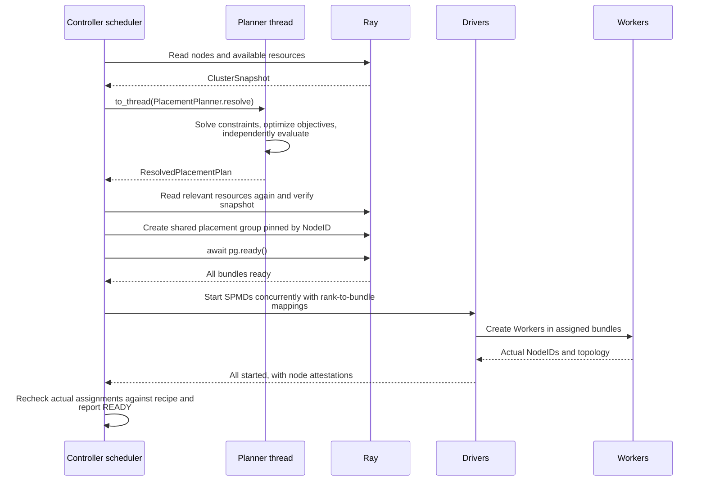

# Placement recipes

[Chinese edition](placement_recipe_zh.md)

A placement recipe states which workers may share nodes and which valid
assignment Fluxway should prefer. Each SPMD declares its own per-worker resource
demand in `ResourceProfile`; the recipe does not repeat those declarations.

## Build and check a recipe locally

This example places two reader workers and two trainer workers on two CPU nodes.
The hard constraint makes both groups use the same nodes. The first objective
spreads trainers evenly; the second minimizes occupied nodes without weakening
the first objective. The cluster snapshot is an offline example input: this code
does not start Ray or reserve resources.

<!-- test:placement-offline-recipe -->
```python
import fluxway as fw
from fluxway.placement import ClusterNode, ClusterSnapshot, PlacementPlanner
from fluxway.placement.inventory import PlacementInventory


class Reader:
    def ready(self) -> None:
        return None


class Trainer:
    def train(self) -> None:
        return None


ReaderSPMD = fw.bind_spmd(
    Reader,
    resource_profile=fw.ResourceProfile(base={"CPU": 1}),
    mesh_axis_names=("data",),
    mesh_axis_shapes=(2,),
    ready={},
)
TrainerSPMD = fw.bind_spmd(
    Trainer,
    resource_profile=fw.ResourceProfile(base={"CPU": 1}),
    mesh_axis_names=("data",),
    mesh_axis_shapes=(2,),
    train={},
)
builder = fw.Builder()
builder.add_node("readers", ReaderSPMD)
builder.add_node("trainers", TrainerSPMD)
builder.add_func_edge("readers", "ready", "trainers", "train")
graph = builder.build("placement-example")

occupied_nodes = fw.cardinality(fw.support(fw.all_workers()))
recipe = fw.PlacementRecipe(
    recipe_id="shared-nodes",
    constraints=(fw.equal(fw.support(ReaderSPMD), fw.support(TrainerSPMD)),),
    objective=fw.lexicographic(
        fw.max_min(fw.occupancy(TrainerSPMD)),
        fw.minimize(occupied_nodes),
    ),
)
snapshot = ClusterSnapshot.from_nodes(
    (
        ClusterNode(node_id="node-a", resources={"CPU": 2}),
        ClusterNode(node_id="node-b", resources={"CPU": 2}),
    )
)
inventory = PlacementInventory.from_compiled_graph(graph.require_compiled_graph())
plan = PlacementPlanner(solve_timeout_s=10).resolve(inventory, recipe, snapshot)

assert plan.worker_counts_by_node("readers") == [1, 1]
assert plan.worker_counts_by_node("trainers") == [1, 1]
assert all(result.satisfied for result in plan.constraint_results)
assert {item.node_id for item in plan.assignments} == {"node-a", "node-b"}
```

`PlacementInventory` reads frozen declarations from the compiled graph. It is
the planner integration entry point; ordinary job startup creates it for you.
`plan.assignments` maps each `(spmd_id, rank)` to a node and resource allocation.
Do not depend on which equally valid node receives rank zero.

These operators only demonstrate placement. For a running data pipeline,
connect real sources and operators as described in [the guide](README.md).

## Start a job with the recipe

For an initialized Ray cluster and a complete graph with a finite source, pass
the graph and its recipe to `start`. Graph classes must match the classes
referenced by the recipe. Install the project's declared dependencies on every node.

<!-- test:placement-controller-entry -->
```python
from fluxway import Graph, GraphExecution, PlacementRecipe, start


async def run_job(graph: Graph, recipe: PlacementRecipe) -> GraphExecution:
    execution = await start(graph, placement_recipe=recipe)
    try:
        await execution.wait()
        return execution
    finally:
        await execution.cancel()
```

`wait()` returns after successful completion and raises on execution failure.
The `finally` block also releases execution resources after failure or cancellation.
Graph and recipe travel as native Python objects. Invalid resources, unknown
SPMDs, impossible constraints, and solver timeouts raise errors.

The controller owns the Ray placement group. Each planned NodeID receives one
composite bundle pinned by the `ray.io/node-id` label selector. Managers and
drivers borrow its rank-to-bundle mapping, and workers verify their actual node.
An IP address is not a NodeID. CPU, GPU, and custom accelerator reservations come
from the plan. Recoverable multi-node jobs also need shared checkpoint storage.

See [placement mathematics](placement_mathematics.md) for selection, constraints,
resource scaling, and objective order.



Offline `resolve()` ends after solving and reserves no Ray resources. A changed
snapshot, infeasibility, or timeout fails. A failed or cancelled placement-group wait
releases the group; a solved plan is not execution readiness.

## Register resources created inside a worker

Hardware quotas belong in `ResourceProfile`. Live objects such as routing tables
and device meshes belong in a `ResourceRegistry`. A `ResourceHandle` identifies
an object without putting that object into a recipe.

<!-- test:placement-resource-registry -->
```python
from io import BytesIO

from fluxway import (
    ResourceHandle,
    ResourceRegistry,
    bind_resource_registry,
    get_active_resource_registry,
)

registry = ResourceRegistry()
handle = ResourceHandle(namespace="buffers", resource_id="batch")
buffer = BytesIO(b"input")
registry.register(handle.namespace, handle.resource_id, buffer)

try:
    with bind_resource_registry(registry):
        active = get_active_resource_registry()
        resource = active.resolve(handle.namespace, handle.resource_id)
        assert resource.read() == b"input"
finally:
    owned_resource = registry.unregister(handle.namespace, handle.resource_id)
    owned_resource.close()

assert buffer.closed
assert not registry.contains(handle.namespace, handle.resource_id)
```

The binding restores the previous context when its scope ends. Integrations
that cannot use a context manager must pair `set_active_resource_registry(registry)`
with `reset_active_resource_registry(token)` using the returned token.
Duplicate registration, a missing resource, or context lookup without an active
registry raises.

`unregister()` and `clear()` remove references; they do not close objects.
The resource owner must close them, including during
[operator shutdown](worker_process_operators.md). Registry synchronization protects
registration and lookup, not concurrent use of the registered object.
