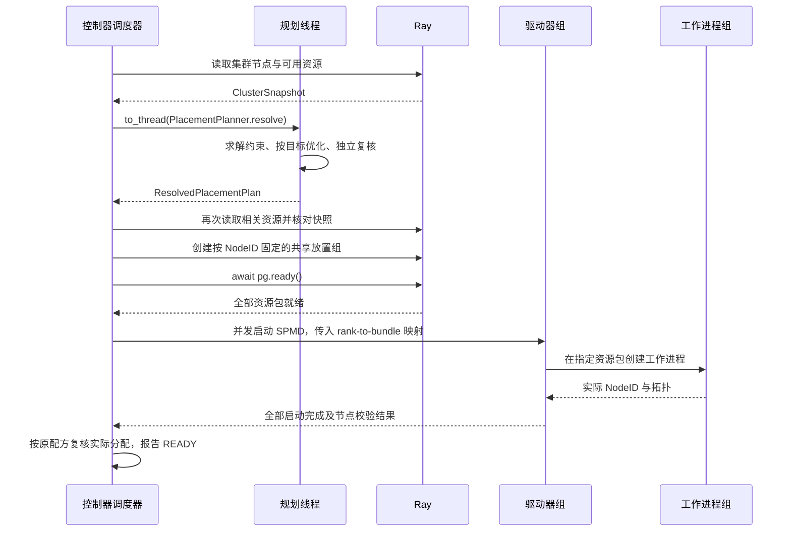

# 放置配方

[英文版](placement_recipe.md)

放置配方规定哪些工作进程可以共用节点，以及在有效方案中优先选择哪一种。
每个 SPMD 通过 `ResourceProfile` 声明单个工作进程的资源需求；配方不重复声明资源。

## 在本地构建并检查配方

下面将两个读取工作进程和两个训练工作进程放到两个 CPU 节点上。
硬约束要求两组进程使用相同的节点集合。第一个目标让训练进程尽量均匀分布；
第二个目标在不影响第一个目标的前提下，减少占用的节点总数。
集群快照是离线检查的示例输入，代码不会启动 Ray，也不会预留资源。

<!-- test:placement-offline-recipe -->
```python
import fluxway as fw
from fluxway.placement import ClusterNode, ClusterSnapshot, PlacementPlanner
from fluxway.placement.inventory import PlacementInventory


class Reader:
    def ready(self) -> None:
        return None


class Trainer:
    def train(self) -> None:
        return None


ReaderSPMD = fw.bind_spmd(
    Reader,
    resource_profile=fw.ResourceProfile(base={"CPU": 1}),
    mesh_axis_names=("data",),
    mesh_axis_shapes=(2,),
    ready={},
)
TrainerSPMD = fw.bind_spmd(
    Trainer,
    resource_profile=fw.ResourceProfile(base={"CPU": 1}),
    mesh_axis_names=("data",),
    mesh_axis_shapes=(2,),
    train={},
)
builder = fw.Builder()
builder.add_node("readers", ReaderSPMD)
builder.add_node("trainers", TrainerSPMD)
builder.add_func_edge("readers", "ready", "trainers", "train")
graph = builder.build("placement-example")

occupied_nodes = fw.cardinality(fw.support(fw.all_workers()))
recipe = fw.PlacementRecipe(
    recipe_id="shared-nodes",
    constraints=(fw.equal(fw.support(ReaderSPMD), fw.support(TrainerSPMD)),),
    objective=fw.lexicographic(
        fw.max_min(fw.occupancy(TrainerSPMD)),
        fw.minimize(occupied_nodes),
    ),
)
snapshot = ClusterSnapshot.from_nodes(
    (
        ClusterNode(node_id="node-a", resources={"CPU": 2}),
        ClusterNode(node_id="node-b", resources={"CPU": 2}),
    )
)
inventory = PlacementInventory.from_compiled_graph(graph.require_compiled_graph())
plan = PlacementPlanner(solve_timeout_s=10).resolve(inventory, recipe, snapshot)

assert plan.worker_counts_by_node("readers") == [1, 1]
assert plan.worker_counts_by_node("trainers") == [1, 1]
assert all(result.satisfied for result in plan.constraint_results)
assert {item.node_id for item in plan.assignments} == {"node-a", "node-b"}
```

`PlacementInventory` 从编译后的计算图读取冻结声明，是规划器的集成入口；
正常启动作业时，运行时会自动创建它。`plan.assignments` 将每个
`(spmd_id, rank)` 映射到节点和资源分配。多个方案同样有效时，不要依赖零号进程固定落在哪个节点。

这里的算子仅用于展示放置配置。运行数据流水线时，需要按[使用指南](README_zh.md)
连接实际的数据源和算子。

## 使用配方启动作业

在已初始化的 Ray 集群上，将包含有限数据源的完整计算图及其配方传给 `start`。
配方引用的类必须与计算图中的类一致。各节点应安装项目声明的依赖。

<!-- test:placement-controller-entry -->
```python
from fluxway import Graph, GraphExecution, PlacementRecipe, start


async def run_job(graph: Graph, recipe: PlacementRecipe) -> GraphExecution:
    execution = await start(graph, placement_recipe=recipe)
    try:
        await execution.wait()
        return execution
    finally:
        await execution.cancel()
```

`wait()` 在执行成功后返回，执行失败时抛出异常。
`finally` 也会在失败或调用被取消时释放执行资源。
计算图和配方以原生 Python 对象传输。无效资源需求、未知 SPMD、无解约束和求解超时都会报错。

控制器拥有 Ray 放置组。每个规划节点对应一个复合资源包，
由 `ray.io/node-id` 标签选择器固定。管理器和驱动器使用生成的进程编号到资源包的映射，
工作进程核对自己实际所在的节点。IP 地址不能代替节点身份。
CPU、GPU 和自定义加速器的预留量来自规划结果；可恢复的多节点作业还需要共享检查点存储。

选择表达式、约束、资源扩展及目标顺序见[放置数学](placement_mathematics_zh.md)。



离线 `resolve()` 到求解结束为止，不预留 Ray 资源。资源快照变化、无解或超时都会失败；放置组等待失败或取消时释放该组，不能把“已求解”视为“可执行”。

## 注册工作进程内创建的资源

硬件配额由 `ResourceProfile` 声明。路由表、设备网格等运行时对象由
`ResourceRegistry` 管理。`ResourceHandle` 只标识对象，不把对象本身放入配方。

<!-- test:placement-resource-registry -->
```python
from io import BytesIO

from fluxway import (
    ResourceHandle,
    ResourceRegistry,
    bind_resource_registry,
    get_active_resource_registry,
)

registry = ResourceRegistry()
handle = ResourceHandle(namespace="buffers", resource_id="batch")
buffer = BytesIO(b"input")
registry.register(handle.namespace, handle.resource_id, buffer)

try:
    with bind_resource_registry(registry):
        active = get_active_resource_registry()
        resource = active.resolve(handle.namespace, handle.resource_id)
        assert resource.read() == b"input"
finally:
    owned_resource = registry.unregister(handle.namespace, handle.resource_id)
    owned_resource.close()

assert buffer.closed
assert not registry.contains(handle.namespace, handle.resource_id)
```

绑定作用域退出后会恢复先前的上下文。无法使用上下文管理器的集成代码，应将
`set_active_resource_registry(registry)` 返回的令牌传给
`reset_active_resource_registry(token)` 来恢复上下文。
重复注册、资源缺失或没有活动注册表时查找上下文都会报错。

`unregister()` 和 `clear()` 只移除引用，不关闭对象。
资源所有者必须负责关闭，包括[算子关闭阶段](worker_process_operators_zh.md)。
注册表的同步只保护注册和查找，不保证对象本身能被并发使用。
