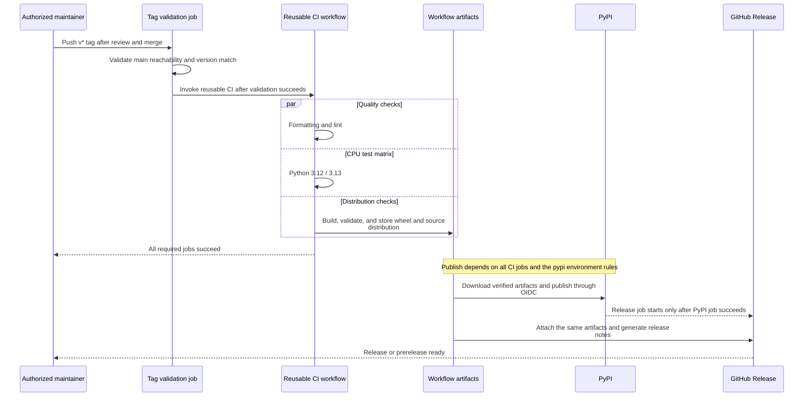

# Releasing Fluxway

[Chinese edition](releasing_zh.md)

`project.version` in `pyproject.toml` is the only release-version source.
`0+unreleased` is valid for local development and package checks, but the release
gate rejects it. Releases require a canonical three-part PEP 440 version, such
as `1.2.3` or `1.2.3rc1`, and the matching tag `v1.2.3` or `v1.2.3rc1`.

## Configure publishing once

The release workflow uses [PyPI Trusted Publishing](https://docs.pypi.org/trusted-publishers/)
through OIDC. Configure these values in the GitHub and PyPI project settings:

| Setting | Value |
| --- | --- |
| GitHub deployment environment | `pypi`, restricted to `v*` tags |
| PyPI project | `fluxway` |
| GitHub owner | `fluxway-project` |
| Repository | `fluxway` |
| Workflow filename | `release.yml` |
| Trusted Publisher environment | `pypi` |

A new PyPI project can use a pending publisher. No long-lived PyPI API token is
required. The workflow grants `id-token: write` only to the publish job.

## Prepare a release locally

Use Linux and Python 3.12 or 3.13. Install the development and build dependencies
as described in [Contributing](../CONTRIBUTING.md). Update the version through a
reviewed pull request and document breaking changes and migration steps.

Run these checks from the repository root. They match the portable CI checks;
the excluded tests require native `sparse_embedding` and Lance dependencies.

```bash
bash scripts/format.sh --check
JAX_PLATFORMS=cpu python -m pytest -ra --strict-markers --strict-config \
  --ignore=tests/checkpointer/test_retention.py \
  --ignore=tests/example/test_sparse_checkpoint_e2e.py
python -m pytest --confcutdir=tests/packaging tests/packaging
```

Check the release version without creating a tag. Pass the intended tag as the
function's argument; it must match `project.version`.

```bash
check_release_tag() {
    python scripts/distribution.py release "$1"
}
```

A valid release candidate prints `version=<version>` and `prerelease=true` or
`prerelease=false`. Noncanonical versions, local/development versions, and a
mismatched tag raise `ValueError`. These checks do not establish whether the
version is already present on PyPI.

## Build and check artifacts

Use a fresh directory so old artifacts cannot enter the candidate. The following
commands use the same validators as Contributing and CI, with task output under
`tmp/`. `mktemp` creates the parent; its `dist` child is created by the build.

```bash
mkdir -p tmp
release_check_dir=$(mktemp -d "$PWD/tmp/release-check.XXXXXX")
python -m build --outdir "$release_check_dir/dist"
python -m twine check --strict "$release_check_dir"/dist/*
python scripts/distribution.py check "$release_check_dir/dist"
python -m venv "$release_check_dir/wheel-env"
"$release_check_dir/wheel-env/bin/python" -m pip install "$release_check_dir"/dist/*.whl
"$release_check_dir/wheel-env/bin/python" -m pip check
"$release_check_dir/wheel-env/bin/python" -I scripts/check_installed.py
```

Package installation can download core dependencies. A successful run checks:

- Exactly one wheel and one source distribution, matching project metadata.
- All runtime Python files, `py.typed`, and the license are included.
- Tests, scripts, and temporary files are absent from the wheel.
- The wheel imports from its isolated environment, with consistent installed
  metadata, and handles a NumPy transport tensor.
- Core import does not load the optional JAX, Orbax, or etils backends.

Local success does not replace the Python 3.12/3.13 CI matrix or distributed
runtime verification. Missing optional backends produce explicit installation
errors when their features are requested.

## Understand the publish trigger

After review and merge, an authorized maintainer creates the matching `v*` tag
on a commit reachable from `main` and pushes it. That push triggers
[the release workflow](../.github/workflows/release.yml), which:

1. Verifies reachability from `main` and the tag/version match.
2. Runs the reusable CI workflow, including formatting, both portable CPU test
   environments, and artifact build and isolated installation checks.
3. Publishes those verified artifacts to PyPI through OIDC.
4. Creates a GitHub Release with the same artifacts and generated notes.

Prerelease versions create a prerelease and are not marked as the latest
release. Local commands in this guide do not create tags, push commits, upload
packages, or publish a release.



Arrows express workflow dependencies, not a PyPI callback to GitHub. A failed
prerequisite blocks later publishing; partial uploads and retries follow the table
below.

## Recover from a failed release

Inspect the failed job and determine which files were actually published before
retrying. Keep the release tag fixed.

| State | Next action |
| --- | --- |
| OIDC or environment error, no files uploaded | Correct the publisher configuration and retry the failed publish job |
| Only some files uploaded, or a published package is defective | Prepare a new version through review; do not overwrite files or move the tag |
| PyPI succeeded, GitHub Release failed | Retry only the GitHub Release job, or attach the verified workflow artifacts to that release |

PyPI does not allow re-uploading an existing filename. Restarting the entire
workflow after a successful upload can therefore fail on duplicates.
