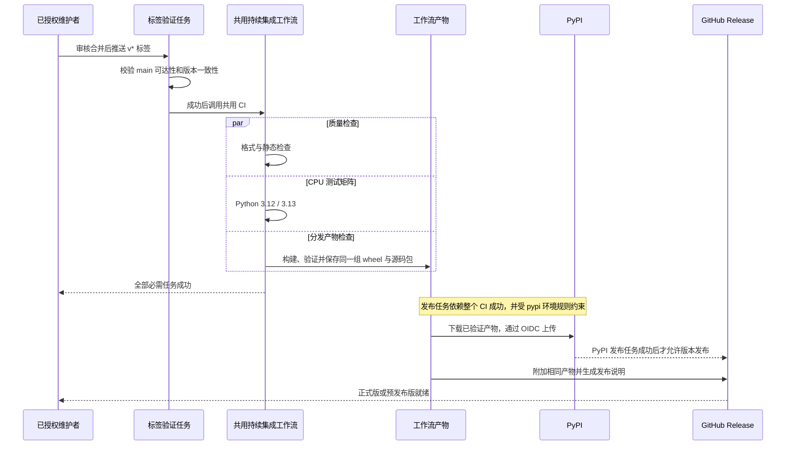

# 发布 Fluxway

[英文版](releasing.md)

`pyproject.toml` 中的 `project.version` 是发布版本号的唯一来源。
`0+unreleased` 可以用于本地开发和打包检查，但发布检查会拒绝它。
正式发布需要规范的三段 PEP 440 版本号，例如 `1.2.3` 或 `1.2.3rc1`，
并使用对应的 `v1.2.3` 或 `v1.2.3rc1` 标签。

## 首次配置发布权限

发布流程通过 OIDC 使用 [PyPI 可信发布](https://docs.pypi.org/trusted-publishers/)。
在 GitHub 和 PyPI 项目设置中配置以下值：

| 设置 | 值 |
| --- | --- |
| GitHub 部署环境 | `pypi`，仅允许 `v*` 标签 |
| PyPI 项目 | `fluxway` |
| GitHub 所有者 | `fluxway-project` |
| 仓库 | `fluxway` |
| 工作流文件名 | `release.yml` |
| 可信发布环境 | `pypi` |

尚未创建的 PyPI 项目可以使用待创建项目的发布者配置。
无需长期有效的 PyPI API 令牌。工作流只向发布任务授予 `id-token: write` 权限。

## 在本地准备版本

使用 Linux 和 Python 3.12 或 3.13，按[贡献指南](../CONTRIBUTING_zh.md)
安装开发与构建依赖。通过经过审核的拉取请求修改版本，并写明破坏性变更和迁移步骤。

从仓库根目录运行以下检查。它们对应可移植的持续集成检查；
排除的测试需要原生 `sparse_embedding` 和 Lance 依赖。

```bash
bash scripts/format.sh --check
JAX_PLATFORMS=cpu python -m pytest -ra --strict-markers --strict-config \
  --ignore=tests/checkpointer/test_retention.py \
  --ignore=tests/example/test_sparse_checkpoint_e2e.py
python -m pytest --confcutdir=tests/packaging tests/packaging
```

检查发布版本时不需要创建标签。将预期标签作为下列函数的参数，它必须与 `project.version` 一致。

```bash
check_release_tag() {
    python scripts/distribution.py release "$1"
}
```

有效候选版本会打印 `version=<version>`，以及 `prerelease=true` 或 `prerelease=false`。
非规范版本、本地版本、开发版本和不匹配的标签都会触发 `ValueError`。
这些检查不确认该版本是否已存在于 PyPI。

## 构建并检查产物

使用全新目录，避免混入旧产物。下列命令与贡献指南和持续集成使用相同校验器，
输出保存在 `tmp/` 中。`mktemp` 创建父目录，构建命令创建其中的 `dist` 子目录。

```bash
mkdir -p tmp
release_check_dir=$(mktemp -d "$PWD/tmp/release-check.XXXXXX")
python -m build --outdir "$release_check_dir/dist"
python -m twine check --strict "$release_check_dir"/dist/*
python scripts/distribution.py check "$release_check_dir/dist"
python -m venv "$release_check_dir/wheel-env"
"$release_check_dir/wheel-env/bin/python" -m pip install "$release_check_dir"/dist/*.whl
"$release_check_dir/wheel-env/bin/python" -m pip check
"$release_check_dir/wheel-env/bin/python" -I scripts/check_installed.py
```

安装包时可能需要下载核心依赖。
全部成功后，可以确认：

- 目录恰好包含一个二进制分发包和一个源码分发包，且与项目元数据一致。
- 运行时 Python 文件、`py.typed` 和许可证均已包含。
- 二进制分发包不包含测试、脚本或临时文件。
- 二进制分发包从隔离环境导入，安装元数据一致，并能处理 NumPy 传输张量。
- 核心导入不会加载可选的 JAX、Orbax 或 etils 后端。

本地成功不能替代 Python 3.12/3.13 持续集成矩阵或分布式运行验证。
使用缺少可选后端的功能时，会收到明确的安装错误。

## 理解发布触发条件

审核合并后，获得授权的维护者在 `main` 可达的提交上创建对应的 `v*` 标签并推送。
该推送触发[发布工作流](../.github/workflows/release.yml)，依次执行：

1. 检查提交可由 `main` 到达，且标签与版本号一致。
2. 调用共用的持续集成工作流，检查格式、两个 Python 环境的 CPU 测试、构建及隔离安装。
3. 通过 OIDC 将已验证的产物上传到 PyPI。
4. 使用相同产物和自动生成的说明创建 GitHub 发布版本。

预发布版本会标记为预发布，不设置为最新版本。
本文的本地命令不会创建标签、推送提交、上传包或发布版本。



箭头表示工作流依赖，不表示 PyPI 主动调用 GitHub。任何前置任务失败都会阻止后续发布；部分上传与重试规则见下表。

## 处理发布失败

重试前先查看失败任务，并确定究竟有哪些文件已经发布。保持发布标签不变。

| 状态 | 下一步 |
| --- | --- |
| OIDC 或环境配置失败，尚未上传文件 | 修正发布者配置，重试失败的发布任务 |
| 仅上传部分文件，或已发布的包有缺陷 | 经过审核后发布新版本，不覆盖文件或移动标签 |
| PyPI 已成功，GitHub 发布失败 | 只重试 GitHub 发布任务，或将已验证的工作流产物附加到该发布版本 |

PyPI 不允许重复上传同名文件。因此，上传成功后重新运行整个工作流，可能因文件重复而失败。
