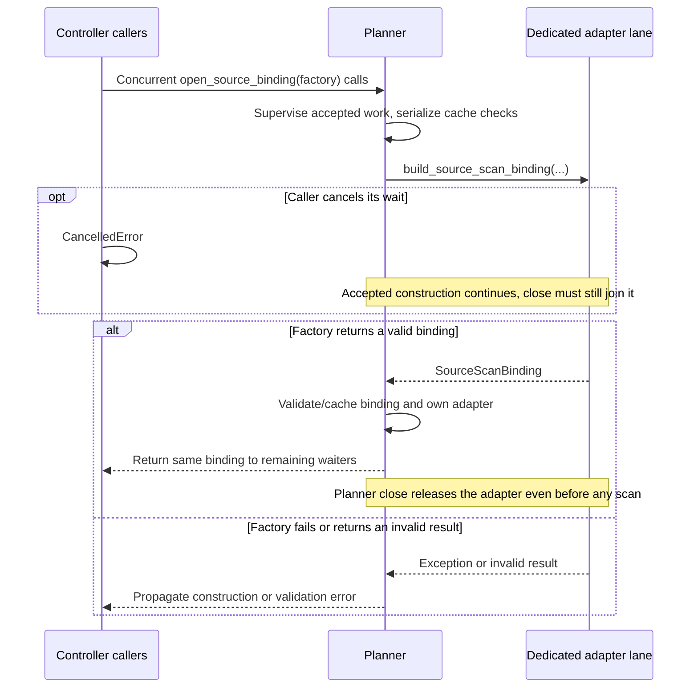
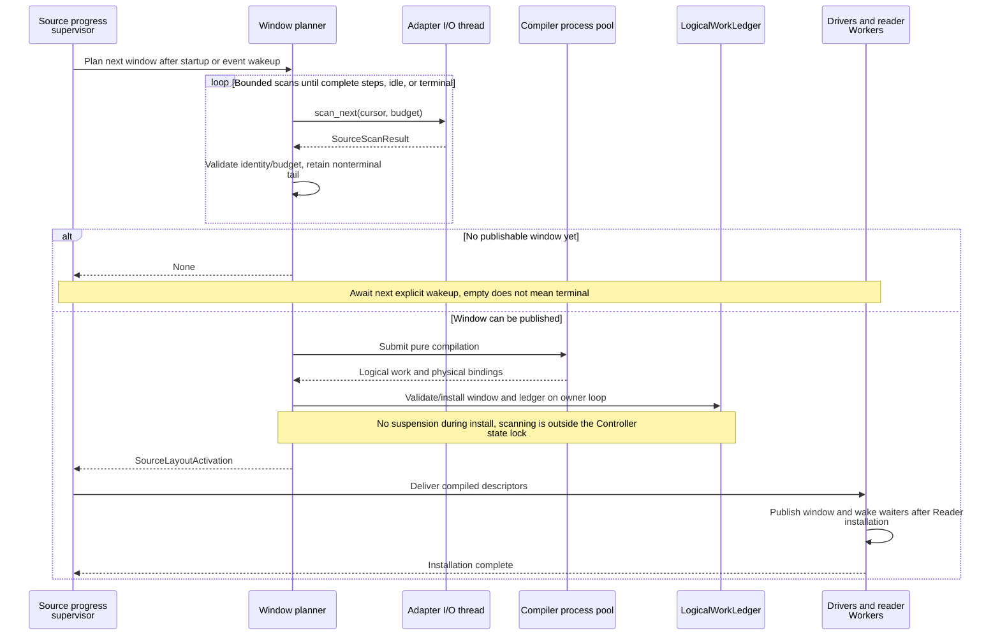
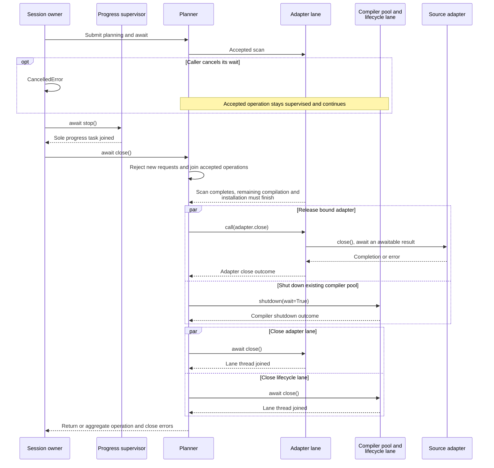

# Source coordination

[Chinese edition](source_coordination_zh.md)

Source coordination keeps source order stable while reader placement and window
sizes change. It separates scanning, physical reads, production acknowledgements
and the joint checkpoint.

Producers do not need to send Fluxway notifications, shared checkpoints, logs or
progress watermarks. Controller-owned scan and acknowledgement events advance
source progress.

## Scan records and locate a consumed prefix

`IngestionSourceAdapter` implements bounded `scan_next(cursor, budget)` and pure
`advance_cursor(cursor, records)`, and provides `close()` for resource release.
The adapter owns source identity, revision
selection, physical locators and cursor encoding. Fluxway does not decode those
bytes or discover a different latest revision on the reader's behalf.
Scans return immutable `SourceScanResult` values with ordered units and opaque
cursors.

| Callback | Result and execution context |
| --- | --- |
| Source descriptor's `build_source_scan_binding(...)` | Returns `SourceScanBinding` or an awaitable producing it; construction runs on the dedicated adapter I/O lane. |
| `SourceScanBinding.initial_cursor_factory()` | Returns `OpaqueSourceCursor`, `None`, or an awaitable producing either; runs on the same lane. |
| `scan_next(cursor, budget)` | Returns `SourceScanResult` or an awaitable producing it; runs on the same lane. |
| `close()` | Returns `None` or an awaitable producing `None`; releases clients and handles on the same lane and propagates failures. |
| `advance_cursor(cursor, records)` | Returns `OpaqueSourceCursor` synchronously; remains pure and performs no storage I/O. |

The lane executes and awaits callbacks on its own thread and event loop, rather
than moving them back to the Controller loop. Adapters without external resources
must still implement `close()`. A caller using an adapter directly owns its final
closure until the planner takes ownership.

This independent example uses the bundled in-memory recommendation source. It
captures four records, then derives a bookmark after the first three records
without reading storage:

```python
from fluxway.common.ingestion import (
    OpaqueSourceCursor,
    SourceScanBudget,
    SourceScanStatus,
)
from fluxway.example.recommendation.source_adapter import RecommendationSourceAdapter

adapter = RecommendationSourceAdapter(revision_id=7)
budget = SourceScanBudget(max_records=4, max_units=1)
start = adapter.cursor(start=0, end=10, finite=True)
result = adapter.scan_next(start, budget)
result.validate_budget(budget)
result.validate_transition(start)
assert result.records == 4
assert result.status is SourceScanStatus.READY
assert result.units[0].revision_identity == "recommendation:7"

bookmark = result.cursor_at(3, adapter.advance_cursor)
image = bookmark.to_checkpoint()
assert OpaqueSourceCursor.from_checkpoint(image) == bookmark
replay = adapter.scan_next(bookmark, budget)
assert replay.units[0].logical_start == 3
assert replay.records == 4

for records, exhausted, finite, expected in (
    (4, False, False, SourceScanStatus.READY),
    (0, False, False, SourceScanStatus.PROGRESS),
    (0, True, False, SourceScanStatus.IDLE),
    (0, True, True, SourceScanStatus.TERMINAL),
    (4, True, True, SourceScanStatus.TERMINAL),
):
    assert (
        SourceScanStatus.from_scan(records=records, exhausted=exhausted, finite=finite)
        is expected
    )
```

The replay starts at record `3`, not at the end of the prefetched result. Each
`unit_cursors` entry identifies one ordered unit's origin; `cursor_at` advances
within that unit through the adapter. These origins stay in the control plane.
Serializing a cursor alone is not a joint checkpoint.

| Scan status | Meaning |
| --- | --- |
| `READY` | Records are available and the cursor advances. |
| `PROGRESS` | No records yet; scanning advanced through metadata. |
| `IDLE` | The current visible range is exhausted, but the source can grow. |
| `TERMINAL` | The finite source is exhausted; the final result may contain records. |

`SourceScanStatus.from_scan` derives status from these facts. An empty result is
not necessarily terminal. Range-reading support does not imply bounded scanning
or resumable positions; every storage adapter must implement and validate both
capabilities. `LayoutUnitDescriptor.slice` is the shared slicing operation used
by compilation and window planning; see the [interval example](source_spmd_formal_protocol.md).

## Bind one source session

`SourceScanBinding` groups the adapter, stable binding identity, reader topology,
tail policy and `initial_cursor_factory`. The Controller delegates creation and
caching to `IngestionLayoutPlanningComponent.open_source_binding()`. The planner
serializes construction requests and takes ownership before the first scan.
Later concurrent requests return the first successful binding without rebuilding
it. The resolver may return `None` when an empty continuous source has no view;
future attempts use the same binding. Once resolved, the session does not replace
that initial position with a new snapshot.



The factory owns partially initialized resources until it successfully hands off
a valid binding. Waiter cancellation does not revoke a successful handoff. Planner
close joins construction before releasing resources. An integration that binds an
adapter directly cannot also use a binding factory.

This independent configuration prepares four records per logical step across two
readers. The source contains twelve records, so the selected strict tail policy
accepts its final step:

```python
from fluxway.common.ingestion import SourceBindingIdentity, ingestion_worker_id
from fluxway.common.metadata import metadata_digest
from fluxway.common.types.configs import SourceControlConfig
from fluxway.control_plane.ingestion import (
    RankDemand,
    ReaderGroupDemand,
    ReaderTopologyDescriptor,
    SourceScanBinding,
    TailLayoutMode,
)
from fluxway.control_plane.source_control import SourceControlRuntime
from fluxway.example.recommendation.source_adapter import RecommendationSourceAdapter

config = SourceControlConfig(
    planning_window_steps=2,
    max_in_flight_steps=2,
    max_planning_records=8,
    max_planning_units=4,
    max_planning_descriptor_bytes=64 * 1024,
)
source_control = SourceControlRuntime(config)
adapter = RecommendationSourceAdapter(revision_id=7)
worker_ids = tuple(ingestion_worker_id("reader", "read", rank) for rank in range(2))
binding = SourceScanBinding(
    adapter=adapter,
    identity=SourceBindingIdentity(
        configuration_identity=metadata_digest(
            {"revision_id": 7, "records": 12, "global_cardinality": 4}
        ),
        source_identity=adapter.source_identity,
        mode_identity="finite",
        native_identity="recommendation-revision:7",
    ),
    initial_cursor_factory=lambda: adapter.cursor(start=0, end=12, finite=True),
    topology=ReaderTopologyDescriptor(
        global_cardinality=4,
        groups=tuple(
            ReaderGroupDemand(
                worker_id=worker_id,
                ranks=(RankDemand(rank_id=worker_id, cardinality=2),),
            )
            for worker_id in worker_ids
        ),
    ),
    tail_layout_mode=TailLayoutMode.REJECT_REMAINDER,
)
assert source_control.scan_budget.max_records == 8
assert source_control.scan_budget.max_units == 4
assert binding.topology.global_cardinality == 4
```

`configuration_identity` describes source configuration, not the physical worker
count. Storage integrations must also retain the source history required by
committed bookmarks.

## Bound planning and acquisition



Scan budgets apply per call; window and descriptor-byte budgets apply separately. A
terminal remainder follows the declared tail policy.

| Configuration field | Limit |
| --- | --- |
| `planning_window_steps` | Target complete logical steps per window. |
| `max_in_flight_steps` | Acquired steps ahead of the source candidate cut. |
| `max_planning_records` | Records returned by one source scan. |
| `max_planning_units` | Source units returned by one source scan. |
| `max_planning_descriptor_bytes` | Total encoded worker descriptor bytes. |

These limits are independent. Adapters own native metadata read limits. Several
bounded scans may be combined into one logical step, so the scan limits do not
cap the window's total rows or units. Window size and compiled descriptor bytes
have separate limits; at least one step's descriptors must fit. Nonterminal tails remain
ordered across scans and
revisions. They are neither padded nor dropped. Finite termination applies the
declared tail policy once.

`IngestionLayoutPlanningComponent` assembles scans, keeps pending tails, compiles
logical steps and publishes windows. The compiler fixes step contents before
assigning physical quotas. The following control-plane integration function uses
an existing planner, source-control component and session binding. `deliver` must
await delivery through the existing driver activation component. The first window
uses `epoch=0, start_step=0`; later calls use the next contiguous window boundary.

```python
from collections.abc import Awaitable, Callable

from fluxway.common.ingestion import SourceLayoutActivation
from fluxway.control_plane.ingestion import (
    IngestionLayoutPlanningComponent,
    SourceScanBinding,
)
from fluxway.control_plane.source_control import SourceControlRuntime


async def publish_window(
    planner: IngestionLayoutPlanningComponent,
    source_control: SourceControlRuntime,
    binding: SourceScanBinding,
    deliver: Callable[[SourceLayoutActivation], Awaitable[None]],
    *,
    epoch: int,
    start_step: int,
) -> SourceLayoutActivation | None:
    planner.bind_source_identity(binding.identity)
    activation = await planner.plan_source_scan(
        binding.adapter,
        binding.initial_cursor_factory,
        source_control.work_ledger,
        planner.resume_cursor,
        budget=source_control.scan_budget,
        topology=binding.topology,
        tail_layout_mode=binding.tail_layout_mode,
        assignment_policy=binding.assignment_policy,
        epoch=epoch,
        start_position=start_step,
        max_steps=source_control.planning_window_steps,
        max_descriptor_bytes=source_control.config.max_planning_descriptor_bytes,
    )
    if activation is not None:
        await deliver(activation)
    return activation
```

Publication validates budgets and exact interval coverage before installing the
window, cursor, pending tail and ledger epoch. Delivery carries the compiled
descriptors; it does not create another planning identity. A `None` result means
no activation was published, not that the source is terminal.

Acquisition is bounded by the smaller of the published window end and
`candidate_cut + max_in_flight_steps`. A worker at the window end waits
asynchronously for the next activation. Windows are prefetch boundaries: retained
records continue into the next window with their existing work identity. Terminal
activation publishes the end position; the worker source scope rejects requests
beyond it, and execution reports `ExecutionStatus.SOURCE_EXHAUSTED` before normal
whole-graph drain. A window boundary does not force a model checkpoint.

## Advance and stop through events

One `SourceProgressSupervisor` owns the progress task for each controller
generation. Scans and acknowledgements trigger explicit wakeups; the supervisor
adds no timer polling. This independent example shows the initial wakeup and one
later event:

```python
import asyncio

from fluxway.control_plane.source_progress import SourceProgressSupervisor


async def demonstrate_wakeup() -> None:
    completed = asyncio.Event()
    calls = 0

    async def progress() -> None:
        nonlocal calls
        calls += 1
        completed.set()

    supervisor = SourceProgressSupervisor(progress)
    try:
        await supervisor.start()
        await completed.wait()
        assert calls == 1
        completed.clear()
        supervisor.wake()
        await completed.wait()
        assert calls == 2
        await supervisor.raise_if_failed()
    finally:
        await supervisor.stop()


asyncio.run(demonstrate_wakeup())
```

In the controller, planning runs outside the state-machine lock; only bounded
wakeups and typed failures cross that boundary. Publishing an activation wakes
all affected admission waiters. Starting after a checkpoint pause does not create
a second source startup.

Scanning and its asynchronous waits use the dedicated adapter lane; compilation
uses the process executor. Cancelling a caller's wait does not abandon accepted
work. The session owner stops and joins progress, then calls `planner.close()`:
reject new work and join accepted operations, close the adapter concurrently with
shutting down the compiler pool, then close both execution lanes.
Adapter/controller integration must separately validate bounded progress when
metadata scans contain no new records.



A failed adapter close still proceeds to lane shutdown before errors are
aggregated. Repeated close shares its result and closes the adapter once;
cancelling a close waiter does not interrupt release. Operation errors or
self-cancellation already observed by a caller are not reported again at close.
Unobserved failures after waiter cancellation stay owned until close reports them.

Supervised operations, such as construction or scanning, and their child tasks
cannot close their planner. A close callback cannot recursively await the same
close. These self-waits raise `RuntimeError`.

## Restore at the joint checkpoint

`LogicalWorkLedger` owns leases, acknowledgements and the contiguous candidate
cut. Acknowledgements confirm source production. They do not prove downstream
consumption or model durability. Fan-out, joins and conditional paths remain the
responsibility of dependency flow control and whole-graph drain; remote transport
credits and local arrival counts cannot manufacture a durable source bookmark.

The controller component registry saves the planner's cut-aligned consumption
bookmark and source constraints, plus the source-control component's logical
progress. Worker components save model and optimizer state at the same cut.
Driver components save their own state; the ingestion activation component's
image is empty and delivery is rebuilt.

The following shows component restore hooks for integration authors. Supply
images from the same committed checkpoint and fresh, registered components before
starting progress. Construct the planner with the current reader topology and
bind the same source identity. Applications use the existing
[checkpoint lifecycle](checkpoint.md) rather than restoring source state alone.

```python
from collections.abc import Mapping
from typing import Any

from fluxway.common.ingestion import OpaqueSourceCursor
from fluxway.common.types.checkpoint import CheckpointCut
from fluxway.control_plane.ingestion import IngestionLayoutPlanningComponent
from fluxway.control_plane.source_control import SourceControlRuntime


def restore_source_components(
    planner: IngestionLayoutPlanningComponent,
    source_control: SourceControlRuntime,
    planner_image: Mapping[str, Any],
    progress_image: Mapping[str, Any],
    cut: CheckpointCut,
) -> OpaqueSourceCursor | None:
    planner.restore_state(planner_image, cut)
    source_control.restore_state(progress_image, cut)
    assert planner.resume_step == cut.position
    return planner.resume_cursor
```

Resume planning from the returned bookmark and `planner.resume_step`. Reader
count and window limits may change; logical batch cardinality and ordered records
may not. Missing source history, incompatible identity or changed batch size
fails. Restore recreates windows, leases, iterators and prefetch buffers; old
layout digests and pure pending tails are not durable source state. Stateful
operators still save every state value that affects future output.

Durable cuts reclaim completed controller windows, ledger bindings and scan
observations while retaining a continuity anchor. Worker-installed windows and
driver activation digests remain retained. Scan and window budgets therefore do
not prove bounded memory across a long run, even with regular checkpoints.
Arbitrary graph recovery and external side effects also need application-level
evidence and an appropriate transaction or idempotency contract.

See the [work protocol](source_spmd_formal_protocol.md) and
[reader API](base_reader.md). Scenario configuration and integration evidence
belong in the downstream application repository.
