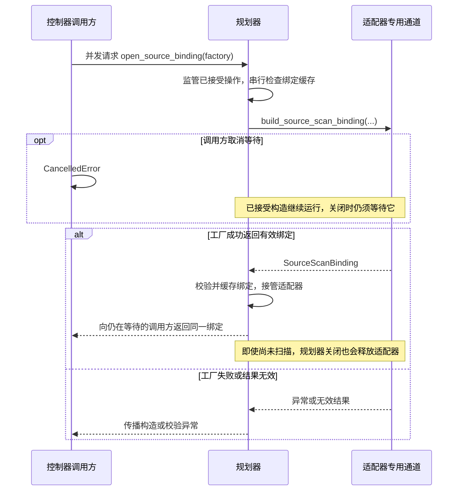
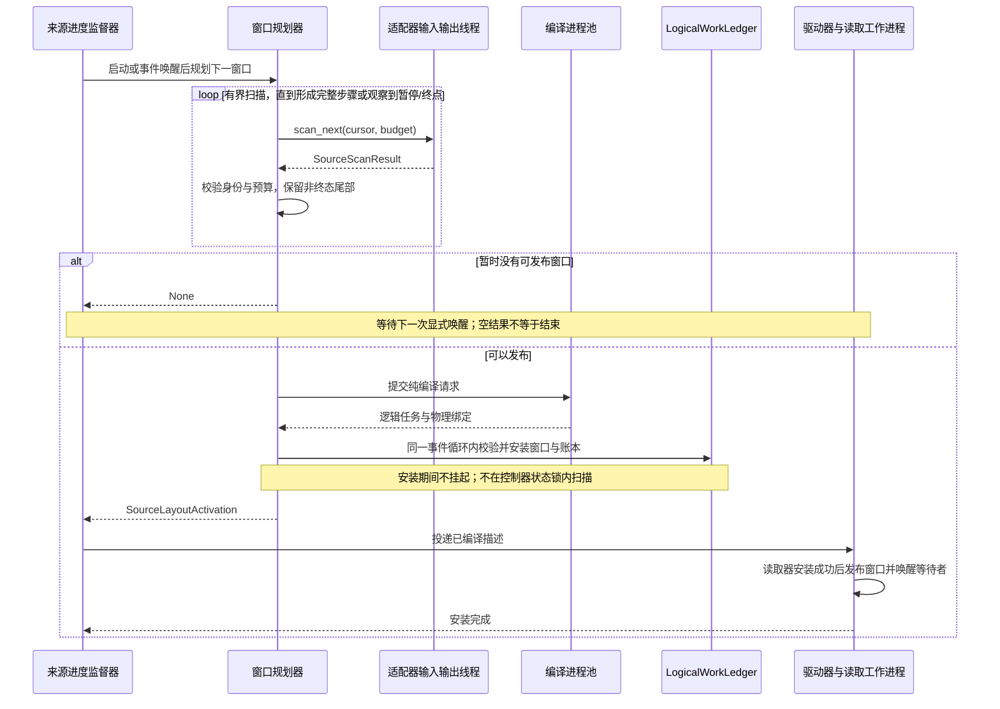
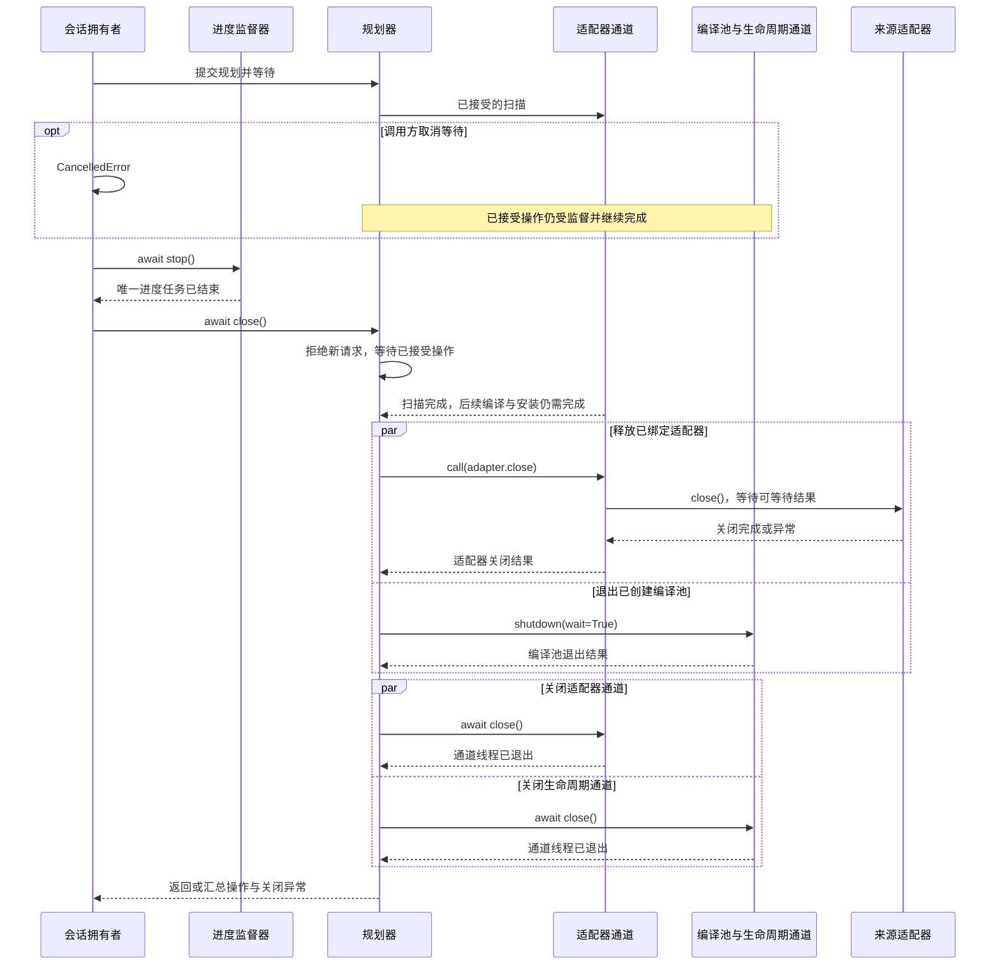

# 来源协调

[英文版](source_coordination.md)

来源协调在读取进程数量和窗口大小变化时保持记录顺序不变，分别管理扫描、物理读取、
生产确认和共同检查点。

生产方不必向 Fluxway 发送通知、共享检查点、日志或进度水位。控制器通过自己拥有的
扫描与确认事件推进来源进度。

## 扫描记录与定位消费前缀

`IngestionSourceAdapter` 实现有界的 `scan_next(cursor, budget)` 和纯位置运算
`advance_cursor(cursor, records)`，并提供资源释放方法 `close()`。适配器负责来源身份、修订选择、物理位置与位置编码。
Fluxway 不解析这些字节，也不替读取器发现另一个最新修订。
扫描返回不可变的 `SourceScanResult`，包含有序区间与不透明位置。

| 回调 | 结果与执行位置 |
| --- | --- |
| 来源描述的 `build_source_scan_binding(...)` | 返回 `SourceScanBinding`，或返回产生该绑定的可等待对象；在适配器专用输入输出通道中构造。 |
| `SourceScanBinding.initial_cursor_factory()` | 返回 `OpaqueSourceCursor`、`None`，或产生这些结果的可等待对象；在同一通道执行。 |
| `scan_next(cursor, budget)` | 返回 `SourceScanResult` 或产生该结果的可等待对象；在同一通道执行。 |
| `close()` | 返回 `None` 或产生 `None` 的可等待对象；在同一通道释放客户端、句柄等资源，失败直接传播。 |
| `advance_cursor(cursor, records)` | 同步返回 `OpaqueSourceCursor`，保持纯运算，不访问存储。 |

专用通道在自己的线程和事件循环执行并等待异步回调，不把它们移回控制器事件循环。无外部资源的适配器也必须实现 `close()`；直接调用适配器而未交给规划器时，由调用方负责最终关闭。

下面的独立示例使用项目自带的内存推荐来源。先扫描四条记录，再计算消费前三条记录后
的书签，整个位置计算不访问存储：

```python
from fluxway.common.ingestion import (
    OpaqueSourceCursor,
    SourceScanBudget,
    SourceScanStatus,
)
from fluxway.example.recommendation.source_adapter import RecommendationSourceAdapter

adapter = RecommendationSourceAdapter(revision_id=7)
budget = SourceScanBudget(max_records=4, max_units=1)
start = adapter.cursor(start=0, end=10, finite=True)
result = adapter.scan_next(start, budget)
result.validate_budget(budget)
result.validate_transition(start)
assert result.records == 4
assert result.status is SourceScanStatus.READY
assert result.units[0].revision_identity == "recommendation:7"

bookmark = result.cursor_at(3, adapter.advance_cursor)
image = bookmark.to_checkpoint()
assert OpaqueSourceCursor.from_checkpoint(image) == bookmark
replay = adapter.scan_next(bookmark, budget)
assert replay.units[0].logical_start == 3
assert replay.records == 4

for records, exhausted, finite, expected in (
    (4, False, False, SourceScanStatus.READY),
    (0, False, False, SourceScanStatus.PROGRESS),
    (0, True, False, SourceScanStatus.IDLE),
    (0, True, True, SourceScanStatus.TERMINAL),
    (4, True, True, SourceScanStatus.TERMINAL),
):
    assert (
        SourceScanStatus.from_scan(records=records, exhausted=exhausted, finite=finite)
        is expected
    )
```

重放从记录 `3` 开始，而不是从预取结果的末尾开始。`unit_cursors` 为每个有序区间提供
起点，`cursor_at` 通过适配器在区间内部推进位置。这些定位信息留在控制面。
仅序列化位置不构成共同检查点。

| 扫描状态 | 含义 |
| --- | --- |
| `READY` | 已取得记录，位置向前推进。 |
| `PROGRESS` | 暂无记录，但已向前扫描元数据。 |
| `IDLE` | 当前可见范围已扫完，来源仍可能增长。 |
| `TERMINAL` | 有限来源已结束，最后一次结果仍可包含记录。 |

`SourceScanStatus.from_scan` 根据这些事实统一推导状态。空结果不一定表示结束。
支持范围读取不代表支持有界扫描或可恢复位置；每个存储适配器必须实现并验证两种能力。
编译和窗口规划共用 `LayoutUnitDescriptor.slice` 切分区间，见[区间示例](source_spmd_formal_protocol_zh.md)。

## 绑定一个来源会话

`SourceScanBinding` 汇集适配器、稳定绑定身份、读取拓扑、尾部策略和
`initial_cursor_factory`。控制器委托 `IngestionLayoutPlanningComponent.open_source_binding()`
创建并缓存首次成功绑定。规划器串行处理构造请求，并在首次扫描前接管适配器。
后续并发请求返回同一绑定，不重新构造。空的持续来源尚无可读视图时，
初始位置工厂可以返回 `None`，后续仍使用同一个绑定重试。初始位置确定后，会话
不会再用新快照替换它。



工厂成功交接有效绑定前，部分初始化资源由工厂负责清理。取消等待不会撤销成功交接；规划器关闭会等待构造结算后再释放资源。直接绑定适配器的接入不能再混用绑定工厂。

下面的独立配置把每个逻辑训练步的四条记录分给两个读取进程。来源共十二条记录，
因此严格尾部策略能够接受最后一个完整训练步：

```python
from fluxway.common.ingestion import SourceBindingIdentity, ingestion_worker_id
from fluxway.common.metadata import metadata_digest
from fluxway.common.types.configs import SourceControlConfig
from fluxway.control_plane.ingestion import (
    RankDemand,
    ReaderGroupDemand,
    ReaderTopologyDescriptor,
    SourceScanBinding,
    TailLayoutMode,
)
from fluxway.control_plane.source_control import SourceControlRuntime
from fluxway.example.recommendation.source_adapter import RecommendationSourceAdapter

config = SourceControlConfig(
    planning_window_steps=2,
    max_in_flight_steps=2,
    max_planning_records=8,
    max_planning_units=4,
    max_planning_descriptor_bytes=64 * 1024,
)
source_control = SourceControlRuntime(config)
adapter = RecommendationSourceAdapter(revision_id=7)
worker_ids = tuple(ingestion_worker_id("reader", "read", rank) for rank in range(2))
binding = SourceScanBinding(
    adapter=adapter,
    identity=SourceBindingIdentity(
        configuration_identity=metadata_digest(
            {"revision_id": 7, "records": 12, "global_cardinality": 4}
        ),
        source_identity=adapter.source_identity,
        mode_identity="finite",
        native_identity="recommendation-revision:7",
    ),
    initial_cursor_factory=lambda: adapter.cursor(start=0, end=12, finite=True),
    topology=ReaderTopologyDescriptor(
        global_cardinality=4,
        groups=tuple(
            ReaderGroupDemand(
                worker_id=worker_id,
                ranks=(RankDemand(rank_id=worker_id, cardinality=2),),
            )
            for worker_id in worker_ids
        ),
    ),
    tail_layout_mode=TailLayoutMode.REJECT_REMAINDER,
)
assert source_control.scan_budget.max_records == 8
assert source_control.scan_budget.max_units == 4
assert binding.topology.global_cardinality == 4
```

`configuration_identity` 描述来源配置，不包含物理进程数量。存储接入还必须保留
已提交书签重放所需的来源历史。

## 限制规划与领取范围



扫描预算约束单次调用，窗口和描述字节预算另行约束。来源结束后的不足批次按声明的尾部策略处理。

| 配置字段 | 上限 |
| --- | --- |
| `planning_window_steps` | 每个窗口期望准备的完整训练步数。 |
| `max_in_flight_steps` | 超前于来源候选切点的已领取训练步数。 |
| `max_planning_records` | 单次来源扫描返回的记录数。 |
| `max_planning_units` | 单次来源扫描返回的来源区间数。 |
| `max_planning_descriptor_bytes` | 所有读取进程的编码任务描述总字节数。 |

各类限制相互独立。原生元数据读取限制由适配器负责。一个逻辑训练步可以拼接多次有界
扫描，因此扫描预算不限制整窗累计记录数或区间数。窗口步数与编译描述字节数另有限制，
至少一个完整训练步的描述必须放得进预算。非终态尾部跨扫描、跨修订
保留顺序，不能补齐或丢弃；有限来源结束时才应用一次声明的尾部策略。

`IngestionLayoutPlanningComponent` 拼接扫描结果、保留尾部、编译逻辑训练步并发布窗口。
编译器先固定每步内容，再分配物理读取额度。下面的控制面集成函数使用已有的规划器、
来源控制组件和会话绑定。`deliver` 必须等待既有驱动激活组件完成投递。首个窗口使用
`epoch=0, start_step=0`，后续调用使用下一个连续窗口的边界。

```python
from collections.abc import Awaitable, Callable

from fluxway.common.ingestion import SourceLayoutActivation
from fluxway.control_plane.ingestion import (
    IngestionLayoutPlanningComponent,
    SourceScanBinding,
)
from fluxway.control_plane.source_control import SourceControlRuntime


async def publish_window(
    planner: IngestionLayoutPlanningComponent,
    source_control: SourceControlRuntime,
    binding: SourceScanBinding,
    deliver: Callable[[SourceLayoutActivation], Awaitable[None]],
    *,
    epoch: int,
    start_step: int,
) -> SourceLayoutActivation | None:
    planner.bind_source_identity(binding.identity)
    activation = await planner.plan_source_scan(
        binding.adapter,
        binding.initial_cursor_factory,
        source_control.work_ledger,
        planner.resume_cursor,
        budget=source_control.scan_budget,
        topology=binding.topology,
        tail_layout_mode=binding.tail_layout_mode,
        assignment_policy=binding.assignment_policy,
        epoch=epoch,
        start_position=start_step,
        max_steps=source_control.planning_window_steps,
        max_descriptor_bytes=source_control.config.max_planning_descriptor_bytes,
    )
    if activation is not None:
        await deliver(activation)
    return activation
```

发布先验证预算与精确区间覆盖，再安装窗口、位置、尾部和账本代次。投递只携带已编译
描述，不创建另一份规划身份。返回 `None` 表示没有发布激活信息，不表示来源已经结束。

领取上限为当前窗口末尾与 `candidate_cut + max_in_flight_steps` 的较小值。读取进程
到达窗口末尾时异步等待下次激活。窗口是预取边界，保留的记录以原任务身份进入下个
窗口。终态激活发布结束位置，工作进程的来源作用域拒绝越界请求，执行层报告
`ExecutionStatus.SOURCE_EXHAUSTED` 后进入正常整图排空。窗口边界不强制模型保存。

## 按事件推进并关闭

每代控制器只有一个 `SourceProgressSupervisor` 拥有进度任务。扫描与确认触发显式唤醒，
监管器不添加定时轮询。下面的独立示例展示启动时的首次唤醒与后续一次事件唤醒：

```python
import asyncio

from fluxway.control_plane.source_progress import SourceProgressSupervisor


async def demonstrate_wakeup() -> None:
    completed = asyncio.Event()
    calls = 0

    async def progress() -> None:
        nonlocal calls
        calls += 1
        completed.set()

    supervisor = SourceProgressSupervisor(progress)
    try:
        await supervisor.start()
        await completed.wait()
        assert calls == 1
        completed.clear()
        supervisor.wake()
        await completed.wait()
        assert calls == 2
        await supervisor.raise_if_failed()
    finally:
        await supervisor.stop()


asyncio.run(demonstrate_wakeup())
```

在控制器中，规划在状态机锁外执行，边界只传递有界唤醒与类型化失败。发布激活后会
唤醒所有受影响的领取等待者。检查点暂停后的继续执行不会再次启动来源。

扫描及其异步等待使用适配器专用通道，编译使用进程池。调用方取消等待不撤销已接受
操作。会话拥有者停止并等待进度任务，再调用 `planner.close()`：先拒绝新工作并等待
已接受操作，随后并发关闭适配器和退出编译池，最后关闭两个执行通道。没有新记录的元数据扫描能否有界推进，仍须由
适配器与控制器的联合验证证明。



适配器关闭失败也会继续关闭通道，最后汇总异常。重复关闭复用同一结果，适配器只关闭一次；取消关闭等待者不会中断释放。已由调用方观察的操作异常或操作自身取消不会在关闭时重复报告；调用方取消等待后发生的未观察失败仍由规划器保留并在关闭时报告。

构造、扫描等受监管操作及其子任务不能关闭自己的规划器，关闭回调也不能递归等待同一次关闭；这些自等待会直接抛出 `RuntimeError`。

## 从共同检查点恢复

`LogicalWorkLedger` 管理租约、确认和连续候选切点。确认只表示来源生产完成，不代表
下游已经消费或模型已经持久化。扇出、汇合和条件路径由依赖边流量控制与整图排空负责；
远程传输额度和本地到达次数不能生成持久来源书签。

控制器组件注册表保存规划器对齐切点的消费书签、来源约束，以及来源控制组件的逻辑
进度。工作进程组件在同一切点保存模型和优化器，驱动组件只保存自身状态；来源激活
组件的保存图像为空，恢复后重建投递。

下面展示供集成作者使用的组件恢复钩子。必须在进度启动前，向新建并已注册的组件提供
同一个已提交检查点的图像。规划器使用当前读取拓扑，并绑定同一来源身份。应用应使用
既有[检查点生命周期](checkpoint_zh.md)，不能单独恢复来源状态。

```python
from collections.abc import Mapping
from typing import Any

from fluxway.common.ingestion import OpaqueSourceCursor
from fluxway.common.types.checkpoint import CheckpointCut
from fluxway.control_plane.ingestion import IngestionLayoutPlanningComponent
from fluxway.control_plane.source_control import SourceControlRuntime


def restore_source_components(
    planner: IngestionLayoutPlanningComponent,
    source_control: SourceControlRuntime,
    planner_image: Mapping[str, Any],
    progress_image: Mapping[str, Any],
    cut: CheckpointCut,
) -> OpaqueSourceCursor | None:
    planner.restore_state(planner_image, cut)
    source_control.restore_state(progress_image, cut)
    assert planner.resume_step == cut.position
    return planner.resume_cursor
```

之后从返回的书签和 `planner.resume_step` 重新规划。读取进程数和窗口限制可以改变，
逻辑批次大小与有序记录不能改变。来源历史缺失、身份不兼容或批次大小变化时直接失败。
恢复重新创建窗口、租约、迭代器和预取缓冲；旧布局摘要与纯预取尾部不属于来源持久状态。
有状态算子仍须保存所有影响未来输出的状态。

持久切点回收控制面已经完成的旧窗口、账本绑定和扫描定位信息，并保留连续性锚点。
工作进程已经安装的窗口与驱动激活摘要仍然保留。因此即使定期保存，扫描和窗口预算
也不能证明长期运行的内存有界。任意图恢复和外部副作用仍需要应用层证据，并使用
适当的事务或幂等契约。

相关说明见[任务协议](source_spmd_formal_protocol_zh.md)与[读取接口](base_reader_zh.md)。
场景配置和集成证据由下游应用仓维护。
