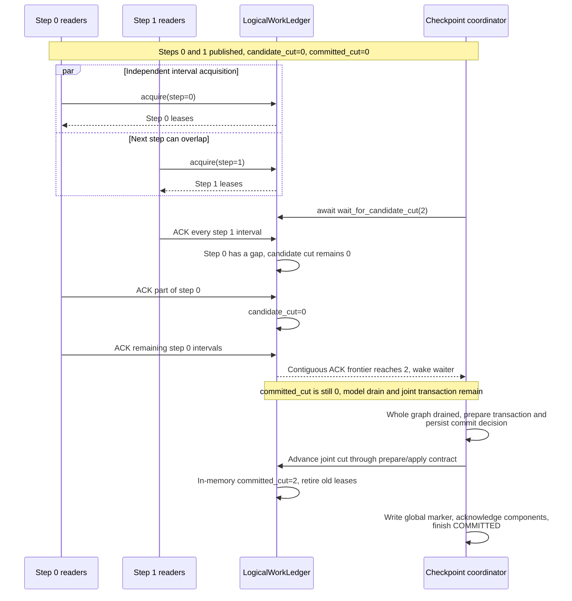
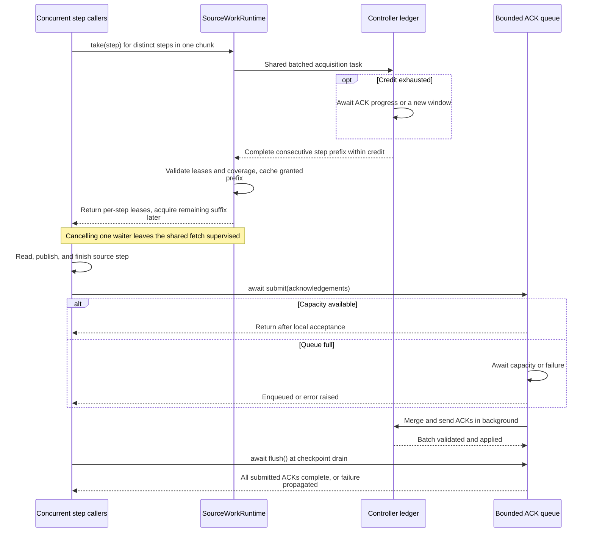

# Source work protocol

[Chinese edition](source_spmd_formal_protocol_zh.md)

This document defines work identity, physical leases and progress. The examples
exercise protocol objects on one CPU process. They do not establish model recovery
or exactly-once external effects.

## Preserve physical coordinates

`LayoutUnitDescriptor` fixes a revision, physical locator, cardinality metric,
interval and source-owned metadata. Splitting changes interval boundaries, not
the original source encoding or physical row numbers. Composition must produce
the same final descriptor regardless of the slicing path:

```python
from fluxway.common.ingestion import LayoutUnitDescriptor

unit = LayoutUnitDescriptor(
    unit_id="file-0:100:108",
    revision_identity="revision-7",
    cardinality=8,
    cardinality_metric="rows",
    split_policy="SplittableSpan",
    locality_key="file-0",
    physical_identity="file-0",
    logical_start=100,
    opaque_token=b"original-source-range",
)
nested = unit.slice(2, 6).slice(1, 2)
direct = unit.slice(3, 2)
assert nested == direct
assert (direct.logical_start, direct.cardinality) == (103, 2)
assert direct.opaque_token is unit.opaque_token
assert direct.physical_identity == "file-0"
```

A reader resolves the assigned interval relative to the original encoded range.
A new scan or planning window must not renumber an existing physical interval.
Compilation, window planning and the in-memory scan adapter all use this slicing
operation.

## Keep logical work independent of readers

The compiler partitions the ordered stream into logical steps before assigning
physical quotas. `SourceWorkAssignment` describes an interval in one step;
`SourceWorkKey(epoch, step, assignment_id)` identifies it. The assignment model
computes the canonical MessagePack digest once.

`CompiledSegment` assigns part of a logical assignment to a worker and carries
its step and assignment identifier. `WorkerLayoutDescriptor` is the shared wire
codec. A single assignment can span several workers; publication validates exact
coverage without gaps or overlaps. Acquisitions must match those published
segments, and cannot steal a segment that is already leased.

The following complete example compiles the same eight records for two readers
and four readers. It then exercises leases on the two-reader layout:

```python
import asyncio
from dataclasses import replace

from fluxway.common.ingestion import (
    SourceScanBudget,
    SourceWorkAcknowledgement,
    WorkerLayoutDescriptor,
)
from fluxway.control_plane.ingestion import (
    AlgebraicLayoutCompiler,
    CompiledIngestionLayout,
    LayoutCompileRequest,
    RankDemand,
    ReaderGroupDemand,
    ReaderTopologyDescriptor,
    TailLayoutMode,
)
from fluxway.control_plane.logical_work_ledger import LogicalWorkLedger
from fluxway.example.recommendation.source_adapter import RecommendationSourceAdapter


def topology(quotas: tuple[int, ...]) -> ReaderTopologyDescriptor:
    return ReaderTopologyDescriptor(
        global_cardinality=sum(quotas),
        groups=tuple(
            ReaderGroupDemand(
                worker_id=f"reader-{rank}",
                ranks=(RankDemand(rank_id=f"rank-{rank}", cardinality=quota),),
            )
            for rank, quota in enumerate(quotas)
        ),
    )


adapter = RecommendationSourceAdapter(revision_id=7)
scan = adapter.scan_next(
    adapter.cursor(start=0, end=8, finite=True), SourceScanBudget(8, 1)
)
request = LayoutCompileRequest(
    source_identity=scan.source_identity,
    view_identity=scan.view_identity,
    schema_digest=scan.schema_digest,
    lineage_digest=scan.lineage_digest,
    units=scan.units,
    topology=topology((2, 2)),
    tail_layout_mode=TailLayoutMode.REJECT_REMAINDER,
)
compiler = AlgebraicLayoutCompiler()
original = compiler.compile(request)
resized = compiler.compile(replace(request, topology=topology((1, 1, 1, 1))))
assert original.work_epoch.assignments == resized.work_epoch.assignments
assert original.layout_digest != resized.layout_digest
assert original.step_count == resized.step_count == 2


async def demonstrate_leases(compiled: CompiledIngestionLayout) -> None:
    encoded = compiled.encoded_worker_layouts()
    bindings = tuple(WorkerLayoutDescriptor.decode(value) for value in encoded)
    assert tuple(binding.encode() for binding in bindings) == encoded
    ledger = LogicalWorkLedger(max_in_flight_steps=2)
    await ledger.publish(compiled.work_epoch, bindings)
    segments = {
        step: tuple(
            segment
            for binding in bindings
            for segment in binding.segments
            if segment.step == step
        )
        for step in range(2)
    }
    first, second = await asyncio.gather(
        ledger.acquire(0, segments[0]), ledger.acquire(0, segments[1])
    )
    waiting = asyncio.create_task(ledger.wait_for_candidate_cut(2))
    second_acks = tuple(
        SourceWorkAcknowledgement(lease.item.key, lease.lease_id) for lease in second
    )
    first_acks = tuple(
        SourceWorkAcknowledgement(lease.item.key, lease.lease_id) for lease in first
    )
    await ledger.acknowledge(second_acks)
    assert await ledger.candidate_cut() == 0
    await ledger.acknowledge(first_acks[:1])
    assert await ledger.candidate_cut() == 0
    await ledger.acknowledge(first_acks[1:])
    await ledger.acknowledge(first_acks)
    assert await waiting == 2
    assert ledger.committed_cut == 0

    image = ledger.checkpoint_state()
    assert image == {"committed_cut": 0}
    replay = LogicalWorkLedger(max_in_flight_steps=2)
    replay.restore_state(image)
    await replay.publish(compiled.work_epoch, bindings)
    fresh = await replay.acquire(0, segments[0])
    assert {lease.lease_id for lease in fresh}.isdisjoint(
        lease.lease_id for lease in first
    )
    assert await replay.candidate_cut() == 0


asyncio.run(demonstrate_leases(original))
```

The logical assignments stay equal while physical layout digests change. Each
step still contains four ordered records. The two-reader layout splits each
assignment into two leases, so one acknowledgement cannot complete the step.

Step `1` completes before step `0`, but `candidate_cut` remains `0` until every
segment in step `0` is acknowledged. The waiting task then returns `2` without
polling. Repeating an identical acknowledgement is harmless while its lease is
retained.

The saved ledger image still has `committed_cut=0`: no joint checkpoint was
committed. Replaying that image reads the uncommitted steps again with new lease
IDs. A delayed acknowledgement with an old lease ID raises `RuntimeError`.

## Distinguish production from durable commit



The candidate cut advances only across consecutive complete steps. Late ACKs for retired
leases fail rather than advancing progress again.

`SourceWorkItem` contains the assignment and exact acquired interval.
`SourceWorkLease` adds the opaque runtime lease ID.
`SourceWorkAcknowledgement(key, lease_id)` confirms only that interval, never the
parent descriptor on behalf of other workers.

Acknowledgement batches are validated before any mutation. Unknown or stale
leases and conflicting assignment keys fail. Commit retires completed lease and
acknowledgement records; identical acknowledgements become stale after retirement.
Per-step remaining counts let acknowledgement processing update only affected
segments and advance over consecutive complete steps.

`committed_cut` advances through the existing coordinated checkpoint transaction.
Source, model and optimizer must agree on that boundary. The following participant
hooks are for controller integration: `permit` must come from the coordinator.
The coordinator calls preparation across all participants, persists the shared
commit decision, then calls the apply hook.

```python
from typing import Any

from fluxway.common.metadata import metadata_digest
from fluxway.common.types.checkpoint import CheckpointCommitPermit, CheckpointCut
from fluxway.control_plane.checkpoint_transaction import PreparedCheckpointTransaction
from fluxway.control_plane.source_control import SourceControlRuntime


def prepare_source_checkpoint(
    source_control: SourceControlRuntime,
    checkpoint_id: str,
    permit: CheckpointCommitPermit,
    cut: CheckpointCut,
) -> PreparedCheckpointTransaction[dict[str, Any]]:
    image = source_control.checkpoint_state(cut)
    return source_control.prepare_checkpoint(
        checkpoint_id, permit, cut, metadata_digest(image)
    )


def apply_source_checkpoint(
    source_control: SourceControlRuntime,
    prepared: PreparedCheckpointTransaction[dict[str, Any]],
) -> None:
    source_control.apply_prepared(prepared)
```

An aborted transaction uses
`source_control.abort_prepared(checkpoint_id, permit)`. Applications use the
[checkpoint lifecycle](checkpoint.md); they do not call the ledger's commit
methods after reading a batch.

The source recovery image contains the consumption bookmark and logical
progress at the shared cut. Replanning may change window boundaries and assignment
keys while preserving each logical batch's ordered records and cardinality.
Restore rejects a changed logical batch size. It recreates leases, acknowledgement
caches, prefetched layouts and pure pending tails. Stateful operators still retain
every state value that affects future output. Source component images do not add
a separate numeric protocol version; identity and cursor compatibility follow
[source coordination](source_coordination.md).

## Keep acquisition and acknowledgement asynchronous

Acquisition is capped by the active window end and
`candidate_cut + max_in_flight_steps`. Credit exhaustion waits asynchronously.
A source window never forces a model checkpoint.

The internal worker runtime batches active steps up to the operator pipeline
depth. Concurrent consumers share each chunk's fetch task. This integration
helper preserves concurrent acquisition; it requires an existing worker runtime
and distinct active step numbers:

```python
import asyncio

from fluxway.common.ingestion import SourceWorkLease
from fluxway.spmd.worker.source_work import SourceWorkRuntime


async def acquire_pipeline_steps(
    runtime: SourceWorkRuntime,
    steps: tuple[int, ...],
) -> tuple[tuple[SourceWorkLease, ...], ...]:
    return tuple(await asyncio.gather(*(runtime.take(step) for step in steps)))
```

The controller may return a nonempty prefix of complete steps within its credit
window. The worker validates epoch, unique lease IDs, exact interval coverage and
prefix completeness before caching the reply. Cancelling a caller does not
abandon supervision of the shared fetch. Lease acknowledgements use a bounded
worker-local queue, propagate failures and drain before checkpointing.

Cache misses still incur controller RPC latency, so batching does not prove the
controller has no throughput bottleneck. The compiled execution layout is the
single source of physical membership and logical group ranks for dispatch and
send-plan lowering. Neither layer discovers source revisions, manages leases or
owns checkpoint cuts. Local zero-copy depends separately on placement and
transport conditions.



## Validate recovery at the application boundary

A complete source integration validates explicit scanning and refill, history
retention, event-driven progress and replay under the joint model checkpoint.
The Fluxway supervisor adds no timer polling, although an adapter may use its
storage protocol internally. Fan-out and joins require whole-graph drain and
common-checkpoint evidence; the scan interface alone is not that evidence.

Automatic retries cannot make arbitrary user side effects safe. External writes
need a transaction or idempotency contract that remains valid when physical
interval boundaries change. See [source coordination](source_coordination.md)
and [checkpoint](checkpoint.md).
