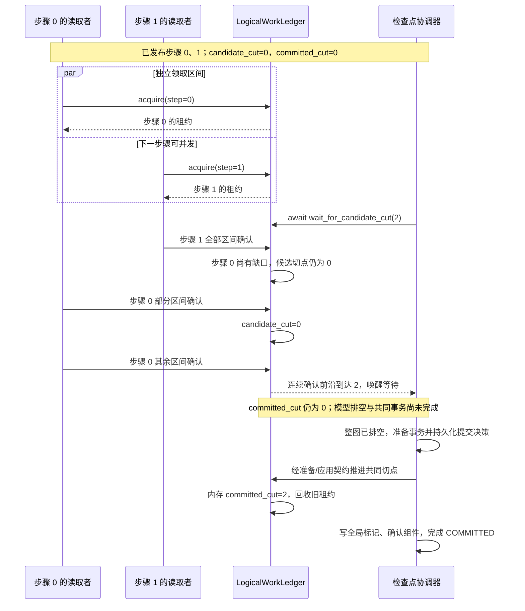
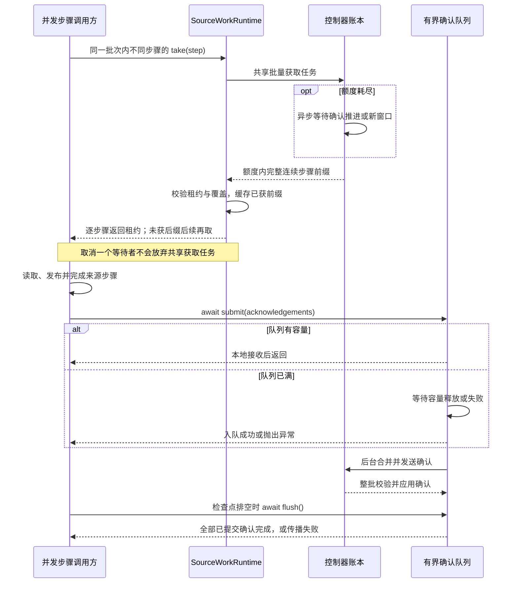

# 来源任务协议

[英文版](source_spmd_formal_protocol.md)

本文定义任务身份、物理租约与进度。示例只在一个本地进程中验证协议对象，
不能据此认定模型恢复或外部副作用已经满足恰好一次语义。

## 保持物理坐标

`LayoutUnitDescriptor` 固定修订、物理位置、记录计量方式、区间和来源自身的编码。
切分只改变区间边界，不改变原始来源编码或物理行号。无论经过几次切分，最终描述应相同：

```python
from fluxway.common.ingestion import LayoutUnitDescriptor

unit = LayoutUnitDescriptor(
    unit_id="file-0:100:108",
    revision_identity="revision-7",
    cardinality=8,
    cardinality_metric="rows",
    split_policy="SplittableSpan",
    locality_key="file-0",
    physical_identity="file-0",
    logical_start=100,
    opaque_token=b"original-source-range",
)
nested = unit.slice(2, 6).slice(1, 2)
direct = unit.slice(3, 2)
assert nested == direct
assert (direct.logical_start, direct.cardinality) == (103, 2)
assert direct.opaque_token is unit.opaque_token
assert direct.physical_identity == "file-0"
```

读取器相对原始编码区间解析任务。重新扫描或划分规划窗口不能重新编号已有物理区间。
编译器、窗口规划与内存扫描适配器共用这一切分方法。

## 让逻辑任务独立于读取进程

编译器先把有序记录划成逻辑训练步，再分配物理读取额度。`SourceWorkAssignment`
描述一个训练步中的区间，`SourceWorkKey(epoch, step, assignment_id)` 标识它。
任务模型统一计算一次规范的 MessagePack 摘要。

`CompiledSegment` 将逻辑任务的一部分分给工作进程，并携带训练步和任务标识。
`WorkerLayoutDescriptor` 是共用的传输编码。一个任务可以跨多个进程；发布时检查
覆盖完整且没有空隙或重叠。领取必须匹配已发布区间，不能抢占已有租约。

下面的完整示例分别用两个和四个读取进程编译同样的八条记录，再验证两个读取进程
布局中的租约：

```python
import asyncio
from dataclasses import replace

from fluxway.common.ingestion import (
    SourceScanBudget,
    SourceWorkAcknowledgement,
    WorkerLayoutDescriptor,
)
from fluxway.control_plane.ingestion import (
    AlgebraicLayoutCompiler,
    CompiledIngestionLayout,
    LayoutCompileRequest,
    RankDemand,
    ReaderGroupDemand,
    ReaderTopologyDescriptor,
    TailLayoutMode,
)
from fluxway.control_plane.logical_work_ledger import LogicalWorkLedger
from fluxway.example.recommendation.source_adapter import RecommendationSourceAdapter


def topology(quotas: tuple[int, ...]) -> ReaderTopologyDescriptor:
    return ReaderTopologyDescriptor(
        global_cardinality=sum(quotas),
        groups=tuple(
            ReaderGroupDemand(
                worker_id=f"reader-{rank}",
                ranks=(RankDemand(rank_id=f"rank-{rank}", cardinality=quota),),
            )
            for rank, quota in enumerate(quotas)
        ),
    )


adapter = RecommendationSourceAdapter(revision_id=7)
scan = adapter.scan_next(
    adapter.cursor(start=0, end=8, finite=True), SourceScanBudget(8, 1)
)
request = LayoutCompileRequest(
    source_identity=scan.source_identity,
    view_identity=scan.view_identity,
    schema_digest=scan.schema_digest,
    lineage_digest=scan.lineage_digest,
    units=scan.units,
    topology=topology((2, 2)),
    tail_layout_mode=TailLayoutMode.REJECT_REMAINDER,
)
compiler = AlgebraicLayoutCompiler()
original = compiler.compile(request)
resized = compiler.compile(replace(request, topology=topology((1, 1, 1, 1))))
assert original.work_epoch.assignments == resized.work_epoch.assignments
assert original.layout_digest != resized.layout_digest
assert original.step_count == resized.step_count == 2


async def demonstrate_leases(compiled: CompiledIngestionLayout) -> None:
    encoded = compiled.encoded_worker_layouts()
    bindings = tuple(WorkerLayoutDescriptor.decode(value) for value in encoded)
    assert tuple(binding.encode() for binding in bindings) == encoded
    ledger = LogicalWorkLedger(max_in_flight_steps=2)
    await ledger.publish(compiled.work_epoch, bindings)
    segments = {
        step: tuple(
            segment
            for binding in bindings
            for segment in binding.segments
            if segment.step == step
        )
        for step in range(2)
    }
    first, second = await asyncio.gather(
        ledger.acquire(0, segments[0]), ledger.acquire(0, segments[1])
    )
    waiting = asyncio.create_task(ledger.wait_for_candidate_cut(2))
    second_acks = tuple(
        SourceWorkAcknowledgement(lease.item.key, lease.lease_id) for lease in second
    )
    first_acks = tuple(
        SourceWorkAcknowledgement(lease.item.key, lease.lease_id) for lease in first
    )
    await ledger.acknowledge(second_acks)
    assert await ledger.candidate_cut() == 0
    await ledger.acknowledge(first_acks[:1])
    assert await ledger.candidate_cut() == 0
    await ledger.acknowledge(first_acks[1:])
    await ledger.acknowledge(first_acks)
    assert await waiting == 2
    assert ledger.committed_cut == 0

    image = ledger.checkpoint_state()
    assert image == {"committed_cut": 0}
    replay = LogicalWorkLedger(max_in_flight_steps=2)
    replay.restore_state(image)
    await replay.publish(compiled.work_epoch, bindings)
    fresh = await replay.acquire(0, segments[0])
    assert {lease.lease_id for lease in fresh}.isdisjoint(
        lease.lease_id for lease in first
    )
    assert await replay.candidate_cut() == 0


asyncio.run(demonstrate_leases(original))
```

逻辑任务保持相等，物理布局摘要发生变化；每个训练步仍包含四条有序记录。
两个读取进程的布局把每个任务分成两个租约，因此一次确认不能完成整个训练步。

训练步 `1` 先于训练步 `0` 完成，但在训练步 `0` 的所有区间都确认前，`candidate_cut`
仍为 `0`。随后等待任务直接返回 `2`，无需轮询。租约保留期间，重复相同确认不会
重复推进。

保存的账本图像仍是 `committed_cut=0`，因为尚未提交共同检查点。重放此图像时会
重新读取未提交训练步，并生成新租约。迟到确认携带旧租约标识时抛出 `RuntimeError`。

## 区分生产完成与持久提交



候选切点只跨越连续完成的步骤。已回收租约的迟到确认报错，不能再次推进进度。

`SourceWorkItem` 包含任务及本次领取的精确区间，`SourceWorkLease` 增加不透明的
运行时租约标识。`SourceWorkAcknowledgement(key, lease_id)` 只确认该区间，不能
替其他进程确认整个原始描述。

确认请求先整批验证，再更新状态。未知租约、过期租约与冲突任务键直接失败。
提交后释放已完成租约及确认记录，此后相同确认也按过期处理。每个训练步维护剩余
区间数，确认只更新涉及的区间，并越过连续完成的训练步。

`committed_cut` 通过既有共同检查点事务推进，来源、模型与优化器必须对齐。下面是
控制器集成使用的参与方钩子，`permit` 必须由协调器提供。协调器先让所有参与方准备，
持久化共同提交决定，再调用应用钩子。

```python
from typing import Any

from fluxway.common.metadata import metadata_digest
from fluxway.common.types.checkpoint import CheckpointCommitPermit, CheckpointCut
from fluxway.control_plane.checkpoint_transaction import PreparedCheckpointTransaction
from fluxway.control_plane.source_control import SourceControlRuntime


def prepare_source_checkpoint(
    source_control: SourceControlRuntime,
    checkpoint_id: str,
    permit: CheckpointCommitPermit,
    cut: CheckpointCut,
) -> PreparedCheckpointTransaction[dict[str, Any]]:
    image = source_control.checkpoint_state(cut)
    return source_control.prepare_checkpoint(
        checkpoint_id, permit, cut, metadata_digest(image)
    )


def apply_source_checkpoint(
    source_control: SourceControlRuntime,
    prepared: PreparedCheckpointTransaction[dict[str, Any]],
) -> None:
    source_control.apply_prepared(prepared)
```

事务撤销时调用 `source_control.abort_prepared(checkpoint_id, permit)`。应用使用
[检查点生命周期](checkpoint_zh.md)，不能在读取一批数据后直接调用账本提交方法。

来源恢复图像保存共同切点的消费书签与逻辑进度。重新规划可以改变窗口边界和任务键，
但不能改变每个逻辑批次的有序记录与大小；恢复拒绝逻辑批次大小变化。租约、确认缓存、
预取布局和纯预取尾部重新创建，有状态算子仍须保存所有影响未来输出的状态。
来源组件图像不额外定义数字协议版本，身份与位置兼容性遵循[来源协调](source_coordination_zh.md)。

## 异步领取与确认

领取受当前窗口末尾与 `candidate_cut + max_in_flight_steps` 共同限制，额度耗尽时
异步等待。来源窗口不强制模型保存。

内部工作进程运行时按算子流水线深度批量领取活跃训练步，同一批请求的并发消费者
共享获取任务。下面的集成辅助函数保留并发领取，需要已有的工作进程运行时和互不重复的
活跃训练步编号：

```python
import asyncio

from fluxway.common.ingestion import SourceWorkLease
from fluxway.spmd.worker.source_work import SourceWorkRuntime


async def acquire_pipeline_steps(
    runtime: SourceWorkRuntime,
    steps: tuple[int, ...],
) -> tuple[tuple[SourceWorkLease, ...], ...]:
    return tuple(await asyncio.gather(*(runtime.take(step) for step in steps)))
```

控制器可以返回额度范围内非空、完整且连续的训练步前缀。工作进程检查任务代次、
租约唯一性、精确区间覆盖和前缀完整性后再缓存回复。调用方取消不放弃对共享获取
任务的监管。租约确认通过有界本地队列批量提交，传播失败，并在检查点前排空。

缓存未命中仍需要访问控制器，批量化不能证明控制器没有吞吐瓶颈。已编译执行布局
统一定义物理成员和逻辑组内编号，分发与发送计划使用同一份定义；两者不负责发现
来源修订、管理租约或推进检查点。同机零拷贝还需单独满足放置与传输条件。



## 在应用边界验证恢复

完整来源接入须在共同模型检查点下验证显式扫描与补充窗口、历史保留、事件驱动进度
和重放。Fluxway 监管器不添加定时轮询，但适配器内部可以使用自身的存储协议。
扇出和汇合仍需要整图排空与共同检查点证据，单独实现扫描接口不能代替这些验证。

自动重试不能让任意业务副作用变得安全。外部写入需要独立事务，或能适应物理区间
边界变化的幂等契约。相关说明见[来源协调](source_coordination_zh.md)与
[检查点](checkpoint_zh.md)。
