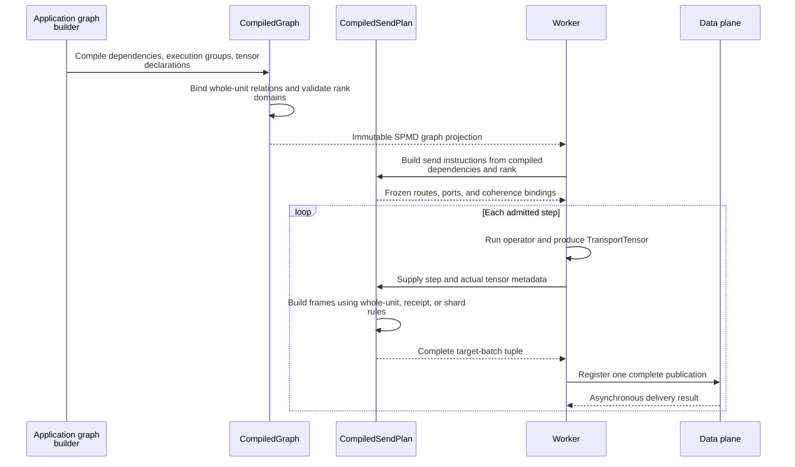

# Transfer planning

[Chinese edition](transfer_planning_zh.md)

A transfer plan answers two questions: which producer supplies a consumer, and
which part of its tensor must be sent. `CompiledGraph` owns the declaration,
`CompiledDependency` binds the active rank domains, and `CompiledSendPlan` creates
the sender instructions. Source work, step admission and checkpoint progress have
separate owners; see [source coordination](source_coordination.md) and
[execution lifecycle](execution_lifecycle.md).

## Route complete units

Use `WholeUnitRouting` when a consumer needs one producer's complete result.
For execution instance `e`, producer `p` emits `U(e, p)`. An assignment `f` gives
consumer `c` exactly `U(e, f(c))`:

```python
from fluxway.common.transfer import WholeUnitRouting

relation = WholeUnitRouting((1, 0, 1, 0)).bind(source_count=2, target_count=4)
assert relation.producers_by_target == ((1,), (0,), (1,), (0,))
assert relation.consumers_by_source == ((1, 3), (0, 2))
```

Consumers 0 and 2 receive producer 1; consumers 1 and 3 receive producer 0.
A permutation exchanges units; repeated producer IDs replicate units. Every
consumer must name one valid producer, and every active producer must be used.
For example, `(0, 0)` with two producers raises `ValueError` because it drops
producer 1. Custom declarations implement `UnitRouting.bind()` and return a
`TransferRelation`; the compiler checks the same domains and completeness rules.

The following public example compiles a graph locally; it starts no workers:

```python
import numpy as np
import fluxway as fw
from fluxway.common.transfer import WholeUnitRouting
from fluxway.common.types.sharding import P, ShardingSpec
from fluxway.common.types.tensor import TransportTensor


class Producer:
    def emit(self) -> dict[str, TransportTensor]:
        return {"value": TransportTensor(np.array([10, 20], dtype=np.int32))}


class Consumer:
    def accept(self, value: TransportTensor) -> None:
        self.total = int(value.flat_values.sum())


builder = fw.Builder()
builder.add_node(
    "producer",
    fw.bind_spmd(
        Producer,
        mesh_axis_names=("data",),
        mesh_axis_shapes=(2,),
        resource_profile=fw.ResourceProfile(base={"CPU": 1}),
        emit={"output_sharding": {"value": ShardingSpec.chunk(P("data"))}},
    ),
)
builder.add_node(
    "consumer",
    fw.bind_spmd(
        Consumer,
        mesh_axis_names=("data",),
        mesh_axis_shapes=(4,),
        resource_profile=fw.ResourceProfile(base={"CPU": 1}),
        accept={"input_sharding": {"value": ShardingSpec.chunk(P("data"))}},
    ),
)
builder.add_func_edge(
    "producer",
    "emit",
    "consumer",
    "accept",
    tensor_map={"value": "value"},
    unit_routing=WholeUnitRouting((1, 0, 1, 0)),
)
graph = builder.build("complete-units").require_compiled_graph()
dependency = graph.dependencies[0]
relation = dependency.unit_relation(dependency.transfers[0].transfer_code)
assert relation is not None
assert relation.consumers_by_source == ((1, 3), (0, 2))
```

The relation applies to every mapped tensor port on the edge and works for
ordinary operators as well as sources. Functional graph calls accept the same
`unit_routing` argument. Ordering-only and `local_only` edges reject it.

After this relation is selected, `input_sharding` does not split each unit again.
Several complete units cannot silently become one input at the same execution
instance. Use separate instances or explicit input ports when the units must
remain separate.

## Execute groups in a cycle

An execution group holds ordered physical ranks and a logical mesh numbered
from zero. Layout calculations use logical coordinates; frame headers and
coherence subjects retain the physical sender rank.

This local compiler example inspects the layout used by runtime integration:

```python
from fluxway.common.execution_layout import compile_execution_layout
from fluxway.common.mesh import DeviceMesh

layout = compile_execution_layout(
    DeviceMesh(("data",), (8,)),
    unit_size=2,
    groups=((0, 4), (1, 5), (2, 6), (3, 7)),
)
assert layout.group_for_step(0).physical_ranks == (0, 4)
assert layout.group_for_step(1).physical_ranks == (1, 5)
assert layout.group_for_step(4).physical_ranks == (0, 4)
assert layout.group_for_rank(5).logical_rank(5) == 1
assert layout.group_for_rank(5).physical_rank(0) == 1
```

With a two-consumer identity relation `(0, 1)`, the first step sends Reader 0
to Input 0 and Reader 4 to Input 1. The next step uses Readers 1 and 5. Each
Input receives four separate microbatches over the cycle, one per instance.

Declare groups through `OperatorSpec.execution_groups` or the corresponding
operator configuration. The compiler stores the result once in
`CompiledOperator.execution_layout`. Groups must have equal size, cover every
physical rank exactly once, and preserve the logical mesh's trailing dimensions.
Without a declaration, groups are contiguous. Invalid rank lookups raise.
Dispatcher, source planning, control-message leaders, send plans and placement
all use this compiled layout.

For Reader/Input affinity, the placement engine derives the target node from
the compiled unit relation and cycle. Conflicting user placement constraints
fail. Affinity between other nodes, such as Input and Dense, is declared
separately; affinity alone does not select a shared-memory transport.

## Route fragments across mesh axes

Without `unit_routing`, the planner intersects `output_sharding` and
`input_sharding`; fragments from several producers may assemble one target
tensor. Receipt routing follows the recorded producer tags and takes precedence
over static shard geometry. Equal layouts do not authorize a direct route when
a receipt determines the destination. Whole-unit and receipt routing cannot
share a transfer.

The following local example splits 12 coordinates over two data ranks and
replicates each partition across three model ranks:

```python
from fluxway.common.mesh import DeviceMesh
from fluxway.common.types.sharding import P, RangeIndices, RoutingDomain, ShardingSpec

mesh = DeviceMesh(("data", "model"), (2, 3))
target = ShardingSpec.chunk(P("data")).bind(mesh)
domain = RoutingDomain.from_layout(
    target=target,
    axis_sizes=(12,),
    axis_indices=(RangeIndices.contiguous(start=6, length=6),),
)
assert domain.domain_size == 12
assert domain.axes[0].num_workers == 2
assert domain.replica is not None
assert domain.replica.axes == ("model",)
assert domain.replica_size == 3
```

`axis_sizes` describes the global routing domain; index lengths describe local
entities. They need not match. Use `RangeIndices.cyclic()` for regular striding,
`LiteralIndices` for explicit keys, and `IdentityIndices` for the full range:

```python
import numpy as np
from fluxway.common.types.sharding import IdentityIndices, LiteralIndices, RangeIndices

cyclic = RangeIndices.cyclic(start=1, length=3, num_workers=2)
explicit = LiteralIndices(length=3, values=np.array([5, 1, 4], dtype=np.int64))
identity = IdentityIndices(length=6)
assert tuple(cyclic.start + i * cyclic.stride for i in range(cyclic.length)) == (
    1,
    3,
    5,
)
assert explicit.values.tolist() == [5, 1, 4]
assert identity.length == 6
```

For several routing axes, `combine="cartesian"` forms their Cartesian product.
Runtime row binding uses `combine="zip"` to retain one routing decision per row.
An optional `valid_length` marks the real prefix before capacity padding.

## Resolve dynamic routing resources

A `FunctionPartition` computes a destination partition for each input key. Its
callable accepts `values` and the keyword arguments `partition_count` and
`domain_size`. Extra `arguments` must be hashable and cannot reuse those names.
The following CPU example resolves the callable through a resource handle:

```python
import numpy as np
from fluxway.common.resource_registry import (
    ResourceHandle,
    ResourceRegistry,
    bind_resource_registry,
)
from fluxway.common.tensor_backend import use_backend
from fluxway.common.types.sharding import FunctionPartition


def route(values, *, partition_count, domain_size, offset):
    return (values + domain_size + offset) % partition_count


registry = ResourceRegistry()
registry.register("routing", "offset", route)
partition = FunctionPartition(
    target=ResourceHandle(namespace="routing", resource_id="offset"),
    arguments={"offset": 1},
)
with use_backend("numba_cpu"), bind_resource_registry(registry):
    destinations = partition(np.array([0, 1, 2, 3]), dim_size=8, num_workers=2)
    assert destinations.tolist() == [1, 0, 1, 0]
```

Passing `target=route` uses the same callable contract without a registry. An
unbound registry, missing resource or incompatible callable raises; graph
definitions do not embed worker addresses or actor handles.

`LogicalPartitionBinding` selects a worker-local value using a logical rank,
optionally projected onto named axes. It does not map physical ranks or restore
state after resizing:

```python
from fluxway.common.logical_partition_binding import LogicalPartitionBinding
from fluxway.common.mesh import DeviceMesh

mesh = DeviceMesh(("data", "model"), (2, 3))
binding = LogicalPartitionBinding({0: "left", 1: "right"}, axes=("data",))
assert binding.resolve(2, logical_mesh=mesh) == "left"
assert binding.resolve(3, logical_mesh=mesh) == "right"
```

## From declaration to execution



Layouts and static routes bind during initialization; dynamic indices and receipts are
evaluated per execution. See [data-plane runtime](dataplane_runtime.md) for ordering,
concurrent fanout, and acceptance proofs.

## Delivery and memory limits

Complete-unit relations and provably equivalent static chunk geometry can
compile to direct targets using the existing distributor and frame format.
Direct delivery skips sorting, packing gathers and concatenation of values from
several shards. In fragment plans, `sort_indices=None` means no reordering;
an actual permutation uses the backend gather. One ordered batch does not prove
that a dynamic route is always an identity route.

These are planning and local assembly properties. They do not establish
cross-process zero-copy, network throughput, exactly-once source processing or
numerical replay. See [data-plane runtime](dataplane_runtime.md) for those
boundaries and [coherence protocol](coherence_protocol.md) for payload lifetime.
