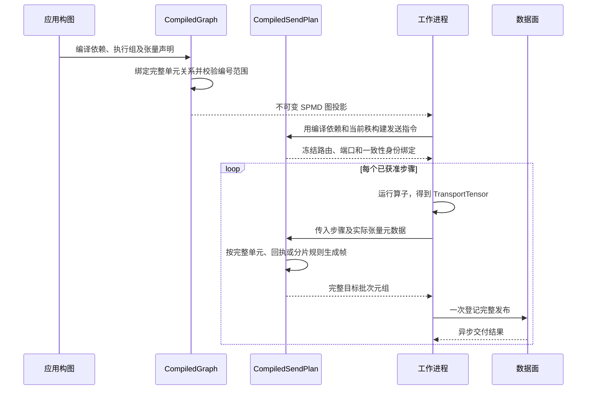

# 传输计划

[英文版](transfer_planning.md)

传输计划回答两个问题：消费者从哪个生产者接收数据，以及需要发送张量的哪一部分。
`CompiledGraph` 保存声明，`CompiledDependency` 绑定活动编号范围，
`CompiledSendPlan` 生成发送指令。来源任务、步骤准入和检查点进度各有独立责任者，
见[来源协调](source_coordination_zh.md)和[执行生命周期](execution_lifecycle_zh.md)。

## 传递完整单元

消费者需要一个生产者的完整结果时，使用 `WholeUnitRouting`。
在执行实例 `e` 中，生产者 `p` 产生 `U(e, p)`；映射 `f` 让消费者 `c`
恰好接收 `U(e, f(c))`：

```python
from fluxway.common.transfer import WholeUnitRouting

relation = WholeUnitRouting((1, 0, 1, 0)).bind(source_count=2, target_count=4)
assert relation.producers_by_target == ((1,), (0,), (1,), (0,))
assert relation.consumers_by_source == ((1, 3), (0, 2))
```

消费者 0、2 接收生产者 1，消费者 1、3 接收生产者 0。排列用于交换完整单元，
重复的生产者编号用于复制。每个消费者必须指定一个有效生产者，每个活动生产者都必须被使用。
例如，两个生产者使用 `(0, 0)` 会遗漏生产者 1，因此抛出 `ValueError`。
自定义声明实现 `UnitRouting.bind()` 并返回 `TransferRelation`，编译器检查相同的编号范围和完整性。

以下公开接口示例只在本地编译计算图，不启动工作进程：

```python
import numpy as np
import fluxway as fw
from fluxway.common.transfer import WholeUnitRouting
from fluxway.common.types.sharding import P, ShardingSpec
from fluxway.common.types.tensor import TransportTensor


class Producer:
    def emit(self) -> dict[str, TransportTensor]:
        return {"value": TransportTensor(np.array([10, 20], dtype=np.int32))}


class Consumer:
    def accept(self, value: TransportTensor) -> None:
        self.total = int(value.flat_values.sum())


builder = fw.Builder()
builder.add_node(
    "producer",
    fw.bind_spmd(
        Producer,
        mesh_axis_names=("data",),
        mesh_axis_shapes=(2,),
        resource_profile=fw.ResourceProfile(base={"CPU": 1}),
        emit={"output_sharding": {"value": ShardingSpec.chunk(P("data"))}},
    ),
)
builder.add_node(
    "consumer",
    fw.bind_spmd(
        Consumer,
        mesh_axis_names=("data",),
        mesh_axis_shapes=(4,),
        resource_profile=fw.ResourceProfile(base={"CPU": 1}),
        accept={"input_sharding": {"value": ShardingSpec.chunk(P("data"))}},
    ),
)
builder.add_func_edge(
    "producer",
    "emit",
    "consumer",
    "accept",
    tensor_map={"value": "value"},
    unit_routing=WholeUnitRouting((1, 0, 1, 0)),
)
graph = builder.build("complete-units").require_compiled_graph()
dependency = graph.dependencies[0]
relation = dependency.unit_relation(dependency.transfers[0].transfer_code)
assert relation is not None
assert relation.consumers_by_source == ((1, 3), (0, 2))
```

该关系应用于边上每个映射的张量端口，普通算子与来源算子都能使用。
函数式构图调用也接受相同的 `unit_routing` 参数。仅表达先后顺序的边和 `local_only` 边拒绝此声明。

选定完整单元关系后，`input_sharding` 不会再次拆分单元。同一执行实例中的多个完整单元
不能悄悄合并为一个输入；需要保持独立时，使用不同执行实例或显式输入端口。

## 按周期执行分组

执行组保存有序物理编号和从零编号的逻辑网格。布局计算使用组内逻辑坐标，
传输帧和一致性主体保留发送端的物理编号。

以下本地编译示例用于检查运行时内部接入所使用的布局：

```python
from fluxway.common.execution_layout import compile_execution_layout
from fluxway.common.mesh import DeviceMesh

layout = compile_execution_layout(
    DeviceMesh(("data",), (8,)),
    unit_size=2,
    groups=((0, 4), (1, 5), (2, 6), (3, 7)),
)
assert layout.group_for_step(0).physical_ranks == (0, 4)
assert layout.group_for_step(1).physical_ranks == (1, 5)
assert layout.group_for_step(4).physical_ranks == (0, 4)
assert layout.group_for_rank(5).logical_rank(5) == 1
assert layout.group_for_rank(5).physical_rank(0) == 1
```

如果两个消费者使用恒等映射 `(0, 1)`，第一步由读取进程 0 供应输入进程 0，
读取进程 4 供应输入进程 1；下一步使用读取进程 1、5。每个输入进程在一个周期内
接收四个独立的小批次，每个执行实例只接收其中一个。

通过 `OperatorSpec.execution_groups` 或对应算子配置声明分组，编译器将唯一结果保存在
`CompiledOperator.execution_layout`。各组必须等大、完整且不重复地覆盖物理编号，
并保留逻辑网格的尾部维度；未声明时生成连续分组。非法编号查询直接抛错。
调度器、来源计划、控制消息主节点、发送计划和放置引擎都使用同一份编译结果。

读取与输入进程的同节点约束由完整单元关系和执行周期确定；用户放置约束与之冲突时直接失败。
其他节点之间的亲和性需要单独声明，例如输入与稠密计算节点。
同节点约束本身不会选择共享内存传输。

## 跨网格轴传递分片

未声明 `unit_routing` 时，计划器计算 `output_sharding` 与 `input_sharding` 的分片交集，
多个生产者的分片可以装配为一个目标张量。回执路由按记录的生产者标签返回，优先于静态分片几何。
即使布局相同，只要目标由回执决定，也不能改走静态直达路径。完整单元路由与回执路由不能用于同一传输。

以下本地示例将 12 个坐标分配到两个数据编号，并沿三个模型编号复制各分区：

```python
from fluxway.common.mesh import DeviceMesh
from fluxway.common.types.sharding import P, RangeIndices, RoutingDomain, ShardingSpec

mesh = DeviceMesh(("data", "model"), (2, 3))
target = ShardingSpec.chunk(P("data")).bind(mesh)
domain = RoutingDomain.from_layout(
    target=target,
    axis_sizes=(12,),
    axis_indices=(RangeIndices.contiguous(start=6, length=6),),
)
assert domain.domain_size == 12
assert domain.axes[0].num_workers == 2
assert domain.replica is not None
assert domain.replica.axes == ("model",)
assert domain.replica_size == 3
```

`axis_sizes` 表示全局路由范围，索引长度表示本地实体数，两者不必相同。
规则跨步使用 `RangeIndices.cyclic()`，显式键使用 `LiteralIndices`，完整区间使用 `IdentityIndices`：

```python
import numpy as np
from fluxway.common.types.sharding import IdentityIndices, LiteralIndices, RangeIndices

cyclic = RangeIndices.cyclic(start=1, length=3, num_workers=2)
explicit = LiteralIndices(length=3, values=np.array([5, 1, 4], dtype=np.int64))
identity = IdentityIndices(length=6)
assert tuple(cyclic.start + i * cyclic.stride for i in range(cyclic.length)) == (
    1,
    3,
    5,
)
assert explicit.values.tolist() == [5, 1, 4]
assert identity.length == 6
```

多个路由轴使用 `combine="cartesian"` 时形成笛卡尔积；运行时逐行绑定使用
`combine="zip"`，让每行只有一个路由决定。可选的 `valid_length` 表示容量填充前的有效前缀。

## 解析动态路由资源

`FunctionPartition` 为每个输入键计算目标分区。函数接收 `values`，以及关键字参数
`partition_count`、`domain_size`；附加 `arguments` 必须可哈希，且不能占用这两个名称。
以下处理器示例通过资源句柄解析路由函数：

```python
import numpy as np
from fluxway.common.resource_registry import (
    ResourceHandle,
    ResourceRegistry,
    bind_resource_registry,
)
from fluxway.common.tensor_backend import use_backend
from fluxway.common.types.sharding import FunctionPartition


def route(values, *, partition_count, domain_size, offset):
    return (values + domain_size + offset) % partition_count


registry = ResourceRegistry()
registry.register("routing", "offset", route)
partition = FunctionPartition(
    target=ResourceHandle(namespace="routing", resource_id="offset"),
    arguments={"offset": 1},
)
with use_backend("numba_cpu"), bind_resource_registry(registry):
    destinations = partition(np.array([0, 1, 2, 3]), dim_size=8, num_workers=2)
    assert destinations.tolist() == [1, 0, 1, 0]
```

直接传入 `target=route` 使用相同的函数契约，不需要注册表。
未绑定注册表、资源缺失或函数签名不匹配时直接抛错；图声明不需要嵌入工作进程地址或远程对象句柄。

`LogicalPartitionBinding` 按逻辑编号选择工作进程内的值，也可以先投影到指定轴。
它不映射物理编号，也不负责扩缩容后的状态恢复：

```python
from fluxway.common.logical_partition_binding import LogicalPartitionBinding
from fluxway.common.mesh import DeviceMesh

mesh = DeviceMesh(("data", "model"), (2, 3))
binding = LogicalPartitionBinding({0: "left", 1: "right"}, axes=("data",))
assert binding.resolve(2, logical_mesh=mesh) == "left"
assert binding.resolve(3, logical_mesh=mesh) == "right"
```

## 从声明交接到执行



布局和静态路由在初始化时绑定；动态索引与回执在每次执行时求值。交付排序、并发扇出及接收证明见[数据面运行时](dataplane_runtime_zh.md)。

## 交付与内存边界

完整单元关系以及可证明等价的静态连续分片可以编译为直达目标，复用现有分发器和传输帧格式。
直达交付跳过排序、收集打包和多分片值拼接。分片计划中，`sort_indices=None` 表示无需重排，
真实排列才调用后端收集操作。某个批次恰好有序，不能证明动态路由始终为恒等映射。

这些结论只涉及计划和本地装配，不能证明跨进程零复制、网络吞吐、来源处理恰好一次或数值重放。
相关边界见[数据面运行时](dataplane_runtime_zh.md)，载荷生命周期见[一致性协议](coherence_protocol_zh.md)。
