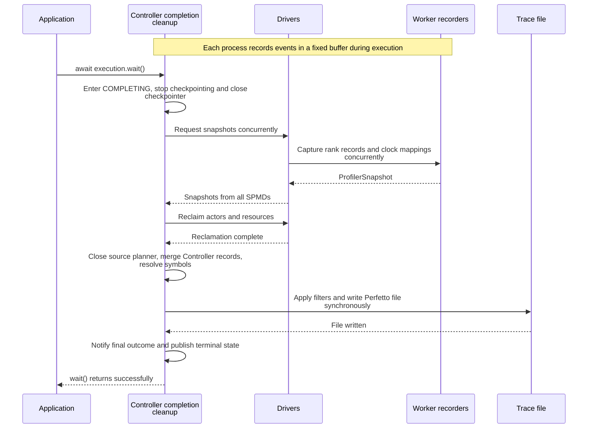

# User profiling

[Chinese edition](user_profiler_zh.md)

Fluxway records the whole operator call as `user_callable.execute`. Add
`profiler.scope()` for smaller timed regions and `profiler.event()` for facts at
one instant. You do not need another decorator around the operator.

## Add a scope and a marker

This helper can run inside an operator. It supplies its own inputs for a local
check. The direct call below verifies the calculation; recording activates only
when Fluxway invokes an operator with profiling enabled.

```python
import fluxway as fw


def lookup(ids: list[int], table: dict[int, float]) -> list[float]:
    attrs = {}
    if fw.profiler.enabled():
        attrs["ids_preview"] = ",".join(str(value) for value in ids[:8])

    with fw.profiler.scope("embedding_lookup", table="item", count=len(ids), **attrs):
        values = [table[item_id] for item_id in ids]

    fw.profiler.event("lookup_complete", result_count=len(values))
    return values


assert lookup([2, 1], {1: 0.5, 2: 1.5}) == [1.5, 0.5]
assert not fw.profiler.enabled()
```

The scope appears as a duration slice named `user.embedding_lookup`; the event
appears as an instant marker named `user.lookup_complete`. `enabled()` is true
only inside an active Fluxway user call. Use it before building expensive
attributes, as the preview example does.

Names must be nonempty strings without control characters. Do not include the
`user.` prefix yourself. Attribute values must be `str`, `int`, `float`, `bool`,
or `None`; complex objects raise `TypeError` while recording is active.
`op_id`, `step`, `rank`, `execution_mode`, and `attrs_id` are reserved keys.
When profiling is inactive, scopes and events do nothing and do not validate,
intern, or serialize attributes. Large tensors and structured payloads belong
in application logs.

## Enable collection for a job

Install the export dependency:

```bash
python -m pip install "fluxway[profiler]"
```

The function below requires an initialized Ray cluster, a complete graph with a
finite source, and its placement recipe. Use a trace directory shared by the
controller and caller so the final file check refers to the same filesystem.
All nodes must satisfy the project's dependency and clock-synchronization
requirements. This function starts the job; it is not a local recording example.

```python
from pathlib import Path

from fluxway import Graph, PlacementRecipe, start
from fluxway.profiler import ProfilerConfig


async def profile_job(
    graph: Graph,
    recipe: PlacementRecipe,
    trace_directory: str | Path,
    run_id: str,
    *,
    skip_initial_steps: int = 0,
    steady_state_only: bool = False,
) -> Path:
    config = ProfilerConfig(
        trace_dir=str(trace_directory),
        run_id=run_id,
        skip_initial_steps=skip_initial_steps,
        steady_state_only=steady_state_only,
    )
    execution = await start(graph, placement_recipe=recipe, profiler_config=config)
    try:
        await execution.wait()
    finally:
        await execution.cancel()
    assert config.output_path.is_file()
    return config.output_path
```

The controller collects worker snapshots and writes the trace during completion.
By default, the result is `trace_directory/run_id/trace.pftrace`; `output_file`
can override that location. Open the file with [Perfetto](https://ui.perfetto.dev/).
Without shared storage, retrieve it from the controller machine instead of
checking a caller-local path.

`skip_initial_steps` excludes early operator steps. `steady_state_only` keeps
records in the steady-state execution interval; a filter that removes every
record raises an error. Collection uses a fixed per-process buffer configured
by `buffer_bytes_per_process`. With its default strict exhaustion policy,
insufficient capacity raises `ProfilerBufferExhausted`. Clock uncertainty beyond
the configured limit also fails collection instead of presenting misleading
timings.



This is automatic export on normal completion. Cancellation and failure cleanup do not
automatically export a trace. Capture, reclamation, or write errors fail completion.
Records show CPU queueing and invocation facts; device completion requires corresponding
backend events.

## Read the trace

Worker tracks follow this hierarchy:

```text
SPMDs/<spmd_id>/rank:<rank>/<subsystem>/<leaf>/lane:<lane>
Controller/<subsystem>/<leaf>
```

`SPMDs` and `Controller` are separate top-level owners. Expand a rank to inspect
compute, transport, mailbox, and scheduler work. The final `lane:<lane>` separates
overlapping slices on one leaf without changing their duration. Lane allocation
is deterministic and uses the minimum lanes needed for that leaf's maximum
concurrency, rather than a new track for each step.

Scheduler leaves are grouped under `scheduler/task`, `scheduler/queue`,
`scheduler/step`, and `scheduler/loop`. Checkpoint component work uses
`checkpoint/storage`; snapshot coordination uses `checkpoint/hook`.
A redundant `worker` level is not inserted below the rank.

Custom scopes and markers appear under
`compute/user_custom/<execution_mode>`. Here, `execution_mode` identifies the
runtime call mode, while the final lane number identifies overlapping trace
slices. Each record is correlated with the surrounding call's `op_id`, `step`,
`rank`, and `execution_mode`. User attributes appear as readable debug
annotations; the internal `attrs_id` does not.

## Match events to the compiled graph

The surrounding `user_callable.execute` slice carries `graph_id`, `spmd_id`,
`op_id`, `function_id`, `input_signature_id`, and `output_signature_id`.
Search the same values in [Model Explorer](graph_visualization.md). Step and
execution mode are runtime facts, not compiled graph fields.

At export, `CompiledGraph` supplies operator functions, declared data/control/
static port names, and explicit parameter-to-field paths. An empty parameter map
stays empty; names are not guessed. A `transfer_code` identifies one source-to-
target port transfer; `logical_tuuid` identifies the producer output. One output
may feed multiple target ports, sharing a logical tensor ID but using separate
transfer codes.

The recorder stores fixed-width integer records on the hot path. Graph names
are resolved once during export through the frozen symbol projection. Explicit
operator, transfer, or tensor IDs must resolve or raise `MissingGraphTraceSymbol`.
Lifecycle events such as `execution.phase` may intentionally have no operator
ID and remain non-operator metadata. Controller records use a separate entry
point with the same recorder format and export pipeline.
