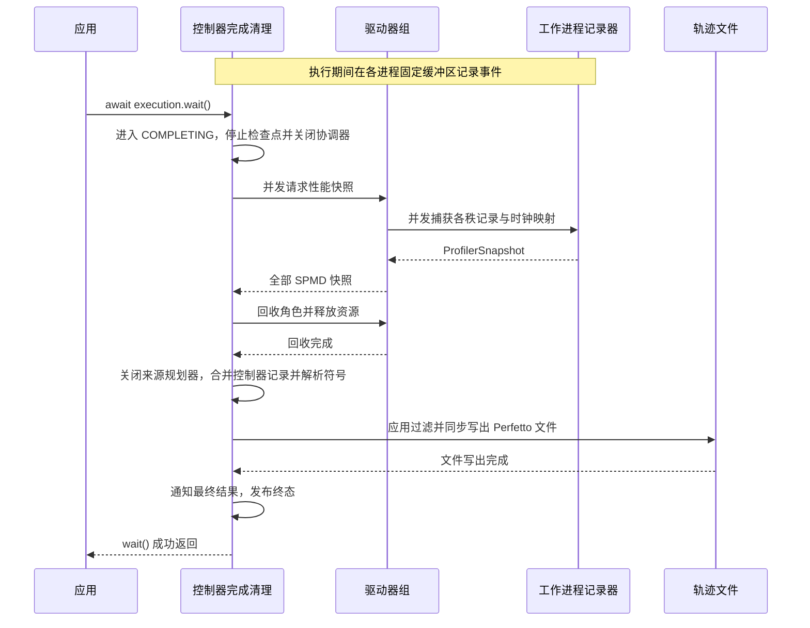

# 用户性能分析

[英文版](user_profiler.md)

Fluxway 会将整个算子调用记录为 `user_callable.execute`。
对内部较小的耗时区域使用 `profiler.scope()`，对某个时刻的事实使用 `profiler.event()`。
不需要再给整个算子增加分析装饰器。

## 添加作用域与标记

下面的辅助函数可以在算子内部调用，并提供了本地检查所需的输入。
直接调用只验证计算结果；只有 Fluxway 在启用分析的情况下调用算子时，才会记录事件。

```python
import fluxway as fw


def lookup(ids: list[int], table: dict[int, float]) -> list[float]:
    attrs = {}
    if fw.profiler.enabled():
        attrs["ids_preview"] = ",".join(str(value) for value in ids[:8])

    with fw.profiler.scope("embedding_lookup", table="item", count=len(ids), **attrs):
        values = [table[item_id] for item_id in ids]

    fw.profiler.event("lookup_complete", result_count=len(values))
    return values


assert lookup([2, 1], {1: 0.5, 2: 1.5}) == [1.5, 0.5]
assert not fw.profiler.enabled()
```

作用域显示为名叫 `user.embedding_lookup` 的持续时间切片，
事件显示为名叫 `user.lookup_complete` 的即时标记。
`enabled()` 只有在活动的 Fluxway 用户调用内才为真。
生成开销较大的属性前先检查它，示例中的输入预览就是这种用法。

名称必须是非空字符串，不能含控制字符，也不要自行添加 `user.` 前缀。
属性值只能是 `str`、`int`、`float`、`bool` 或 `None`；记录启用时，复杂对象会触发 `TypeError`。
`op_id`、`step`、`rank`、`execution_mode` 和 `attrs_id` 是保留属性名。
分析未启用时，作用域和事件不执行记录，也不校验、驻留或序列化属性。
大型张量和结构化数据应写入应用日志。

## 为作业启用采集

安装导出依赖：

```bash
python -m pip install "fluxway[profiler]"
```

下面的函数需要已初始化的 Ray 集群、包含有限数据源的完整计算图及其放置配方。
轨迹目录需要由控制器和调用方共享，才能在函数最后检查同一个文件。
所有节点必须满足项目的依赖和时钟同步要求。该函数会启动作业，不是本地记录示例。

```python
from pathlib import Path

from fluxway import Graph, PlacementRecipe, start
from fluxway.profiler import ProfilerConfig


async def profile_job(
    graph: Graph,
    recipe: PlacementRecipe,
    trace_directory: str | Path,
    run_id: str,
    *,
    skip_initial_steps: int = 0,
    steady_state_only: bool = False,
) -> Path:
    config = ProfilerConfig(
        trace_dir=str(trace_directory),
        run_id=run_id,
        skip_initial_steps=skip_initial_steps,
        steady_state_only=steady_state_only,
    )
    execution = await start(graph, placement_recipe=recipe, profiler_config=config)
    try:
        await execution.wait()
    finally:
        await execution.cancel()
    assert config.output_path.is_file()
    return config.output_path
```

控制器在完成阶段收集工作进程的快照并写出轨迹。
默认输出为 `trace_directory/run_id/trace.pftrace`；可以用 `output_file` 指定其他位置。
用 [Perfetto](https://ui.perfetto.dev/) 打开该文件。
没有共享存储时，应从控制器所在机器取回文件，不能检查调用方本地的同名路径。

`skip_initial_steps` 排除最初若干执行步，`steady_state_only` 只保留稳定执行区间内的记录。
如果过滤删除了全部记录，导出会报错。
采集使用固定大小的进程缓冲区，由 `buffer_bytes_per_process` 配置。
默认启用严格的耗尽检查，容量不足时抛出 `ProfilerBufferExhausted`。
时钟不确定度超过配置上限也会使采集失败，避免输出误导性的耗时。



图示正常完成的自动导出路径。取消与失败清理不自动导出轨迹；采集、回收或写出异常会使完成结果失败。记录区间含 CPU 排队与调用事实，设备实际完成时间仍需相应后端事件证明。

## 阅读轨迹

工作进程轨道使用以下层级：

```text
SPMDs/<spmd_id>/rank:<rank>/<subsystem>/<leaf>/lane:<lane>
Controller/<subsystem>/<leaf>
```

`SPMDs` 和 `Controller` 是两个顶层所有者。
展开某个进程编号即可查看计算、传输、信箱和调度活动。
末尾的 `lane:<lane>` 将同一叶节点上重叠的切片分到不同轨道，同时保留原始持续时间。
轨道分配是确定性的，数量等于该叶节点最大并发度所需的最少值，不会为每一步新建轨道。

调度活动按职责分到 `scheduler/task`、`scheduler/queue`、`scheduler/step`
和 `scheduler/loop`。检查点组件操作位于 `checkpoint/storage`，
快照协调位于 `checkpoint/hook`。进程编号之下不会再重复插入 `worker` 层级。

自定义作用域和标记位于 `compute/user_custom/<execution_mode>`。
其中的 `execution_mode` 表示运行时调用模式，末尾的通道编号用于区分重叠切片。
每条记录关联外围调用的 `op_id`、`step`、`rank` 和 `execution_mode`。
用户属性显示为可读的调试注解，内部的 `attrs_id` 不显示。

## 将事件对应到编译后的计算图

外围的 `user_callable.execute` 切片携带 `graph_id`、`spmd_id`、`op_id`、
`function_id`、`input_signature_id` 和 `output_signature_id`。
可以在 [Model Explorer](graph_visualization_zh.md) 中搜索相同值。
执行步和调用模式属于运行时事实，不属于编译后的计算图字段。

导出时，`CompiledGraph` 提供算子函数、已声明的数据端口、控制端口、静态端口名称，
以及显式的参数到字段路径。参数映射为空时保持为空，不猜测名称。
`transfer_code` 标识从源端口到目标端口的一次传输，`logical_tuuid` 标识生产者输出。
同一个输出可以供给多个目标端口：它们共享逻辑张量标识，但具有各自的传输编码。

记录器在热路径上保存定宽整数记录，图名称在导出时通过冻结的符号投影统一解析。
显式的算子、传输或张量标识必须能解析，否则抛出 `MissingGraphTraceSymbol`。
`execution.phase` 等生命周期事件可以不携带算子标识，按非算子元数据处理。
控制器使用独立的记录入口，但共用同一记录格式和导出流程。
