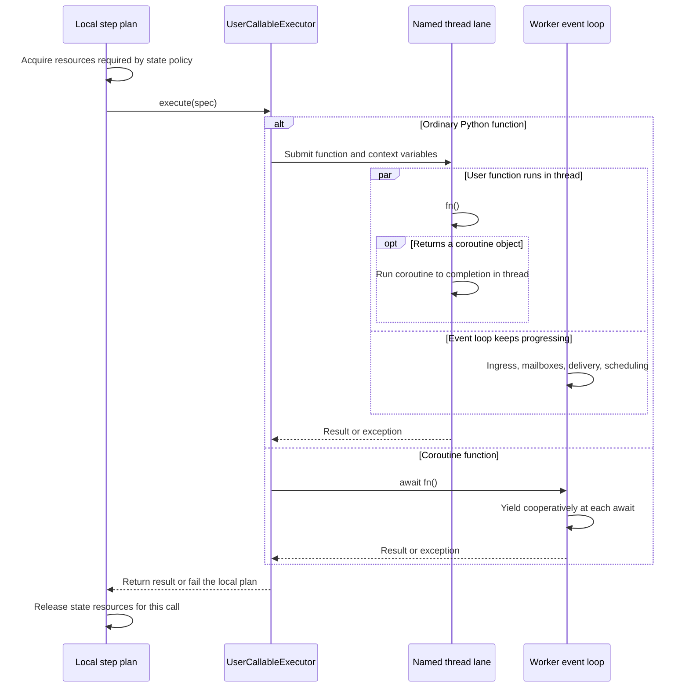
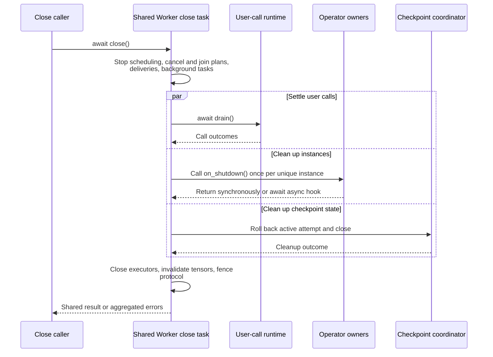

# Worker-process operators

[Chinese edition](worker_process_operators_zh.md)

A stateful operator instance belongs to one SPMD worker process. Use
`@requires_worker_process` when its constructor creates process-local handles or
needs the final worker topology, such as `jax.distributed.initialize`.
Ordinary stateful classes do not need this marker.

## Declare an operator and release its resources

This example separates a stateless preparation step from a stateful file write.
`bind_spmd` leaves the original class available for local checks and creates an
SPMD declaration for graph execution. The writer has one worker, so its output
path has one owner. That path must not already exist.

```python
from pathlib import Path
from tempfile import TemporaryDirectory

import numpy as np
import fluxway as fw
from fluxway.common.operator_policy import AsyncPolicy, StatePolicy


@fw.requires_worker_process
class BatchWriter:
    def __init__(self, output_path: str):
        self._stream = Path(output_path).open("x", encoding="utf-8")

    def prepare(self, values: np.ndarray) -> dict[str, np.ndarray]:
        return {"values": np.abs(values)}

    def write(self, values: np.ndarray) -> int:
        self._stream.writelines(f"{value}\n" for value in values.tolist())
        return len(values)

    def on_shutdown(self) -> None:
        self._stream.close()


replicated = {"type": "static", "axis": []}
WriterSPMD = fw.bind_spmd(
    BatchWriter,
    resource_profile=fw.ResourceProfile(base={"CPU": 1}),
    mesh_axis_names=("data",),
    mesh_axis_shapes=(1,),
    prepare={
        "input_sharding": {"values": replicated},
        "output_sharding": {"values": replicated},
        "async_policy": AsyncPolicy.pipelined(depth=2, state=StatePolicy.thread_safe()),
    },
    write={
        "input_sharding": {"values": replicated},
        "async_policy": AsyncPolicy.pipelined(depth=2, state=StatePolicy.exclusive()),
    },
)


def build_writer_graph(output_path: str) -> fw.Graph:
    builder = fw.Builder()
    builder.add_node("writer", WriterSPMD, output_path=output_path)
    builder.add_func_edge(
        "writer",
        "prepare",
        "writer",
        "write",
        tensor_map={"values": "values"},
        local_only=True,
    )
    return builder.build("batch-writer")


Path("tmp").mkdir(exist_ok=True)
with TemporaryDirectory(dir="tmp") as directory:
    output = Path(directory) / "batch.txt"
    writer = BatchWriter(str(output))
    try:
        prepared = writer.prepare(np.array([-1, 2, -3]))
        assert writer.write(prepared["values"]) == 3
    finally:
        writer.on_shutdown()
    assert output.read_text() == "1\n2\n3\n"

    graph = build_writer_graph(str(Path(directory) / "runtime.txt"))
    view = graph.require_compiled_graph().spmd("writer")
    assert view.operator("prepare").spec.async_policy.state.access == "thread_safe"
    assert view.operator("write").spec.async_policy.state.access == "exclusive"
    assert view.operator("write").spec.requires_worker_process
```

The direct call checks the file contents and resource lifetime on the CPU; it
also checks the compiled policies. It does not run Ray workers. The graph shows
the local handoff; connect a real source to `prepare` before starting a job.
`local_only=True` means a dependency within the same worker, not a remote call.

At startup Fluxway constructs one instance per owner class in each worker and
shares it across that class's operators. Constructor parameters come from the
node's static arguments, such as `output_path` above. Before `__init__`, Fluxway
also supplies `rank`, `world_size`, `local_rank`, `local_world_size`, `node_rank`,
`num_nodes`, `spmd_id`, `rank0_address`, and `ray_component_limits`.
`self.ctx` carries the current invocation's context and can vary between calls.

On graceful worker shutdown, Fluxway calls each owner's `on_shutdown()` once,
even when several operators share it. The hook may be synchronous or return an
awaitable. Shutdown attempts all owners and propagates cleanup errors. Forced
process termination cannot guarantee a hook; buffered output is not a
checkpoint or a crash-recovery guarantee. A resource registry does not close
registered objects for you; see [resource
ownership](placement_recipe.md#register-resources-created-inside-a-worker).

## Where user code runs

| Callable | Execution |
| --- | --- |
| Ordinary Python function | Submitted asynchronously to a named worker-local thread lane, from its first call |
| Ordinary function returning a coroutine object | The worker thread runs that coroutine to completion |
| Coroutine function (`async def`) | Uses `COROUTINE_ASYNC` and runs cooperatively on the actor event loop |

`@requires_worker_process` controls construction, not this choice. A coroutine
must yield while waiting; blocking work inside `async def` blocks the actor
loop. Context variables, including rank and step, follow the call into worker
threads. Exceptions propagate to the local step plan and fail the worker.

This separation lets transport reception, mailbox updates, input preparation,
outbound delivery, and scheduler wakeups progress while ordinary operators run.
CPU-bound Python still competes for the GIL on standard CPython. Native code
that releases the GIL can overlap. Free-threaded CPython can also run Python
bytecode in parallel, with the same lane and scheduling rules.



Thread lanes and state locks are separate boundaries. `thread_safe()` permits
overlapping calls on the same owner; `exclusive()` preserves mutual exclusion. Blocking
work inside a coroutine still blocks the event loop.

### Concurrency during shutdown



Synchronous `on_shutdown()` runs directly on the Worker event loop; use an async hook
and explicitly offload blocking cleanup. Owner hooks and user-call drain run
concurrently; hooks are not guaranteed to start after every thread call ends. Owners
must coordinate outstanding resource access. Cancelling a coroutine wait cannot stop a
running Python thread. Forced process termination does not guarantee hooks.

## State and scheduling

`AsyncPolicy.depth` bounds local pipelining. State access is a separate decision:

- `StatePolicy.exclusive()` serializes operators sharing the same state resource.
  Keep this for model updates and mutable stores; it is the default.
- `StatePolicy.thread_safe()` removes that instance lock. Use it only when the
  operator and its underlying resources support concurrent calls.

In the example, `prepare` only transforms its input and can overlap with `write`.
Calls to `write` remain exclusive because they share a file. A process-local
constructor does not prohibit this overlap.

For multi-phase model updates, `SchedulePolicy.phase_graph` can allow helper
work and updates from one step to overlap while preventing the next training
step from reading unfinished state. The
[recommendation example](../fluxway/example/recommendation/dense_spmd.py) uses
thread-safe `prepare_dense_inputs` and `scatter_sparse_grads`, with exclusive
`train_core` and `update`. The graph and [visualization](graph_visualization.md)
use the same compiled phase rules.

With profiling enabled, `user_callable.execute` includes queue wait;
`user_callable.function_run` measures the function invocation without lane
queueing or worker context setup. `worker_process_call.thread_run` records the
worker-thread interval. Profiling observes the selected lane without dispatching
it a second time.

## Initialization errors

A class that calls `jax.distributed.initialize` without the marker is rejected
with a `Fluxway Worker Process Error`. Use the decorator instead of setting the
internal `__fluxway_process_affine__` field. The marker does not supply JAX,
create a distributed coordinator, or make mismatched worker topology valid.

## Checkpoint extension boundary

Operators do not implement checkpoint hooks. Register a
`CheckpointComponentRegistration` through the SPMD's `checkpoint_components`.
A `SAVE` component handles `prepare_save`, `save`, `finish_save`, `commit_save`,
and `publish_save`; `rollback_save` handles failed transactions. A `RESTORE`
component handles `restore`. Object holds and cleanup reservations belong to
`OBJECT_LIFECYCLE`; physical deletion belongs to `OBJECT_CLEANUP`.
The control runtime calls `abort_save` to discard an incomplete attempt and
`acknowledge_save` after the global commit succeeds.

The controller orders transactions and publishes the manifest. Components own
physical URIs, staging layouts, versions, and retention operations.
Save methods receive `SaveSession`; `commit_save` receives `CommitSaveSession`
with all worker results. `restore` receives `RestoreSession` with the saved and
target topologies and component publication. Use `session.checkpoint_object_ref`
to describe a component-owned object and `session.component_checkpoint` to
publish those references. Worker `save` returns `WorkerSaveResult`, while
`commit_save` returns `CheckpointComponentPublication`. Mutating save sessions
carry `CheckpointCommitPermit`; stale permits are rejected after a coordinator
generation change. See [checkpoint components](checkpoint.md) for registration
examples and the complete capability contract.
