# 工作进程算子

[英文版](worker_process_operators.md)

有状态算子实例属于一个 SPMD 工作进程。如果构造函数创建进程本地句柄，
或者需要最终的工作进程拓扑，例如调用 `jax.distributed.initialize`，使用
`@requires_worker_process`。普通有状态类不需要这一标记。

## 声明算子并释放资源

下面将无状态的输入准备与有状态的文件写入分开。
`bind_spmd` 保留原始类供本地检查，并创建用于计算图执行的 SPMD 声明。
写入器只有一个工作进程，因此输出路径只有一个所有者。该路径必须尚不存在。

```python
from pathlib import Path
from tempfile import TemporaryDirectory

import numpy as np
import fluxway as fw
from fluxway.common.operator_policy import AsyncPolicy, StatePolicy


@fw.requires_worker_process
class BatchWriter:
    def __init__(self, output_path: str):
        self._stream = Path(output_path).open("x", encoding="utf-8")

    def prepare(self, values: np.ndarray) -> dict[str, np.ndarray]:
        return {"values": np.abs(values)}

    def write(self, values: np.ndarray) -> int:
        self._stream.writelines(f"{value}\n" for value in values.tolist())
        return len(values)

    def on_shutdown(self) -> None:
        self._stream.close()


replicated = {"type": "static", "axis": []}
WriterSPMD = fw.bind_spmd(
    BatchWriter,
    resource_profile=fw.ResourceProfile(base={"CPU": 1}),
    mesh_axis_names=("data",),
    mesh_axis_shapes=(1,),
    prepare={
        "input_sharding": {"values": replicated},
        "output_sharding": {"values": replicated},
        "async_policy": AsyncPolicy.pipelined(depth=2, state=StatePolicy.thread_safe()),
    },
    write={
        "input_sharding": {"values": replicated},
        "async_policy": AsyncPolicy.pipelined(depth=2, state=StatePolicy.exclusive()),
    },
)


def build_writer_graph(output_path: str) -> fw.Graph:
    builder = fw.Builder()
    builder.add_node("writer", WriterSPMD, output_path=output_path)
    builder.add_func_edge(
        "writer",
        "prepare",
        "writer",
        "write",
        tensor_map={"values": "values"},
        local_only=True,
    )
    return builder.build("batch-writer")


Path("tmp").mkdir(exist_ok=True)
with TemporaryDirectory(dir="tmp") as directory:
    output = Path(directory) / "batch.txt"
    writer = BatchWriter(str(output))
    try:
        prepared = writer.prepare(np.array([-1, 2, -3]))
        assert writer.write(prepared["values"]) == 3
    finally:
        writer.on_shutdown()
    assert output.read_text() == "1\n2\n3\n"

    graph = build_writer_graph(str(Path(directory) / "runtime.txt"))
    view = graph.require_compiled_graph().spmd("writer")
    assert view.operator("prepare").spec.async_policy.state.access == "thread_safe"
    assert view.operator("write").spec.async_policy.state.access == "exclusive"
    assert view.operator("write").spec.requires_worker_process
```

直接调用会在 CPU 上检查文件内容、资源生命周期和编译后的策略，不会运行 Ray 工作进程。
计算图展示了本地交接；启动作业前，需要为 `prepare` 连接实际数据源。
`local_only=True` 表示同一工作进程内的依赖，不是远程调用。

启动时，Fluxway 在每个工作进程内为每个所有者类创建一个实例，并在该类的算子之间共享。
构造参数取自节点的静态参数，例如上面的 `output_path`。
在 `__init__` 之前，Fluxway 还会提供 `rank`、`world_size`、`local_rank`、
`local_world_size`、`node_rank`、`num_nodes`、`spmd_id`、`rank0_address`
和 `ray_component_limits`。`self.ctx` 携带当前调用的上下文，会随调用变化。

正常关闭工作进程时，即使多个算子共享同一实例，Fluxway 也只调用一次该实例的
`on_shutdown()`。该方法可以是同步函数，也可以返回可等待对象。
关闭过程会尝试清理所有实例，并传播清理错误。强制终止进程不能保证执行清理；
缓冲文件也不提供检查点或崩溃恢复保证。注册表不会替资源所有者关闭对象，见
[资源所有权](placement_recipe_zh.md#注册工作进程内创建的资源)。

## 用户代码在哪里运行

| 可调用对象 | 执行方式 |
| --- | --- |
| 普通 Python 函数 | 从第一次调用起，异步提交到工作进程内的命名线程通道 |
| 返回协程对象的普通函数 | 工作线程运行该协程至完成 |
| 协程函数（`async def`） | 使用 `COROUTINE_ASYNC`，在执行器的事件循环上协作运行 |

`@requires_worker_process` 控制构造位置，不改变上表中的选择。
协程等待时必须让出控制权；在 `async def` 内执行阻塞操作会阻塞执行器的事件循环。
进程编号和执行步等上下文变量会随调用传入工作线程。异常会传播到本地执行计划并使工作进程失败。

这样，普通算子运行时，传输接收、信箱更新、输入准备、输出交付和调度器唤醒仍可推进。
标准 CPython 下，计算密集的 Python 代码仍然竞争 GIL。
释放 GIL 的原生代码可以重叠；自由线程版 CPython 还可以并行执行 Python 字节码，
通道和调度规则保持一致。

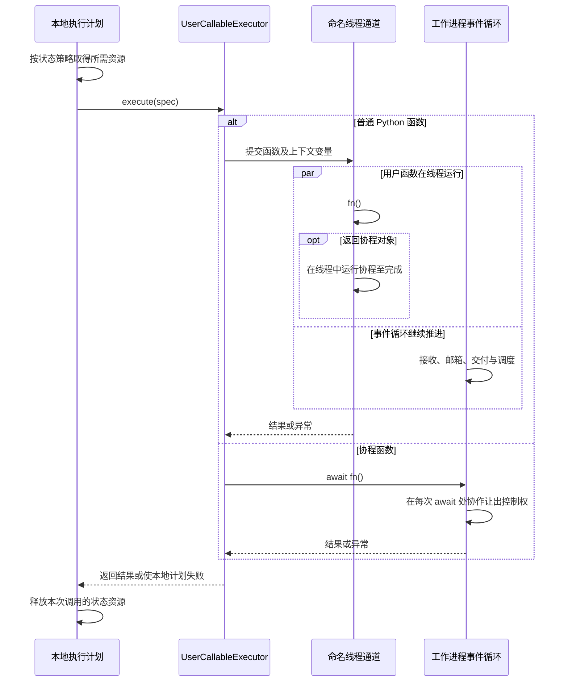

线程通道与状态锁是不同边界：`thread_safe()` 允许共用实例的调用重叠，`exclusive()` 保留互斥。协程内的同步阻塞工作仍会阻塞事件循环。

### 关闭时的并发边界

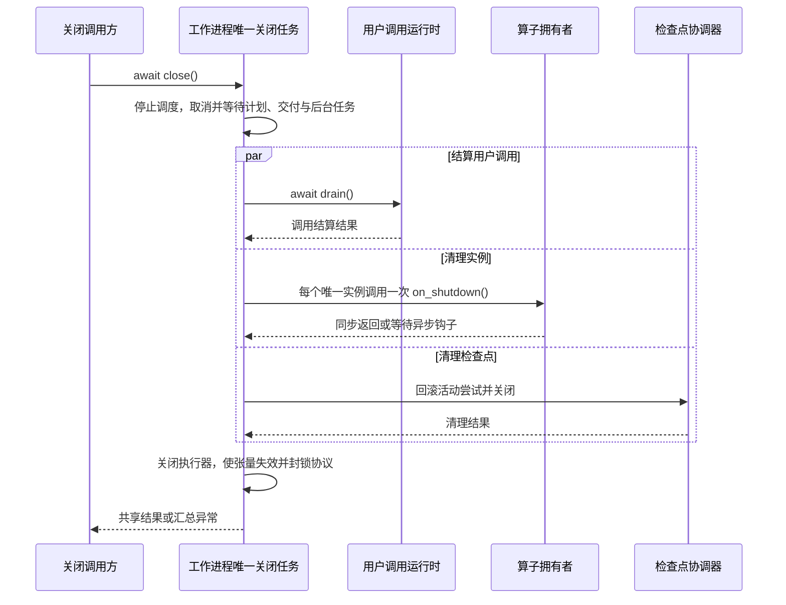

同步 `on_shutdown()` 直接在工作进程事件循环调用；耗时清理应使用异步钩子并自行分派阻塞工作。实例钩子与用户调用排空并发执行，不保证钩子开始前所有线程调用已经结束。拥有者须协调仍在进行的资源访问；取消协程等待也不能终止已运行的 Python 线程。强制结束进程不保证执行钩子。

## 异步执行与协同调度架构 (Async, State & Schedule Architecture)

在 Fluxway 中，算子的并发执行由三个正交的策略维度共同决定：**异步并发策略 (`AsyncPolicy`)**、**队列调度策略 (`SchedulePolicy`)** 与 **状态互斥策略 (`StatePolicy`)**。三者彼此解耦，由框架编译引擎统一组装为高性能、内存安全的运行时控制块。

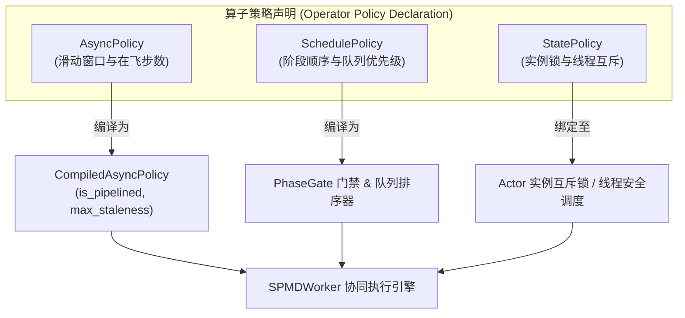

---

### 1. 异步执行策略 (`AsyncPolicy`)

`AsyncPolicy` 定义算子在步数（Step / Microbatch）维度的向前推进能力与重叠窗口，提供三种平级且正交的原生并发执行模式：

#### `AsyncPolicy.sync`（严格单步同步）

* **核心语义**：严格单步执行，流水线深度固定为 1（`depth=1`）。当前 Step 的输入准备、执行与结果提交全部完成之前，绝不触发下一步。
* **适用场景**：单步调试验证、有强因果同步屏障、或完全不可重叠的串行执行流。

```mermaid
gantt
    title AsyncPolicy.sync (depth=1) 执行甘特图
    dateFormat X
    axisFormat %s
    section Worker 计算
    Step 0 执行 :active, 0, 10
    Step 1 执行 :active, 10, 20
    section Ingress 输入准备
    Step 0 准备 :0, 3
    Step 1 准备 :10, 13
```

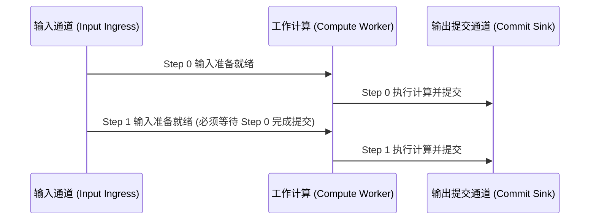

#### `AsyncPolicy.pipelined`（滑动窗口流水线）

* **核心语义**：滑动窗口异步流水线。允许算子同时在飞（in-flight）最多 $K$ 个微批次或步数。框架自动重叠上游预取（Prefetching）、输入准备（Input Prepare）与工作线程执行，消除 IO 与网络等待气泡；在飞步数达到 $K$ 时天然触发背压限流。
* **适用场景**：数据读取、特征物化变换、深度学习前向/反向计算、标准流水线并行。

```mermaid
gantt
    title AsyncPolicy.pipelined (depth=2) 执行甘特图
    dateFormat X
    axisFormat %s
    section Worker 计算
    Step 0 执行 :active, 3, 10
    Step 1 执行 :active, 10, 17
    Step 2 执行 :active, 17, 24
    section Ingress 输入预取
    Step 0 准备 :0, 3
    Step 1 预取 (并发重叠) :3, 6
    Step 2 预取 (并发重叠) :10, 13
    Step 3 预取 (并发重叠) :17, 20
```

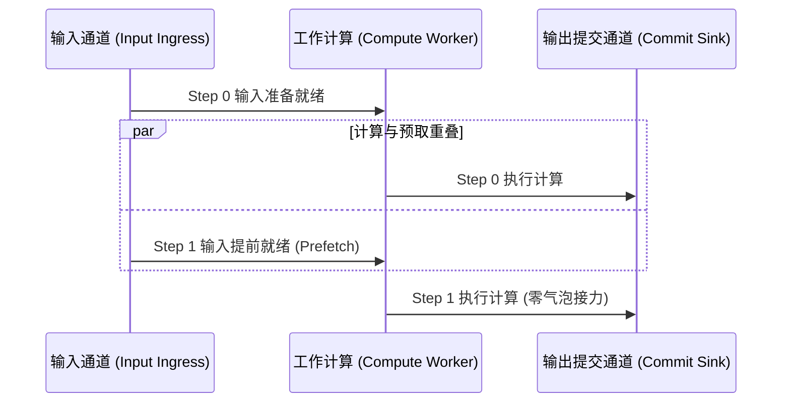

#### `AsyncPolicy.bounded_stale`（有界陈旧度并行 / SSP）

* **核心语义**：有界陈旧度参数并行（Stale Synchronous Parallelism, SSP）。允许算子在本地使用落后至多 $M$ 步的陈旧参数（Stale Parameters）高速迭代；当滞后步数达到 $M$ 时，框架触发强制屏障同步（Staleness Fence Barrier）挂起算子，等待全局参数同步对齐。
* **适用场景**：大规模推荐系统 Embedding 异步查表更新、参数服务器（Parameter Server）架构、容忍轻微滞后的分布式 SGD。

```mermaid
gantt
    title AsyncPolicy.bounded_stale (depth=2, max_staleness=2) 执行甘特图
    dateFormat X
    axisFormat %s
    section Worker 计算
    Step 0 (使用参数 W0) :active, 0, 6
    Step 1 (使用参数 W0) :active, 6, 12
    Step 2 (使用参数 W0) :active, 12, 18
    Staleness 超限屏障挂起 :crit, 18, 24
    Step 3 (使用参数 W1) :active, 24, 30
    section 参数同步
    W0 到 W1 异步网络传输 :0, 24
```

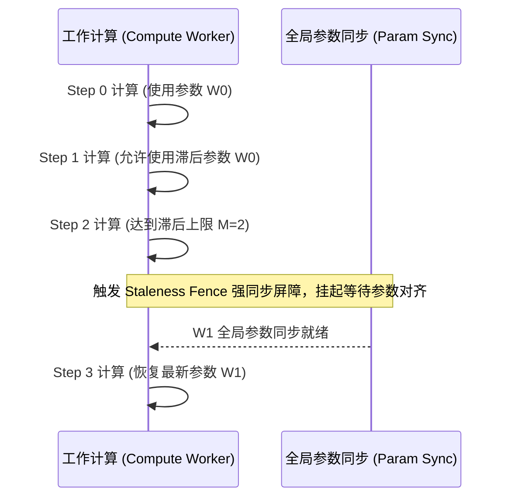

#### 极速选型决策树

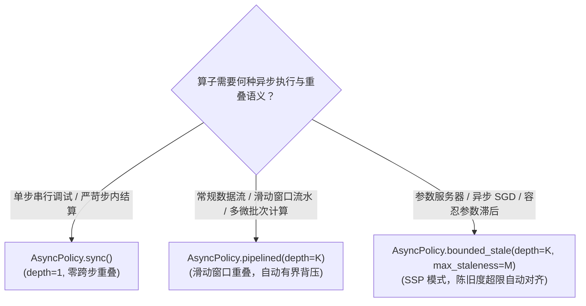

---

### 2. 状态访问策略 (`StatePolicy`)

* **`StatePolicy.exclusive()`**：**默认策略**。对同一个 SPMD Actor 实例加锁串行化。模型权重更新、有状态缓存等存在数据竞争的算子必须保留此策略。
* **`StatePolicy.thread_safe()`**：移除实例锁。仅当算子为纯无状态转换或其内部资源完全线程安全时使用，允许同一个 Actor 实例跨多步并发执行。

---

### 3. 队列调度策略 (`SchedulePolicy`)

为了让业务方快速选择最适合的调度策略，请参考以下决策树与速查表：

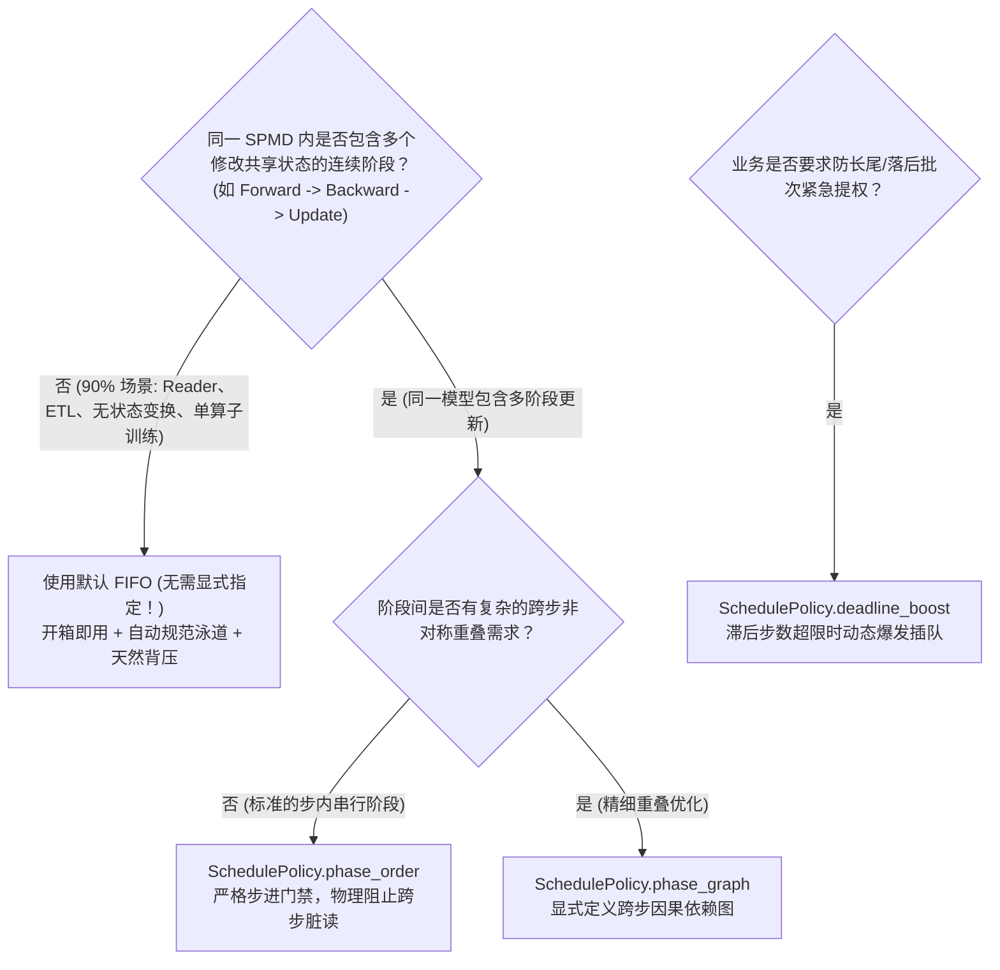

#### 策略速查与代码模板对照表

| 策略类型 | 适用场景 | 框架保证 | 核心代码范式 |
| :--- | :--- | :--- | :--- |
| **`fifo` (默认)** | **90% 业务场景**：数据读取、特征物化、无状态前向、单算子训练。 | **默认开箱即用**。自动归入 `io`/`compute` 规范泳道并自动配齐协同优先级 `("compute", "io")`，下游计算优先出队消费。 | `@operator("read", async_policy=AsyncPolicy.pipelined(depth=4))` *(无需显式指定 schedule)* |
| **`phase_order`** | **多阶段模型训练**：同一个 Actor 内有 `train_core` 与 `update` 等阶段，确保下一步计算不会读取到正在更新的脏权重。 | 框架编译底层 `PhaseGate` 门禁。在 Step $S$ 优化器更新完成前，Step $S+1$ 计算**物理被拦截在执行队列之外**，绝对无竞态。 | `SchedulePolicy.phase_order(phase="fwd", phase_order=("fwd", "bwd", "opt"))` |
| **`phase_graph`** | **复杂跨步重叠**：模型更新时，允许 Step $S+1$ 的部分辅助工作（如梯度预通信）与 Step $S$ 更新重叠，但核心前向必须等待。 | 用户通过 `(before, after, step_delta)` 显式表达细粒度因果依赖 DAG。 | `SchedulePolicy.phase_graph(phase="fwd", phase_order=..., dependencies=(("opt", "fwd", 1),))` |
| **`deadline_boost`** | **防掉队者 / 周期性刷盘**：平时保持低优先级让出资源，当滞后步数超过阈值时，临时提权到 `boost_priority` 优先出队。 | 自动监控调度步数滞后差，超限立即在 Min-Heap 队列中提权插队。 | `SchedulePolicy.deadline_boost(base_priority=0, boost_priority=100)` |

---

### 4. 正交组合应用范式 (Orthogonal Composition Patterns)

Fluxway 拒绝硬编码的死板模式。`AsyncPolicy`（滑动窗口与推进深度）与 `SchedulePolicy`（因果依赖与阶段门禁）通过正交解耦的组合，天然支撑各种高性能计算范式：

#### 范式 A：流式数据预取与背压流水（Streaming Ingestion & Backpressure）

适用于纯数据加载、特征变换与无状态前向。无需声明阶段门禁，直接由 `pipelined` 与默认 `FIFO` 协同工作，提供天然的内存有界反压：

```python
# 最简流式数据处理：上游预取与当前步计算自动重叠，在飞步数达到 4 时自动反压限流
@operator("process", async_policy=AsyncPolicy.pipelined(depth=4))
def process(self, batch: Batch) -> Tensor:
    return self.transform(batch)
```

#### 范式 B：多阶段流水线并行（Cross-Phase Pipeline Parallelism / 1F1B）

适用于现代大模型与分布式深度学习流水线并行。由 `AsyncPolicy.pipelined(depth=K)` 驱动 $K$ 个微批次（Microbatch）同时在流水线中流动，并由 `SchedulePolicy.phase_order` 提供前向（Forward）与反向（Backward）阶段的因果门禁：

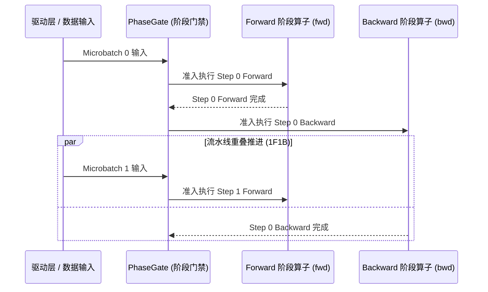

```python
class PipelineParallelStage:
    """标准 1F1B 流水线并行阶段算子组"""

    @operator(
        "fwd_stage",
        async_policy=AsyncPolicy.pipelined(
            depth=4,  # 在飞微批次深度
            schedule=SchedulePolicy.phase_order(phase="fwd", phase_order=("fwd", "bwd")),
            state=StatePolicy.exclusive(),
        ),
    )
    def fwd_stage(self, microbatch: Tensor) -> Tensor:
        return self.forward_compute(microbatch)

    @operator(
        "bwd_stage",
        async_policy=AsyncPolicy.pipelined(
            depth=4,
            schedule=SchedulePolicy.phase_order(phase="bwd", phase_order=("fwd", "bwd")),
            state=StatePolicy.exclusive(),
        ),
    )
    def bwd_stage(self, grad_output: Tensor) -> Tensor:
        return self.backward_compute(grad_output)
```

#### 范式 C：多阶段步内屏障隔离（Barrier-Isolated Multi-Phase Training）

适用于单 Actor 内包含核心计算与参数更新的多阶段任务，通过 `depth=1` 结合 `phase_order` 门禁，物理阻止下一步读到未更新完成的脏权重：

```python
@operator(
    "train_core",
    async_policy=AsyncPolicy.pipelined(
        depth=1,
        schedule=SchedulePolicy.phase_order(phase="train", phase_order=("train", "update")),
    ),
)
def train_core(self, batch: Batch) -> Gradients:
    return self.backward(batch)

@operator(
    "update",
    async_policy=AsyncPolicy.pipelined(
        depth=1,
        schedule=SchedulePolicy.phase_order(phase="update", phase_order=("train", "update")),
    ),
)
def update(self, grads: Gradients) -> None:
    self.optimizer_step(grads)
```

启用性能分析后，`user_callable.execute` 包含排队时间；
`user_callable.function_run` 只测量函数调用，不包含通道排队和工作进程上下文设置。
`worker_process_call.thread_run` 记录工作线程的执行区间。
分析器观察已经选定的通道，不会再次分发调用。

## 初始化错误

类调用 `jax.distributed.initialize` 却缺少标记时，会被拒绝并报
`Fluxway Worker Process Error`。应使用装饰器，不要直接设置内部字段
`__fluxway_process_affine__`。该标记不会安装 JAX、创建分布式协调器或修正不一致的工作进程拓扑。

## 标准执行泳道与自动协同调度 (Canonical Lanes & Cooperative Scheduling)

在分布式与高性能计算中，算子通常具有不同的计算与 IO 语义特征。若将所有算子混入单一无序队列，或者为每个函数动态分裂出无限个线程池，都会导致系统调度失控、线程上下文切换过载或内存反压失效。

Fluxway 在编译计算图时，基于算子元数据（Metadata）自动进行粗粒度的**标准规范泳道（Canonical Lanes）归类与协同调度规划**：

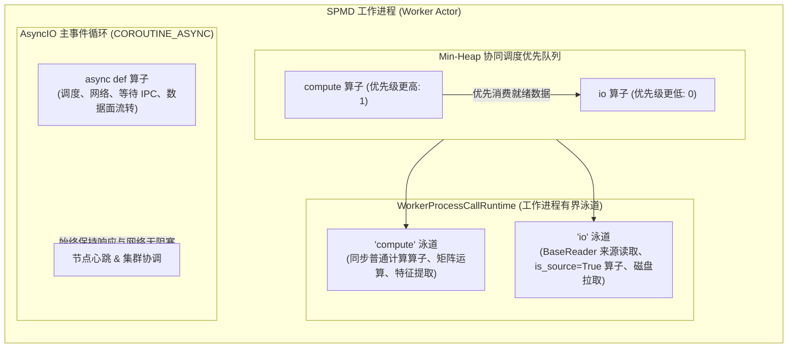

### 1. 标准泳道粗粒度自动规划规则

在 `Builder.build` 编译图阶段，框架根据算子的静态元数据语义特征解析执行特征（Execution Trait）并自动执行泳道推导（实现位于 `fluxway.common.canonical_lanes`）：

* **`OperatorExecutionTrait.IO_SOURCE`**：凡是算子标记为 `is_source=True`、声明了 `source` 描述符或所属类继承自 `BaseReader` 的算子，默认归入 `"io"` 泳道。
* **`OperatorExecutionTrait.SYNC_COMPUTE`**：普通的同步计算算子（非 IO 的 `def` 算子）默认归入 `"compute"` 泳道，并在专属有界工作线程池中执行，C 扩展完全释放 GIL，不阻塞主事件循环。
* **`OperatorExecutionTrait.ASYNC_COROUTINE`**：`async def` 协程算子不分配线程池泳道（保持 `lane=None`），直接由 asyncio 主事件循环调度，专职负责跨节点高效通信与异步编排。

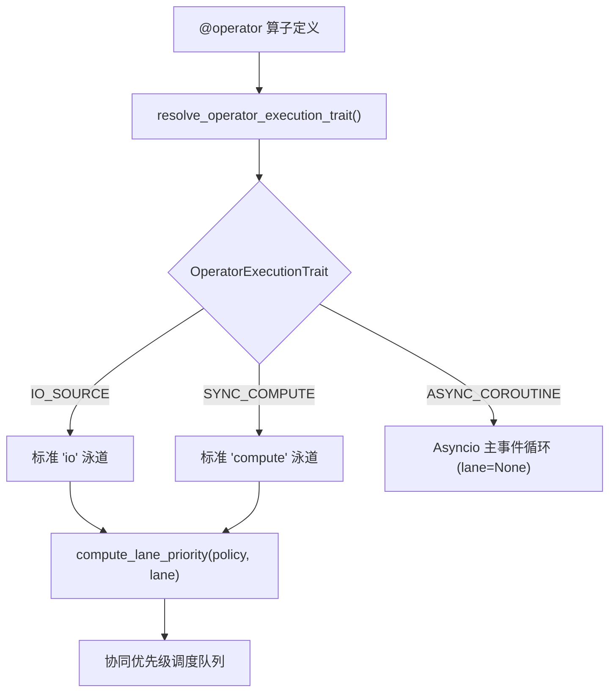

辅助函数 `compute_lane_priority(policy, lane)` 作为泳道优先级的单一真实来源（Single Source of Truth），统一依据 `SchedulePolicy.lane_priorities` 或 `SchedulePolicy.lane_ordering` 结算调度分值。

以下独立示例展示了静态特征解析、标准泳道推导与优先级计算：

```python
from fluxway.common.canonical_lanes import (
    compute_lane_priority,
    infer_canonical_lane,
    resolve_operator_execution_trait,
)
from fluxway.common.decorators import get_spmd_config, operator, spmd
from fluxway.common.operator_policy import SchedulePolicy
from fluxway.common.operator_spec import OperatorExecutionTrait
from fluxway.resources import ResourceProfile


@spmd(resource_profile=ResourceProfile(base={"CPU": 1}))
class PipelineModel:
    @operator(name="read_batch", is_source=True)
    def read_batch(self) -> dict:
        return {"x": 1}

    @operator(name="sync_compute")
    def sync_compute(self, x: int) -> int:
        return x * 2

    @operator(name="async_coord")
    async def async_coord(self, x: int) -> int:
        return x + 1


config = get_spmd_config(PipelineModel)
read_spec = config.operator_specs["read_batch"]
compute_spec = config.operator_specs["sync_compute"]
async_spec = config.operator_specs["async_coord"]

assert resolve_operator_execution_trait(read_spec, PipelineModel) == OperatorExecutionTrait.IO_SOURCE
assert infer_canonical_lane(read_spec, PipelineModel) == "io"

assert resolve_operator_execution_trait(compute_spec, PipelineModel) == OperatorExecutionTrait.SYNC_COMPUTE
assert infer_canonical_lane(compute_spec, PipelineModel) == "compute"

assert resolve_operator_execution_trait(async_spec, PipelineModel) == OperatorExecutionTrait.ASYNC_COROUTINE
assert infer_canonical_lane(async_spec, PipelineModel) is None

# 统一优先级分值结算
policy = SchedulePolicy.fifo(lane="compute", lane_order=("compute", "io"))
assert compute_lane_priority(policy, "compute") == 1
assert compute_lane_priority(policy, "io") == 0
```

### 2. 自动配齐协同优先级与天然背压

当框架在图中同时识别到 `compute` 泳道与 `io` 泳道时，会自动为未显式指定排序的算子注入标准协同优先级：
```python
lane_order = ("compute", "io")
```
在 Worker 调度引擎与优先队列中，`compute` 泳道算子获得更高的调度权重（`priority(compute) > priority(io)`）。这确保了已生成的批次数据被下游计算算子**优先消费**，而不是任由读取算子无限制预取撑爆内存，从而在框架层实现了优雅且高性能的生产-消费协同背压。

### 3. 开闭原则与显式定制

默认规则为开箱即用的高性能标准实践。如果算子有特殊调度需求，可直接在 `SchedulePolicy` 中显式指定，框架严格遵从用户显式配置，绝不覆盖：

```python
# 示例：显式定制算子泳道与优先级
@operator(
    "custom_transform",
    async_policy=AsyncPolicy.pipelined(
        depth=2,
        schedule=SchedulePolicy.fifo(
            lane="custom_lane",
            lane_order=("custom_lane", "io"),
        ),
    ),
)
def custom_transform(self, batch: UserBatch) -> NodeOutput:
    ...
```

## 检查点扩展边界

算子不实现检查点钩子。通过 SPMD 的 `checkpoint_components` 注册
`CheckpointComponentRegistration`。
`SAVE` 组件处理 `prepare_save`、`save`、`finish_save`、`commit_save` 和
`publish_save`；`rollback_save` 处理失败事务。`RESTORE` 组件处理 `restore`。
对象持有和清理预留属于 `OBJECT_LIFECYCLE`，物理删除属于 `OBJECT_CLEANUP`。
控制侧通过 `abort_save` 丢弃未完成的保存尝试，在全局提交成功后调用 `acknowledge_save`。

控制器负责事务顺序和清单发布。组件负责物理 URI、暂存布局、版本和保留操作。
保存方法接收 `SaveSession`，`commit_save` 接收包含全部工作进程结果的
`CommitSaveSession`。`restore` 接收 `RestoreSession`，其中包含保存时和目标拓扑以及组件发布结果。
用 `session.checkpoint_object_ref` 描述由组件管理的对象，再用
`session.component_checkpoint` 发布这些引用。
工作进程的 `save` 返回 `WorkerSaveResult`，`commit_save` 返回
`CheckpointComponentPublication`。变更保存状态的会话携带 `CheckpointCommitPermit`；
协调器换代后，旧许可会被拒绝。注册示例与完整能力约定见[检查点组件](checkpoint_zh.md)。
