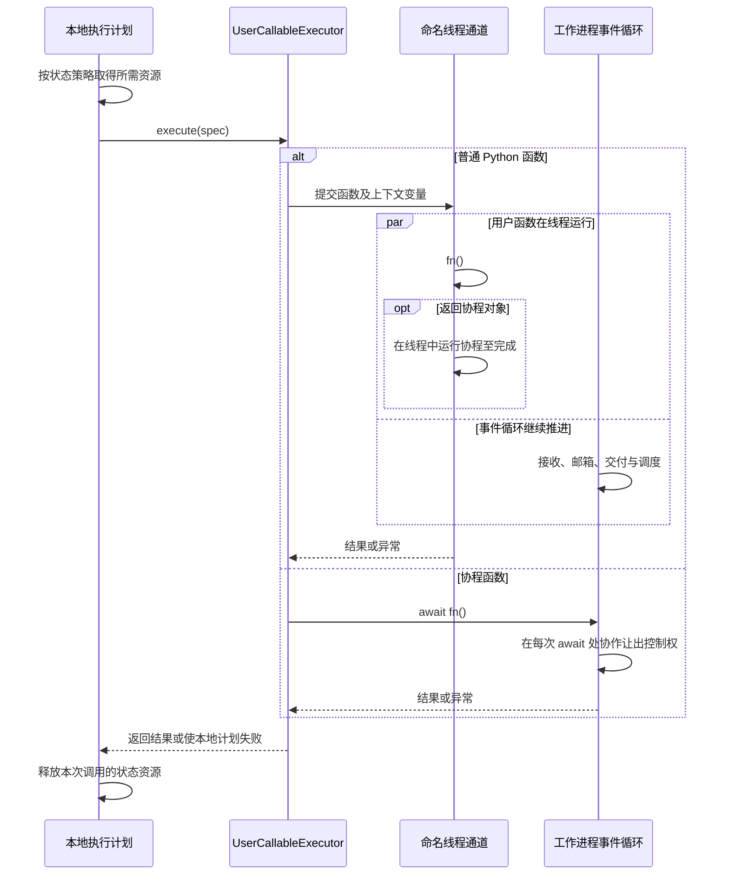
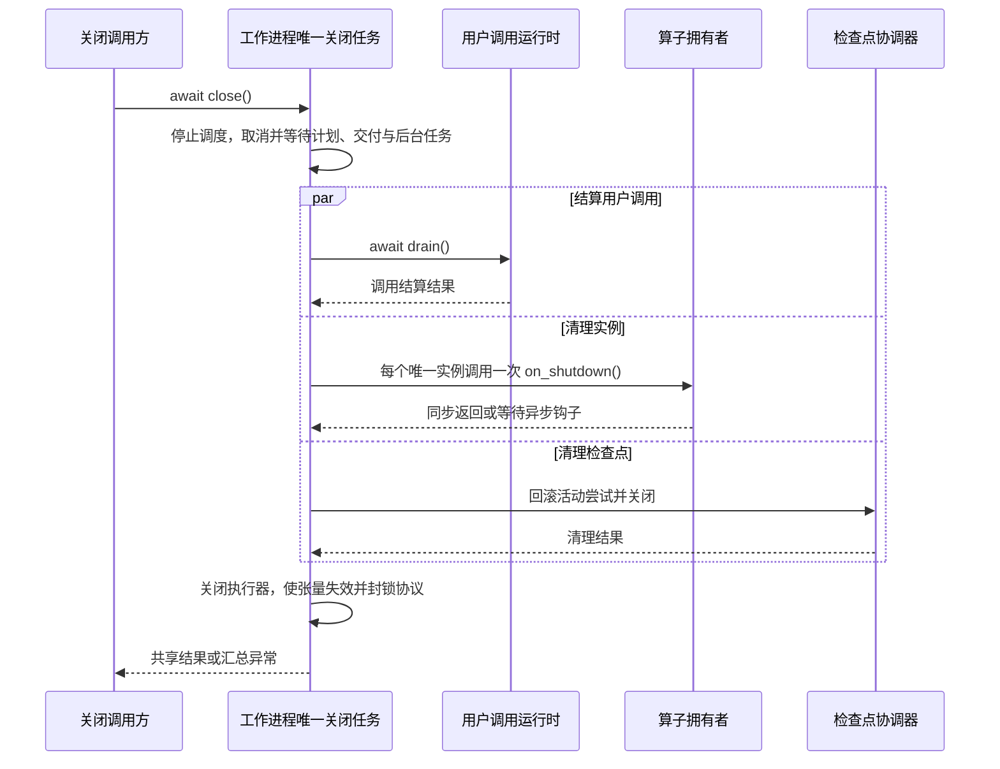

# 工作进程算子

[英文版](worker_process_operators.md)

有状态算子实例属于一个 SPMD 工作进程。如果构造函数创建进程本地句柄，
或者需要最终的工作进程拓扑，例如调用 `jax.distributed.initialize`，使用
`@requires_worker_process`。普通有状态类不需要这一标记。

## 声明算子并释放资源

下面将无状态的输入准备与有状态的文件写入分开。
`bind_spmd` 保留原始类供本地检查，并创建用于计算图执行的 SPMD 声明。
写入器只有一个工作进程，因此输出路径只有一个所有者。该路径必须尚不存在。

```python
from pathlib import Path
from tempfile import TemporaryDirectory

import numpy as np
import fluxway as fw
from fluxway.common.operator_policy import AsyncPolicy, StatePolicy


@fw.requires_worker_process
class BatchWriter:
    def __init__(self, output_path: str):
        self._stream = Path(output_path).open("x", encoding="utf-8")

    def prepare(self, values: np.ndarray) -> dict[str, np.ndarray]:
        return {"values": np.abs(values)}

    def write(self, values: np.ndarray) -> int:
        self._stream.writelines(f"{value}\n" for value in values.tolist())
        return len(values)

    def on_shutdown(self) -> None:
        self._stream.close()


replicated = {"type": "static", "axis": []}
WriterSPMD = fw.bind_spmd(
    BatchWriter,
    resource_profile=fw.ResourceProfile(base={"CPU": 1}),
    mesh_axis_names=("data",),
    mesh_axis_shapes=(1,),
    prepare={
        "input_sharding": {"values": replicated},
        "output_sharding": {"values": replicated},
        "async_policy": AsyncPolicy.pipelined(depth=2, state=StatePolicy.thread_safe()),
    },
    write={
        "input_sharding": {"values": replicated},
        "async_policy": AsyncPolicy.pipelined(depth=2, state=StatePolicy.exclusive()),
    },
)


def build_writer_graph(output_path: str) -> fw.Graph:
    builder = fw.Builder()
    builder.add_node("writer", WriterSPMD, output_path=output_path)
    builder.add_func_edge(
        "writer",
        "prepare",
        "writer",
        "write",
        tensor_map={"values": "values"},
        local_only=True,
    )
    return builder.build("batch-writer")


Path("tmp").mkdir(exist_ok=True)
with TemporaryDirectory(dir="tmp") as directory:
    output = Path(directory) / "batch.txt"
    writer = BatchWriter(str(output))
    try:
        prepared = writer.prepare(np.array([-1, 2, -3]))
        assert writer.write(prepared["values"]) == 3
    finally:
        writer.on_shutdown()
    assert output.read_text() == "1\n2\n3\n"

    graph = build_writer_graph(str(Path(directory) / "runtime.txt"))
    view = graph.require_compiled_graph().spmd("writer")
    assert view.operator("prepare").spec.async_policy.state.access == "thread_safe"
    assert view.operator("write").spec.async_policy.state.access == "exclusive"
    assert view.operator("write").spec.requires_worker_process
```

直接调用会在 CPU 上检查文件内容、资源生命周期和编译后的策略，不会运行 Ray 工作进程。
计算图展示了本地交接；启动作业前，需要为 `prepare` 连接实际数据源。
`local_only=True` 表示同一工作进程内的依赖，不是远程调用。

启动时，Fluxway 在每个工作进程内为每个所有者类创建一个实例，并在该类的算子之间共享。
构造参数取自节点的静态参数，例如上面的 `output_path`。
在 `__init__` 之前，Fluxway 还会提供 `rank`、`world_size`、`local_rank`、
`local_world_size`、`node_rank`、`num_nodes`、`spmd_id`、`rank0_address`
和 `ray_component_limits`。`self.ctx` 携带当前调用的上下文，会随调用变化。

正常关闭工作进程时，即使多个算子共享同一实例，Fluxway 也只调用一次该实例的
`on_shutdown()`。该方法可以是同步函数，也可以返回可等待对象。
关闭过程会尝试清理所有实例，并传播清理错误。强制终止进程不能保证执行清理；
缓冲文件也不提供检查点或崩溃恢复保证。注册表不会替资源所有者关闭对象，见
[资源所有权](placement_recipe_zh.md#注册工作进程内创建的资源)。

## 用户代码在哪里运行

| 可调用对象 | 执行方式 |
| --- | --- |
| 普通 Python 函数 | 从第一次调用起，异步提交到工作进程内的命名线程通道 |
| 返回协程对象的普通函数 | 工作线程运行该协程至完成 |
| 协程函数（`async def`） | 使用 `COROUTINE_ASYNC`，在执行器的事件循环上协作运行 |

`@requires_worker_process` 控制构造位置，不改变上表中的选择。
协程等待时必须让出控制权；在 `async def` 内执行阻塞操作会阻塞执行器的事件循环。
进程编号和执行步等上下文变量会随调用传入工作线程。异常会传播到本地执行计划并使工作进程失败。

这样，普通算子运行时，传输接收、信箱更新、输入准备、输出交付和调度器唤醒仍可推进。
标准 CPython 下，计算密集的 Python 代码仍然竞争 GIL。
释放 GIL 的原生代码可以重叠；自由线程版 CPython 还可以并行执行 Python 字节码，
通道和调度规则保持一致。



线程通道与状态锁是不同边界：`thread_safe()` 允许共用实例的调用重叠，`exclusive()` 保留互斥。协程内的同步阻塞工作仍会阻塞事件循环。

### 关闭时的并发边界



同步 `on_shutdown()` 直接在工作进程事件循环调用；耗时清理应使用异步钩子并自行分派阻塞工作。实例钩子与用户调用排空并发执行，不保证钩子开始前所有线程调用已经结束。拥有者须协调仍在进行的资源访问；取消协程等待也不能终止已运行的 Python 线程。强制结束进程不保证执行钩子。

## 状态与调度

`AsyncPolicy.depth` 限制本地流水线深度。状态访问需要单独选择：

- `StatePolicy.exclusive()` 将共用同一状态资源的算子串行化。
  模型更新和可变存储应保留此默认策略。
- `StatePolicy.thread_safe()` 移除实例锁。只有算子及其底层资源支持并发调用时才使用。

示例中，`prepare` 只转换输入，可以与 `write` 重叠。
`write` 的多次调用共用文件，因此仍然互斥。进程本地构造并不禁止这样的重叠。

模型更新包含多个阶段时，`SchedulePolicy.phase_graph` 可以允许同一步的辅助工作与更新重叠，
同时阻止下一训练步读取尚未完成的状态。
[推荐模型示例](../fluxway/example/recommendation/dense_spmd.py) 中，
`prepare_dense_inputs` 和 `scatter_sparse_grads` 声明为线程安全，
`train_core` 和 `update` 保持独占。计算图和[可视化](graph_visualization_zh.md)
使用同一份编译后的阶段规则。

启用性能分析后，`user_callable.execute` 包含排队时间；
`user_callable.function_run` 只测量函数调用，不包含通道排队和工作进程上下文设置。
`worker_process_call.thread_run` 记录工作线程的执行区间。
分析器观察已经选定的通道，不会再次分发调用。

## 初始化错误

类调用 `jax.distributed.initialize` 却缺少标记时，会被拒绝并报
`Fluxway Worker Process Error`。应使用装饰器，不要直接设置内部字段
`__fluxway_process_affine__`。该标记不会安装 JAX、创建分布式协调器或修正不一致的工作进程拓扑。

## 检查点扩展边界

算子不实现检查点钩子。通过 SPMD 的 `checkpoint_components` 注册
`CheckpointComponentRegistration`。
`SAVE` 组件处理 `prepare_save`、`save`、`finish_save`、`commit_save` 和
`publish_save`；`rollback_save` 处理失败事务。`RESTORE` 组件处理 `restore`。
对象持有和清理预留属于 `OBJECT_LIFECYCLE`，物理删除属于 `OBJECT_CLEANUP`。
控制侧通过 `abort_save` 丢弃未完成的保存尝试，在全局提交成功后调用 `acknowledge_save`。

控制器负责事务顺序和清单发布。组件负责物理 URI、暂存布局、版本和保留操作。
保存方法接收 `SaveSession`，`commit_save` 接收包含全部工作进程结果的
`CommitSaveSession`。`restore` 接收 `RestoreSession`，其中包含保存时和目标拓扑以及组件发布结果。
用 `session.checkpoint_object_ref` 描述由组件管理的对象，再用
`session.component_checkpoint` 发布这些引用。
工作进程的 `save` 返回 `WorkerSaveResult`，`commit_save` 返回
`CheckpointComponentPublication`。变更保存状态的会话携带 `CheckpointCommitPermit`；
协调器换代后，旧许可会被拒绝。注册示例与完整能力约定见[检查点组件](checkpoint_zh.md)。
