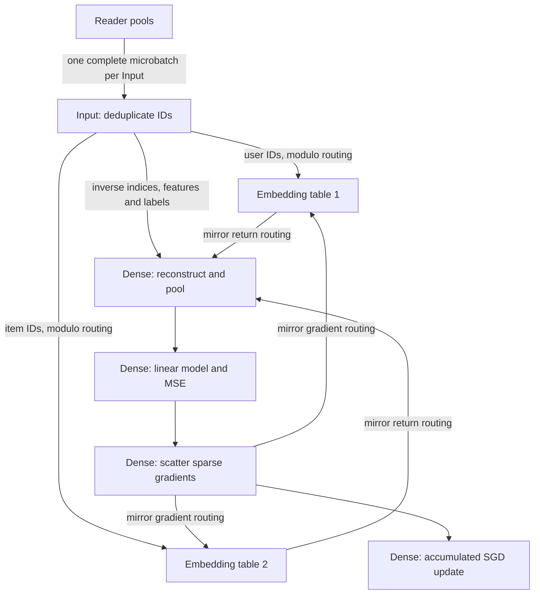
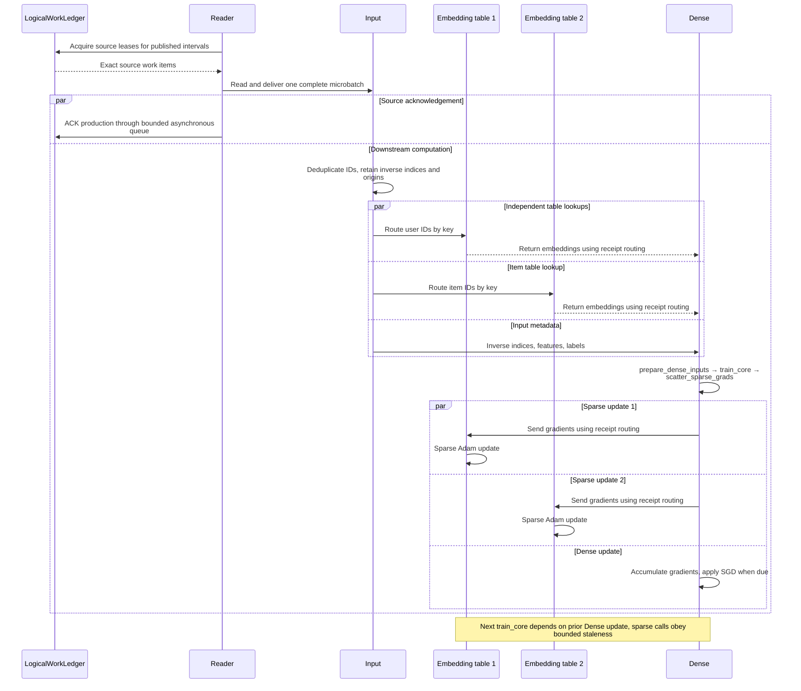

# Recommendation training example

[中文说明](README_zh.md)

This example trains a small model on a finite synthetic recommendation dataset.
It combines data-parallel Input and Dense workers with two sharded CPU embedding
tables. It exercises whole-microbatch source delivery, deduplication, CPU/GPU
transport and coordinated source/model checkpoint recovery.

## Execution architecture



| Stage | Computation and ownership |
| --- | --- |
| Reader | Reads canonical intervals acquired from `LogicalWorkLedger`. Physical rank is not a durable dataset cursor. |
| Input | Deduplicates IDs within its microbatch using `async_unique`, preserving inverse indices and sample provenance. |
| Embedding tables | Own keys by `key % shard_count`, perform lookups and apply sparse Adam updates. With two shards, shard 0 owns even keys and shard 1 owns odd keys. |
| Dense | Reconstructs and pools embeddings, combines them with dense features, and computes a single linear output with mean squared error. Dense parameters use SGD with gradient accumulation. |
| Checkpoint | Coordinates the source cut, Dense model state and sparse parameter/optimizer state. Recovery restores fresh actors before authorizing execution. |

Deduplication is local to each Input batch; the same key can still be supplied by
multiple Inputs. Mirror routing returns values and gradients using the transfer
receipt. Neither deduplication nor node affinity proves zero-copy delivery.

## Asynchronous interactions in one training step



Each data message collapses routing, transport, and ingress; arrows do not imply
cross-process zero-copy. Source ACKs can precede downstream computation. A joint
checkpoint still requires every branch to drain and publication to finish; see
[execution lifecycle](../../../docs/execution_lifecycle.md) and [checkpoint
transactions](../../../docs/checkpoint.md).

## Environment

Install Fluxway and the example dependencies on every Ray node. The example imports
JAX, Flax, CuPy, Grain, Orbax and `sparse_embedding` with Lance checkpoint support;
the GPU packages must match the installed CUDA environment. The project declares
`recommendation`, `jax`, `cuda12x`, `cuda13x`, `visualization` and `profiler` extras
in [pyproject.toml](../../../pyproject.toml). Flax is also required by the model.

The launcher uses `RAY_ADDRESS` when connecting to an existing Ray cluster. Without
an initialized cluster or that variable, the sandbox initializes Ray locally.
Provide enough CPU resources for Reader, Input and embedding workers, and one GPU
per Dense rank for the commands below. A four-rank Dense job therefore needs four
GPUs. Make the checkpoint directory accessible at the same path on every node.

## Start training

Always specify a valid Reader/DP topology. Reader count must be positive and a
multiple of DP, with at least one Reader per Input. DP must divide the example's
logical batch size of 24. `--num-gpus` is the allocation per Dense rank.

The parser defaults to Reader=4 and DP=4, which is a valid graph topology. It
still requires four available GPUs unless `--num-gpus 0` is selected for a CPU
smoke run. Explicit topology flags are recommended for multi-node experiments.

```bash
python -m fluxway.example.recommendation.train \
  --reader-shards 16 --dp 4 --num-gpus 1 \
  --max-steps 10 --checkpoint-interval 2 --source-max-in-flight 40 \
  --checkpoint-dir /shared/checkpoints/recommendation-smoke
```

Choose a new checkpoint path for a fresh experiment. With checkpointing enabled,
the example uses `resume="latest"`; an empty repository starts a fresh run.
`--clear-ckpt` explicitly deletes the existing checkpoint directory before launch.

## Checkpoint and change worker counts

Stop the prior execution before starting its replacement. Keep the synthetic data
configuration, logical batch size and source identity stable. `--max-steps` is the
total target, including restored steps. All model checkpoint components must
support the selected topology change; the following commands keep sparse table
shard counts unchanged.

```bash
python -m fluxway.example.recommendation.train \
  --reader-shards 16 --dp 4 --num-gpus 1 \
  --max-steps 17 --checkpoint-interval 17 --source-max-in-flight 40 \
  --checkpoint-dir /shared/checkpoints/recommendation

python -m fluxway.example.recommendation.train \
  --reader-shards 4 --dp 2 --num-gpus 1 \
  --max-steps 23 --checkpoint-interval 23 --source-max-in-flight 40 \
  --checkpoint-dir /shared/checkpoints/recommendation

python -m fluxway.example.recommendation.train \
  --reader-shards 16 --dp 4 --num-gpus 1 \
  --max-steps 37 --checkpoint-interval 37 --source-max-in-flight 40 \
  --checkpoint-dir /shared/checkpoints/recommendation
```

Source ACKs confirm Reader production. Coordinated checkpoint publication establishes
the durable source/model boundary. Recovery replays the uncommitted suffix, so
physical reads can repeat after failure. External side effects need their own
transaction or idempotency contract.

Dense checkpoint finalization applies pending partial gradient accumulation and
stores `model_state`; restore starts with an empty accumulator. Dense has no Adam
or momentum state. The sparse checkpoint component includes its Adam state.
Numerical comparisons must use matching data and finalization boundaries.

## Validating continuation

Use a fresh checkpoint repository for each experiment and retain the training
logs. Keep the source identity, synthetic data configuration and global batch size
fixed across executions. Changing Reader or DP counts must change physical
assignment without changing the logical sample sequence.

1. Train to a committed boundary, such as 17, with multiple Readers per Input.
   Choose boundaries that are not divisible by the configured gradient accumulation
   length to exercise partial accumulation finalization.
2. Start a fresh execution against the same repository with different Reader and
   DP counts. Verify the reported restored position before accepting new progress.
3. To test recovery, terminate an Input process after it observes data beyond the
   committed boundary and before the next checkpoint publishes. Verify that the
   observed failure identifies that process and the latest committed cut is unchanged.
4. Restore again, complete the remaining boundaries, and inspect the evidence below.

| Property | Required evidence |
| --- | --- |
| Dataset continuation | For each successful interval `[a, b)`, the multiset of Input origins equals `[24a, 24b)` with each origin once. Track failed-attempt observations separately; an uncommitted suffix may be read again. |
| Whole microbatch delivery | Each Input invocation receives `24 / dp` rows from one Reader invocation. Compare origins per step and Input rank, not only total row counts. |
| Affinity | Record runtime NodeIDs for each Reader, its target Input and the corresponding Dense rank; all three must agree. |
| Checkpoint state | Compare saved Dense replicas and each restored replica; compare sparse values, optimizer state and step counters by logical key before new work runs. Check that no incomplete checkpoint transaction remains. |
| Copy behavior | Inspect value-buffer aliasing at frame construction and Input assembly, and explicit copies before RPC submission. Node affinity and matching payload values alone do not establish zero-copy transport. |

A successful process exit or a checkpoint directory alone does not establish these
properties. A same-host cluster with multiple Ray nodes exercises distinct NodeIDs
and actors; physical multi-host network performance requires a separate deployment.
The commands above preserve sparse table shard counts. Testing sparse resharding
also requires comparing state by logical key across the old and new partitions.

## Reader pools, placement and credit

For `--reader-shards 16 --dp 4`, the compiled route uses these Reader pools:

| Input rank | Reader ranks supplying it over the cycle |
| --- | --- |
| 0 | 0, 1, 2, 3 |
| 1 | 4, 5, 6, 7 |
| 2 | 8, 9, 10, 11 |
| 3 | 12, 13, 14, 15 |

One Reader from each pool executes per cycle slot. It supplies one complete
microbatch to its Input; Input does not concatenate the pool's microbatches into
one execution. The graph declares `WholeUnitRouting` and derives Reader/Input
placement constraints from the compiled relation. Each Reader shares its target
Input's NodeID, and each Input shares its Dense rank's NodeID. Runtime routing uses
compiled execution-group bindings rather than reconstructing groups from rank.

Input assembly can reference a received complete payload directly. This does not
establish copy-free Ray delivery between processes. See
[transfer planning](../../../docs/transfer_planning.md) and
[data-plane runtime](../../../docs/dataplane_runtime.md) for the memory boundaries.

`--source-max-in-flight` bounds source steps ahead of the contiguous acknowledged candidate cut. Set it so
the next checkpoint boundary is reachable. Source work is acquired in batches,
but grant size is also limited by credit and the Reader execution cycle. Increasing
Reader count with fixed credit can reduce batching efficiency.

## Numerical and API contracts

Sparse lookup and update use bounded-stale execution with `max_staleness=7`.
The bound does not select a fixed parameter version for every lookup. Two runs
restored from the same checkpoint can read before or after an earlier update,
even with identical worker counts. GPU sparse-gradient scatter can also produce
different floating-point results for duplicate indices.

Exact saved/restored state and an identical committed sample sequence do not
promise bitwise identical subsequent training trajectories. Validate state restore,
sample identity and numerical behavior separately. This example does not expose
a deterministic replay mode or provide a convergence benchmark.

The public entrypoint submits a compiled `FunctionalGraph`. Eager computation
inside an operator uses the same execution authorization; there is no separate
dynamic eager graph submission API. The synthetic source is finite. Adapter scanning and
controller-owned event-driven refill follow the
[source coordination contract](../../../docs/source_coordination.md).

## Graph export and profiling

Graph export requires the `visualization` extra and takes place during a normal
training launch. Use a new output directory or explicitly pass
`--overwrite-graph-visualization` when replacing an existing graph bundle.

```bash
python -m fluxway.example.recommendation.train \
  --reader-shards 16 --dp 4 --num-gpus 1 \
  --max-steps 10 --source-max-in-flight 40 \
  --checkpoint-dir /shared/checkpoints/recommendation-graph \
  --graph-visualization-dir tmp/recommendation-graph
```

For Perfetto profiling, install the `profiler` extra and pass a trace root:

```bash
python -m fluxway.example.recommendation.train \
  --reader-shards 16 --dp 4 --num-gpus 1 \
  --max-steps 10 --source-max-in-flight 40 \
  --checkpoint-dir /shared/checkpoints/recommendation-profile \
  --profiler-trace-dir tmp/recommendation-traces
```

See [graph visualization](../../../docs/graph_visualization.md) and
[profiler usage](../../../docs/user_profiler.md) for viewing the exported artifacts.

## Sparse checkpoint maintenance

Sparse storage compaction is explicit. To compact an existing repository without
starting training:

```bash
python -m fluxway.example.recommendation.train \
  --compact-only --checkpoint-dir /shared/checkpoints/recommendation
```

`--compact-checkpoints` performs the same maintenance after a training run.
Compaction is separate from source-window history reclamation. See
[checkpoint usage](../../../docs/checkpoint.md) and
[execution lifecycle](../../../docs/execution_lifecycle.md) for the framework contracts.
