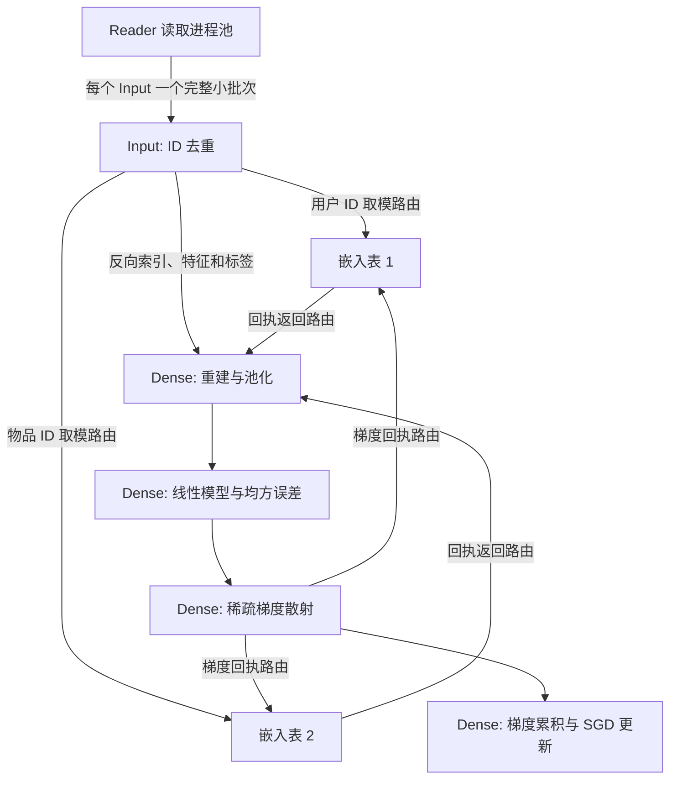
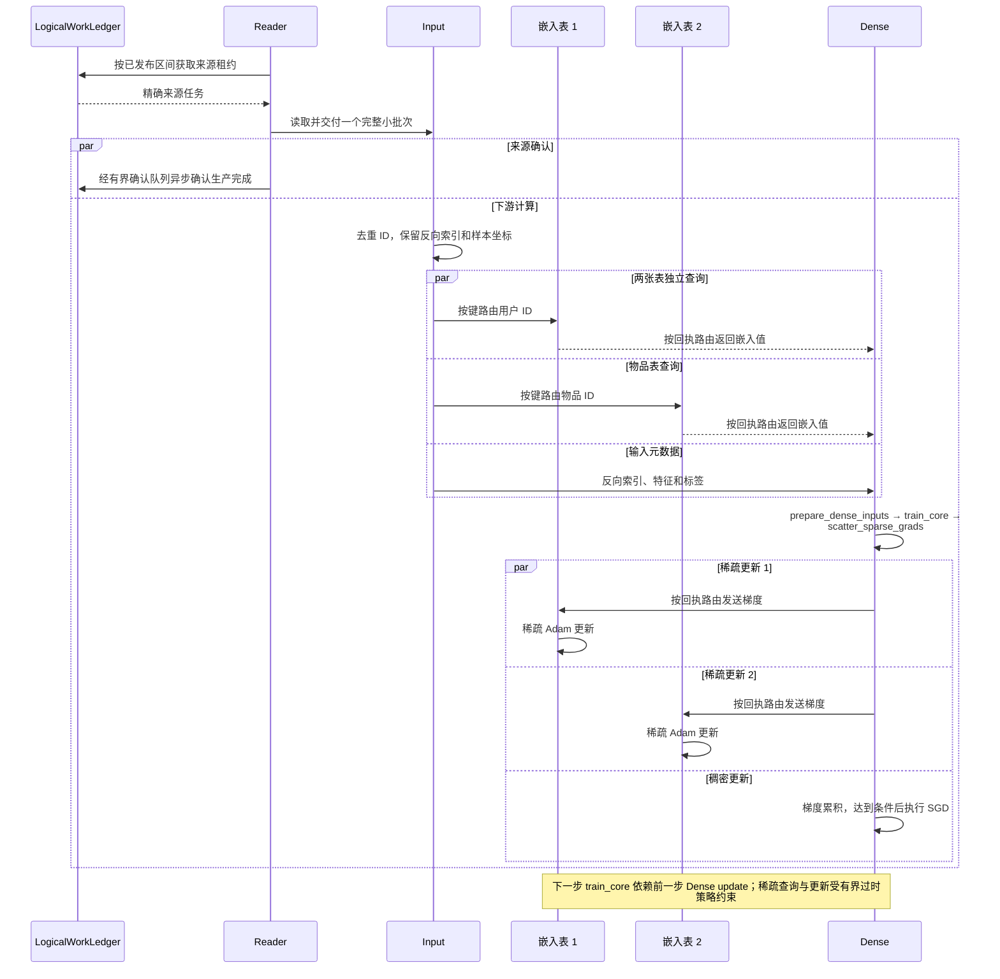

# 推荐模型训练示例

[English](README.md)

本示例使用有限的合成推荐数据训练小型模型。Reader 负责读取，Input 负责输入处理，Dense 负责稠密计算。Input 和 Dense 使用数据并行，两张 CPU
嵌入表使用分片存储，覆盖完整小批次交付、去重、CPU/GPU 传输以及
来源与模型的协调检查点恢复。

## 执行架构



| 阶段 | 计算与所有权 |
| --- | --- |
| Reader | 读取从 `LogicalWorkLedger` 获取的规范区间；物理秩不是持久化数据游标。 |
| Input | 使用 `async_unique` 对自身小批次内的 ID 去重，保留反向索引和样本来源信息。 |
| 嵌入表 | 按 `key % shard_count` 拥有键，执行查询与稀疏 Adam 更新。两个分区时，分区 0 拥有偶数键，分区 1 拥有奇数键。 |
| Dense | 重建与池化嵌入值，拼接稠密特征，计算单层线性输出和均方误差；参数使用梯度累积与 SGD 更新。 |
| 检查点 | 协调来源切点、Dense 模型及稀疏参数和优化器状态；恢复时先还原新角色，再授权执行。 |

去重范围是各个 Input 的批次；不同 Input 仍可能提供相同键。值和梯度依据传输回执记录的生产者信息返回。去重与节点亲和性都不能证明传输零拷贝。

## 单步训练的异步交互



图中每条数据消息聚合了路由、传输和接收，箭头不代表跨进程零复制。来源确认可早于下游计算；共同检查点仍需所有分支排空并完成发布，见[执行生命周期](../../../docs/execution_lifecycle_zh.md)和[检查点事务](../../../docs/checkpoint_zh.md)。

## 环境

每个 Ray 节点都需要安装 Fluxway 和示例依赖。本示例导入 JAX、Flax、CuPy、Grain、
Orbax，以及支持 Lance 检查点的 `sparse_embedding`；GPU 包必须与 CUDA 环境
匹配。[pyproject.toml](../../../pyproject.toml) 声明了 `recommendation`、`jax`、
`cuda12x`、`cuda13x`、`visualization` 和 `profiler` 可选依赖。模型还需要 Flax。

连接已有 Ray 集群时，启动器使用 `RAY_ADDRESS`。若没有已初始化的集群且未设置该
变量，沙箱会在本机初始化 Ray。为 Reader、Input 和嵌入表工作进程提供足够
CPU 资源；以下命令为每个 Dense 秩分配一张 GPU，四秩作业共需四张 GPU。
所有节点必须能通过相同路径访问检查点目录。

## 启动训练

始终显式指定合法的 Reader/DP 拓扑。Reader 数量必须为正、是 DP 的整数倍，且每个
Input 至少对应一个 Reader。DP 必须整除本示例的逻辑批次大小 24。
`--num-gpus` 表示每个 Dense 秩的 GPU 分配量。

解析器默认使用 Reader=4、DP=4，能够构成合法图；除非 CPU 冒烟检查显式使用
`--num-gpus 0`，否则仍需要四张可用 GPU。多机实验建议显式指定拓扑参数。

```bash
python -m fluxway.example.recommendation.train \
  --reader-shards 16 --dp 4 --num-gpus 1 \
  --max-steps 10 --checkpoint-interval 2 --source-max-in-flight 40 \
  --checkpoint-dir /shared/checkpoints/recommendation-smoke
```

新实验应选择新的检查点路径。启用检查点时，示例使用 `resume="latest"`；
空仓库从头运行。`--clear-ckpt` 会在启动前显式删除已有检查点目录。

## 检查点与更改工作进程数量

启动替代执行前先停止旧执行。保持合成数据配置、逻辑批次大小和来源身份
不变。`--max-steps` 是包含已恢复步骤的总目标。全部模型检查点组件都必须
支持所选拓扑变化；以下命令保持稀疏表分区数量不变。

```bash
python -m fluxway.example.recommendation.train \
  --reader-shards 16 --dp 4 --num-gpus 1 \
  --max-steps 17 --checkpoint-interval 17 --source-max-in-flight 40 \
  --checkpoint-dir /shared/checkpoints/recommendation

python -m fluxway.example.recommendation.train \
  --reader-shards 4 --dp 2 --num-gpus 1 \
  --max-steps 23 --checkpoint-interval 23 --source-max-in-flight 40 \
  --checkpoint-dir /shared/checkpoints/recommendation

python -m fluxway.example.recommendation.train \
  --reader-shards 16 --dp 4 --num-gpus 1 \
  --max-steps 37 --checkpoint-interval 37 --source-max-in-flight 40 \
  --checkpoint-dir /shared/checkpoints/recommendation
```

来源确认表示 Reader 已生产数据；协调检查点发布建立来源与模型的持久化
边界。恢复会重放未提交后缀，因此故障后的物理读取可能重复。外部副作用需要自身的事务
或幂等契约。

Dense 在检查点归整阶段应用未满批的累积梯度，并保存 `model_state`；恢复后
累积器为空。Dense 不维护 Adam 或动量状态；稀疏检查点组件
包含自身的 Adam 状态。数值比较需要使用相同数据和归整边界。

## 验证续训

每次实验使用新的检查点仓库并保留训练日志。不同执行保持相同的来源身份、
合成数据配置和全局批次大小。改变 Reader 或 DP 数量只应改变物理分配，不能改变逻辑
样本序列。

1. 使用每个 Input 对应多个 Reader 的拓扑，训练到已提交边界，例如 17。选择不能被配置的
   梯度累积长度整除的边界，覆盖未满批累积梯度的归整。
2. 使用不同 Reader 和 DP 数量创建新执行，指向相同仓库；接受新进度前核验报告的恢复位置。
3. 验证故障恢复时，在某个 Input 已观察到已提交切点之后的数据、下一次检查点
   发布之前终止该进程。核验收到的失败确实属于该进程，且最新已提交切点未变化。
4. 再次恢复并完成其余边界，检查以下证据。

| 属性 | 所需证据 |
| --- | --- |
| 数据集续读 | 每个成功区间 `[a, b)` 的 Input 样本坐标多重集合等于 `[24a, 24b)`，每个样本坐标恰好一次。失败尝试的观察记录单独计数，未提交后缀允许再次读取。 |
| 完整小批次交付 | 每次 Input 调用接收某一次 Reader 调用提供的 `24 / dp` 行。按步骤和 Input 秩比较样本坐标，不能只核对总行数。 |
| 亲和性 | 记录各 Reader、目标 Input、对应 Dense 秩的运行时 NodeID，三者必须一致。 |
| 检查点状态 | 比较 Dense 保存副本和每个恢复副本；在新工作执行前按逻辑键比较稀疏值、优化器状态和步骤计数，并确认没有未完成的检查点事务。 |
| 复制行为 | 检查帧构建与输入装配的值缓冲区别名，以及 RPC 提交前的显式复制。节点亲和性和载荷数值相同本身不能证明传输零拷贝。 |

进程正常退出或检查点目录存在都不能单独证明这些属性。同机多个 Ray 节点可验证
不同 NodeID 和角色的协议；物理多机网络性能需要单独部署测试。上述命令保持稀疏表
分区数量不变；测试稀疏重分片时，还需按逻辑键比较新旧分区中的状态。

## 读取进程池、放置与信用额度

`--reader-shards 16 --dp 4` 的编译路由使用以下 Reader 读取进程池：

| Input 秩 | 在一个周期内向它供给数据的 Reader 秩 |
| --- | --- |
| 0 | 0, 1, 2, 3 |
| 1 | 4, 5, 6, 7 |
| 2 | 8, 9, 10, 11 |
| 3 | 12, 13, 14, 15 |

每个周期位置从各池激活一个 Reader，向对应 Input 提供一个完整小批次；Input
不会把整个池的多个小批次拼成一次执行。图显式声明 `WholeUnitRouting`，并从
编译后的关系推导 Reader/Input 放置约束。每个 Reader 与目标 Input 共享
NodeID，各 Input 与对应 Dense 秩共享 NodeID。运行时使用编译后的执行组绑定，不通过物理秩重新猜算分组。

输入装配可以直接引用收到的完整载荷，但这不证明 Ray 跨进程交付没有
复制。内存边界见[传输计划](../../../docs/transfer_planning_zh.md)和
[数据面运行时](../../../docs/dataplane_runtime_zh.md)。

`--source-max-in-flight` 限制来源领先连续确认候选切点的逻辑步数。来源按批获取任务，但授权批次大小还受信用额度和 Reader
执行周期限制；信用额度固定时，增加 Reader 数量可能降低批量效率。

## 数值与 API 契约

稀疏查询与更新使用 `max_staleness=7` 的有界过时策略。该限制不会
为每次查询指定固定参数版本。即使工作进程数量相同，两次从相同检查点恢复
的执行也可能在某次较早的更新之前或之后读取。GPU 稀疏梯度散射对
重复索引也可能产生不同的浮点累加结果。

保存与恢复状态精确一致、已提交样本序列相同，不代表后续训练轨迹逐位相同。应分别验证
状态恢复、样本身份和数值行为。本示例不提供确定性重放模式，也不是收敛基准测试。

公共入口提交编译后的 `FunctionalGraph`。算子内部的即时计算遵守相同执行授权，
但没有独立的动态即时图提交接口。合成来源是有限数据集。适配器扫描与控制器事件驱动补窗的契约见[来源协调](../../../docs/source_coordination_zh.md)。

## 图导出与性能分析

图导出需要 `visualization` 可选依赖，并在正常训练启动过程中执行。使用新的输出目录；
替换已有图导出包时需显式传入 `--overwrite-graph-visualization`。

```bash
python -m fluxway.example.recommendation.train \
  --reader-shards 16 --dp 4 --num-gpus 1 \
  --max-steps 10 --source-max-in-flight 40 \
  --checkpoint-dir /shared/checkpoints/recommendation-graph \
  --graph-visualization-dir tmp/recommendation-graph
```

Perfetto 性能分析需要 `profiler` 可选依赖，并指定轨迹根目录：

```bash
python -m fluxway.example.recommendation.train \
  --reader-shards 16 --dp 4 --num-gpus 1 \
  --max-steps 10 --source-max-in-flight 40 \
  --checkpoint-dir /shared/checkpoints/recommendation-profile \
  --profiler-trace-dir tmp/recommendation-traces
```

导出文件的查看方式见[图可视化](../../../docs/graph_visualization_zh.md)和
[性能分析说明](../../../docs/user_profiler_zh.md)。

## 稀疏检查点维护

稀疏存储压实是显式操作。仅整理已有仓库、不启动训练时使用：

```bash
python -m fluxway.example.recommendation.train \
  --compact-only --checkpoint-dir /shared/checkpoints/recommendation
```

`--compact-checkpoints` 在训练结束后执行相同维护。存储压实与来源窗口历史回收是不同职责。框架契约见[检查点说明](../../../docs/checkpoint_zh.md)
和[执行生命周期](../../../docs/execution_lifecycle_zh.md)。
